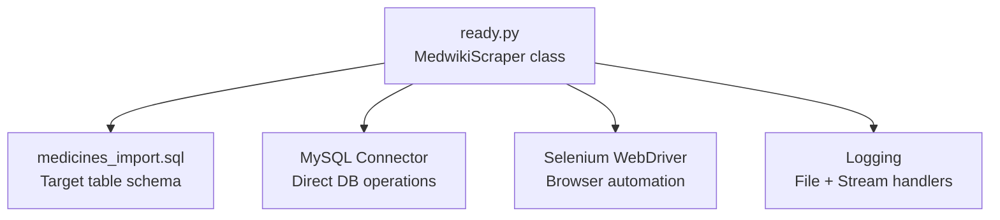
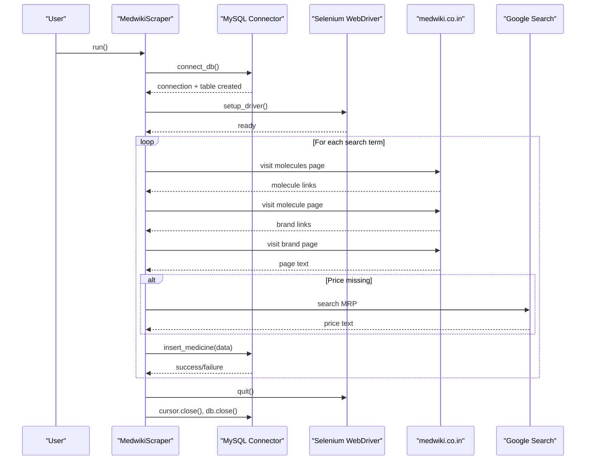
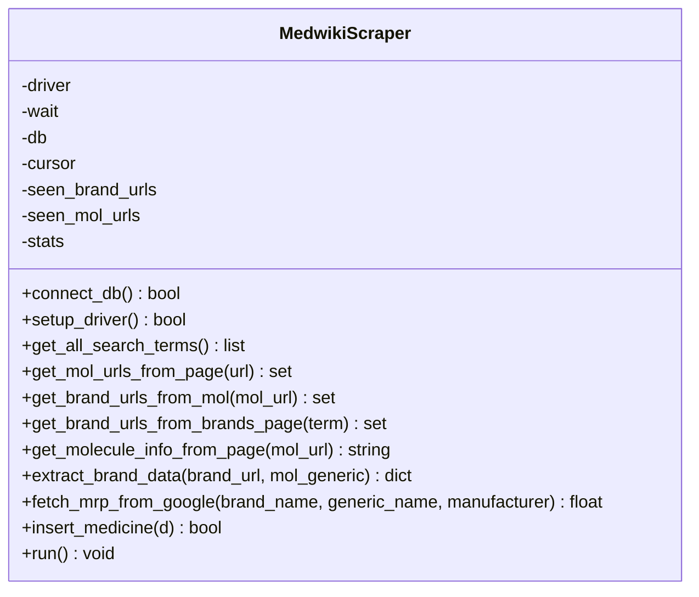
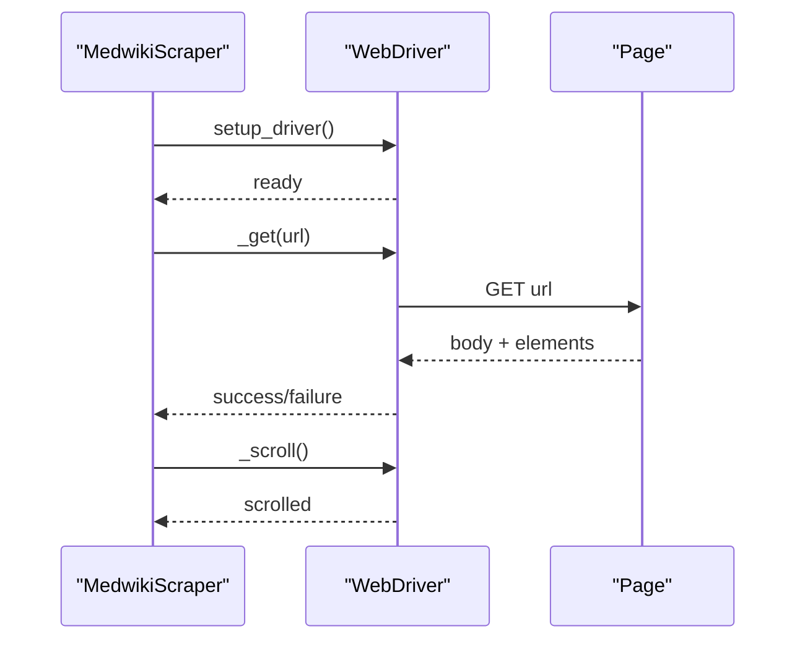
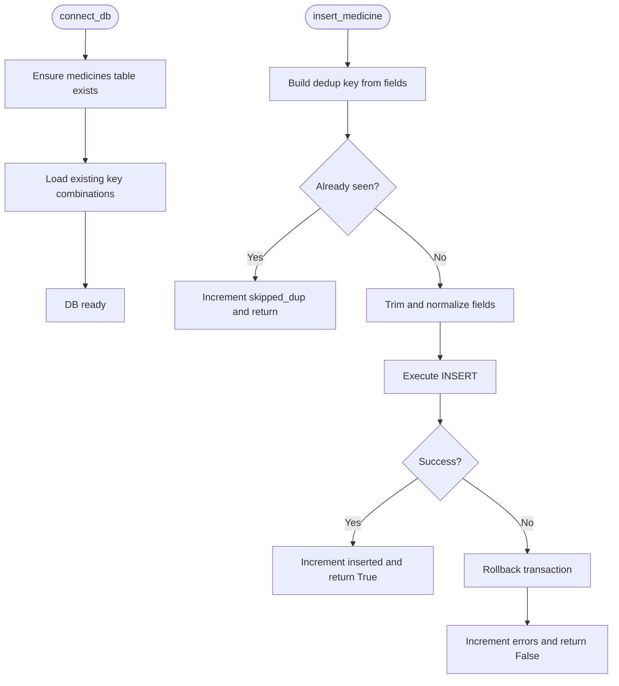
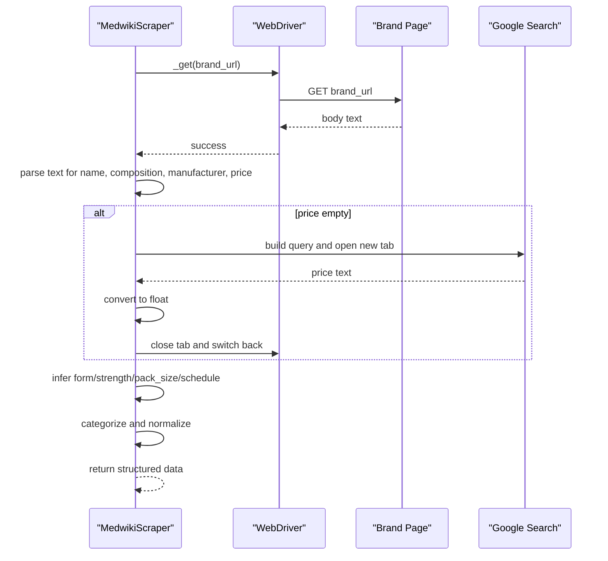
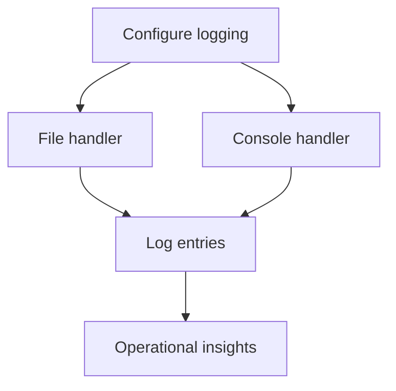
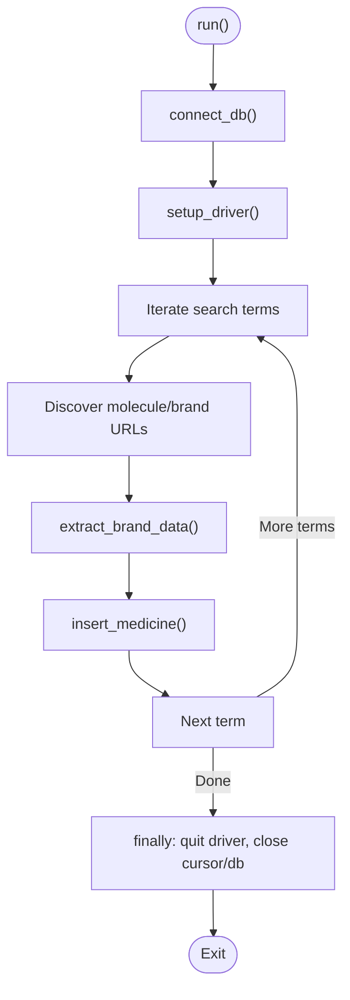
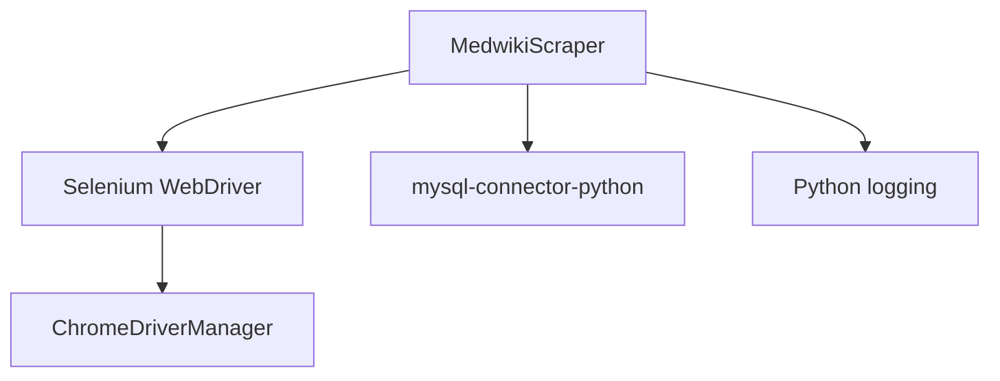

# Component Interactions

<cite>
**Referenced Files in This Document**
- [ready.py](file://ready.py)
- [medicines_import.sql](file://medicines_import.sql)
</cite>

## Table of Contents
1. [Introduction](#introduction)
2. [Project Structure](#project-structure)
3. [Core Components](#core-components)
4. [Architecture Overview](#architecture-overview)
5. [Detailed Component Analysis](#detailed-component-analysis)
6. [Dependency Analysis](#dependency-analysis)
7. [Performance Considerations](#performance-considerations)
8. [Troubleshooting Guide](#troubleshooting-guide)
9. [Conclusion](#conclusion)
10. [Appendices](#appendices)

## Introduction
This document explains how the MedWiki scraper orchestrates communication among browser automation, database management, and data extraction modules. It documents the end-to-end flow from initialization through scraping to database insertion, including logging and monitoring, error propagation, resource cleanup, and lifecycle management. It also clarifies the absence of explicit observer, factory, strategy, and singleton patterns in the current implementation and proposes how they could be introduced.

## Project Structure
The project consists of a single Python script that implements the MedwikiScraper class and a SQL schema file for the target database table. The scraper runs locally and writes scraped data directly into a MySQL database.

**Diagram sources**
- [ready.py:1-780](file://ready.py#L1-L780)
- [medicines_import.sql:1-73](file://medicines_import.sql#L1-L73)

**Section sources**
- [ready.py:1-780](file://ready.py#L1-L780)
- [medicines_import.sql:1-73](file://medicines_import.sql#L1-L73)

## Core Components
- MedwikiScraper: Orchestrates the entire pipeline. It initializes browser automation, connects to the database, scrapes pages, extracts structured data, and inserts rows into the medicines table. It maintains runtime de-duplication sets and statistics counters.
- Browser Automation (Selenium): Manages Chrome driver lifecycle, navigates pages, waits for elements, scrolls, and parses page text.
- Database Management (MySQL Connector): Establishes a connection, creates the medicines table if missing, loads existing keys for de-duplication, and performs inserts with rollback on errors.
- Logging: Provides file and console logging for operational visibility.

Key implementation references:
- MedwikiScraper class definition and methods: [ready.py:52-780](file://ready.py#L52-L780)
- Database configuration and table creation: [ready.py:43-136](file://ready.py#L43-L136)
- Browser setup and navigation: [ready.py:290-326](file://ready.py#L290-L326)
- Data extraction helpers: [ready.py:364-558](file://ready.py#L364-L558)
- Insertion logic and deduplication: [ready.py:149-207](file://ready.py#L149-L207)
- Logging configuration: [ready.py:31-40](file://ready.py#L31-L40)

**Section sources**
- [ready.py:52-780](file://ready.py#L52-L780)
- [ready.py:43-136](file://ready.py#L43-L136)
- [ready.py:290-326](file://ready.py#L290-L326)
- [ready.py:364-558](file://ready.py#L364-L558)
- [ready.py:149-207](file://ready.py#L149-L207)
- [ready.py:31-40](file://ready.py#L31-L40)

## Architecture Overview
The MedwikiScraper follows a linear orchestration pattern:
- Initialization: Connects to the database and sets up the browser.
- Discovery: Iterates over search terms, visits molecule and brands pages, collects brand URLs.
- Extraction: Loads brand pages, parses text, infers fields, and enriches missing MRP via Google search.
- Insertion: Validates and inserts into the medicines table, with runtime de-duplication and error handling.
- Cleanup: Quits the browser and closes DB resources.

**Diagram sources**
- [ready.py:655-767](file://ready.py#L655-L767)
- [ready.py:66-136](file://ready.py#L66-L136)
- [ready.py:290-326](file://ready.py#L290-L326)
- [ready.py:405-558](file://ready.py#L405-L558)
- [ready.py:149-207](file://ready.py#L149-L207)

## Detailed Component Analysis

### MedwikiScraper Class
The class encapsulates the entire scraping pipeline. It holds references to the browser driver and DB connection, maintains runtime de-duplication sets, and tracks statistics.

**Diagram sources**
- [ready.py:52-780](file://ready.py#L52-L780)

**Section sources**
- [ready.py:52-780](file://ready.py#L52-L780)

### Browser Automation Module
Responsibilities:
- Initialize Chrome with anti-bot evasion options.
- Navigate to target pages, wait for readiness, scroll to load dynamic content.
- Extract page text and locate links for discovery.

Key methods:
- setup_driver(): Creates and configures the Chrome driver and waits for initial navigation.
- _get(url, retries): Navigates to a URL with retry and timeout handling.
- _scroll(times): Scrolls to load infinite lists.

**Diagram sources**
- [ready.py:290-326](file://ready.py#L290-L326)
- [ready.py:328-347](file://ready.py#L328-L347)
- [ready.py:349-363](file://ready.py#L349-L363)

**Section sources**
- [ready.py:290-326](file://ready.py#L290-L326)
- [ready.py:328-347](file://ready.py#L328-L347)
- [ready.py:349-363](file://ready.py#L349-L363)

### Database Management Module
Responsibilities:
- Establish a MySQL connection using configured credentials.
- Create the medicines table if it does not exist.
- Load existing keys for runtime de-duplication.
- Insert new medicines with validation and rollback on failure.

Key methods:
- connect_db(): Initializes connection, creates table, and preloads de-dup keys.
- insert_medicine(d): Builds SQL, validates inputs, checks dedup key, executes insert, and handles errors.

**Diagram sources**
- [ready.py:66-136](file://ready.py#L66-L136)
- [ready.py:149-207](file://ready.py#L149-L207)

**Section sources**
- [ready.py:66-136](file://ready.py#L66-L136)
- [ready.py:149-207](file://ready.py#L149-L207)

### Data Extraction Module
Responsibilities:
- Parse brand pages to extract product attributes.
- Infer missing fields (e.g., dosage form, strength, pack size) from text patterns.
- Enrich missing MRP by searching Google.
- Categorize products and mark controlled schedules.

Key methods:
- extract_brand_data(brand_url, mol_generic): Loads page, scrolls, parses text, and builds a normalized dictionary.
- fetch_mrp_from_google(...): Opens a new tab, searches for MRP, parses price, and returns a numeric value.
- Helper regex patterns and categorization logic.

**Diagram sources**
- [ready.py:405-558](file://ready.py#L405-L558)
- [ready.py:221-287](file://ready.py#L221-L287)

**Section sources**
- [ready.py:405-558](file://ready.py#L405-L558)
- [ready.py:221-287](file://ready.py#L221-L287)

### Logging and Monitoring
- Logging configuration writes to both a rotating log file and stdout.
- The scraper logs informational progress, warnings, and debug messages during navigation, extraction, and database operations.

**Diagram sources**
- [ready.py:31-40](file://ready.py#L31-L40)

**Section sources**
- [ready.py:31-40](file://ready.py#L31-L40)

### Observer Pattern Implementation
- The code does not implement an observer pattern. Logging is handled via standard logging configuration and module-level logger instances. There are no explicit event publishers/subscribers or listener registries.

**Section sources**
- [ready.py:31-40](file://ready.py#L31-L40)

### Factory Pattern for Browser Instance Creation
- The browser instance is created inside the MedwikiScraper.setup_driver method using Selenium’s Chrome driver manager and options. While this centralizes instantiation, it is not a formal factory because:
  - No separate factory class or interface is defined.
  - The driver creation logic is embedded within the scraper class.
  - No abstraction for choosing different drivers or configurations is present.

**Section sources**
- [ready.py:290-326](file://ready.py#L290-L326)

### Strategy Pattern for Different Extraction Approaches
- The extraction logic is centralized in extract_brand_data and helper methods. There is no explicit strategy interface or pluggable strategies for different extraction approaches. The logic is procedural and not modularized behind interchangeable strategies.

**Section sources**
- [ready.py:405-558](file://ready.py#L405-L558)

### Singleton Pattern for Database Connections
- The code does not implement a singleton for database connections. Instead, it creates a single connection and cursor per MedwikiScraper instance and manages their lifecycle in run(). There is no global shared instance enforcing thread safety.

**Section sources**
- [ready.py:66-136](file://ready.py#L66-L136)
- [ready.py:655-767](file://ready.py#L655-L767)

### Component Lifecycle Management and Resource Cleanup
- Lifecycle:
  - Initialization: connect_db(), setup_driver().
  - Execution: run() iterates search terms, discovers URLs, extracts data, and inserts into DB.
  - Cleanup: quit browser, close cursor, close DB connection.
- Resource cleanup is performed in the finally block of run().

**Diagram sources**
- [ready.py:655-767](file://ready.py#L655-L767)

**Section sources**
- [ready.py:655-767](file://ready.py#L655-L767)

### Inter-Component Communication Protocols
- MedwikiScraper orchestrates data flow:
  - From browser to extraction: page text and element collections are passed implicitly via the driver instance.
  - From extraction to database: a normalized dictionary is passed to insert_medicine.
  - From database to extraction: runtime de-duplication keys are maintained in-memory.

**Section sources**
- [ready.py:405-558](file://ready.py#L405-L558)
- [ready.py:149-207](file://ready.py#L149-L207)

## Dependency Analysis
- Internal dependencies:
  - MedwikiScraper depends on Selenium for browser automation and MySQL Connector for DB operations.
  - Logging is a standard library dependency.
- External dependencies:
  - Selenium WebDriver and ChromeDriverManager for browser automation.
  - mysql-connector-python for database connectivity.
  - webdriver-manager for automatic driver installation.

**Diagram sources**
- [ready.py:5-30](file://ready.py#L5-L30)
- [ready.py:66-136](file://ready.py#L66-L136)
- [ready.py:290-326](file://ready.py#L290-L326)

**Section sources**
- [ready.py:5-30](file://ready.py#L5-L30)
- [ready.py:66-136](file://ready.py#L66-L136)
- [ready.py:290-326](file://ready.py#L290-L326)

## Performance Considerations
- Network latency: The scraper introduces random delays between actions to reduce detection risk and server load.
- Browser overhead: Headless vs. visible mode trade-offs are considered; visible mode improves reliability at the cost of speed.
- Database throughput: Batched inserts are not used; each record is inserted individually with per-record validation and rollback on error.
- De-duplication: Runtime sets prevent duplicate processing; preloading existing keys reduces redundant inserts.

[No sources needed since this section provides general guidance]

## Troubleshooting Guide
Common issues and their handling:
- Browser setup failures: Logged with error severity; setup_driver returns False to halt execution.
- Navigation timeouts: Retried with exponential backoff-like delays; page validity checked against domain.
- Extraction errors: Logged with error severity; stats incremented and processing continues.
- Database errors: Logged with error severity; transaction rolled back and processing continues.

Cleanup:
- On completion or interruption, the scraper quits the browser and closes DB resources.

**Section sources**
- [ready.py:324-326](file://ready.py#L324-L326)
- [ready.py:339-347](file://ready.py#L339-L347)
- [ready.py:555-558](file://ready.py#L555-L558)
- [ready.py:200-207](file://ready.py#L200-L207)
- [ready.py:749-767](file://ready.py#L749-L767)

## Conclusion
The MedwikiScraper implements a straightforward orchestration of browser automation, data extraction, and database insertion. While it lacks explicit observer, factory, strategy, and singleton patterns, it demonstrates robust logging, error handling, and resource cleanup. Introducing formal patterns would improve modularity, testability, and scalability.

## Appendices

### Database Schema Reference
The medicines table schema defines the target destination for scraped data, including indexing and full-text search capabilities.

**Section sources**
- [medicines_import.sql:15-60](file://medicines_import.sql#L15-L60)