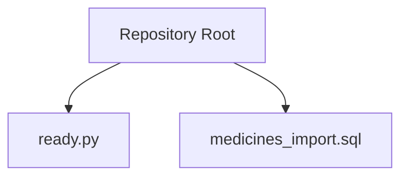
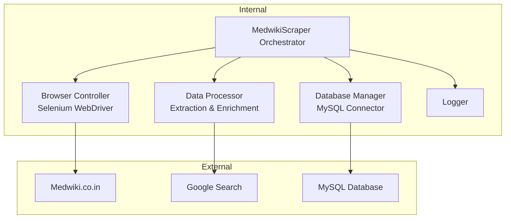
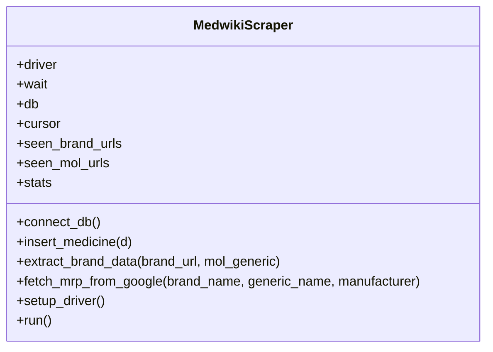
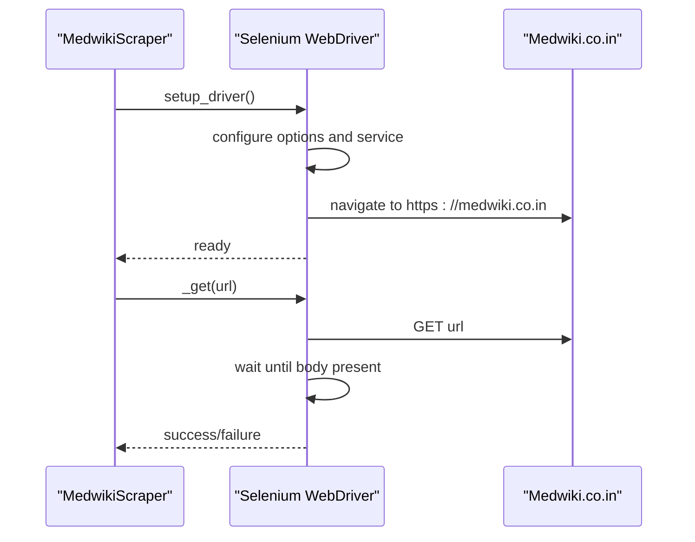
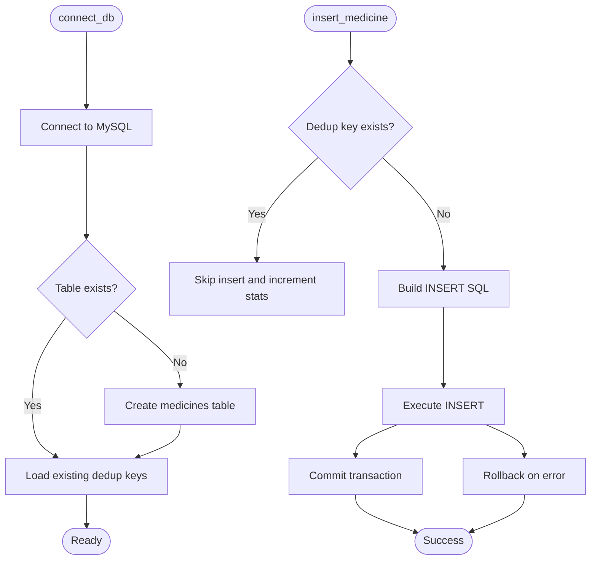
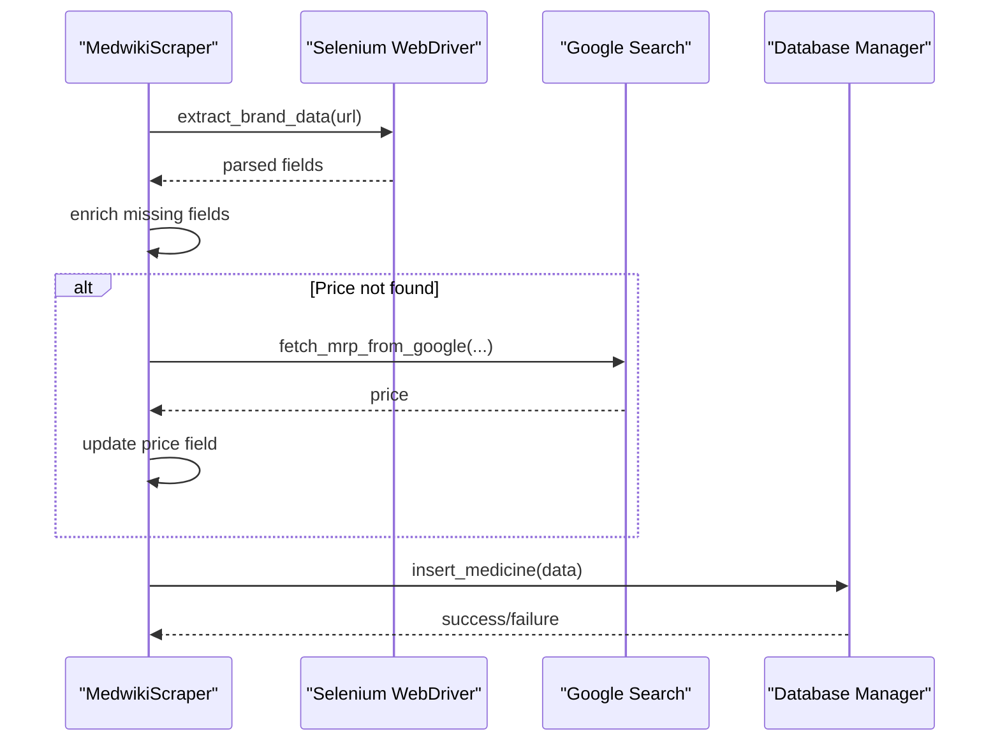
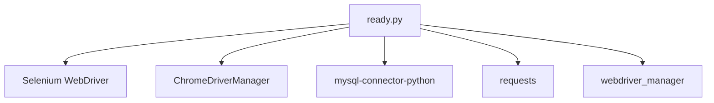
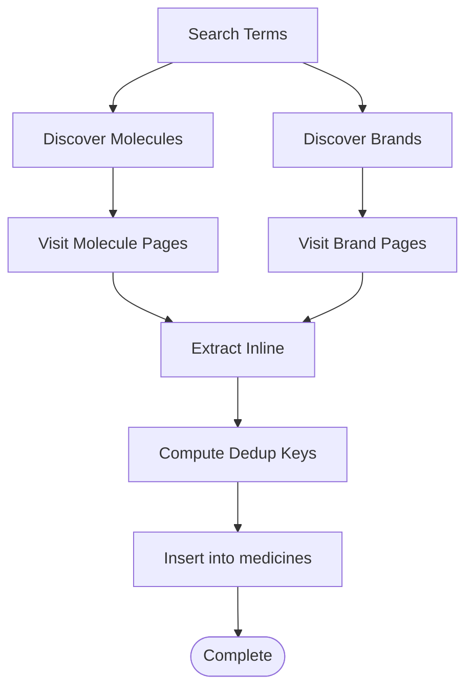

# Core Architecture

<cite>
**Referenced Files in This Document**
- [ready.py](file://ready.py)
- [medicines_import.sql](file://medicines_import.sql)
</cite>

## Table of Contents
1. [Introduction](#introduction)
2. [Project Structure](#project-structure)
3. [Core Components](#core-components)
4. [Architecture Overview](#architecture-overview)
5. [Detailed Component Analysis](#detailed-component-analysis)
6. [Dependency Analysis](#dependency-analysis)
7. [Performance Considerations](#performance-considerations)
8. [Troubleshooting Guide](#troubleshooting-guide)
9. [Conclusion](#conclusion)
10. [Appendices](#appendices)

## Introduction
This document describes the core architecture of the MedWiki scraper system. The system is designed to scrape molecule and brand information from Medwiki.co.in, enrich missing pricing data using Google search fallback, and persist results directly into a MySQL database. The central orchestrator is the MedwikiScraper class, which coordinates browser automation, database operations, and data extraction. Cross-cutting concerns include robust error handling, structured logging, and resource lifecycle management.

## Project Structure
The repository contains two primary artifacts:
- ready.py: Implements the MedwikiScraper orchestrator and all associated modules (browser automation, database manager, data processor, and logger).
- medicines_import.sql: Defines the target MySQL schema for the medicines table and provides a baseline for indexing and constraints.

**Diagram sources**
- [ready.py:1-780](file://ready.py#L1-L780)
- [medicines_import.sql:1-73](file://medicines_import.sql#L1-L73)

**Section sources**
- [ready.py:1-780](file://ready.py#L1-L780)
- [medicines_import.sql:1-73](file://medicines_import.sql#L1-L73)

## Core Components
The MedwikiScraper class acts as the main orchestrator, integrating four major subsystems:
- Browser Controller (Selenium WebDriver): Manages browser lifecycle, navigation, waits, scrolling, and page parsing.
- Database Manager: Handles connection, schema initialization, deduplication keys, and insertion logic.
- Data Processor: Implements extraction strategies for brand pages, including fallback to Google search for MRP.
- Logger: Centralized logging to file and console with timestamps and severity levels.

Key responsibilities:
- MedwikiScraper.run(): Coordinates the end-to-end flow from search terms to database persistence.
- MedwikiScraper.setup_driver(): Initializes the browser with anti-detection options and waits.
- MedwikiScraper.connect_db(): Establishes MySQL connection, creates the medicines table if missing, and loads existing dedup keys.
- MedwikiScraper.extract_brand_data(): Parses brand pages and enriches missing fields.
- MedwikiScraper.fetch_mrp_from_google(): Performs Google search fallback for MRP extraction.
- MedwikiScraper.insert_medicine(): Inserts normalized data into the medicines table with deduplication.

**Section sources**
- [ready.py:52-780](file://ready.py#L52-L780)

## Architecture Overview
The system follows a pipeline architecture with explicit boundaries:
- External Boundaries:
  - Medwiki.co.in: Source of molecule and brand listings and product pages.
  - Google Search: Fallback service for MRP extraction when not present on Medwiki.
  - MySQL Database: Persistent store for medicines table with indexing and constraints.
- Internal Boundaries:
  - MedwikiScraper orchestrator.
  - Browser Controller (Selenium WebDriver).
  - Database Manager (MySQL Connector).
  - Data Processor (Extraction and enrichment).
  - Logger (File and console handlers).

**Diagram sources**
- [ready.py:52-780](file://ready.py#L52-L780)
- [medicines_import.sql:15-60](file://medicines_import.sql#L15-L60)

## Detailed Component Analysis

### MedwikiScraper Orchestrator
Responsibilities:
- Initialize and manage browser, database, and logging.
- Drive the end-to-end scraping pipeline: search terms → molecule pages → brand pages → extraction → database insertion.
- Maintain runtime deduplication sets and statistics counters.
- Gracefully handle interruptions and cleanup resources.

Design patterns observed:
- Singleton-like behavior for database connection within the orchestrator instance (single connection reused across operations).
- Factory-like behavior for browser instance creation via Selenium WebDriver Manager.
- Strategy-like behavior for extraction approaches: inline parsing on Medwiki plus Google fallback for MRP.

**Diagram sources**
- [ready.py:52-780](file://ready.py#L52-L780)

**Section sources**
- [ready.py:52-780](file://ready.py#L52-L780)

### Browser Controller (Selenium WebDriver)
Responsibilities:
- Configure Chrome options for reliability and anti-detection.
- Manage driver lifecycle, timeouts, and waits.
- Navigate to pages, scroll to load dynamic content, and parse DOM/text.

Key behaviors:
- Anti-detection measures: disabling automation indicators, overriding user agent, and setting page load timeout.
- Robust navigation with retry logic and presence-of-element waits.
- Scroll strategy to reveal lazy-loaded content.

**Diagram sources**
- [ready.py:290-347](file://ready.py#L290-L347)

**Section sources**
- [ready.py:290-347](file://ready.py#L290-L347)

### Database Manager (MySQL Connector)
Responsibilities:
- Establish connection using configured credentials.
- Create medicines table if not exists with precise schema and indexes.
- Load existing deduplication keys from database to avoid duplicates.
- Insert normalized medicine rows with deduplication checks and rollback on errors.

Design patterns:
- Singleton-like connection reuse within the orchestrator instance.
- Deduplication strategy across multiple columns to prevent duplicates.

**Diagram sources**
- [ready.py:67-136](file://ready.py#L67-L136)
- [ready.py:150-207](file://ready.py#L150-L207)
- [medicines_import.sql:15-60](file://medicines_import.sql#L15-L60)

**Section sources**
- [ready.py:67-136](file://ready.py#L67-L136)
- [ready.py:150-207](file://ready.py#L150-L207)
- [medicines_import.sql:15-60](file://medicines_import.sql#L15-L60)

### Data Processor (Extraction and Enrichment)
Responsibilities:
- Parse brand pages to extract name, composition, manufacturer, price, form, strength, pack size, schedule, uses, side effects, dosage, and instructions.
- Fallback to Google search for MRP when not found on Medwiki.
- Normalize and trim extracted values to fit schema limits.
- Categorize medicines based on heuristics.

Extraction strategies:
- Inline parsing on Medwiki pages using element detection and text scanning.
- Google search fallback using regex patterns to locate price information.
- Heuristic-based categorization and schedule detection.

**Diagram sources**
- [ready.py:406-558](file://ready.py#L406-L558)
- [ready.py:221-287](file://ready.py#L221-L287)
- [ready.py:150-207](file://ready.py#L150-L207)

**Section sources**
- [ready.py:406-558](file://ready.py#L406-L558)
- [ready.py:221-287](file://ready.py#L221-L287)
- [ready.py:150-207](file://ready.py#L150-L207)

### Logger
Responsibilities:
- Provide centralized logging to both file and console streams.
- Include timestamps and severity levels for traceability.
- Log browser setup, database operations, extraction attempts, and errors.

**Section sources**
- [ready.py:31-40](file://ready.py#L31-L40)

## Dependency Analysis
External dependencies and integration points:
- Selenium WebDriver: Browser automation and page interaction.
- ChromeDriverManager: Automatic ChromeDriver installation and management.
- mysql-connector-python: MySQL connectivity and transactions.
- requests: HTTP client for potential external integrations (present in imports).
- webdriver_manager: Driver management for Chrome.

**Diagram sources**
- [ready.py:5-30](file://ready.py#L5-L30)

**Section sources**
- [ready.py:5-30](file://ready.py#L5-L30)

## Performance Considerations
- Browser configuration: Maximized window, sandbox disabled, GPU disabled, and reduced logging level to improve stability and speed.
- Anti-detection: Disabling automation indicators and overriding user agent helps avoid blocking.
- Retries and waits: Presence-of-element waits and retry loops mitigate transient network/page issues.
- Deduplication: Runtime and database-level deduplication reduces redundant inserts and improves throughput.
- Indexing: The medicines table schema includes multiple indexes and a full-text index to optimize lookups and search performance.

[No sources needed since this section provides general guidance]

## Troubleshooting Guide
Common issues and resolutions:
- Browser setup failures: Verify Chrome installation and permissions; ensure ChromeDriverManager can download drivers.
- Database connection errors: Confirm MySQL server is running, credentials are correct, and the database exists.
- Timeout exceptions: Increase page load timeout or adjust waits; verify network connectivity.
- Duplicate entries: Ensure deduplication keys are correctly computed and stored in the database.
- Google search fallback: Validate regex patterns and ensure the browser can open new tabs for search results.

**Section sources**
- [ready.py:290-347](file://ready.py#L290-L347)
- [ready.py:67-136](file://ready.py#L67-L136)
- [ready.py:221-287](file://ready.py#L221-L287)

## Conclusion
The MedWiki scraper employs a clean, modular architecture centered on the MedwikiScraper orchestrator. It integrates browser automation, database management, and data extraction while addressing cross-cutting concerns like logging, error handling, and resource management. The system’s design patterns—Singleton-like database connection reuse, Factory-like browser instantiation, and Strategy-like extraction approaches—provide a robust foundation for scalable and maintainable web scraping.

[No sources needed since this section summarizes without analyzing specific files]

## Appendices

### Technology Stack and Version Compatibility
- Python packages:
  - selenium: Web automation and browser control.
  - webdriver_manager: Automated ChromeDriver management.
  - mysql-connector-python: MySQL connectivity and transactions.
  - requests: HTTP client support.
- Database: MySQL with InnoDB engine and utf8mb4 character set.
- Schema: medicines table with primary key, multiple indexes, and full-text search capabilities.

**Section sources**
- [ready.py:5-30](file://ready.py#L5-L30)
- [medicines_import.sql:15-60](file://medicines_import.sql#L15-L60)

### Data Flow Architecture
End-to-end flow from input search terms to database storage:
- Input: A-Z letters and common medical prefixes.
- Discovery: Visit molecules and brands pages for each term; collect molecule and brand URLs.
- Extraction: Parse brand pages for product details; fallback to Google search for MRP.
- Deduplication: Compute deduplication keys and skip duplicates.
- Persistence: Insert normalized data into the medicines table with transaction safety.

**Diagram sources**
- [ready.py:655-767](file://ready.py#L655-L767)
- [ready.py:406-558](file://ready.py#L406-L558)
- [ready.py:150-207](file://ready.py#L150-L207)