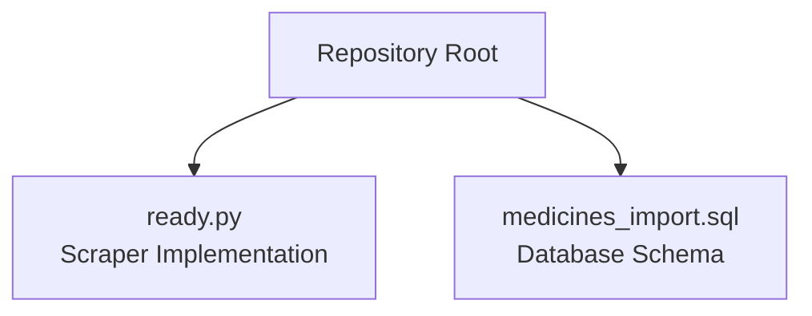
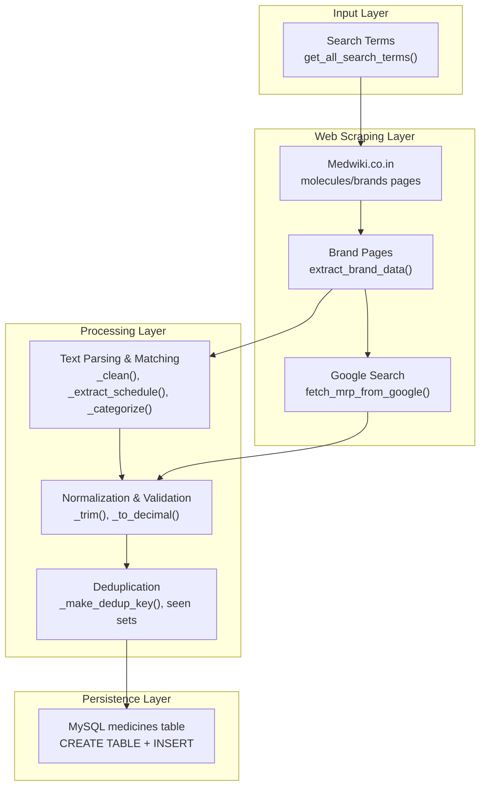
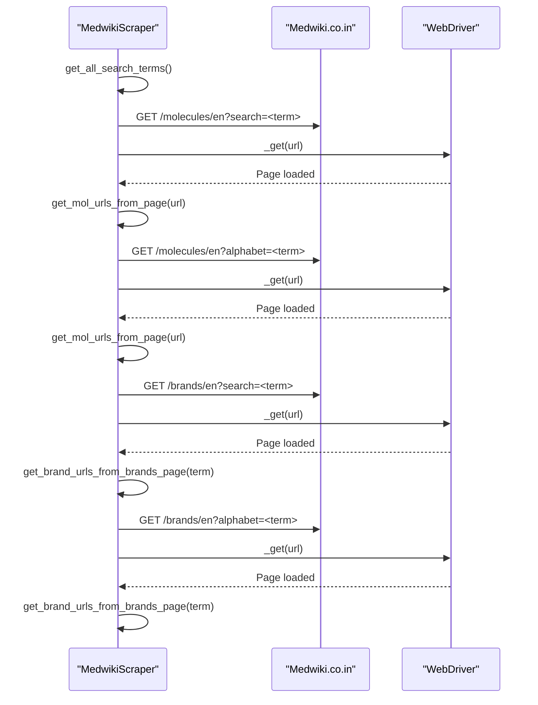
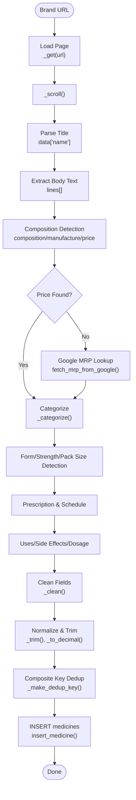
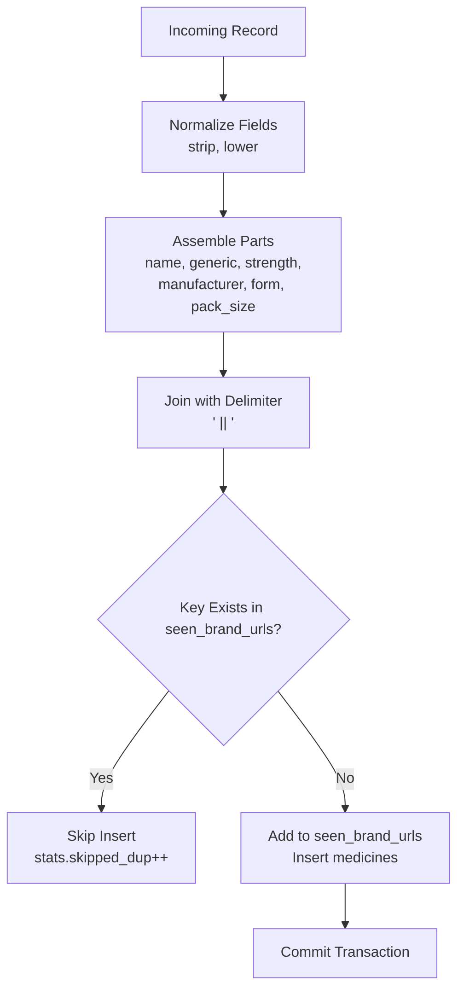
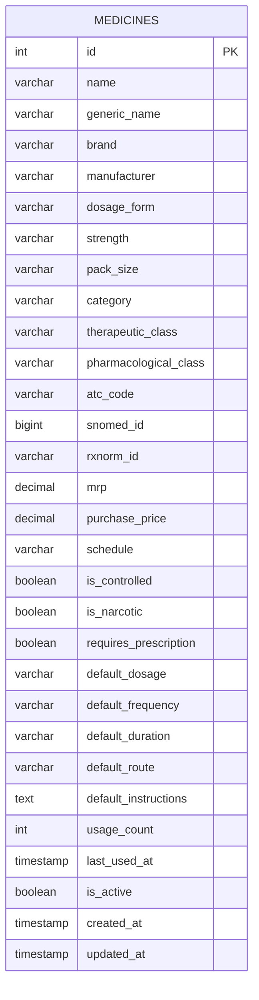
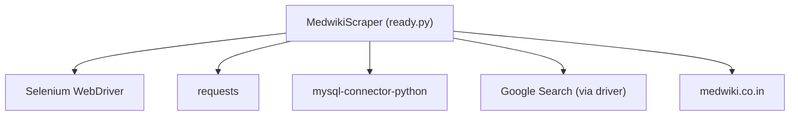

# Data Flow Architecture

<cite>
**Referenced Files in This Document**
- [ready.py](file://ready.py)
- [medicines_import.sql](file://medicines_import.sql)
</cite>

## Table of Contents
1. [Introduction](#introduction)
2. [Project Structure](#project-structure)
3. [Core Components](#core-components)
4. [Architecture Overview](#architecture-overview)
5. [Detailed Component Analysis](#detailed-component-analysis)
6. [Dependency Analysis](#dependency-analysis)
7. [Performance Considerations](#performance-considerations)
8. [Troubleshooting Guide](#troubleshooting-guide)
9. [Conclusion](#conclusion)

## Introduction
This document describes the complete data flow architecture of the MedWiki scraper, which extracts medicine information from medwiki.co.in and stores it into a local MySQL database. The system follows a multi-stage pipeline: search term generation, URL discovery across multiple entry points, web scraping with robust parsing, data normalization and validation, deduplication, and atomic database insertion with transaction management and rollback support.

The scraper targets Indian medicines and integrates with external services (Medwiki.co.in and Google search) to enrich missing data such as MRP pricing. It ensures data consistency through composite key deduplication and maintains logs for observability.

## Project Structure
The repository contains two primary artifacts:
- ready.py: The complete MedWiki scraper implementation, including Selenium-driven web scraping, data extraction, normalization, deduplication, and MySQL persistence.
- medicines_import.sql: The target database schema definition for the medicines table, including indexes and constraints.

**Diagram sources**
- [ready.py](file://ready.py)
- [medicines_import.sql](file://medicines_import.sql)

**Section sources**
- [ready.py](file://ready.py)
- [medicines_import.sql](file://medicines_import.sql)

## Core Components
- MedwikiScraper class orchestrates the entire pipeline:
  - Database connectivity and table creation/initialization
  - Browser automation with Selenium WebDriver
  - Search term generation and URL discovery
  - Text parsing and structured data extraction
  - Data normalization and validation
  - Deduplication using composite keys
  - Transaction-safe insertion with rollback on errors
- External integrations:
  - Medwiki.co.in for molecule and brand listings
  - Google search for MRP retrieval when not present on Medwiki

Key responsibilities:
- Search term generation via get_all_search_terms()
- URL collection from molecules and brands pages
- Brand page extraction and normalization
- Composite-key deduplication across runtime and persisted records
- Atomic inserts with error handling and rollback

**Section sources**
- [ready.py](file://ready.py)

## Architecture Overview
The data flow spans three major domains: input generation, web scraping, and database persistence. The scraper iterates over a curated list of search terms, discovers molecule and brand URLs from multiple entry points, scrapes brand pages, normalizes and validates the extracted data, deduplicates entries, and writes to the medicines table.

**Diagram sources**
- [ready.py](file://ready.py)
- [medicines_import.sql](file://medicines_import.sql)

## Detailed Component Analysis

### Search Term Generation and Discovery Pipeline
The scraper generates a comprehensive list of search terms and discovers URLs from multiple entry points to maximize coverage.

**Diagram sources**
- [ready.py](file://ready.py)

Key behaviors:
- Search terms include lowercase letters and common 2-letter medical prefixes.
- Two discovery modes per entry point: search and alphabet parameters.
- Deduplication at the URL level using sets to avoid revisiting pages.

**Section sources**
- [ready.py](file://ready.py)

### Brand Page Extraction and Normalization
Brand pages are parsed to extract structured fields, with fallbacks and normalization rules.

**Diagram sources**
- [ready.py](file://ready.py)

Extraction highlights:
- Composition parsing with generic name inference from first salt.
- Manufacturer detection and price extraction.
- Fallback to Google search for MRP when absent on Medwiki.
- Form, strength, pack size inferred from text patterns.
- Prescription requirement and controlled drug scheduling derived from text.
- Uses, side effects, dosage, and how-to-use extracted from nearby lines.

**Section sources**
- [ready.py](file://ready.py)

### Data Transformation Pipeline
The transformation pipeline applies cleaning, normalization, categorization, and validation rules.

- Text cleaning: Whitespace normalization and trimming.
- Categorization: Heuristic matching against known therapeutic categories.
- Scheduling: Controlled drug classification based on schedule patterns.
- Pricing: Numeric extraction and range validation.
- Field trimming: Enforced length limits per column constraints.

Validation rules:
- Decimal conversion for MRP with numeric extraction and range filtering.
- Length limits enforced per VARCHAR/TEXT column definitions.
- Presence checks for essential fields (e.g., name) before insertion.

**Section sources**
- [ready.py](file://ready.py)

### Deduplication Algorithm
The scraper employs a composite key strategy combining multiple attributes to prevent duplicates.

**Diagram sources**
- [ready.py](file://ready.py)

Runtime and persistent deduplication:
- Runtime set tracks newly discovered brand URLs and normalized composite keys.
- On startup, the scraper loads existing composite keys from the medicines table to seed the runtime set.

**Section sources**
- [ready.py](file://ready.py)

### Database Integration and Transactions
The medicines table schema defines strict column constraints and indexes for efficient querying and uniqueness enforcement.

**Diagram sources**
- [medicines_import.sql](file://medicines_import.sql)

Transaction management:
- Each insert is committed immediately after successful execution.
- On MySQL errors, rollback is attempted and logged.
- Unique constraints and composite keys prevent duplicate rows at the database level.

**Section sources**
- [ready.py](file://ready.py)
- [medicines_import.sql](file://medicines_import.sql)

## Dependency Analysis
The scraper depends on external services and libraries for browser automation, database connectivity, and web scraping.

**Diagram sources**
- [ready.py](file://ready.py)

External dependencies:
- Selenium WebDriver for browser automation and page interactions.
- requests for HTTP operations (used for Google search URL construction).
- mysql-connector-python for MySQL connectivity and transactions.
- Medwiki.co.in and Google for data sources.

**Section sources**
- [ready.py](file://ready.py)

## Performance Considerations
- Browser behavior tuning: Maximized window, reduced logging, and user agent spoofing improve stability and reduce detection risk.
- Intelligent scrolling: Scroll until content stops changing to avoid premature termination.
- Retry and timeout handling: Robust page load attempts with exponential backoff-like delays.
- Randomized delays: Introduces jitter between requests to mimic human behavior and avoid rate limiting.
- Index utilization: Database indexes optimize lookups and full-text search capabilities.

[No sources needed since this section provides general guidance]

## Troubleshooting Guide
Common issues and remedies:
- Browser setup failures: Verify ChromeDriver installation and compatibility; ensure network and sandbox settings are configured.
- Page load timeouts: Increase wait times or adjust network conditions; verify site accessibility.
- Google MRP extraction: Patterns may vary; ensure sufficient text coverage and consider refining regex.
- Database connectivity: Confirm host, user, password, and database name; verify MySQL server availability.
- Duplicate insertions: Review composite key logic and ensure all relevant fields are included in deduplication.

**Section sources**
- [ready.py](file://ready.py)

## Conclusion
The MedWiki scraper implements a robust, multi-stage data flow that transforms raw web content into normalized, deduplicated records stored in a MySQL database. It leverages Medwiki.co.in and Google search to enrich missing data, enforces validation and normalization rules, and maintains transactional integrity with rollback support. The composite key deduplication strategy ensures data consistency across runtime and persistent states, while comprehensive logging provides visibility into the scraping process.