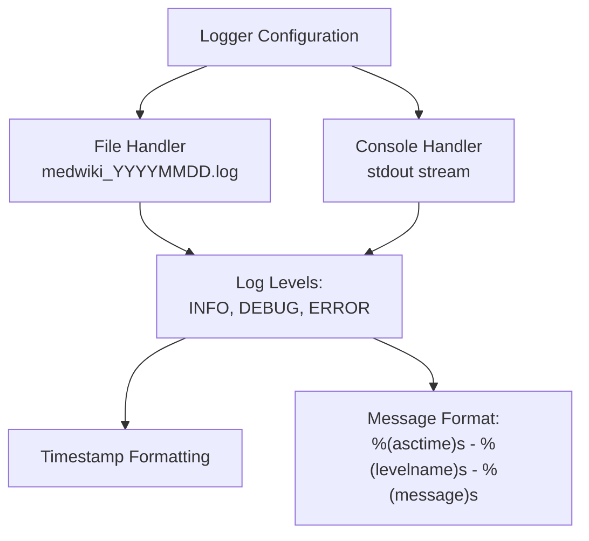
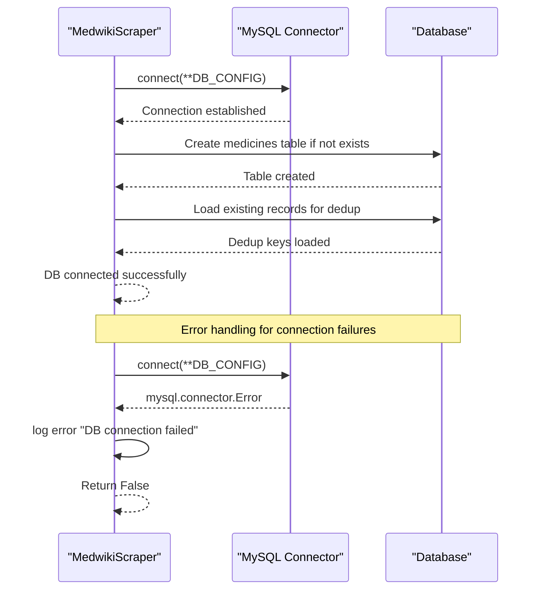
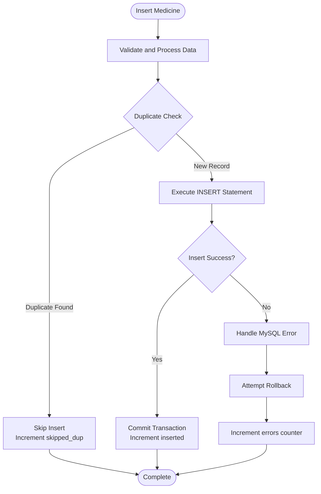
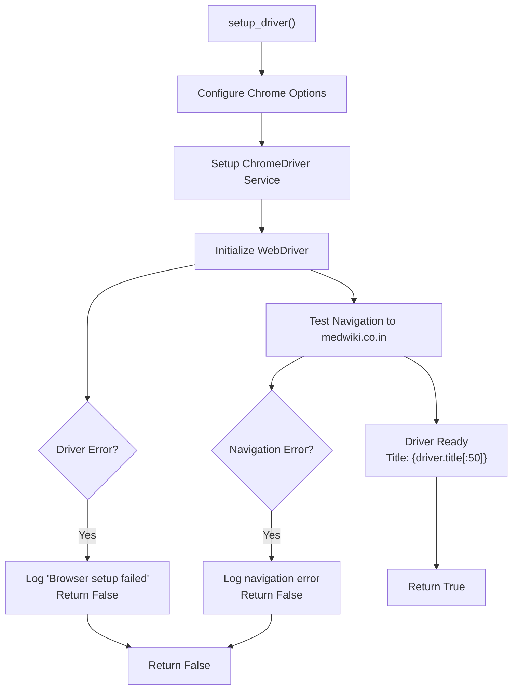
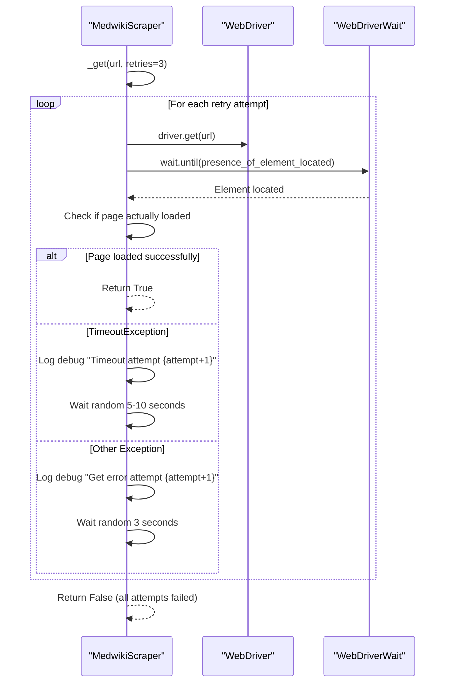
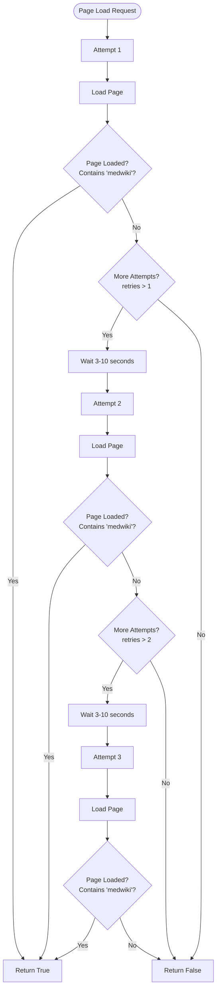
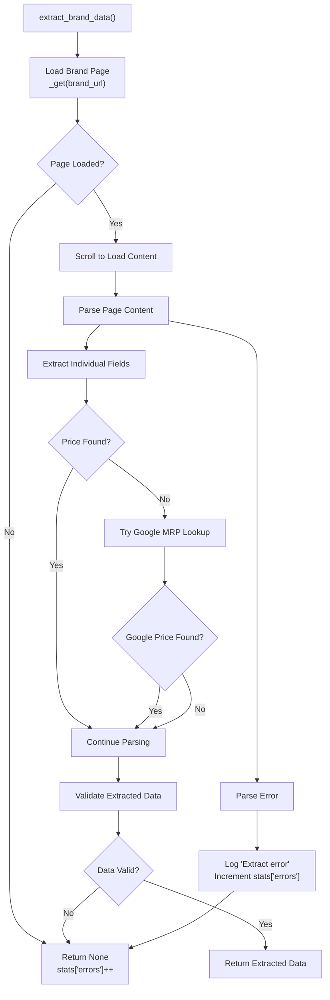
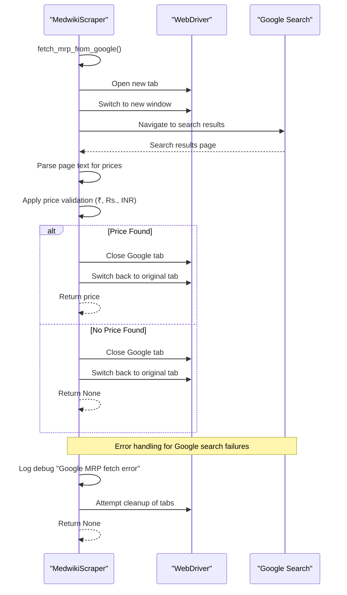
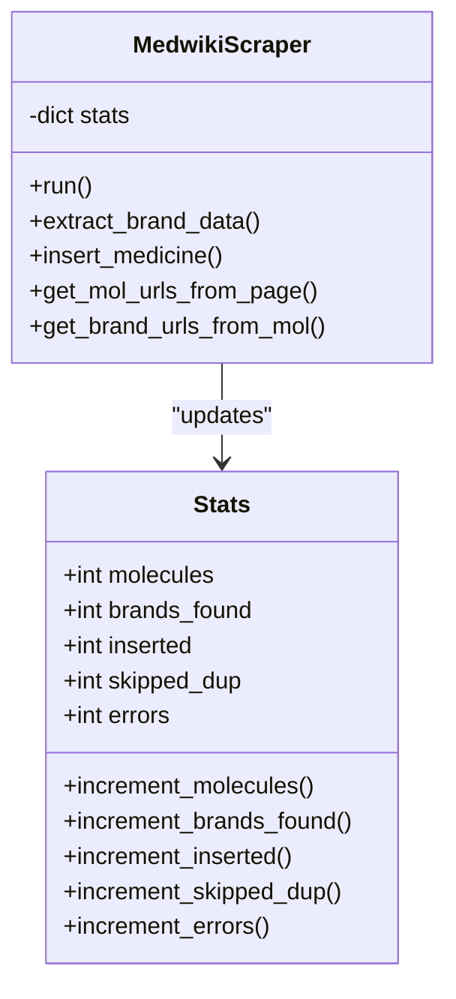

# Error Handling Patterns

<cite>
**Referenced Files in This Document**
- [ready.py](file://ready.py)
- [medicines_import.sql](file://medicines_import.sql)
</cite>

## Table of Contents
1. [Introduction](#introduction)
2. [Logging Strategy](#logging-strategy)
3. [Database Error Handling](#database-error-handling)
4. [Browser Automation Error Management](#browser-automation-error-management)
5. [Retry Mechanisms](#retry-mechanisms)
6. [Data Extraction Error Handling](#data-extraction-error-handling)
7. [Fallback Mechanisms](#fallback-mechanisms)
8. [Statistics and Monitoring](#statistics-and-monitoring)
9. [Common Failure Scenarios](#common-failure-scenarios)
10. [Graceful Degradation Strategies](#graceful-degradation-strategies)
11. [Troubleshooting Guide](#troubleshooting-guide)
12. [Conclusion](#conclusion)

## Introduction

The MedWiki scraper implements a comprehensive error handling and exception management strategy designed to handle the complexities of web scraping, database operations, and browser automation. The system employs multiple layers of error handling including timeout exceptions, network failures, parsing errors, database connection issues, and browser automation failures.

The scraper follows a robust approach to error management by implementing retry mechanisms, fallback strategies, detailed logging, and graceful degradation patterns. This ensures reliable operation even when encountering various failure scenarios during the scraping process.

## Logging Strategy

The system implements a sophisticated logging strategy with multiple handlers and log levels to capture different types of errors and operational events.

### Logging Configuration

The logging system is configured with both file and console handlers, providing comprehensive visibility into the scraping process:

**Diagram sources**
- [ready.py:32-40](file://ready.py#L32-L40)

### Error Categorization

The logging system categorizes different types of errors with specific patterns:

- **Database Connection Errors**: Logged with "DB connection failed" prefix
- **Database Operation Errors**: Logged with "DB insert error" prefix  
- **Browser Setup Failures**: Logged with "Browser setup failed" prefix
- **Page Load Failures**: Logged with "Timeout attempt" and "Get error attempt" patterns
- **Extraction Errors**: Logged with "Extract error" prefix
- **Google Search Errors**: Logged with "Google MRP fetch error" prefix

**Section sources**
- [ready.py:134-136](file://ready.py#L134-L136)
- [ready.py:200-202](file://ready.py#L200-L202)
- [ready.py:324-326](file://ready.py#L324-L326)
- [ready.py:339-346](file://ready.py#L339-L346)
- [ready.py:555-558](file://ready.py#L555-L558)
- [ready.py:279-287](file://ready.py#L279-L287)

## Database Error Handling

The database layer implements comprehensive error handling with automatic rollback capabilities and duplicate detection mechanisms.

### Connection Management

The database connection process includes robust error handling:

**Diagram sources**
- [ready.py:67-136](file://ready.py#L67-L136)

### Insert Operations with Error Recovery

The insert operation includes comprehensive error handling and rollback mechanisms:

**Diagram sources**
- [ready.py:150-208](file://ready.py#L150-L208)

**Section sources**
- [ready.py:67-136](file://ready.py#L67-L136)
- [ready.py:150-208](file://ready.py#L150-L208)

## Browser Automation Error Management

The browser automation layer implements sophisticated error handling for Selenium WebDriver operations, including timeout management and page load validation.

### Driver Setup Error Handling

The browser driver setup includes comprehensive error handling for various failure scenarios:

**Diagram sources**
- [ready.py:290-326](file://ready.py#L290-L326)

### Page Load Error Handling

The `_get()` method implements a sophisticated retry mechanism with configurable attempts and error-specific handling:

**Diagram sources**
- [ready.py:328-347](file://ready.py#L328-L347)

**Section sources**
- [ready.py:290-326](file://ready.py#L290-L326)
- [ready.py:328-347](file://ready.py#L328-L347)

## Retry Mechanisms

The scraper implements configurable retry mechanisms specifically designed for failed page loads, with exponential backoff and intelligent error detection.

### Retry Configuration

The retry mechanism is implemented in the `_get()` method with the following characteristics:

- **Configurable Attempts**: Default 3 retry attempts
- **Intelligent Error Detection**: Differentiates between timeout and other exceptions
- **Adaptive Waiting**: Randomized delays (3-10 seconds) between attempts
- **Page Validation**: Ensures the page actually loaded, not just a redirect

### Retry Logic Implementation

**Diagram sources**
- [ready.py:328-347](file://ready.py#L328-L347)

**Section sources**
- [ready.py:328-347](file://ready.py#L328-L347)

## Data Extraction Error Handling

The data extraction phase implements comprehensive error handling for parsing failures, missing data, and extraction timeouts.

### Extraction Error Recovery

The extraction process includes multiple layers of error handling:

**Diagram sources**
- [ready.py:406-558](file://ready.py#L406-L558)

### Field Extraction Error Handling

The field extraction process handles various failure scenarios:

- **Missing Price**: Automatically triggers Google search fallback
- **Missing Dosage Form**: Uses pattern matching to infer from content
- **Missing Strength**: Extracts from text patterns with validation
- **Missing Manufacturer**: Falls back to available alternatives
- **Missing Uses/Side Effects**: Handles missing sections gracefully

**Section sources**
- [ready.py:406-558](file://ready.py#L406-L558)

## Fallback Mechanisms

The scraper implements sophisticated fallback mechanisms to ensure data completeness even when primary sources fail.

### Google Search Fallback

The Google search fallback mechanism provides a robust alternative for price lookup:

**Diagram sources**
- [ready.py:221-287](file://ready.py#L221-L287)

### Pattern-Based Extraction Fallbacks

The system implements multiple fallback patterns for different data types:

- **Dosage Form Detection**: Pattern-based inference from content
- **Strength Extraction**: Regex pattern matching with validation
- **Pack Size Detection**: Multi-pattern matching approach
- **Category Classification**: Fuzzy matching with multiple categories

**Section sources**
- [ready.py:221-287](file://ready.py#L221-L287)
- [ready.py:462-500](file://ready.py#L462-L500)

## Statistics and Monitoring

The scraper maintains comprehensive statistics tracking to enable system monitoring and debugging.

### Statistics Collection

The system tracks multiple categories of statistics:

**Diagram sources**
- [ready.py:61-64](file://ready.py#L61-L64)
- [ready.py:656-766](file://ready.py#L656-L766)

### Monitoring Dashboard

The statistics provide insights into system performance:

- **Processing Metrics**: Molecules processed, brands found, inserts
- **Quality Metrics**: Duplicate skips, error rates
- **Performance Metrics**: Throughput, error rates per hour
- **Data Quality**: Success rates by extraction type

**Section sources**
- [ready.py:61-64](file://ready.py#L61-L64)
- [ready.py:759-766](file://ready.py#L759-L766)

## Common Failure Scenarios

The scraper is designed to handle various common failure scenarios encountered in web scraping operations.

### Blocked Sites and Anti-Bot Protection

The system handles anti-bot protection through:

- **User Agent Spoofing**: Realistic browser user agent strings
- **Automation Control Removal**: Disabling automation indicators
- **Window Size Configuration**: Standard browser dimensions
- **Headless Mode Alternatives**: Visible mode for reliability

### Dynamic Content Loading Issues

The system addresses dynamic content challenges:

- **Explicit Waits**: WebDriverWait for element presence
- **Scroll-Based Loading**: Automatic scrolling to trigger lazy loading
- **Content Validation**: Checking for actual content vs. loading indicators
- **Timeout Management**: Configurable page load timeouts

### External Service Unavailability

The system handles external service failures:

- **Google Search Fallback**: Alternative price lookup mechanism
- **Network Resilience**: Retry mechanisms for network failures
- **Graceful Degradation**: Partial data extraction when services unavailable
- **Error Isolation**: Preventing single failures from crashing the entire process

**Section sources**
- [ready.py:290-326](file://ready.py#L290-L326)
- [ready.py:328-347](file://ready.py#L328-L347)
- [ready.py:221-287](file://ready.py#L221-L287)

## Graceful Degradation Strategies

The scraper implements graceful degradation to maintain functionality even when components fail.

### Data Completeness Strategies

The system prioritizes data completeness while maintaining reliability:

- **Partial Data Acceptance**: Proceeds with available data even if some fields are missing
- **Inference Mechanisms**: Uses available data to infer missing information
- **Validation Thresholds**: Minimum quality thresholds for data acceptance
- **Fallback Chains**: Multiple fallback options for critical data points

### User Notification Patterns

The system provides comprehensive user feedback:

- **Progress Indicators**: Detailed progress logs with statistics
- **Error Reporting**: Specific error messages with context
- **Status Updates**: Regular status updates during long-running operations
- **Completion Reports**: Comprehensive summary at completion

**Section sources**
- [ready.py:656-766](file://ready.py#L656-L766)

## Troubleshooting Guide

This section provides guidance for diagnosing and resolving common issues encountered with the scraper.

### Database Connection Issues

**Symptoms**: "DB connection failed" errors in logs
**Diagnosis**: Check MySQL server status, credentials, and network connectivity
**Resolution**: Verify database configuration, ensure MySQL service is running, check firewall settings

### Browser Automation Problems

**Symptoms**: "Browser setup failed" errors
**Diagnosis**: Check ChromeDriver installation, browser compatibility, and system resources
**Resolution**: Update ChromeDriver, verify Chrome installation, adjust driver options

### Network Timeout Issues

**Symptoms**: "Timeout attempt" messages in logs
**Diagnosis**: Check internet connectivity, server response times, and proxy settings
**Resolution**: Increase timeout values, check network stability, implement retry logic

### Data Extraction Failures

**Symptoms**: "Extract error" messages with empty results
**Diagnosis**: Check website structure changes, element selectors, and content availability
**Resolution**: Update extraction patterns, implement more robust selectors, add fallback mechanisms

**Section sources**
- [ready.py:134-136](file://ready.py#L134-L136)
- [ready.py:324-326](file://ready.py#L324-L326)
- [ready.py:339-346](file://ready.py#L339-L346)
- [ready.py:555-558](file://ready.py#L555-L558)

## Conclusion

The MedWiki scraper demonstrates comprehensive error handling and exception management patterns that ensure reliable operation in challenging web scraping environments. The system's layered approach to error handling, combined with robust retry mechanisms, fallback strategies, and detailed logging, provides a solid foundation for production-grade web scraping operations.

Key strengths of the error handling strategy include:

- **Multi-layered Error Handling**: Database, browser, and extraction layers each with dedicated error handling
- **Configurable Retry Mechanisms**: Intelligent retry logic with adaptive waiting times
- **Comprehensive Fallback Systems**: Multiple fallback options for critical data points
- **Detailed Statistics Tracking**: Comprehensive metrics for monitoring and debugging
- **Graceful Degradation**: Maintains functionality even when individual components fail

The implementation serves as an excellent example of production-ready error handling for web scraping applications, providing valuable patterns for similar projects facing similar challenges.