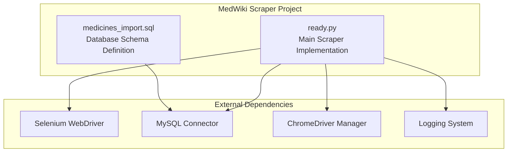
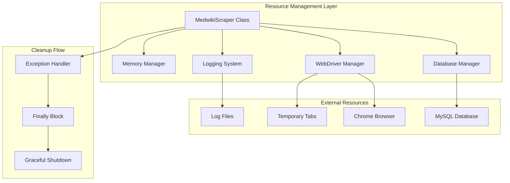
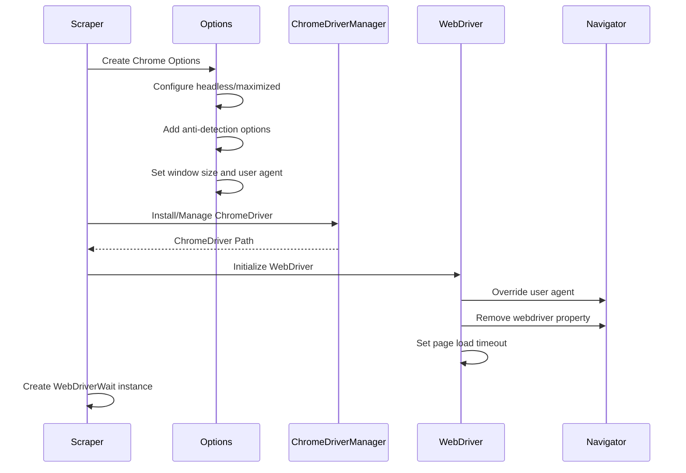
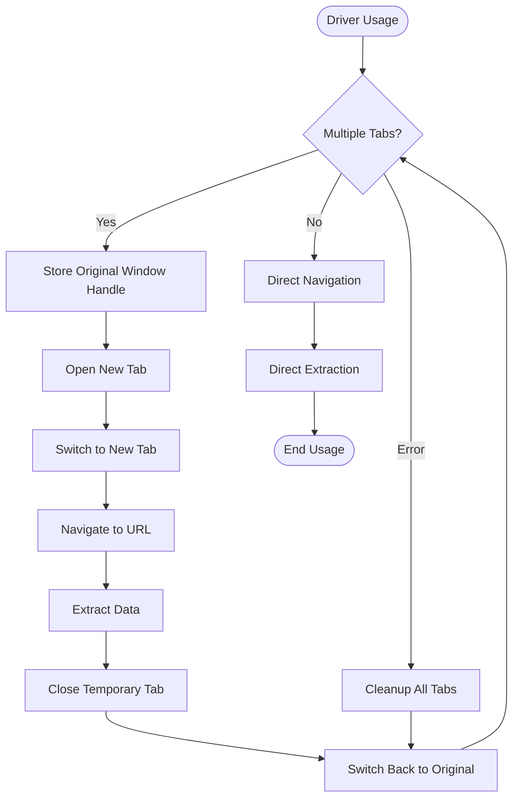
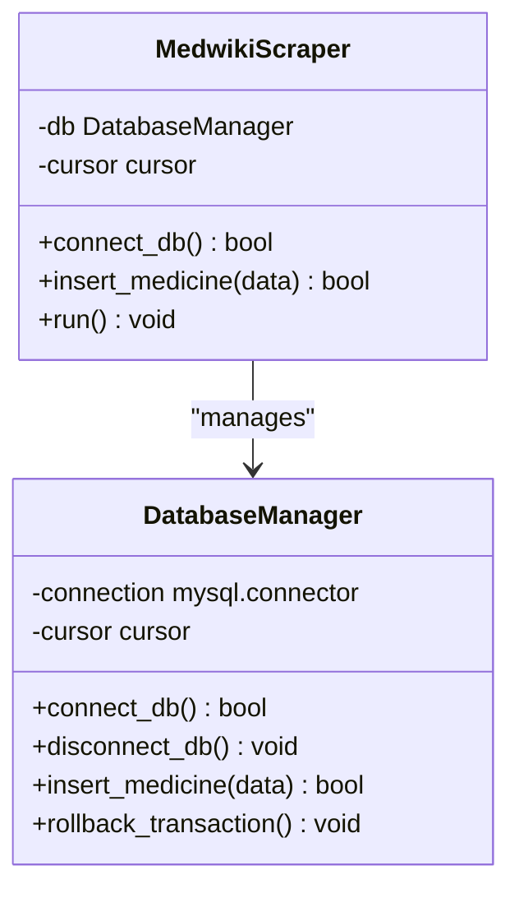
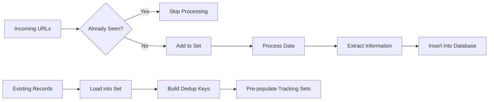
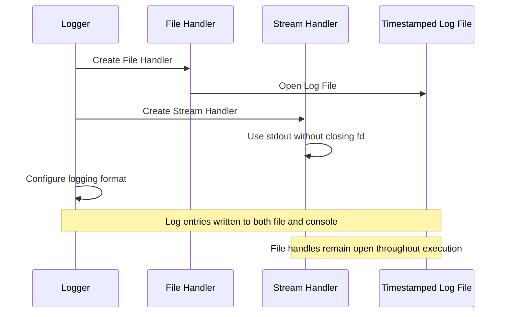
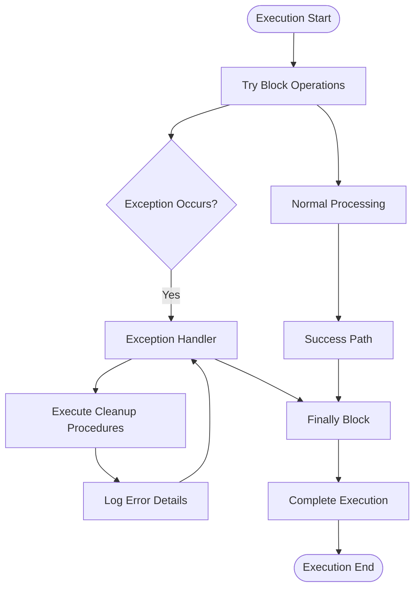
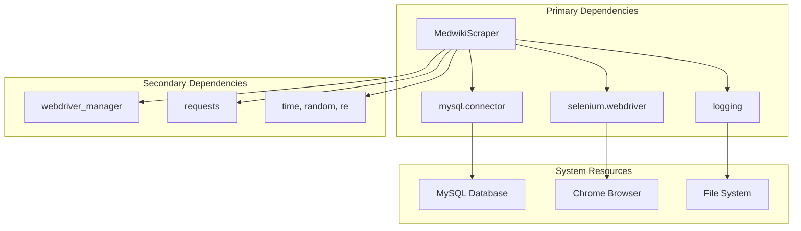

# Resource Management

<cite>
**Referenced Files in This Document**
- [ready.py](file://ready.py)
- [medicines_import.sql](file://medicines_import.sql)
</cite>

## Table of Contents
1. [Introduction](#introduction)
2. [Project Structure](#project-structure)
3. [Core Components](#core-components)
4. [Architecture Overview](#architecture-overview)
5. [Detailed Component Analysis](#detailed-component-analysis)
6. [Dependency Analysis](#dependency-analysis)
7. [Performance Considerations](#performance-considerations)
8. [Troubleshooting Guide](#troubleshooting-guide)
9. [Conclusion](#conclusion)

## Introduction
This document provides comprehensive guidance for resource management and cleanup strategies in the MedWiki scraper. The scraper performs large-scale web scraping operations to collect pharmaceutical data from medwiki.co.in and stores it directly into a MySQL database. The focus areas include browser driver lifecycle management, memory management for extensive scraping sessions, database connection management, file handle management for logs, resource monitoring techniques, and robust cleanup procedures for exception scenarios.

The MedWiki scraper demonstrates practical implementations of resource management patterns including proper initialization, usage, and shutdown procedures for Selenium WebDriver instances, efficient database connection handling, and comprehensive cleanup mechanisms that ensure resources are properly released even during failure conditions.

## Project Structure
The project consists of two primary components that work together to manage resources effectively:

**Diagram sources**
- [ready.py:1-780](file://ready.py#L1-L780)
- [medicines_import.sql:1-73](file://medicines_import.sql#L1-L73)

The project follows a modular architecture where the main scraper class encapsulates all resource management responsibilities, while the SQL file provides the target database schema for persistent storage.

**Section sources**
- [ready.py:1-780](file://ready.py#L1-L780)
- [medicines_import.sql:1-73](file://medicines_import.sql#L1-L73)

## Core Components
The MedWiki scraper implements several critical resource management components that work together to ensure efficient operation and proper cleanup:

### Database Connection Management
The scraper uses a straightforward connection-based approach rather than a singleton pattern. The database connection is established once per execution and maintained throughout the scraping process. This approach simplifies resource management while maintaining thread safety for single-threaded scraping operations.

### Browser Driver Lifecycle Management
The Selenium WebDriver instance is managed through explicit lifecycle methods that handle initialization, configuration, and proper shutdown. The driver setup includes comprehensive Chrome options for optimal scraping performance and anti-detection measures.

### Memory Management Strategies
The scraper implements multiple memory optimization techniques including:
- Runtime deduplication using sets for URL tracking
- Efficient data extraction with targeted element selection
- Strategic delays and timeouts to balance performance with resource usage
- Proper cleanup of temporary browser tabs during Google search operations

### Logging and File Handle Management
The logging system creates timestamped log files while maintaining console output through non-closing stream handlers to prevent premature file descriptor closure.

**Section sources**
- [ready.py:52-767](file://ready.py#L52-L767)
- [ready.py:42-49](file://ready.py#L42-L49)

## Architecture Overview
The resource management architecture follows a structured approach to handle multiple concurrent resource types with proper cleanup mechanisms:

**Diagram sources**
- [ready.py:52-767](file://ready.py#L52-L767)

The architecture ensures that all resources follow a predictable lifecycle with explicit cleanup paths for both normal completion and exceptional termination scenarios.

## Detailed Component Analysis

### Browser Driver Lifecycle Management

#### Initialization Phase
The browser driver initialization follows a comprehensive setup procedure that configures Chrome with optimal options for reliable scraping:

**Diagram sources**
- [ready.py:290-326](file://ready.py#L290-L326)

#### Usage Phase Operations
During the scraping operations, the driver manages multiple browser tabs efficiently:

**Diagram sources**
- [ready.py:240-287](file://ready.py#L240-L287)

#### Shutdown Procedures
The driver shutdown follows a strict sequence to ensure complete resource release:

**Section sources**
- [ready.py:290-326](file://ready.py#L290-L326)
- [ready.py:240-287](file://ready.py#L240-L287)

### Database Connection Management

#### Connection Establishment
The database connection management uses a straightforward approach that prioritizes reliability over connection pooling for single-threaded scraping operations:

**Diagram sources**
- [ready.py:67-136](file://ready.py#L67-L136)

#### Transaction Management
The database operations implement proper transaction handling with rollback capabilities for error recovery:

**Section sources**
- [ready.py:67-136](file://ready.py#L67-L136)

### Memory Management Strategies

#### Runtime Deduplication
The scraper implements sophisticated deduplication mechanisms to minimize memory usage and prevent redundant processing:

**Diagram sources**
- [ready.py:59-64](file://ready.py#L59-L64)
- [ready.py:118-131](file://ready.py#L118-L131)

#### Data Extraction Optimization
The data extraction process minimizes memory footprint through targeted element selection and efficient text processing:

**Section sources**
- [ready.py:59-64](file://ready.py#L59-L64)
- [ready.py:118-131](file://ready.py#L118-L131)

### Logging and File Handle Management

#### Multi-destination Logging
The logging system provides comprehensive monitoring while maintaining proper file handle management:

**Diagram sources**
- [ready.py:32-40](file://ready.py#L32-L40)

**Section sources**
- [ready.py:32-40](file://ready.py#L32-L40)

### Exception Handling and Cleanup

#### Comprehensive Exception Management
The scraper implements robust exception handling with dedicated cleanup procedures:

**Diagram sources**
- [ready.py:746-767](file://ready.py#L746-L767)

#### Finally Block Implementation
The finally block ensures comprehensive resource cleanup regardless of execution path:

**Section sources**
- [ready.py:746-767](file://ready.py#L746-L767)

## Dependency Analysis

### Resource Dependency Graph
The resource management system follows a hierarchical dependency structure:

**Diagram sources**
- [ready.py:5-30](file://ready.py#L5-L30)

### Resource Cleanup Dependencies
The cleanup procedures depend on proper resource ordering to prevent errors:

**Section sources**
- [ready.py:5-30](file://ready.py#L5-L30)

## Performance Considerations

### Memory Usage Optimization
The scraper implements several strategies to optimize memory usage during large-scale operations:

#### Efficient Data Structures
- Uses sets for O(1) deduplication lookups
- Implements targeted element selection to minimize DOM parsing overhead
- Employs strategic delays to balance performance with site responsiveness

#### Browser Resource Management
- Limits concurrent tab operations to prevent memory accumulation
- Implements proper tab cleanup after temporary operations
- Uses appropriate timeouts to prevent hanging operations

#### Database Connection Efficiency
- Maintains single connection throughout execution
- Uses prepared statements for efficient data insertion
- Implements batch-like processing through individual inserts with transaction support

### Performance Tuning Recommendations
For long-running scraping sessions, consider these optimizations:

1. **Connection Pooling**: While the current implementation uses a single connection, consider implementing connection pooling for multi-threaded scenarios
2. **Memory Monitoring**: Implement periodic memory usage checks to trigger garbage collection
3. **Batch Processing**: Group database operations into batches to reduce transaction overhead
4. **Resource Limits**: Implement configurable limits for concurrent operations to prevent system overload

## Troubleshooting Guide

### Common Resource Management Issues

#### Browser Driver Problems
- **Issue**: ChromeDriver not found or incompatible
- **Solution**: Ensure ChromeDriverManager is properly installed and configured
- **Prevention**: Verify Chrome version compatibility before execution

#### Database Connection Failures
- **Issue**: Connection timeouts or authentication errors
- **Solution**: Implement retry logic with exponential backoff
- **Prevention**: Validate database credentials and network connectivity

#### Memory Leaks During Scraping
- **Issue**: Increasing memory usage over time
- **Solution**: Monitor memory usage and implement periodic garbage collection
- **Prevention**: Ensure proper cleanup of browser tabs and temporary resources

#### Logging File Handle Issues
- **Issue**: Log files not being written or closed prematurely
- **Solution**: Verify file permissions and ensure proper file handle management
- **Prevention**: Use timestamped filenames and proper logging configuration

### Exception Scenario Cleanup
The scraper's exception handling ensures proper resource cleanup through multiple fallback mechanisms:

**Section sources**
- [ready.py:746-767](file://ready.py#L746-L767)

## Conclusion

The MedWiki scraper demonstrates comprehensive resource management practices that ensure reliable operation during large-scale web scraping tasks. The implementation successfully addresses key resource management challenges through:

### Key Strengths
- **Structured Lifecycle Management**: Clear initialization, usage, and shutdown procedures for all major resources
- **Robust Exception Handling**: Comprehensive cleanup mechanisms that ensure resource release even during failure scenarios
- **Efficient Memory Management**: Sophisticated deduplication and data extraction strategies that minimize memory footprint
- **Proper File Handle Management**: Multi-destination logging system that maintains proper file handle lifecycle
- **Performance Optimization**: Balanced approach to speed and resource usage through strategic delays and efficient data processing

### Best Practices Demonstrated
- **Explicit Resource Management**: All resources are explicitly tracked and cleaned up
- **Fail-safe Cleanup**: Finally blocks and exception handlers ensure cleanup occurs regardless of execution path
- **Anti-detection Measures**: Chrome configuration prevents blocking while maintaining performance
- **Database Safety**: Proper transaction handling with rollback capabilities for error recovery

### Areas for Enhancement
While the current implementation is robust, potential improvements could include:
- Implementing connection pooling for multi-threaded scenarios
- Adding configurable resource limits and monitoring
- Incorporating more sophisticated memory management strategies
- Enhancing error recovery mechanisms for transient failures

The MedWiki scraper serves as an excellent example of how to implement comprehensive resource management in web scraping applications, providing a solid foundation for similar projects requiring reliable resource handling and cleanup procedures.