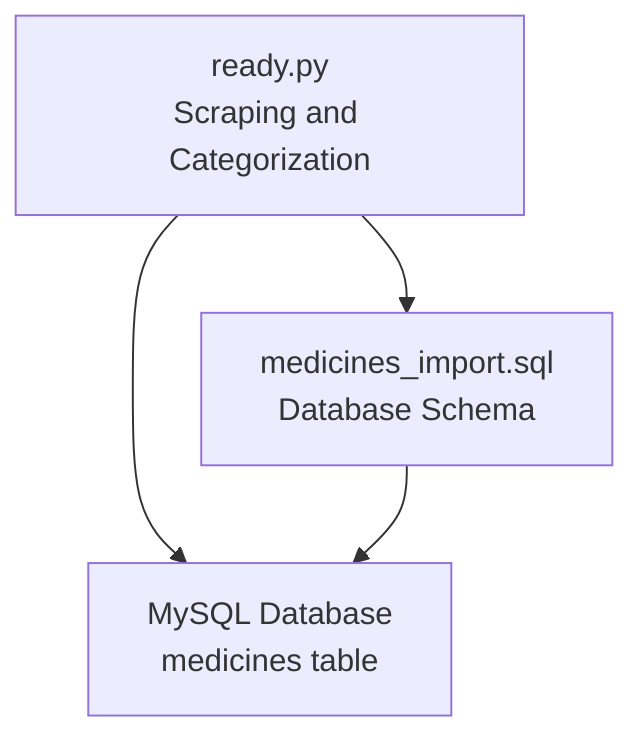
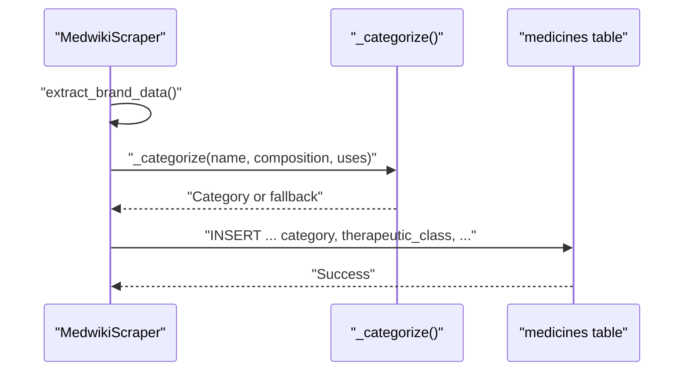
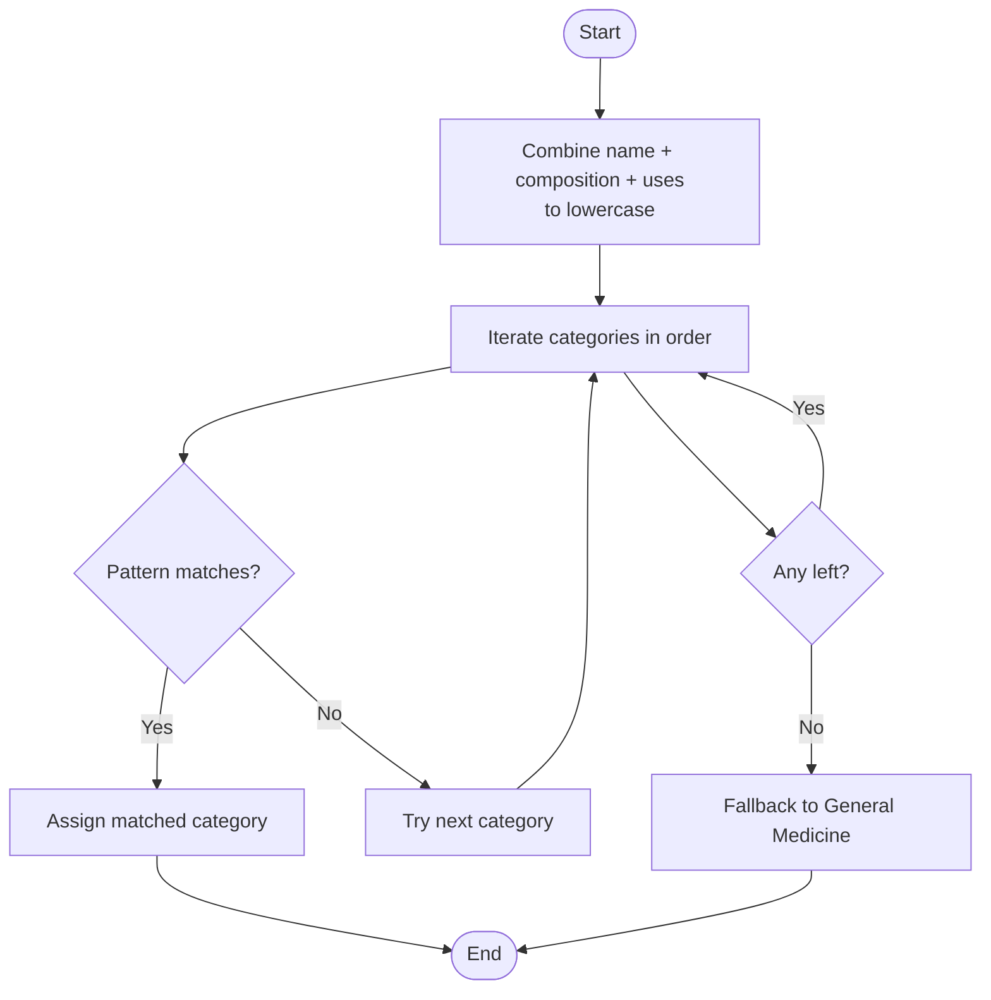
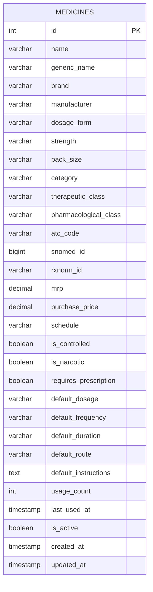
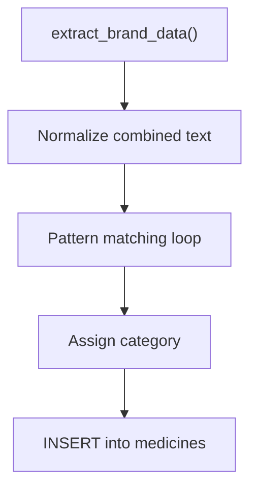

# Categorization System

<cite>
**Referenced Files in This Document**
- [ready.py](file://ready.py)
- [medicines_import.sql](file://medicines_import.sql)
</cite>

## Table of Contents
1. [Introduction](#introduction)
2. [Project Structure](#project-structure)
3. [Core Components](#core-components)
4. [Architecture Overview](#architecture-overview)
5. [Detailed Component Analysis](#detailed-component-analysis)
6. [Dependency Analysis](#dependency-analysis)
7. [Performance Considerations](#performance-considerations)
8. [Troubleshooting Guide](#troubleshooting-guide)
9. [Conclusion](#conclusion)
10. [Appendices](#appendices)

## Introduction
This document describes the therapeutic categorization system used by the Medwiki scraper to automatically assign medicines to therapeutic categories during ingestion. The system analyzes medicine names, compositions, and uses to classify entries into predefined therapeutic classes using keyword-based pattern matching. It also documents the fallback mechanism to a general category and how the categorized data integrates into the broader ingestion pipeline.

## Project Structure
The repository contains two primary artifacts relevant to the categorization system:
- A Python script that scrapes medicine data from a website, extracts attributes, and assigns categories.
- A SQL schema definition that declares the database table used to persist scraped and categorized medicines.

**Diagram sources**
- [ready.py:381-404](file://ready.py#L381-L404)
- [medicines_import.sql:15-60](file://medicines_import.sql#L15-L60)

**Section sources**
- [ready.py:381-404](file://ready.py#L381-L404)
- [medicines_import.sql:15-60](file://medicines_import.sql#L15-L60)

## Core Components
- Keyword-based categorization engine: A deterministic pattern-matching routine that scans combined text from name, composition, and uses to select a therapeutic class.
- Fallback mechanism: If no pattern matches, the system defaults to a general category.
- Ingestion pipeline integration: The categorization occurs during the extraction phase and is persisted alongside other medicine attributes.

Key implementation locations:
- Categorization function and pattern registry: [ready.py:381-404](file://ready.py#L381-L404)
- Category assignment during extraction: [ready.py:546-547](file://ready.py#L546-L547)
- Category persistence in insertion: [ready.py:172-181](file://ready.py#L172-L181)
- Category column in schema: [medicines_import.sql:24](file://medicines_import.sql#L24)

**Section sources**
- [ready.py:381-404](file://ready.py#L381-L404)
- [ready.py:546-547](file://ready.py#L546-L547)
- [ready.py:172-181](file://ready.py#L172-L181)
- [medicines_import.sql:24](file://medicines_import.sql#L24)

## Architecture Overview
The categorization system is embedded within the scraping pipeline. The flow is:
- Scrape brand pages and extract name, composition, uses, and other attributes.
- Combine name, composition, and uses into a single normalized text.
- Apply keyword patterns to determine the category.
- Persist the category along with other attributes into the medicines table.

**Diagram sources**
- [ready.py:546-547](file://ready.py#L546-L547)
- [ready.py:381-404](file://ready.py#L381-L404)
- [ready.py:172-181](file://ready.py#L172-L181)

## Detailed Component Analysis

### Keyword-Based Categorization Engine
The categorization engine combines the medicine name, composition, and uses into a single lowercase string and applies a fixed dictionary of categories mapped to regular expression patterns. The first pattern that matches determines the category. If none match, the system falls back to a general category.

**Diagram sources**
- [ready.py:381-404](file://ready.py#L381-L404)

Implementation highlights:
- Combined text normalization: [ready.py:382](file://ready.py#L382)
- Category-to-pattern mapping: [ready.py:383-400](file://ready.py#L383-L400)
- Matching loop and selection: [ready.py:401-403](file://ready.py#L401-L403)
- Fallback to general category: [ready.py:404](file://ready.py#L404)

Confidence scoring and precedence:
- The current implementation does not compute numeric confidence scores; it uses a strict first-match precedence determined by the iteration order of the category dictionary.
- Precedence is implicit in the order of keys in the category mapping.

Ambiguity handling:
- Ambiguous cases are resolved by the order of patterns. If multiple patterns could match, the first one encountered wins.
- No tie-breaking logic is present; the order of categories in the mapping defines the resolution.

Integration with ingestion:
- Category assignment occurs immediately after extracting attributes and before insertion: [ready.py:546-547](file://ready.py#L546-L547)
- The assigned category is persisted as part of the INSERT statement: [ready.py:172-181](file://ready.py#L172-L181)

Downstream impact:
- The category field influences downstream analytics and filtering (e.g., category indexing and fast queries): [medicines_import.sql:50](file://medicines_import.sql#L50)

**Section sources**
- [ready.py:381-404](file://ready.py#L381-L404)
- [ready.py:546-547](file://ready.py#L546-L547)
- [ready.py:172-181](file://ready.py#L172-L181)
- [medicines_import.sql:50](file://medicines_import.sql#L50)

### Category Patterns and Classification Rules
The following categories and representative patterns are defined in the system:

- Antibiotic: [ready.py:384](file://ready.py#L384)
- Antihypertensive: [ready.py:385](file://ready.py#L385)
- Antidiabetic: [ready.py:386](file://ready.py#L386)
- Analgesic/Antipyretic: [ready.py:387](file://ready.py#L387)
- Gastrointestinal: [ready.py:388](file://ready.py#L388)
- Antiallergic: [ready.py:389](file://ready.py#L389)
- Cardiovascular: [ready.py:390](file://ready.py#L390)
- Respiratory: [ready.py:391](file://ready.py#L391)
- Dermatological: [ready.py:392](file://ready.py#L392)
- Ophthalmic: [ready.py:393](file://ready.py#L393)
- Vitamin/Supplement: [ready.py:394](file://ready.py#L394)
- Antiepileptic: [ready.py:395](file://ready.py#L395)
- Antiviral: [ready.py:396](file://ready.py#L396)
- Antifungal: [ready.py:397](file://ready.py#L397)
- Thyroid: [ready.py:398](file://ready.py#L398)
- Neurological: [ready.py:399](file://ready.py#L399)

Decision-making for ambiguous cases:
- First-match precedence: The first pattern that matches the combined text determines the category.
- Case-insensitive matching ensures robust detection across variations in capitalization.

Examples of decision-making:
- If the combined text contains a pattern associated with multiple categories, the first matching category in the mapping is selected.
- If no patterns match, the fallback category is applied.

**Section sources**
- [ready.py:383-400](file://ready.py#L383-L400)

### Data Model and Persistence
The medicines table includes a category column that stores the assigned therapeutic category. The schema also includes indices for category and other fields to support efficient querying and filtering.

**Diagram sources**
- [medicines_import.sql:15-60](file://medicines_import.sql#L15-L60)

Persistence of category:
- Category is included in the INSERT payload and stored in the category column: [ready.py:172-181](file://ready.py#L172-L181)
- Category index enables fast filtering and reporting: [medicines_import.sql:50](file://medicines_import.sql#L50)

**Section sources**
- [medicines_import.sql:15-60](file://medicines_import.sql#L15-L60)
- [ready.py:172-181](file://ready.py#L172-L181)
- [medicines_import.sql:50](file://medicines_import.sql#L50)

## Dependency Analysis
The categorization logic depends on:
- The extraction function that gathers name, composition, and uses.
- The combined text normalization performed before pattern matching.
- The category mapping dictionary and its ordering.

**Diagram sources**
- [ready.py:546-547](file://ready.py#L546-L547)
- [ready.py:381-404](file://ready.py#L381-L404)
- [ready.py:172-181](file://ready.py#L172-L181)

**Section sources**
- [ready.py:546-547](file://ready.py#L546-L547)
- [ready.py:381-404](file://ready.py#L381-L404)
- [ready.py:172-181](file://ready.py#L172-L181)

## Performance Considerations
- Pattern evaluation cost: The categorization performs a linear scan over a small, fixed set of patterns. The cost is negligible compared to network and database operations in the ingestion pipeline.
- Regex compilation: Patterns are compiled once as part of the mapping; repeated matching uses precompiled patterns.
- Normalization overhead: Lowercasing combined text is inexpensive and performed only once per record.
- Indexing: Category indexing in the schema supports efficient filtering and reporting.

[No sources needed since this section provides general guidance]

## Troubleshooting Guide
Common issues and resolutions:
- Unexpected category assignments:
  - Verify that the combined text includes expected terms (name, composition, uses).
  - Adjust pattern specificity or ordering to resolve conflicts.
  - Confirm case-insensitivity is sufficient for the target dataset.
- Fallback to general category:
  - Add or refine patterns for missing classes.
  - Ensure the combined text normalization captures relevant keywords.
- Data persistence:
  - Confirm that category is included in the INSERT payload and that the schema supports the category column.

Operational tips:
- Review logs for extraction errors that might prevent category assignment.
- Validate that the category index is present for efficient queries.

**Section sources**
- [ready.py:381-404](file://ready.py#L381-L404)
- [ready.py:172-181](file://ready.py#L172-L181)
- [medicines_import.sql:50](file://medicines_import.sql#L50)

## Conclusion
The therapeutic categorization system uses a straightforward, deterministic keyword-based approach to classify medicines during ingestion. Its simplicity makes it easy to maintain and customize while integrating seamlessly with the broader scraping and persistence pipeline. The fallback to a general category ensures resilience against ambiguous or novel cases. Extending the system involves adding or refining patterns and updating the category mapping.

[No sources needed since this section summarizes without analyzing specific files]

## Appendices

### Appendix A: Category Expansion and Customization
To add new therapeutic classes:
- Extend the category mapping with a new category and its associated patterns.
- Place the new category early in the mapping if it should take precedence over existing ones.
- Re-run ingestion to apply new classifications.

To refine existing categories:
- Tighten or broaden patterns to improve precision/recall.
- Reorder categories to adjust precedence when conflicts arise.

[No sources needed since this section provides general guidance]