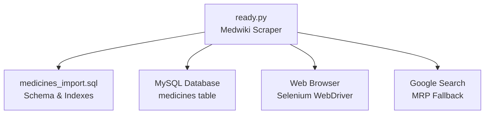
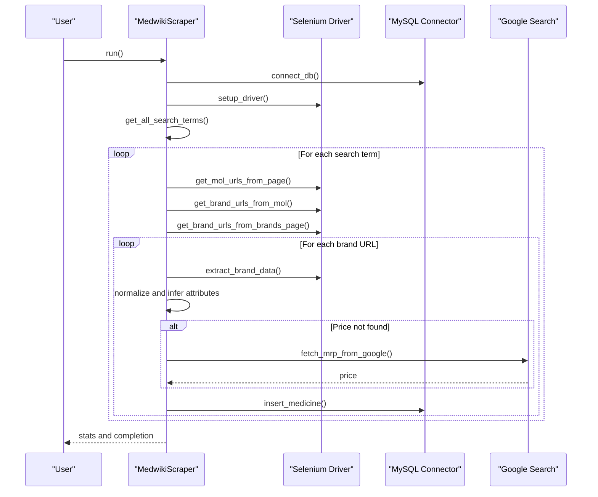
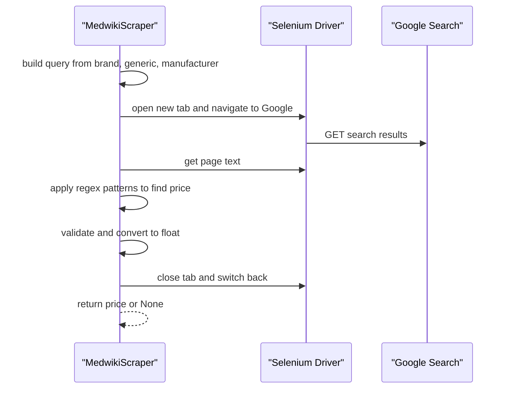
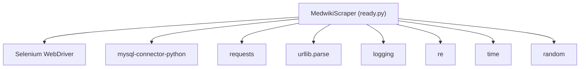

# Data Extraction and Processing

<cite>
**Referenced Files in This Document**
- [ready.py](file://ready.py)
- [medicines_import.sql](file://medicines_import.sql)
</cite>

## Table of Contents
1. [Introduction](#introduction)
2. [Project Structure](#project-structure)
3. [Core Components](#core-components)
4. [Architecture Overview](#architecture-overview)
5. [Detailed Component Analysis](#detailed-component-analysis)
6. [Dependency Analysis](#dependency-analysis)
7. [Performance Considerations](#performance-considerations)
8. [Troubleshooting Guide](#troubleshooting-guide)
9. [Conclusion](#conclusion)

## Introduction
This document describes the data extraction and processing pipeline used to scrape medicine information from a target website and persist it into a structured database. It covers text parsing algorithms for extracting composition, manufacturer, dosage, and other attributes; normalization techniques for text cleaning and value standardization; categorization strategies for therapeutic classes; duplicate prevention mechanisms; and Google search integration for price lookup fallback. The goal is to provide a clear understanding of how raw textual data is transformed into normalized, validated records suitable for downstream applications.

## Project Structure
The project consists of two primary artifacts:
- A Python script that orchestrates browser automation, data extraction, normalization, categorization, and database insertion.
- A SQL script that defines the target database schema and indexes for efficient querying and deduplication.

**Diagram sources**
- [ready.py](file://ready.py)
- [medicines_import.sql](file://medicines_import.sql)

**Section sources**
- [ready.py](file://ready.py)
- [medicines_import.sql](file://medicines_import.sql)

## Core Components
- MedwikiScraper: Orchestrates scraping, parsing, normalization, categorization, and persistence.
- Database connector: Manages MySQL connectivity, schema creation, and deduplication checks.
- Text parsers: Composition, manufacturer, dosage, strength, pack size, schedule, and category classifiers.
- Price fallback: Google search integration to extract MRP when unavailable on the source site.
- Duplicate prevention: Runtime and database-level deduplication keys.

Key responsibilities:
- Navigate to search pages and collect molecule and brand URLs.
- Extract brand-level details from individual pages.
- Normalize extracted values and infer missing attributes.
- Insert records into the medicines table with deduplication safeguards.
- Log statistics and handle errors gracefully.

**Section sources**
- [ready.py](file://ready.py)

## Architecture Overview
The pipeline follows a multi-stage process:
1. Initialize browser and database connections.
2. Generate search terms (single letters and common medical prefixes).
3. Scrape molecule and brand pages to discover brand URLs.
4. For each brand URL, extract and normalize attributes.
5. Infer missing attributes (e.g., form, strength, pack size) using pattern matching.
6. Attempt Google search for MRP if not present on the source.
7. Insert normalized data into the medicines table with deduplication.
8. Track and log statistics; gracefully handle failures.

**Diagram sources**
- [ready.py](file://ready.py)

**Section sources**
- [ready.py](file://ready.py)

## Detailed Component Analysis

### Text Parsing Algorithms
The parser extracts and normalizes key attributes from brand pages using a combination of:
- Line-based scanning with context-aware heuristics.
- Regular expressions for structured pattern matching.
- Fallback inference for missing attributes.

Key parsing strategies:
- Composition parsing: Split active ingredients by separators and extract the first component as the generic name.
- Manufacturer identification: Look for lines containing manufacturer-related keywords and capture the immediately following line.
- Dosage extraction: Capture lines labeled as dosage/dose and clean surrounding text.
- Form inference: Map common textual forms to standardized dosage forms using regex patterns.
- Strength extraction: Detect numeric values followed by units (mg, mcg, ml, g, IU, etc.).
- Pack size detection: Identify quantities and units associated with packaging.
- Schedule classification: Recognize controlled drug schedules using regex patterns.
- Uses and side effects: Collect paragraphs following dedicated sections until encountering other sections.
- How-to-use and storage: Capture instructions and storage conditions near relevant keywords.

Normalization techniques:
- Text cleaning: Replace multiple whitespace with a single space and strip leading/trailing spaces.
- Character encoding: Ensure UTF-8 handling via logging and driver configuration.
- Value standardization: Convert prices to decimals, truncate strings to column limits, and map forms to canonical values.

Validation and error handling:
- Robust page loading with retry and timeout logic.
- Graceful skipping of malformed entries and logging of errors.
- Deduplication checks at runtime and database level.

Examples from the codebase:
- Composition parsing and generic name extraction: [ready.py](file://ready.py)
- Manufacturer identification: [ready.py](file://ready.py)
- Dosage extraction: [ready.py](file://ready.py)
- Form inference patterns: [ready.py](file://ready.py)
- Strength extraction patterns: [ready.py](file://ready.py)
- Pack size detection patterns: [ready.py](file://ready.py)
- Schedule classification patterns: [ready.py](file://ready.py)
- Uses and side effects collection: [ready.py](file://ready.py)
- Text cleaning and trimming: [ready.py](file://ready.py)
- Decimal conversion for prices: [ready.py](file://ready.py)

**Section sources**
- [ready.py](file://ready.py)

### Data Normalization Techniques
Normalization ensures consistent representation across diverse textual sources:
- Whitespace normalization: Collapse multiple spaces into a single space.
- Case-insensitive matching: Apply lowercasing for comparisons and pattern matching.
- Truncation: Enforce column length limits to prevent constraint violations.
- Encoding: Configure UTF-8 for logs and driver operations.
- Decimal standardization: Extract numeric price values and convert to decimal type.

Patterns and functions:
- Cleaning function: [ready.py](file://ready.py)
- Trimming function: [ready.py](file://ready.py)
- Decimal conversion: [ready.py](file://ready.py)

**Section sources**
- [ready.py](file://ready.py)

### Extraction Pattern Strategies
Pattern strategies are tailored to different attributes:

- Name and generic name:
  - Extract from page title or headings.
  - Fallback to URL-derived names when page metadata is unavailable.

- Composition and generic name:
  - Split by separators (+, |, /, ,) and remove numeric strengths to isolate the generic base.

- Manufacturer:
  - Match lines containing manufacturer-related keywords and capture the next meaningful line.

- Dosage and how-to-use:
  - Locate sections with dosage-related keywords and capture the immediately following lines.

- Uses and side effects:
  - Scan for dedicated sections and collect subsequent lines until encountering other sections.

- Form, strength, and pack size:
  - Use regex patterns to identify standardized forms, numeric strengths with units, and pack quantities.

- Schedule:
  - Recognize controlled drug schedules using specific patterns.

- Category classification:
  - Combine name, composition, and uses; apply regex-based categories to infer therapeutic class.

Examples:
- Name extraction from title: [ready.py](file://ready.py)
- Composition splitting and generic extraction: [ready.py](file://ready.py)
- Manufacturer detection: [ready.py](file://ready.py)
- Dosage and how-to-use extraction: [ready.py](file://ready.py)
- Uses and side effects collection: [ready.py](file://ready.py)
- Form inference patterns: [ready.py](file://ready.py)
- Strength extraction patterns: [ready.py](file://ready.py)
- Pack size detection patterns: [ready.py](file://ready.py)
- Schedule classification patterns: [ready.py](file://ready.py)
- Category classification patterns: [ready.py](file://ready.py)

**Section sources**
- [ready.py](file://ready.py)

### Intelligent Parsing Logic
Intelligent parsing handles:
- Inconsistent data presentation: Uses multiple heuristics and fallbacks to maximize coverage.
- Special characters and encoding: Employs UTF-8 logging and driver configuration.
- Context-aware extraction: Captures adjacent lines and stops at section boundaries.
- Controlled drug scheduling: Identifies schedules with flexible spacing and casing.

Examples:
- Context-aware scanning and section boundaries: [ready.py](file://ready.py)
- Flexible schedule recognition: [ready.py](file://ready.py)
- UTF-8 handling in logging and driver: [ready.py](file://ready.py)

**Section sources**
- [ready.py](file://ready.py)

### Google Search Integration for Price Lookup
When MRP is not available on the source site, the system attempts to find pricing via Google search:
- Query construction: Combines brand name, generic name, manufacturer, and a price search term.
- Search execution: Opens a new browser tab, navigates to the constructed query, and waits briefly.
- Result processing: Extracts body text and applies multiple regex patterns to locate price values.
- Price extraction patterns: Matches currency symbols, keywords, and numeric amounts with optional decimals.
- Validation: Filters plausible price ranges and converts to numeric values.
- Cleanup: Closes the Google tab and switches back to the original window.

Examples:
- Query construction: [ready.py](file://ready.py)
- Regex patterns for price extraction: [ready.py](file://ready.py)
- Price validation and conversion: [ready.py](file://ready.py)

**Diagram sources**
- [ready.py](file://ready.py)

**Section sources**
- [ready.py](file://ready.py)

### Categorization System for Therapeutic Classes
The system infers therapeutic categories by combining the medicine name, composition, and uses, then applying regex-based rules:
- Antibiotic, Antihypertensive, Antidiabetic, Analgesic/Antipyretic, Gastrointestinal, Antiallergic, Cardiovascular, Respiratory, Dermatological, Ophthalmic, Vitamin/Supplement, Antiepileptic, Antiviral, Antifungal, Thyroid, Neurological.
- Default category: General Medicine if no pattern matches.

Examples:
- Combined text for categorization: [ready.py](file://ready.py)
- Category regex patterns: [ready.py](file://ready.py)

**Section sources**
- [ready.py](file://ready.py)

### Duplicate Prevention Mechanisms
Duplicate prevention operates at two levels:
- Runtime deduplication: Maintains sets of seen URLs and a composite dedup key built from name, generic name, strength, manufacturer, form, and pack size.
- Database-level deduplication: Preloads existing composite keys from the medicines table to avoid reprocessing.
- Insert-time validation: Skips insertion if the dedup key already exists.

Examples:
- Runtime sets for seen URLs: [ready.py](file://ready.py)
- Composite dedup key construction: [ready.py](file://ready.py)
- Database preload of dedup keys: [ready.py](file://ready.py)
- Insertion with deduplication: [ready.py](file://ready.py)

**Section sources**
- [ready.py](file://ready.py)

### Data Validation Rules and Quality Assurance
Quality assurance measures include:
- Page load validation: Ensures the current URL contains the expected domain and waits for body presence.
- Attribute completeness: Skips entries without essential identifiers (e.g., name).
- Price range validation: Filters out implausible prices during Google search fallback.
- String truncation: Enforces column length limits to satisfy database constraints.
- Decimal conversion: Safely extracts numeric price values and converts to decimal type.
- Logging and statistics: Tracks inserted records, duplicates, and errors for monitoring.

Examples:
- Page load validation: [ready.py](file://ready.py)
- Attribute completeness checks: [ready.py](file://ready.py)
- Price range validation: [ready.py](file://ready.py)
- String truncation: [ready.py](file://ready.py)
- Decimal conversion: [ready.py](file://ready.py)
- Statistics tracking: [ready.py](file://ready.py)

**Section sources**
- [ready.py](file://ready.py)

## Dependency Analysis
The MedwikiScraper depends on external libraries and services:
- Selenium WebDriver for browser automation and page interaction.
- mysql-connector-python for database connectivity and schema management.
- requests for HTTP operations (used indirectly via browser automation).
- urllib.parse for constructing Google search URLs.
- Logging for observability and error tracking.

**Diagram sources**
- [ready.py](file://ready.py)

**Section sources**
- [ready.py](file://ready.py)

## Performance Considerations
- Browser configuration: Maximizes window size, disables unnecessary features, and sets timeouts to improve stability.
- Scroll and wait strategies: Dynamically scrolls to load content and waits for element presence to reduce premature extraction.
- Retry and backoff: Implements retries for page loads and delays between requests to avoid rate limiting.
- Efficient pattern matching: Uses compiled regex patterns and targeted searches to minimize overhead.
- Database batching: Inserts records in batches to reduce round-trips; deduplication checks are performed before inserts.
- Logging efficiency: Writes logs to both file and console with UTF-8 encoding to support international content.

[No sources needed since this section provides general guidance]

## Troubleshooting Guide
Common issues and resolutions:
- Browser setup failures: Verify ChromeDriver installation and compatibility; adjust options for headless vs. visible mode.
- Page load timeouts: Increase timeouts and add retry logic; ensure network connectivity.
- Missing attributes: Confirm that the page structure aligns with expected patterns; adjust regex or heuristics accordingly.
- Price extraction failures: Expand regex patterns to cover more currency formats; validate price ranges.
- Database connection errors: Check credentials and charset settings; ensure the database server is reachable.
- Duplicate insertions: Review deduplication keys and ensure they cover all relevant fields.

**Section sources**
- [ready.py](file://ready.py)

## Conclusion
The data extraction and processing pipeline demonstrates robust techniques for parsing heterogeneous textual data, normalizing values, inferring missing attributes, and integrating external sources for price lookup. Through careful pattern matching, deduplication, and validation, it produces a high-quality dataset suitable for downstream analytics and applications. The modular design allows for incremental improvements to parsing rules, categorization logic, and fallback strategies.