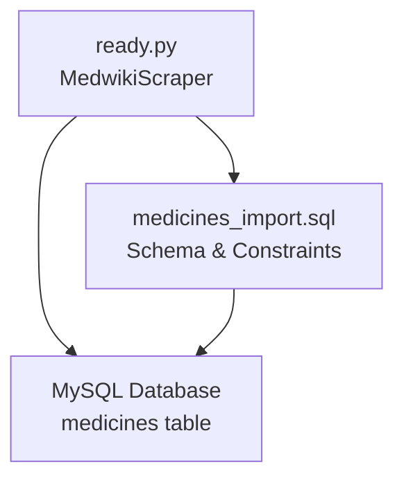
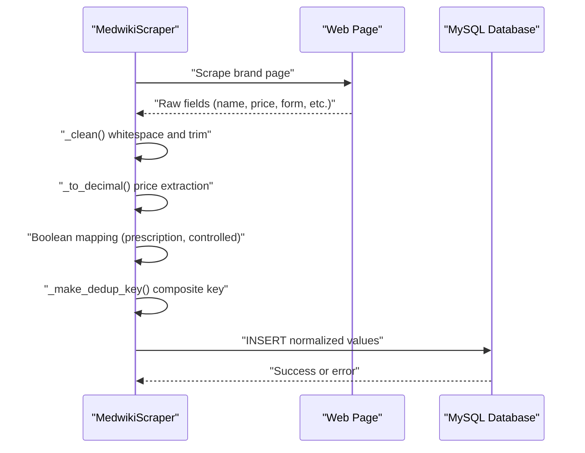
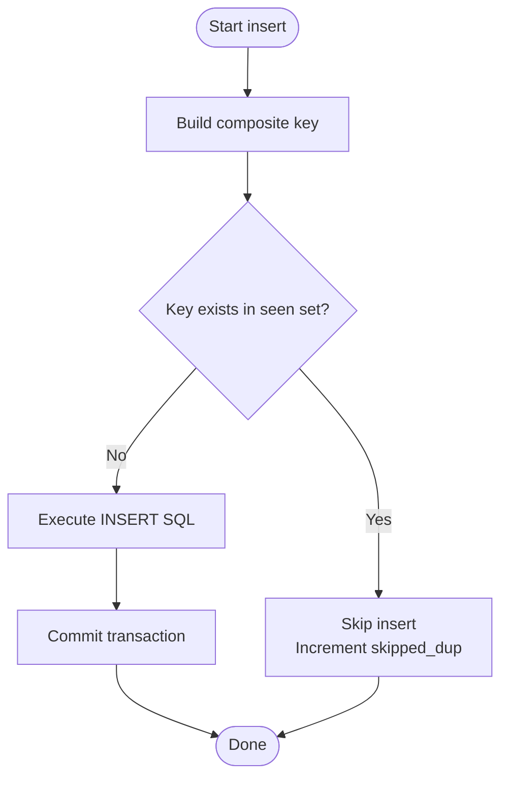
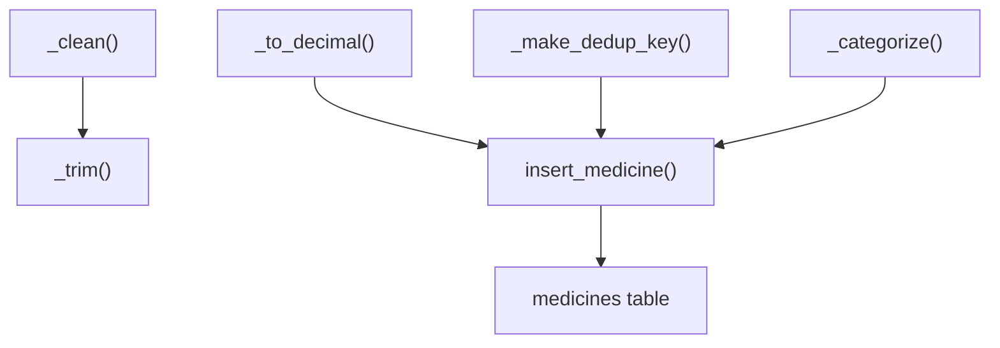

# Data Normalization

<cite>
**Referenced Files in This Document**
- [medicines_import.sql](file://medicines_import.sql)
- [ready.py](file://ready.py)
</cite>

## Table of Contents
1. [Introduction](#introduction)
2. [Project Structure](#project-structure)
3. [Core Components](#core-components)
4. [Architecture Overview](#architecture-overview)
5. [Detailed Component Analysis](#detailed-component-analysis)
6. [Dependency Analysis](#dependency-analysis)
7. [Performance Considerations](#performance-considerations)
8. [Troubleshooting Guide](#troubleshooting-guide)
9. [Conclusion](#conclusion)

## Introduction
This document explains the data normalization processes implemented in the project. It covers text cleaning and standardization, decimal conversion for price normalization, boolean mapping for prescription requirements and schedule classification, categorical data standardization, duplicate key generation using composite identifiers, deduplication validation logic, and quality assurance checks. It also outlines validation patterns for malformed data and performance optimization techniques for large-scale text processing.

## Project Structure
The project consists of:
- A MySQL schema definition that establishes the target table structure and constraints.
- A Python scraper that extracts, normalizes, and inserts medicine data into the database.

**Diagram sources**
- [ready.py:52-780](file://ready.py#L52-L780)
- [medicines_import.sql:15-60](file://medicines_import.sql#L15-L60)

**Section sources**
- [medicines_import.sql:15-60](file://medicines_import.sql#L15-L60)
- [ready.py:52-136](file://ready.py#L52-L136)

## Core Components
- Text cleaning and standardization: Consolidates whitespace and trims strings to fit column length limits.
- Decimal conversion: Extracts numeric price values and converts them to decimals.
- Boolean mapping: Converts textual prescription indicators to tinyint booleans and classifies controlled substances.
- Categorical standardization: Assigns standardized categories based on content heuristics.
- Duplicate detection: Builds composite keys from multiple fields to prevent duplicates.
- Quality assurance: Applies length limits, safe defaults, and validation ranges.

**Section sources**
- [ready.py:138-219](file://ready.py#L138-L219)
- [ready.py:365-404](file://ready.py#L365-L404)
- [ready.py:150-207](file://ready.py#L150-L207)
- [medicines_import.sql:15-45](file://medicines_import.sql#L15-L45)

## Architecture Overview
The normalization pipeline operates during scraping and insertion:
- Extract raw fields from web pages.
- Normalize each field (whitespace, casing, lengths).
- Convert types (decimals, booleans).
- Standardize categorical fields.
- Compute composite duplicate key and check against existing records.
- Insert normalized data into the database.

**Diagram sources**
- [ready.py:365-368](file://ready.py#L365-L368)
- [ready.py:215-219](file://ready.py#L215-L219)
- [ready.py:155-156](file://ready.py#L155-L156)
- [ready.py:138-148](file://ready.py#L138-L148)
- [ready.py:172-195](file://ready.py#L172-L195)

## Detailed Component Analysis

### Text Cleaning and Standardization
Normalization ensures consistent formatting and prevents storage errors:
- Whitespace consolidation: Replaces runs of whitespace with a single space and strips leading/trailing spaces.
- Value trimming: Enforces per-column maximum lengths to match schema constraints.
- Safe defaults: Returns None for empty values to align with nullable schema fields.

Key functions:
- Whitespace consolidation: [_clean:365-368](file://ready.py#L365-L368)
- Length trimming: [_trim:209-213](file://ready.py#L209-L213)

Examples of before/after transformations:
- Before: "  Multiple   spaces  and\n\t tabs  "
- After: "Multiple spaces and tabs"
- Before: "Very long text exceeding column limit..."
- After: Truncated to the column’s maximum length

Normalization rules:
- All string fields are cleaned and trimmed before insertion.
- Null-like values are converted to None for database compatibility.

Quality assurance checks:
- Empty or whitespace-only inputs produce empty strings or None depending on context.
- Length limits prevent truncation beyond column capacity.

**Section sources**
- [ready.py:365-368](file://ready.py#L365-L368)
- [ready.py:209-213](file://ready.py#L209-L213)
- [medicines_import.sql:17-40](file://medicines_import.sql#L17-L40)

### Decimal Conversion for Price Normalization
Price normalization extracts numeric values from mixed-format strings:
- Removes commas and captures the first valid decimal number.
- Converts to float; returns None if no numeric pattern is found.
- Range validation occurs during Google MRP lookup to constrain realistic values.

Key functions:
- Decimal extraction: [_to_decimal:215-219](file://ready.py#L215-L219)
- Google MRP range filtering: [fetch_mrp_from_google:221-277](file://ready.py#L221-L277)

Examples of before/after transformations:
- Before: "₹ 1,299/-"
- After: 1299.0
- Before: "MRP: INR 500"
- After: 500.0
- Before: "No price found"
- After: None

Validation patterns:
- Only digits and optional decimal point are considered.
- Comma removal enables parsing of localized formats.

**Section sources**
- [ready.py:215-219](file://ready.py#L215-L219)
- [ready.py:221-277](file://ready.py#L221-L277)

### String Sanitization for Database Safety
String sanitization focuses on:
- Consistent casing and spacing.
- Enforcing maximum lengths to match schema constraints.
- Returning None for empty values to avoid invalid inserts.

Key functions:
- Cleaning and trimming: [_clean:365-368](file://ready.py#L365-L368), [_trim:209-213](file://ready.py#L209-L213)

Quality assurance checks:
- All string fields are normalized prior to insertion.
- Schema-defined maxima are respected to prevent truncation errors.

**Section sources**
- [ready.py:365-368](file://ready.py#L365-L368)
- [ready.py:209-213](file://ready.py#L209-L213)
- [medicines_import.sql:17-40](file://medicines_import.sql#L17-L40)

### Data Type Conversion Mechanisms

#### Boolean Mapping for Prescription Requirements
Prescription requirement is mapped to a tinyint boolean:
- "No" (case-insensitive) becomes 0.
- Any other value (including missing) becomes 1.

Key logic:
- [insert_medicine:150-207](file://ready.py#L150-L207) sets requires_prescription based on the field.

Validation patterns:
- Case-insensitive comparison.
- Defaults to 1 when unspecified.

**Section sources**
- [ready.py:155-156](file://ready.py#L155-L156)

#### Schedule Classification
Schedule classification determines controlled substance flags:
- Controlled schedules (e.g., X, H1) set is_controlled to 1; otherwise 0.
- Standardizes schedule text to canonical forms.

Key functions:
- Controlled flag: [insert_medicine:150-207](file://ready.py#L150-L207)
- Canonical schedule extraction: [_extract_schedule:370-379](file://ready.py#L370-L379)

Examples of before/after transformations:
- Before: "Schedule H1"
- After: "Schedule H1" (stored as schedule), is_controlled = 1
- Before: "Schedule X"
- After: "Schedule X" (stored as schedule), is_controlled = 1

**Section sources**
- [ready.py:155](file://ready.py#L155)
- [ready.py:370-379](file://ready.py#L370-L379)

#### Categorical Data Standardization
Categories are inferred from the medicine name, composition, and uses:
- Heuristic patterns match known drug families and therapeutic areas.
- Defaults to "General Medicine" if no pattern matches.

Key function:
- Category inference: [_categorize:381-404](file://ready.py#L381-L404)

Examples of before/after transformations:
- Before: "Amoxicillin 500mg Capsules"
- After: "Antibiotic"
- Before: "Salbutamol Inhaler"
- After: "Respiratory"

Validation patterns:
- Case-insensitive pattern matching.
- Combined text increases confidence in categorization.

**Section sources**
- [ready.py:381-404](file://ready.py#L381-L404)

### Duplicate Key Generation and Deduplication Validation
Duplicate detection prevents redundant inserts by building a composite key:
- Composite key includes name, generic_name, strength, manufacturer, dosage_form, and pack_size.
- Keys are lowercased and joined with a delimiter for consistent comparison.
- Existing keys are preloaded from the database to support runtime deduplication.

Key functions:
- Composite key builder: [_make_dedup_key:138-148](file://ready.py#L138-L148)
- Runtime deduplication: [connect_db:118-132](file://ready.py#L118-L132), [insert_medicine:150-207](file://ready.py#L150-L207)

Flow of duplicate validation:

**Diagram sources**
- [ready.py:138-148](file://ready.py#L138-L148)
- [ready.py:166-170](file://ready.py#L166-L170)
- [ready.py:172-195](file://ready.py#L172-L195)

**Section sources**
- [ready.py:118-132](file://ready.py#L118-L132)
- [ready.py:138-148](file://ready.py#L138-L148)
- [ready.py:150-207](file://ready.py#L150-L207)

### Schema-Level Normalization and Constraints
The database schema defines:
- Column sizes and collations to enforce storage limits and sorting behavior.
- Boolean flags for controlled/narcotic/prescription requirements.
- Indexes to optimize search and deduplication.
- Unique constraints to prevent primary duplicates.

Key schema elements:
- String columns with explicit max lengths.
- Tinyint booleans for flags.
- Indexes on frequently queried columns.

**Section sources**
- [medicines_import.sql:15-60](file://medicines_import.sql#L15-L60)

## Dependency Analysis
The normalization logic depends on:
- Regex patterns for text extraction and cleaning.
- Database schema constraints for trimming and validation.
- Runtime deduplication set for composite-key checks.

**Diagram sources**
- [ready.py:365-368](file://ready.py#L365-L368)
- [ready.py:209-213](file://ready.py#L209-L213)
- [ready.py:215-219](file://ready.py#L215-L219)
- [ready.py:138-148](file://ready.py#L138-L148)
- [ready.py:381-404](file://ready.py#L381-L404)
- [ready.py:150-207](file://ready.py#L150-L207)
- [medicines_import.sql:15-60](file://medicines_import.sql#L15-L60)

**Section sources**
- [ready.py:138-219](file://ready.py#L138-L219)
- [medicines_import.sql:15-60](file://medicines_import.sql#L15-L60)

## Performance Considerations
- Regex-based cleaning and extraction are efficient for typical page sizes.
- Preloading existing composite keys reduces repeated database queries for deduplication.
- Batch-like processing by iterating over search terms minimizes overhead.
- Randomized delays reduce server-side blocking and improve robustness.
- Using a single connection and committing per record balances safety and throughput.

[No sources needed since this section provides general guidance]

## Troubleshooting Guide
Common issues and resolutions:
- Malformed price strings: [_to_decimal:215-219](file://ready.py#L215-L219) returns None when no numeric pattern is found; handle gracefully by skipping or retrying.
- Empty or missing fields: [_clean:365-368](file://ready.py#L365-L368) and [_trim:209-213](file://ready.py#L209-L213) normalize to safe defaults; ensure downstream logic handles None appropriately.
- Duplicate inserts: [_make_dedup_key:138-148](file://ready.py#L138-L148) and runtime set prevent duplicates; verify composite key logic matches intended uniqueness criteria.
- Database errors: [insert_medicine:150-207](file://ready.py#L150-L207) logs errors and rolls back; inspect logs for constraint violations or connectivity issues.
- Google MRP lookup failures: [fetch_mrp_from_google:221-277](file://ready.py#L221-L277) includes timeouts and fallbacks; adjust retry logic if needed.

**Section sources**
- [ready.py:215-219](file://ready.py#L215-L219)
- [ready.py:365-368](file://ready.py#L365-L368)
- [ready.py:209-213](file://ready.py#L209-L213)
- [ready.py:138-148](file://ready.py#L138-L148)
- [ready.py:150-207](file://ready.py#L150-L207)
- [ready.py:221-277](file://ready.py#L221-L277)

## Conclusion
The project implements a robust normalization pipeline that cleans and standardizes text, converts prices to decimals, maps booleans for controlled substances and prescriptions, infers categories, and prevents duplicates using composite keys. Together with schema constraints and runtime checks, these mechanisms ensure data integrity and performance at scale.