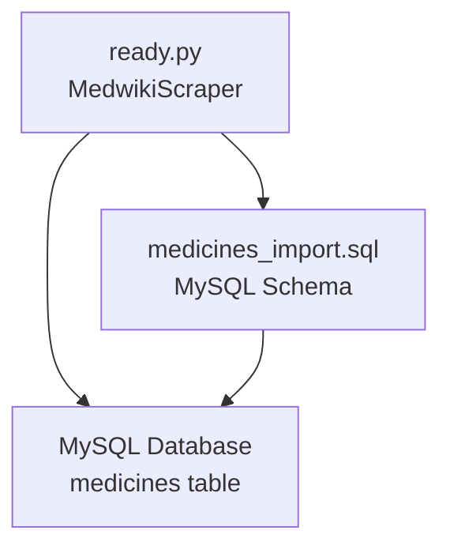
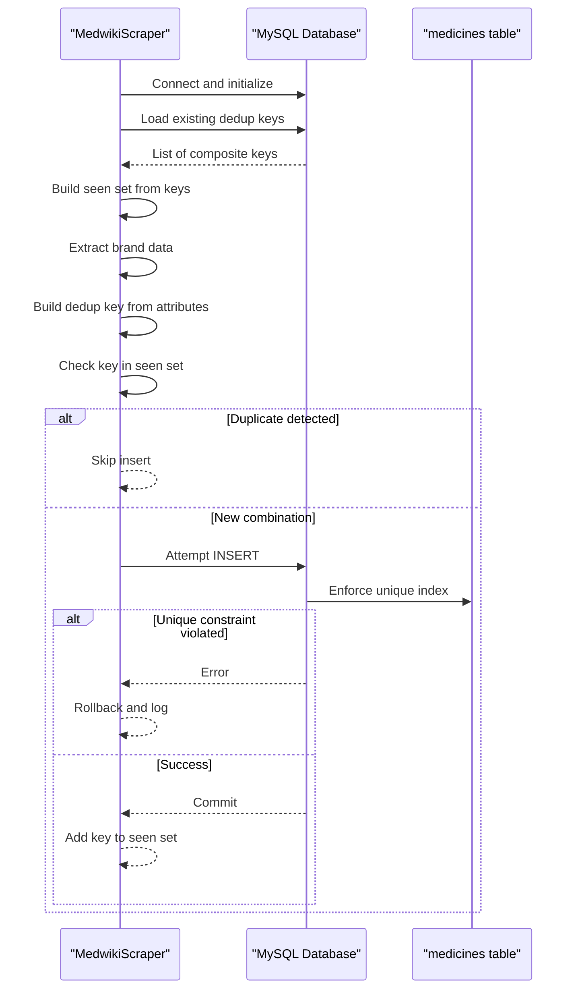
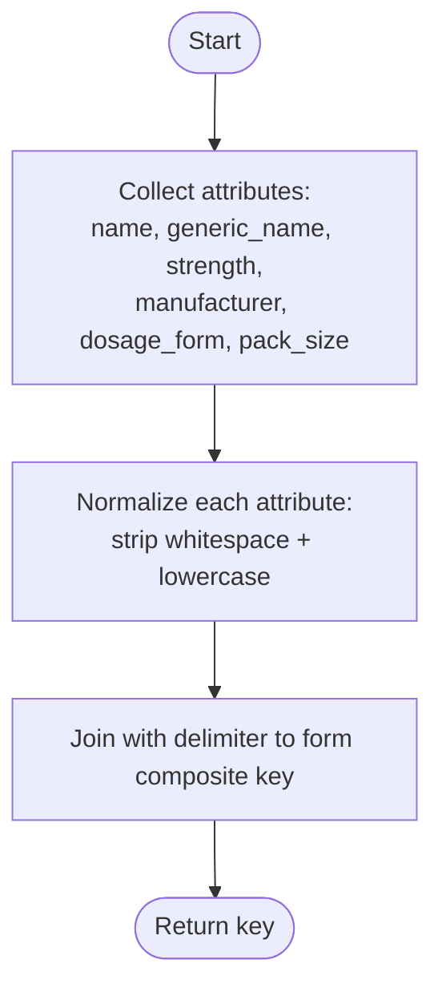
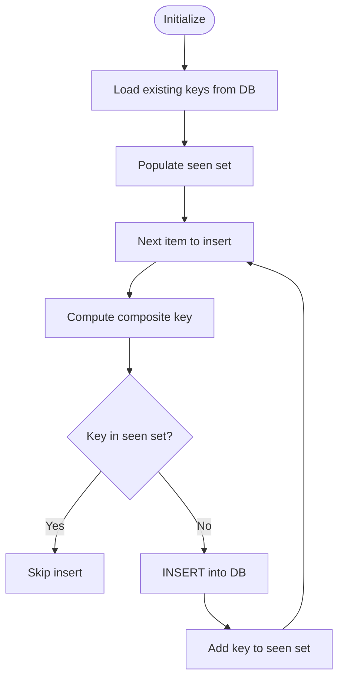
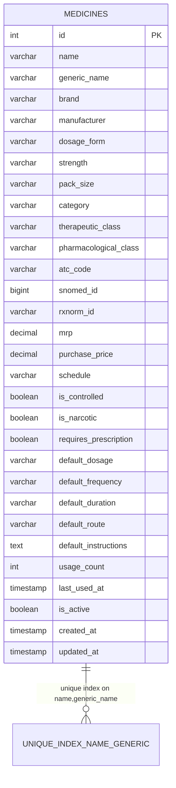
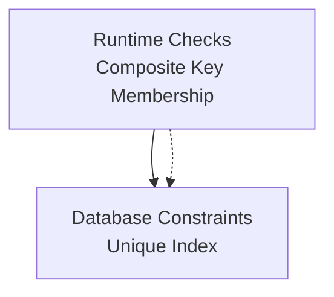
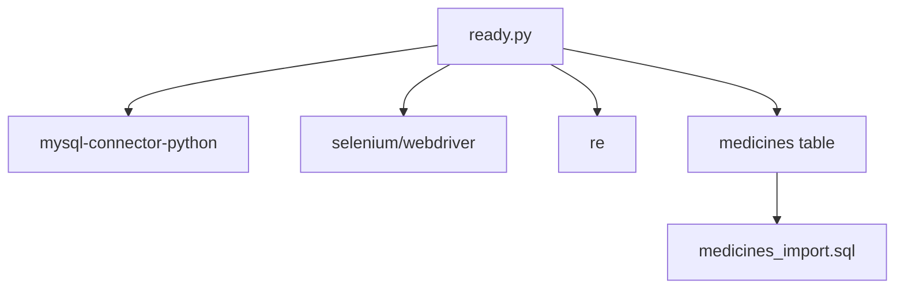

# Duplicate Prevention

<cite>
**Referenced Files in This Document**
- [medicines_import.sql](file://medicines_import.sql)
- [ready.py](file://ready.py)
</cite>

## Table of Contents
1. [Introduction](#introduction)
2. [Project Structure](#project-structure)
3. [Core Components](#core-components)
4. [Architecture Overview](#architecture-overview)
5. [Detailed Component Analysis](#detailed-component-analysis)
6. [Dependency Analysis](#dependency-analysis)
7. [Performance Considerations](#performance-considerations)
8. [Troubleshooting Guide](#troubleshooting-guide)
9. [Conclusion](#conclusion)

## Introduction
This document explains the duplicate prevention system used by the Medwiki scraper to ensure that identical or near-identical medicines are not inserted into the database. It covers:
- Composite key generation from multiple medicine attributes
- Runtime deduplication tracking
- Database-level uniqueness constraints
- Dual-layer deduplication strategy combining runtime checks and database constraints
- Case-insensitive matching and partial key scenarios
- Examples of duplicate scenarios prevented
- Statistical impact on data quality
- Performance considerations and optimization techniques

## Project Structure
The project consists of two primary artifacts:
- A MySQL schema definition that declares the medicines table and its indexes
- A Python scraper that extracts data from a website and inserts it into the database while preventing duplicates

**Diagram sources**
- [ready.py:67-116](file://ready.py#L67-L116)
- [medicines_import.sql:15-60](file://medicines_import.sql#L15-L60)

**Section sources**
- [ready.py:67-116](file://ready.py#L67-L116)
- [medicines_import.sql:15-60](file://medicines_import.sql#L15-L60)

## Core Components
- Deduplication key construction: A composite key is built from name, generic name, strength, manufacturer, dosage form, and pack size. The key is normalized to lowercase and stripped of whitespace, then joined with a delimiter to form a single string used for hashing.
- Runtime deduplication tracking: A set stores dedup keys for all previously seen combinations, enabling O(1) average-time duplicate checks before insertion.
- Database-level uniqueness constraints: A unique index enforces uniqueness on name and generic_name to prevent duplicates at the database level.
- Dual-layer strategy: Runtime checks prevent duplicates before attempting inserts; database constraints act as a safety net to catch edge cases.

Key implementation references:
- Deduplication key construction: [ready.py:138-148](file://ready.py#L138-L148)
- Runtime dedup tracking initialization: [ready.py:118-130](file://ready.py#L118-L130)
- Runtime insert check: [ready.py:165-170](file://ready.py#L165-L170)
- Unique index definition: [ready.py:105](file://ready.py#L105)
- Database schema (indexes): [medicines_import.sql:46-59](file://medicines_import.sql#L46-L59)

**Section sources**
- [ready.py:118-148](file://ready.py#L118-L148)
- [ready.py:165-170](file://ready.py#L165-L170)
- [ready.py:105](file://ready.py#L105)
- [medicines_import.sql:46-59](file://medicines_import.sql#L46-L59)

## Architecture Overview
The duplicate prevention system operates in a dual-layer pipeline:
- Pre-insertion runtime checks using a composite key stored in memory
- Database constraints to enforce uniqueness

**Diagram sources**
- [ready.py:118-130](file://ready.py#L118-L130)
- [ready.py:138-148](file://ready.py#L138-L148)
- [ready.py:165-170](file://ready.py#L165-L170)
- [ready.py:172-199](file://ready.py#L172-L199)
- [ready.py:105](file://ready.py#L105)

## Detailed Component Analysis

### Composite Key Generation Algorithm
The composite key combines six attributes:
- name
- generic_name
- strength
- manufacturer
- dosage_form
- pack_size

Normalization steps:
- Convert to lowercase
- Strip leading/trailing whitespace
- Join with a delimiter to form a single string

This ensures case-insensitive matching and consistent ordering of attributes.

**Diagram sources**
- [ready.py:138-148](file://ready.py#L138-L148)

**Section sources**
- [ready.py:138-148](file://ready.py#L138-L148)

### Runtime Deduplication Tracking
- On startup, the scraper loads all existing composite keys from the database and populates an in-memory set.
- Before inserting a new record, the scraper computes the composite key and checks membership in the set.
- If present, the record is skipped; otherwise, it is inserted and the key is added to the set.

**Diagram sources**
- [ready.py:118-130](file://ready.py#L118-L130)
- [ready.py:165-170](file://ready.py#L165-L170)

**Section sources**
- [ready.py:118-130](file://ready.py#L118-L130)
- [ready.py:165-170](file://ready.py#L165-L170)

### Database-Level Uniqueness Constraints
- A unique index is defined on name and generic_name to prevent duplicates at the database level.
- The scraper’s runtime checks are designed to cover a broader set of attributes (including strength, manufacturer, dosage form, and pack size), but the unique index acts as a safety net.

**Diagram sources**
- [ready.py:105](file://ready.py#L105)
- [medicines_import.sql:15-60](file://medicines_import.sql#L15-L60)

**Section sources**
- [ready.py:105](file://ready.py#L105)
- [medicines_import.sql:15-60](file://medicines_import.sql#L15-L60)

### Dual-Layer Deduplication Strategy
- Layer 1 (runtime): Composite key checks prevent duplicates before any database write.
- Layer 2 (database): Unique index prevents duplicates that slip through runtime checks.

Benefits:
- Prevents wasted writes and reduces database load
- Acts as a safety net against edge cases

**Diagram sources**
- [ready.py:118-130](file://ready.py#L118-L130)
- [ready.py:165-170](file://ready.py#L165-L170)
- [ready.py:105](file://ready.py#L105)

**Section sources**
- [ready.py:118-130](file://ready.py#L118-L130)
- [ready.py:165-170](file://ready.py#L165-L170)
- [ready.py:105](file://ready.py#L105)

### Case-Insensitive Matching and Partial Key Matching
- Case-insensitivity: All attributes are lowercased before joining, ensuring “Paracetamol” and “paracetamol” are treated identically.
- Partial key matching: The runtime key includes six attributes, while the database unique index only covers two. This means:
  - Runtime checks are stricter and prevent duplicates across multiple attributes
  - Database constraints still protect against duplicates on name and generic_name alone

Implications:
- Reduces false positives from partial matches
- Ensures robustness even if some attributes vary slightly

**Section sources**
- [ready.py:138-148](file://ready.py#L138-L148)
- [ready.py:105](file://ready.py#L105)

### Examples of Duplicate Scenarios Prevented
- Identical brand entries with the same name, generic name, strength, manufacturer, dosage form, and pack size are skipped on subsequent visits.
- Variations in capitalization (e.g., mixed case) are normalized and treated as duplicates.
- Records with different values in attributes not included in the unique index (e.g., different pack sizes) are considered distinct at runtime, but still protected by the unique index if name and generic_name match.

**Section sources**
- [ready.py:138-148](file://ready.py#L138-L148)
- [ready.py:165-170](file://ready.py#L165-L170)
- [ready.py:105](file://ready.py#L105)

### Statistical Impact on Data Quality
- The scraper maintains statistics for inserted records, skipped duplicates, and errors, enabling measurement of deduplication effectiveness.
- The presence of both runtime and database constraints minimizes duplicate ingestion and improves dataset integrity.

**Section sources**
- [ready.py:61-64](file://ready.py#L61-L64)
- [ready.py:757-766](file://ready.py#L757-L766)

## Dependency Analysis
- The scraper depends on:
  - MySQL connector for database operations
  - Selenium for web scraping
  - Regular expressions for parsing and normalization
- The medicines table schema defines indexes and constraints that support deduplication.

**Diagram sources**
- [ready.py:23-29](file://ready.py#L23-L29)
- [ready.py:5](file://ready.py#L5)
- [ready.py:105](file://ready.py#L105)
- [medicines_import.sql:15-60](file://medicines_import.sql#L15-L60)

**Section sources**
- [ready.py:23-29](file://ready.py#L23-L29)
- [ready.py:5](file://ready.py#L5)
- [ready.py:105](file://ready.py#L105)
- [medicines_import.sql:15-60](file://medicines_import.sql#L15-L60)

## Performance Considerations
- Memory footprint: The seen set grows with the number of unique combinations. For large datasets, consider periodic cleanup or external storage if memory becomes constrained.
- Hash-based lookups: Using a set for membership testing provides O(1) average-case performance for duplicate checks.
- Database round-trips: Loading existing keys once at startup avoids repeated scans during runtime.
- Index selection: The unique index on name and generic_name helps enforce integrity quickly, but the composite key approach provides broader protection.

Optimization techniques:
- Batch processing: Group inserts to reduce transaction overhead.
- Incremental loading: Load keys incrementally if the dataset is extremely large.
- Monitoring: Track stats to identify hotspots and adjust strategies.

[No sources needed since this section provides general guidance]

## Troubleshooting Guide
Common issues and resolutions:
- Duplicate insert errors: Occur when the unique index is violated. The scraper logs and rolls back the transaction.
- Connection failures: The scraper attempts to install the MySQL connector automatically and logs connection errors.
- Web scraping timeouts: The scraper retries and scrolls to load dynamic content.

Operational indicators:
- Skipped duplicates: Incremented when a composite key is already present in the seen set.
- Errors: Incremented for database and extraction errors.

**Section sources**
- [ready.py:200-207](file://ready.py#L200-L207)
- [ready.py:134-136](file://ready.py#L134-L136)
- [ready.py:339-347](file://ready.py#L339-L347)
- [ready.py:61-64](file://ready.py#L61-L64)
- [ready.py:757-766](file://ready.py#L757-L766)

## Conclusion
The duplicate prevention system combines a composite key approach with runtime and database-level safeguards. The composite key ensures strict duplicate detection across multiple attributes, while the unique index provides a reliable fallback. Together, they improve data quality, reduce redundant writes, and scale effectively for large datasets.