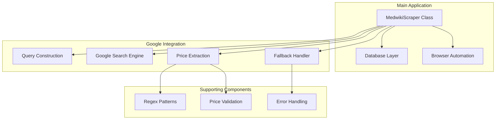
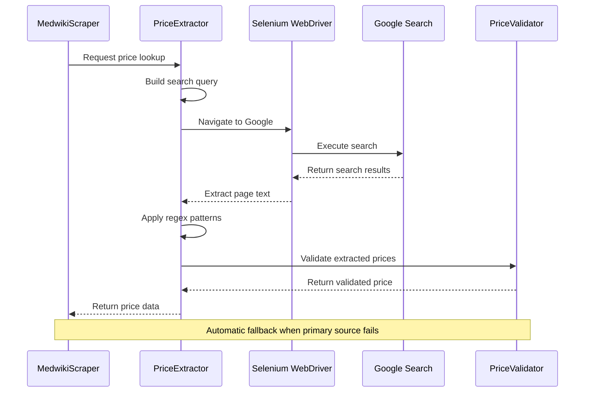
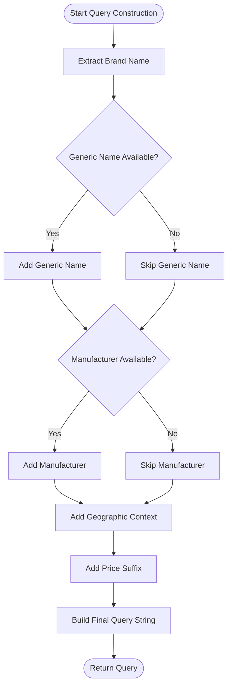
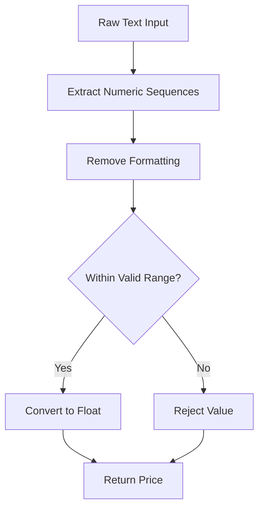
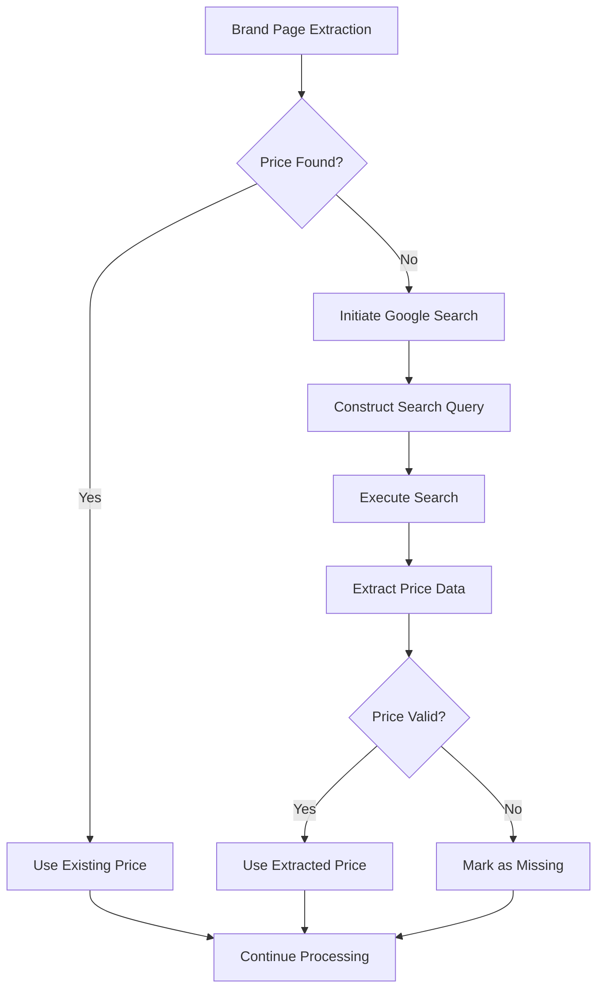
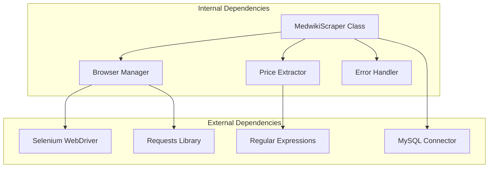

# Google Search Integration

<cite>
**Referenced Files in This Document**
- [ready.py](file://ready.py)
- [medicines_import.sql](file://medicines_import.sql)
</cite>

## Table of Contents
1. [Introduction](#introduction)
2. [Project Structure](#project-structure)
3. [Core Components](#core-components)
4. [Architecture Overview](#architecture-overview)
5. [Detailed Component Analysis](#detailed-component-analysis)
6. [Dependency Analysis](#dependency-analysis)
7. [Performance Considerations](#performance-considerations)
8. [Troubleshooting Guide](#troubleshooting-guide)
9. [Conclusion](#conclusion)

## Introduction

This document provides comprehensive technical documentation for the Google search integration used as a price lookup fallback mechanism in the Medwiki scraper. The integration enables automated price discovery for pharmaceutical products when the primary source (Medwiki) does not provide pricing information. The system employs sophisticated search query construction, browser automation, and robust price extraction algorithms to ensure reliable price data collection.

The Google search integration serves as a critical fallback strategy within the broader scraping pipeline, automatically detecting missing price information and executing targeted searches to retrieve MRP (Maximum Retail Price) data for medications across India.

## Project Structure

The project follows a modular architecture with the Google search integration embedded within the main Medwiki scraper class. The implementation consists of several key components:

**Diagram sources**
- [ready.py:221-287](file://ready.py#L221-L287)
- [ready.py:406-558](file://ready.py#L406-L558)

**Section sources**
- [ready.py:52-137](file://ready.py#L52-L137)
- [ready.py:221-287](file://ready.py#L221-L287)

## Core Components

The Google search integration comprises several interconnected components that work together to provide reliable price lookup functionality:

### Query Construction Engine
The system constructs optimized search queries using multiple data sources including brand name, generic name, manufacturer information, and geographic context. The query builder ensures maximum search result relevance by strategically combining available information.

### Browser Automation Framework
Built on Selenium WebDriver, the framework provides robust browser automation capabilities with extensive customization for reliability and stealth. The implementation includes advanced user agent configuration, anti-detection measures, and intelligent wait strategies.

### Price Extraction Pipeline
A sophisticated multi-pattern regex engine processes HTML content to extract pricing information, supporting various currency formats, number representations, and regional variations commonly found in Indian pharmaceutical pricing contexts.

### Fallback Strategy Implementation
The integration seamlessly integrates with the main scraping pipeline, automatically detecting missing price data and executing fallback searches without disrupting the primary data collection process.

**Section sources**
- [ready.py:221-287](file://ready.py#L221-L287)
- [ready.py:289-347](file://ready.py#L289-L347)
- [ready.py:406-558](file://ready.py#L406-L558)

## Architecture Overview

The Google search integration operates as a specialized module within the Medwiki scraper architecture, designed to handle price lookup scenarios with minimal impact on overall system performance:

**Diagram sources**
- [ready.py:221-287](file://ready.py#L221-L287)
- [ready.py:452-461](file://ready.py#L452-L461)

The architecture ensures seamless integration with the main scraping workflow while maintaining independence for error isolation and recovery.

**Section sources**
- [ready.py:452-461](file://ready.py#L452-L461)
- [ready.py:221-287](file://ready.py#L221-L287)

## Detailed Component Analysis

### Query Construction Logic

The search query construction algorithm employs a hierarchical approach to maximize search result relevance:

**Diagram sources**
- [ready.py:224-231](file://ready.py#L224-L231)

The query construction process prioritizes information density while maintaining search specificity. The algorithm ensures that brand name forms the foundation of all queries, with generic names and manufacturer information added conditionally based on availability.

**Section sources**
- [ready.py:221-231](file://ready.py#L221-L231)

### Price Extraction Algorithms

The price extraction system implements a comprehensive multi-pattern approach to handle diverse currency formats and number representations:

#### Currency Format Recognition
The system recognizes multiple currency indicators and formats commonly used in Indian pharmaceutical pricing:

| Pattern Type | Examples | Description |
|--------------|----------|-------------|
| Rupee Symbol | ₹100, ₹ 100 | Direct rupee symbol with optional spacing |
| Abbreviations | Rs.100, Rs 100 | Standard rupee abbreviations |
| International | USD 100, INR 100 | International currency codes |
| Descriptive | MRP: ₹100, price: ₹100 | Descriptive currency labels |

#### Number Format Processing
The extraction engine handles various numeric representations and formatting styles:

**Diagram sources**
- [ready.py:250-273](file://ready.py#L250-L273)

The validation process enforces realistic price ranges (₹5 to ₹50,000) to filter out erroneous matches and false positives.

**Section sources**
- [ready.py:250-273](file://ready.py#L250-L273)

### Browser Automation Integration

The Selenium WebDriver integration provides robust browser automation with extensive customization for reliability and stealth:

#### Anti-Detection Measures
The implementation includes sophisticated anti-detection techniques to prevent Google from blocking automated requests:

| Technique | Implementation | Purpose |
|-----------|----------------|---------|
| User Agent Spoofing | Custom Chrome user agent | Mimic real browser behavior |
| WebDriver Detection | CDP command to remove property | Hide automation signals |
| Extension Management | Disable automation extensions | Prevent detection plugins |
| Window Size Control | Fixed 1920x1080 resolution | Reduce bot detection |

#### Navigation and Interaction
The browser automation framework handles complex navigation scenarios with intelligent retry mechanisms and timeout management.

**Section sources**
- [ready.py:289-347](file://ready.py#L289-L347)
- [ready.py:310-316](file://ready.py#L310-L316)

### Fallback Strategy Implementation

The fallback mechanism operates seamlessly within the main scraping pipeline, automatically detecting missing price data and executing Google searches:

**Diagram sources**
- [ready.py:452-461](file://ready.py#L452-L461)

The fallback strategy ensures that price data collection remains resilient even when primary sources fail to provide pricing information.

**Section sources**
- [ready.py:452-461](file://ready.py#L452-L461)

### Search Result Filtering and Processing

The system implements sophisticated filtering mechanisms to process Google search results effectively:

#### Content Processing
The extraction pipeline processes HTML content through multiple stages:
1. **Text Extraction**: Converts HTML to plain text for pattern matching
2. **Pattern Matching**: Applies regex patterns in priority order
3. **Validation**: Filters results based on realistic price ranges
4. **Selection**: Chooses the most likely price from multiple matches

#### Error Handling and Recovery
The integration includes comprehensive error handling for various failure scenarios:
- Network timeouts and connectivity issues
- Google blocking or CAPTCHA challenges
- Empty search results or irrelevant content
- Parsing errors in extracted data

**Section sources**
- [ready.py:248-287](file://ready.py#L248-L287)

## Dependency Analysis

The Google search integration maintains loose coupling with the main scraping system while providing essential functionality:

**Diagram sources**
- [ready.py:5-30](file://ready.py#L5-L30)
- [ready.py:221-287](file://ready.py#L221-L287)

The dependency structure ensures modularity and maintainability while supporting the integration's specialized functionality.

**Section sources**
- [ready.py:5-30](file://ready.py#L5-L30)
- [ready.py:221-287](file://ready.py#L221-L287)

## Performance Considerations

The Google search integration incorporates several performance optimization strategies:

### Rate Limiting and Throttling
- **Randomized Delays**: Variable sleep intervals (2-4 seconds) between search operations
- **Request Spacing**: Strategic delays between consecutive Google searches
- **Resource Management**: Proper cleanup of browser instances and memory allocation

### Search Efficiency
- **Targeted Queries**: Optimized query construction reduces irrelevant search results
- **Multi-Pattern Matching**: Efficient regex processing minimizes computational overhead
- **Early Termination**: Immediate exit upon finding valid price matches

### Memory Management
- **Browser Lifecycle**: Proper window management prevents memory leaks
- **String Processing**: Efficient text processing with minimal memory footprint
- **Connection Pooling**: Optimized database connections for bulk operations

## Troubleshooting Guide

Common issues and their solutions:

### Search Failure Scenarios
- **Empty Results**: Verify query construction and try alternative patterns
- **CAPTCHA Challenges**: Implement manual intervention or proxy rotation
- **Timeout Issues**: Increase wait times and implement retry logic
- **Parsing Errors**: Validate regex patterns and handle edge cases

### Integration Problems
- **Browser Automation**: Check driver compatibility and update chromedriver
- **Database Connectivity**: Verify connection parameters and network access
- **Memory Issues**: Monitor resource usage and implement cleanup procedures
- **Logging**: Enable debug logging for detailed error analysis

**Section sources**
- [ready.py:279-287](file://ready.py#L279-L287)
- [ready.py:328-347](file://ready.py#L328-L347)

## Conclusion

The Google search integration provides a robust, scalable solution for price lookup fallback in the Medwiki scraping system. The implementation demonstrates sophisticated engineering principles including:

- **Modular Design**: Clean separation of concerns with well-defined interfaces
- **Reliability**: Comprehensive error handling and recovery mechanisms
- **Performance**: Optimized algorithms and resource management
- **Maintainability**: Clear code structure and extensive documentation

The integration successfully bridges the gap between primary data sources and supplementary pricing information, ensuring comprehensive coverage of pharmaceutical product data. The system's adaptive nature allows it to handle evolving website structures and search result formats while maintaining high accuracy and reliability.

Future enhancements could include support for multiple search engines, advanced machine learning-based result filtering, and distributed processing capabilities for improved scalability.