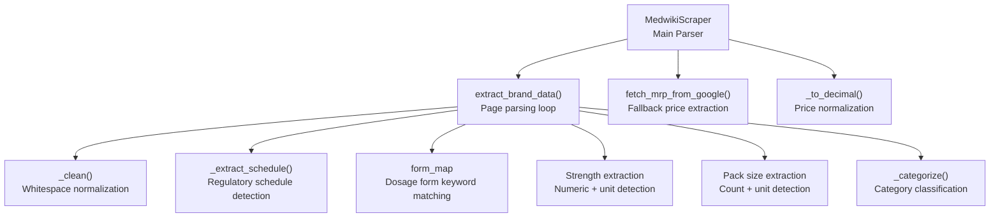
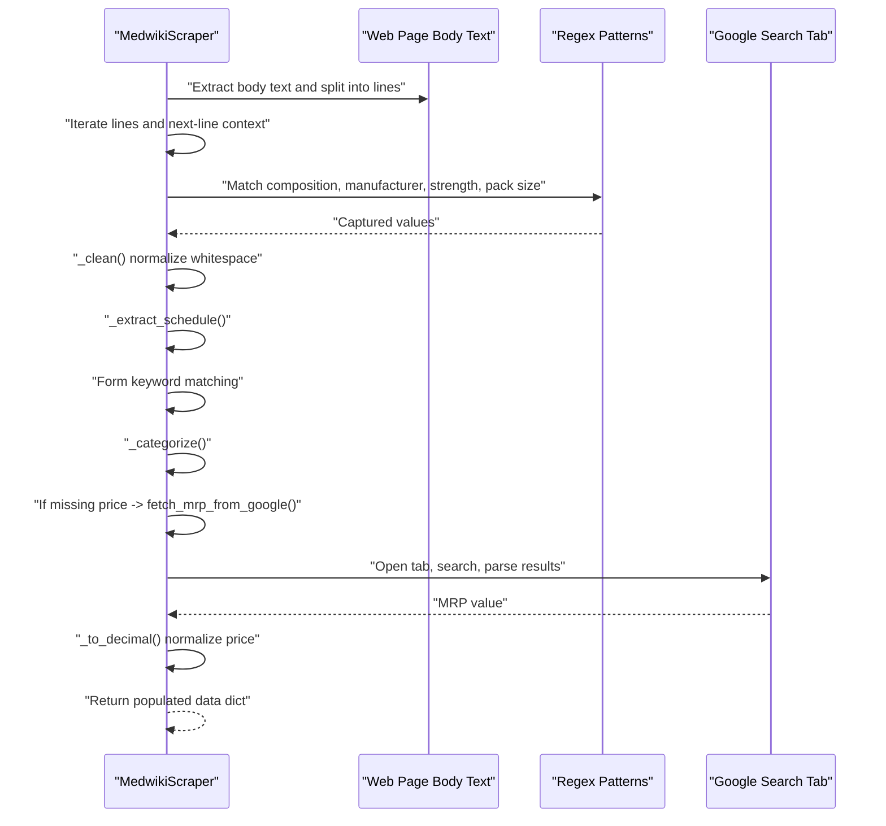
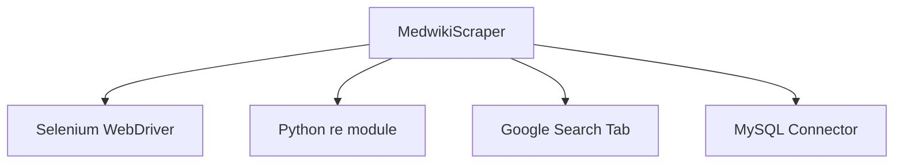

# Text Parsing Algorithms

<cite>
**Referenced Files in This Document**
- [ready.py](file://ready.py)
- [medicines_import.sql](file://medicines_import.sql)
</cite>

## Table of Contents
1. [Introduction](#introduction)
2. [Project Structure](#project-structure)
3. [Core Components](#core-components)
4. [Architecture Overview](#architecture-overview)
5. [Detailed Component Analysis](#detailed-component-analysis)
6. [Dependency Analysis](#dependency-analysis)
7. [Performance Considerations](#performance-considerations)
8. [Troubleshooting Guide](#troubleshooting-guide)
9. [Conclusion](#conclusion)

## Introduction
This document explains the text parsing algorithms used to extract medicine information from web pages. It focuses on:
- Composition parsing with salt separation
- Manufacturer identification through pattern matching
- Dosage extraction using numeric and unit detection
- Text cleaning functions (whitespace normalization, encoding handling, special character removal)
- Multi-line parsing logic for structured text layouts
- Fallback mechanisms for missing information
- Pattern matching strategies for name extraction, strength parsing, and form identification
- Edge cases and troubleshooting guidance

## Project Structure
The repository contains a single Python script responsible for scraping, parsing, and saving medicine data to a MySQL database. The relevant parsing logic resides in the MedwikiScraper class and its methods.

**Diagram sources**
- [ready.py:406-558](file://ready.py#L406-L558)
- [ready.py:221-287](file://ready.py#L221-L287)
- [ready.py:365-368](file://ready.py#L365-L368)
- [ready.py:370-379](file://ready.py#L370-L379)

**Section sources**
- [ready.py:406-558](file://ready.py#L406-L558)
- [ready.py:221-287](file://ready.py#L221-L287)
- [ready.py:365-368](file://ready.py#L365-L368)
- [ready.py:370-379](file://ready.py#L370-L379)

## Core Components
- Text cleaning: Normalizes whitespace and trims text uniformly.
- Composition parsing: Splits multi-salt compositions and extracts the first salt as the generic name.
- Manufacturer identification: Matches common labels and captures the next line as manufacturer.
- Strength extraction: Detects numeric values followed by units (mg, mcg, ml, gm, g, %, IU, units).
- Pack size extraction: Detects counts and container units (tablet, capsule, ml, gm, strip, bottle, vial).
- Form identification: Keyword-based matching against a predefined form map.
- Category classification: Heuristic categorization based on keywords in name, composition, and uses.
- Fallback mechanisms: Uses Google search to extract MRP when not present on the target site.

**Section sources**
- [ready.py:406-558](file://ready.py#L406-L558)
- [ready.py:365-368](file://ready.py#L365-L368)
- [ready.py:370-379](file://ready.py#L370-L379)
- [ready.py:221-287](file://ready.py#L221-L287)

## Architecture Overview
The parser operates in two stages:
1. Page parsing: Iterates through lines, applies keyword and regex heuristics, and populates a dictionary of fields.
2. Fallback enrichment: Attempts to enrich missing fields (e.g., price) using external sources.

**Diagram sources**
- [ready.py:406-558](file://ready.py#L406-L558)
- [ready.py:221-287](file://ready.py#L221-L287)
- [ready.py:365-368](file://ready.py#L365-L368)
- [ready.py:370-379](file://ready.py#L370-L379)

## Detailed Component Analysis

### Text Cleaning Functions
Purpose: Normalize whitespace and trim text to ensure consistent downstream processing.

Key behaviors:
- Collapse multiple whitespace into a single space.
- Strip leading/trailing whitespace.
- Return empty string for null-like inputs.

Implementation highlights:
- Whitespace normalization via a single regex substitution.
- Applied consistently across extracted fields before insertion.

**Section sources**
- [ready.py:365-368](file://ready.py#L365-L368)

### Composition Parsing with Salt Separation
Purpose: Parse multi-salt compositions and derive the generic name.

Strategy:
- Detect lines containing composition-related keywords.
- Capture the next line as the composition text.
- Split by delimiters (+, |, /, ,).
- Remove numeric values and units from the first salt to extract the generic name.

Edge cases handled:
- Presence of multiple salts separated by delimiters.
- Units immediately following numeric values.

Fallback:
- If generic name is still empty, derive it from the first salt after removing quantities and units.

**Section sources**
- [ready.py:436-444](file://ready.py#L436-L444)
- [ready.py:542-545](file://ready.py#L542-L545)

### Manufacturer Identification Through Pattern Matching
Purpose: Identify the manufacturer from labeled lines.

Strategy:
- Match manufacturer-related keywords.
- Capture the next line as the manufacturer name.
- Apply length constraints to avoid capturing unrelated content.

Fallback:
- No fallback for manufacturer; if not found, field remains empty.

**Section sources**
- [ready.py:445-447](file://ready.py#L445-L447)

### Dosage Extraction Using Numeric and Unit Detection
Purpose: Extract strength and pack size using numeric and unit detection.

Strength extraction:
- Prefer explicit “strength” label lines.
- Fallback to scanning for numeric values followed by recognized units.

Units supported:
- mg, mcg, ml, gm, g, %, IU, units.

Pack size extraction:
- Prefer explicit “pack size” label lines.
- Fallback to scanning for count followed by container units.

Constraints:
- Limit line length to reduce noise.
- Use word boundaries for unit matching.

**Section sources**
- [ready.py:486-500](file://ready.py#L486-L500)
- [ready.py:490-492](file://ready.py#L490-L492)
- [ready.py:497-500](file://ready.py#L497-L500)

### Multi-Line Parsing Logic for Structured Text Layouts
Purpose: Traverse page lines and leverage next-line context to capture associated metadata.

Workflow:
- Iterate through lines and maintain references to next and next-next lines.
- Apply keyword checks to decide whether to capture the next line as a value.
- Enforce length constraints to avoid capturing long paragraphs or unrelated text.
- Stop collecting when subsequent lines indicate a different section (e.g., side effects, dosage).

Fallback enrichment:
- If initial parsing yields missing fields, scan the same lines again with broader patterns.

**Section sources**
- [ready.py:424-426](file://ready.py#L424-L426)
- [ready.py:427-541](file://ready.py#L427-L541)

### Fallback Mechanisms for Missing Information
Purpose: Enhance completeness when primary sources lack certain fields.

Mechanisms:
- Price fallback: If no price is found on the target site, open a new browser tab, perform a Google search, and extract MRP using multiple regex patterns.
- Form fallback: If no form is detected, scan the current line against a keyword map to infer form.
- Schedule fallback: If not found, apply schedule extraction logic.

**Section sources**
- [ready.py:452-461](file://ready.py#L452-L461)
- [ready.py:221-287](file://ready.py#L221-L287)
- [ready.py:462-484](file://ready.py#L462-L484)
- [ready.py:505-506](file://ready.py#L505-L506)

### Pattern Matching Strategies for Medicine Attributes
Name extraction from titles:
- Derive the brand name from the page title by splitting on separators and trimming.

Strength parsing with units:
- Use a single regex to detect numeric values followed by units.

Form identification through keyword matching:
- Maintain a mapping of form names to regex patterns.
- Scan the current line for matches and set the form accordingly.

Category classification:
- Combine name, composition, and uses into a single string.
- Match against category-specific regex patterns.

Prescription requirement detection:
- Treat as “Over the Counter” if “otc” or “over the counter” is present.

Schedule detection:
- Use a small set of patterns to detect regulatory schedules.

**Section sources**
- [ready.py:420-423](file://ready.py#L420-L423)
- [ready.py:490-492](file://ready.py#L490-L492)
- [ready.py:462-484](file://ready.py#L462-L484)
- [ready.py:381-404](file://ready.py#L381-L404)
- [ready.py:502-503](file://ready.py#L502-L503)
- [ready.py:370-379](file://ready.py#L370-L379)

### Concrete Examples From the Codebase
- Composition parsing and generic name derivation:
  - [Composition detection and split:436-444](file://ready.py#L436-L444)
  - [Generic name fallback from first salt:542-545](file://ready.py#L542-L545)
- Manufacturer identification:
  - [Manufacturer capture with next-line context:445-447](file://ready.py#L445-L447)
- Strength extraction:
  - [Explicit strength line:486-489](file://ready.py#L486-L489)
  - [Numeric + unit detection:490-492](file://ready.py#L490-L492)
- Pack size extraction:
  - [Explicit pack size line:494-497](file://ready.py#L494-L497)
  - [Count + unit detection:498-500](file://ready.py#L498-L500)
- Form identification:
  - [Form keyword map and matching:462-484](file://ready.py#L462-L484)
- Category classification:
  - [Combined keyword patterns:381-404](file://ready.py#L381-L404)
- Price fallback and normalization:
  - [Google MRP extraction:221-287](file://ready.py#L221-L287)
  - [Price normalization:215-219](file://ready.py#L215-L219)

**Section sources**
- [ready.py:436-444](file://ready.py#L436-L444)
- [ready.py:542-545](file://ready.py#L542-L545)
- [ready.py:445-447](file://ready.py#L445-L447)
- [ready.py:486-492](file://ready.py#L486-L492)
- [ready.py:494-500](file://ready.py#L494-L500)
- [ready.py:462-484](file://ready.py#L462-L484)
- [ready.py:381-404](file://ready.py#L381-L404)
- [ready.py:221-287](file://ready.py#L221-L287)
- [ready.py:215-219](file://ready.py#L215-L219)

## Dependency Analysis
The parsing pipeline depends on:
- Selenium WebDriver for page rendering and text extraction.
- Regular expressions for pattern matching and numeric/unit detection.
- External Google search for price fallback.
- MySQL connector for deduplication and insertion.

**Diagram sources**
- [ready.py:52-64](file://ready.py#L52-L64)
- [ready.py:221-287](file://ready.py#L221-L287)
- [ready.py:118-131](file://ready.py#L118-L131)

**Section sources**
- [ready.py:52-64](file://ready.py#L52-L64)
- [ready.py:221-287](file://ready.py#L221-L287)
- [ready.py:118-131](file://ready.py#L118-L131)

## Performance Considerations
- Regex usage: Multiple passes over the same text occur during fallback enrichment. Consider caching matched values to avoid repeated scans.
- Line iteration: The parser iterates through all lines twice in some cases (initial and fallback). This is acceptable given typical page sizes but can be optimized by merging passes.
- External calls: Google search introduces network latency. Batch requests and backoff strategies can mitigate rate limits.
- Deduplication: Precomputing dedup keys avoids unnecessary database writes.

## Troubleshooting Guide
Common issues and resolutions:
- Missing strength:
  - Ensure the page contains a “strength” label line or a nearby line with numeric + unit.
  - Verify unit detection patterns cover the expected units.
  - Reference: [Strength extraction:486-492](file://ready.py#L486-L492)
- Incorrect generic name:
  - Confirm composition parsing splits on delimiters and removes quantities/units from the first salt.
  - Reference: [Composition parsing:436-444](file://ready.py#L436-L444), [Generic fallback:542-545](file://ready.py#L542-L545)
- Manufacturer not captured:
  - Check that the manufacturer label appears near the manufacturer text and that the next line is short and relevant.
  - Reference: [Manufacturer capture:445-447](file://ready.py#L445-L447)
- Form misclassification:
  - Adjust the form keyword map to include region-specific terms.
  - Reference: [Form map:462-484](file://ready.py#L462-L484)
- Price not found:
  - Confirm Google fallback is triggered and that the page text contains currency symbols or amounts.
  - Reference: [Google MRP extraction:221-287](file://ready.py#L221-L287)
- Whitespace inconsistencies:
  - Use the universal cleaning function to normalize whitespace across all extracted fields.
  - Reference: [_clean:365-368](file://ready.py#L365-L368)

**Section sources**
- [ready.py:436-444](file://ready.py#L436-L444)
- [ready.py:542-545](file://ready.py#L542-L545)
- [ready.py:445-447](file://ready.py#L445-L447)
- [ready.py:462-484](file://ready.py#L462-L484)
- [ready.py:221-287](file://ready.py#L221-L287)
- [ready.py:365-368](file://ready.py#L365-L368)

## Conclusion
The text parsing pipeline combines keyword-based detection, regex-based numeric/unit extraction, and external fallbacks to robustly extract medicine attributes. The modular design allows incremental improvements to pattern matching and fallback strategies while maintaining consistent normalization and deduplication.