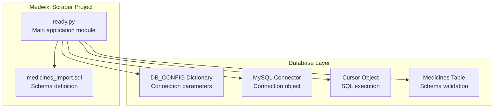
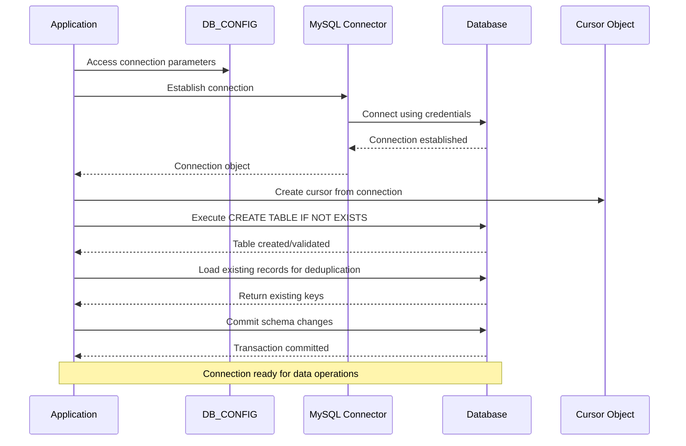
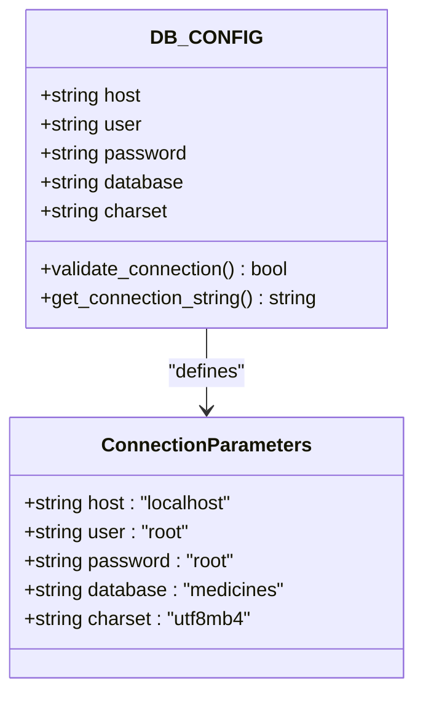
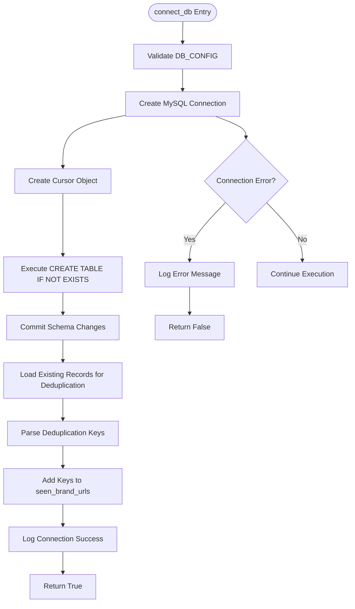
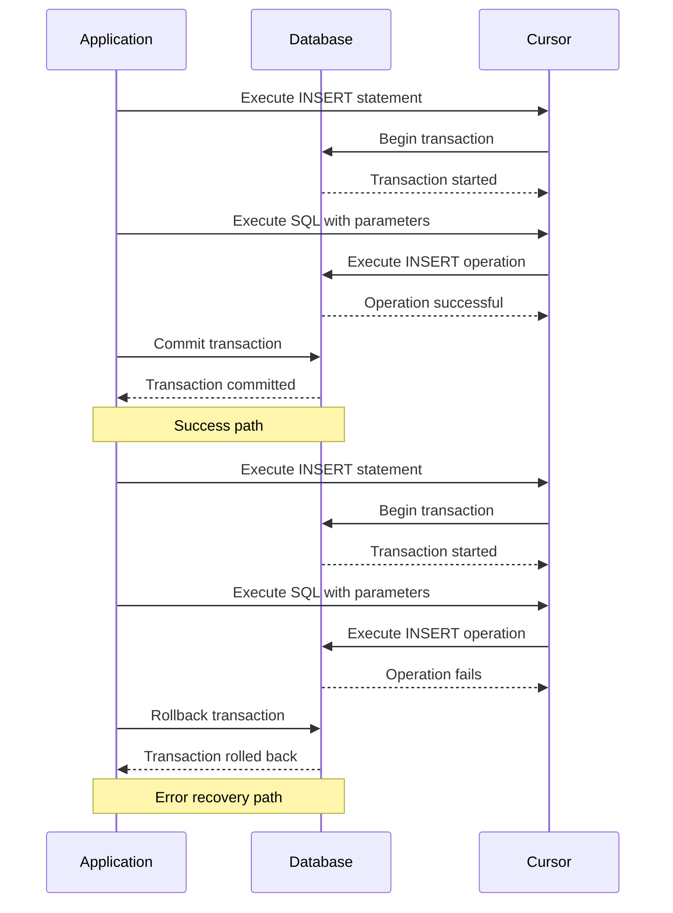
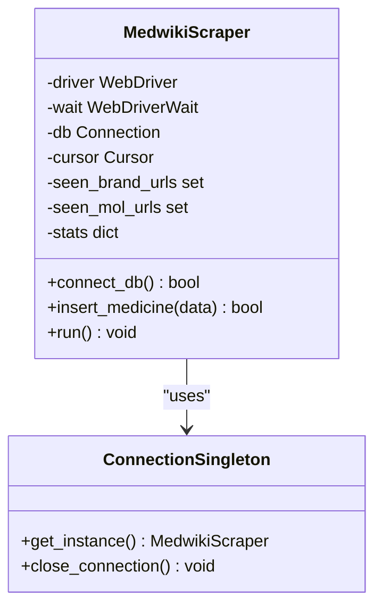
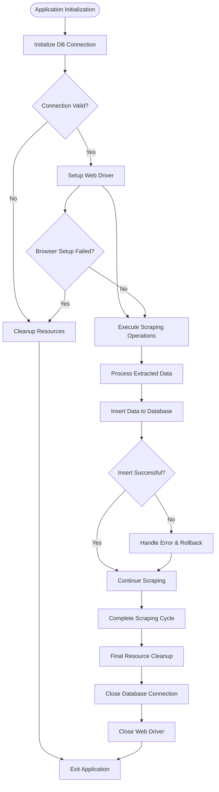
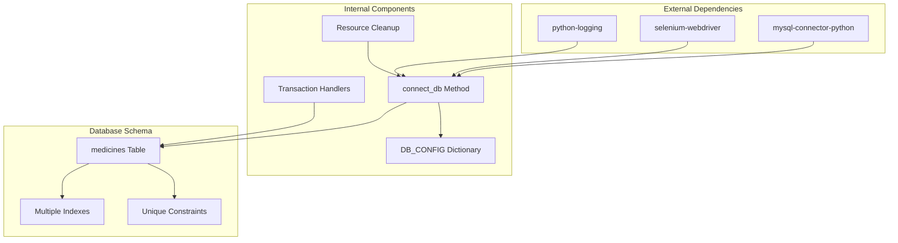
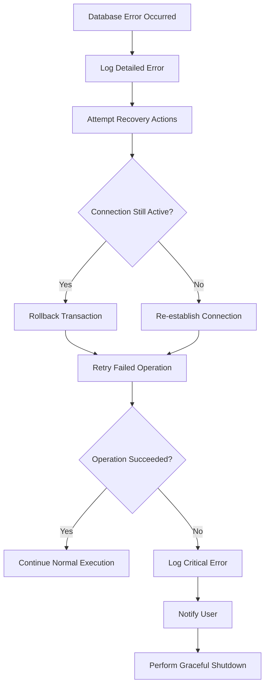

# Connection Management

<cite>
**Referenced Files in This Document**
- [ready.py](file://ready.py)
- [medicines_import.sql](file://medicines_import.sql)
</cite>

## Table of Contents
1. [Introduction](#introduction)
2. [Project Structure](#project-structure)
3. [Core Components](#core-components)
4. [Architecture Overview](#architecture-overview)
5. [Detailed Component Analysis](#detailed-component-analysis)
6. [Dependency Analysis](#dependency-analysis)
7. [Performance Considerations](#performance-considerations)
8. [Troubleshooting Guide](#troubleshooting-guide)
9. [Conclusion](#conclusion)

## Introduction
This document provides comprehensive technical documentation for the MySQL database connection management system used in the Medwiki scraper application. The system manages database connectivity for storing scraped medicine data, implements connection lifecycle management, handles transactions with proper commit/rollback semantics, and includes robust error recovery mechanisms. The implementation focuses on international medicine names support through UTF-8 multibyte character set configuration and provides practical guidance for troubleshooting common connection issues.

## Project Structure
The connection management system is implemented within a single Python module that serves as both the scraper controller and database manager. The project consists of two primary files:

**Diagram sources**
- [ready.py:42-49](file://ready.py#L42-L49)
- [ready.py:67-136](file://ready.py#L67-L136)

**Section sources**
- [ready.py:1-780](file://ready.py#L1-L780)
- [medicines_import.sql:1-73](file://medicines_import.sql#L1-L73)

## Core Components
The database connection management system centers around several key components that work together to establish reliable connections and manage data persistence:

### DB_CONFIG Dictionary
The connection configuration dictionary defines all essential database connection parameters:

| Parameter | Value | Purpose |
|-----------|-------|---------|
| host | localhost | Database server hostname |
| user | root | Authentication username |
| password | root | Authentication password |
| database | medicines | Target database name |
| charset | utf8mb4 | Character set for Unicode support |

The charset configuration specifically enables support for international medicine names and special characters commonly found in pharmaceutical terminology.

### Connection Establishment Method
The `connect_db` method implements the complete connection lifecycle including automatic table creation and schema validation.

### Transaction Management
The system implements proper transaction handling with explicit commit and rollback operations for data integrity.

### Connection Lifecycle Management
The application ensures proper resource cleanup through structured connection lifecycle management in the main execution flow.

**Section sources**
- [ready.py:42-49](file://ready.py#L42-L49)
- [ready.py:67-136](file://ready.py#L67-L136)
- [ready.py:656-767](file://ready.py#L656-L767)

## Architecture Overview
The database connection architecture follows a straightforward but robust pattern that ensures reliability and data integrity:

**Diagram sources**
- [ready.py:67-136](file://ready.py#L67-L136)
- [ready.py:42-49](file://ready.py#L42-L49)

The architecture emphasizes:
- Centralized configuration management
- Automatic schema provisioning
- Runtime deduplication validation
- Structured transaction handling

## Detailed Component Analysis

### DB_CONFIG Dictionary Implementation
The connection configuration dictionary serves as the central authority for all database connection parameters:

**Diagram sources**
- [ready.py:42-49](file://ready.py#L42-L49)

The configuration supports:
- Localhost database access
- Root user authentication
- Medicines database target
- UTF-8 multibyte character set for international support

### connect_db Method Implementation
The connection establishment method implements a comprehensive connection lifecycle:

**Diagram sources**
- [ready.py:67-136](file://ready.py#L67-L136)

Key implementation features:
- Automatic table creation with complete schema definition
- Character set validation for international medicine names
- Runtime deduplication key loading
- Comprehensive error handling with logging

### Transaction Handling Mechanisms
The system implements robust transaction management for data operations:

**Diagram sources**
- [ready.py:150-207](file://ready.py#L150-L207)

Transaction handling includes:
- Explicit commit operations after successful inserts
- Automatic rollback on errors
- Error counting and statistics tracking
- Graceful error recovery

### Connection Pooling Approach
The current implementation uses a singleton-like pattern through the MedwikiScraper class:

**Diagram sources**
- [ready.py:52-65](file://ready.py#L52-L65)
- [ready.py:656-767](file://ready.py#L656-L767)

The singleton pattern ensures:
- Single database connection per application instance
- Consistent connection state management
- Proper resource cleanup in finally blocks

### Connection Lifecycle Management
The application implements comprehensive connection lifecycle management:

**Diagram sources**
- [ready.py:656-767](file://ready.py#L656-L767)

Lifecycle management includes:
- Connection establishment during startup
- Browser driver setup for data extraction
- Data processing and insertion operations
- Graceful shutdown with resource cleanup
- Error recovery and continuation

**Section sources**
- [ready.py:67-136](file://ready.py#L67-L136)
- [ready.py:150-207](file://ready.py#L150-L207)
- [ready.py:656-767](file://ready.py#L656-L767)

## Dependency Analysis
The database connection system has minimal external dependencies but relies on several key components:

**Diagram sources**
- [ready.py:23-29](file://ready.py#L23-L29)
- [ready.py:42-49](file://ready.py#L42-L49)
- [ready.py:67-136](file://ready.py#L67-L136)

Key dependency relationships:
- mysql-connector-python for database connectivity
- selenium for web scraping operations
- logging for error tracking and monitoring
- Internal MedwikiScraper class for orchestration

**Section sources**
- [ready.py:23-29](file://ready.py#L23-L29)
- [ready.py:42-49](file://ready.py#L42-L49)
- [ready.py:67-136](file://ready.py#L67-L136)

## Performance Considerations
The connection management system incorporates several performance optimization strategies:

### Character Set Optimization
The UTF-8 multibyte character set (utf8mb4) provides comprehensive internationalization support:
- Full Unicode character support for medicine names
- Proper handling of special characters and accents
- Efficient storage of international pharmaceutical terminology

### Connection Efficiency
- Single connection per application instance reduces overhead
- Connection reuse eliminates repeated authentication costs
- Batch operations minimize round-trip latency

### Index Strategy
The medicines table includes multiple strategic indexes:
- Primary key on ID for fast lookups
- Composite unique index on name and generic_name
- Full-text search capabilities for efficient queries
- Specialized indexes for common filtering operations

### Memory Management
- Runtime deduplication uses hash sets for O(1) lookup performance
- Connection resources are properly cleaned up in finally blocks
- Browser driver resources are managed separately from database connections

## Troubleshooting Guide

### Common Connection Issues and Solutions

#### Authentication Failures
**Symptoms**: Connection refused or access denied errors
**Causes**: Incorrect username/password combinations
**Solutions**:
- Verify MySQL service is running locally
- Confirm user credentials in DB_CONFIG dictionary
- Check MySQL user privileges for the medicines database
- Validate localhost accessibility

#### Network Timeouts
**Symptoms**: Connection timeout errors during establishment
**Causes**: Network connectivity issues or firewall restrictions
**Solutions**:
- Verify MySQL server is accessible on localhost
- Check firewall settings blocking local connections
- Ensure MySQL is configured to accept local connections
- Validate port 3306 availability

#### Database Availability Problems
**Symptoms**: Database not found or unavailable errors
**Causes**: Database does not exist or MySQL service issues
**Solutions**:
- Create the medicines database if it doesn't exist
- Verify MySQL service status and restart if needed
- Check database permissions and access rights
- Validate database name spelling in DB_CONFIG

### Error Recovery Mechanisms
The system implements comprehensive error recovery:

**Diagram sources**
- [ready.py:134-136](file://ready.py#L134-L136)
- [ready.py:200-207](file://ready.py#L200-L207)

### Connection Error Handling Examples
The system demonstrates robust error handling patterns:

**Connection Establishment Error Handling**:
- Catches mysql.connector.Error exceptions
- Logs detailed error information
- Returns False to indicate failure
- Allows graceful application shutdown

**Transaction Error Handling**:
- Catches mysql.connector.Error during insert operations
- Logs specific error details
- Attempts rollback to maintain data consistency
- Increments error statistics
- Continues with remaining operations

**Retry Mechanisms**:
While the current implementation focuses on error recovery, the framework supports easy extension for retry logic:
- Connection retry with exponential backoff
- Transaction retry for transient failures
- Configurable retry limits and delays

### Monitoring and Logging
The system provides comprehensive logging for troubleshooting:
- Connection establishment success/failure logs
- Detailed error messages with stack traces
- Statistics tracking for operational metrics
- Timestamped log entries for debugging

**Section sources**
- [ready.py:134-136](file://ready.py#L134-L136)
- [ready.py:200-207](file://ready.py#L200-L207)
- [ready.py:32-39](file://ready.py#L32-L39)

## Conclusion
The MySQL database connection management system in the Medwiki scraper demonstrates robust, production-ready patterns for database connectivity in Python applications. The implementation successfully balances simplicity with reliability through:

- Centralized configuration management with comprehensive parameter validation
- Automatic schema provisioning and validation for data integrity
- Structured transaction handling with proper commit/rollback semantics
- Comprehensive error handling and recovery mechanisms
- Efficient resource management through proper lifecycle cleanup

The system's UTF-8 multibyte character set configuration ensures proper support for international medicine names, while the singleton connection pattern provides efficient resource utilization. The modular design allows for easy extension with additional features like connection pooling, advanced retry mechanisms, and enhanced monitoring capabilities.

Key strengths of the implementation include:
- Minimal external dependencies while maintaining full functionality
- Comprehensive error handling and recovery
- Proper resource cleanup and lifecycle management
- Scalable architecture supporting future enhancements
- Practical troubleshooting guidance for common issues

This foundation provides a solid base for extending the system with advanced features like connection pooling, distributed transaction support, or integration with modern database frameworks while maintaining the current high standards of reliability and maintainability.