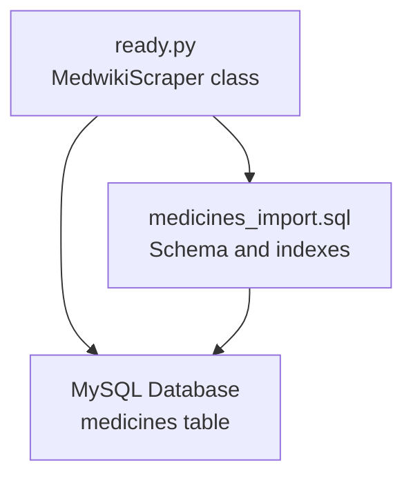
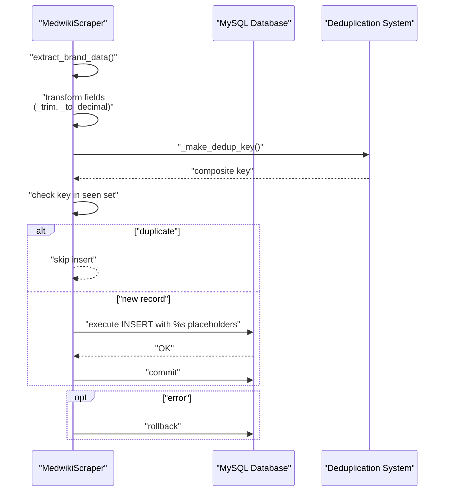
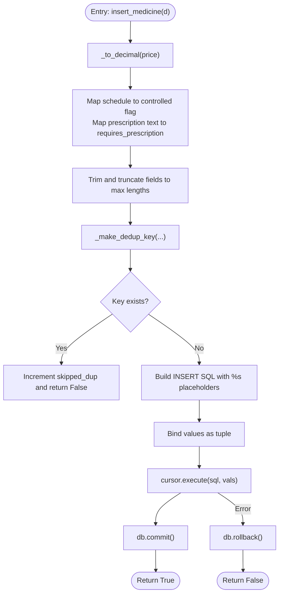
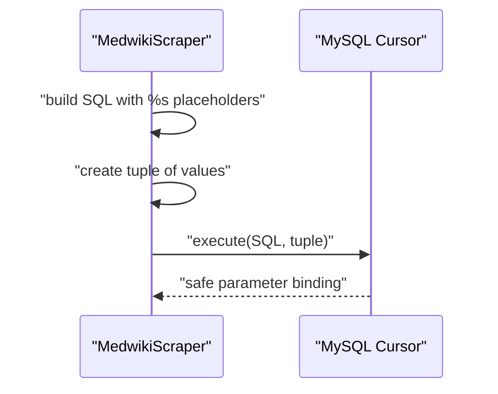
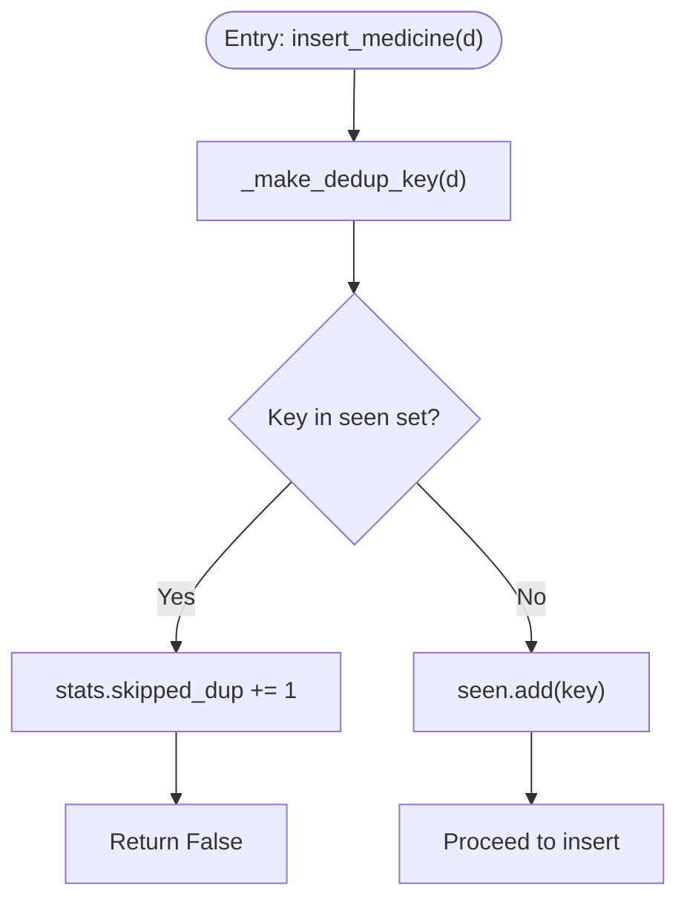
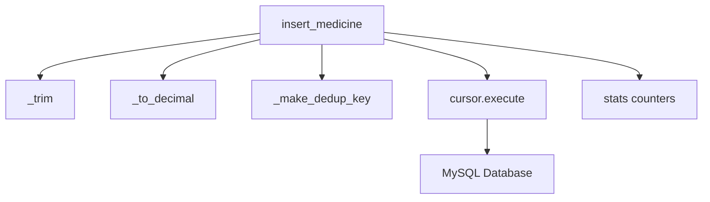

# Data Insertion Strategies

<cite>
**Referenced Files in This Document**
- [medicines_import.sql](file://medicines_import.sql)
- [ready.py](file://ready.py)
</cite>

## Table of Contents
1. [Introduction](#introduction)
2. [Project Structure](#project-structure)
3. [Core Components](#core-components)
4. [Architecture Overview](#architecture-overview)
5. [Detailed Component Analysis](#detailed-component-analysis)
6. [Dependency Analysis](#dependency-analysis)
7. [Performance Considerations](#performance-considerations)
8. [Troubleshooting Guide](#troubleshooting-guide)
9. [Conclusion](#conclusion)

## Introduction
This document explains the data insertion and processing pipeline used to ingest medicine records from a web source into a MySQL database. It focuses on the insert_medicine method, which orchestrates data validation, transformation, duplicate prevention, and persistence. It also covers SQL injection prevention via parameterized queries, transaction handling, and performance considerations for large-scale ingestion.

## Project Structure
The project consists of:
- A Python script that scrapes medicine data from a website and inserts it into a MySQL database.
- A SQL script that defines the target medicines table schema and indexes.

**Diagram sources**
- [ready.py:52-780](file://ready.py#L52-L780)
- [medicines_import.sql:15-60](file://medicines_import.sql#L15-L60)

**Section sources**
- [ready.py:52-780](file://ready.py#L52-L780)
- [medicines_import.sql:15-60](file://medicines_import.sql#L15-L60)

## Core Components
- MedwikiScraper: Orchestrates scraping, deduplication, transformation, and insertion.
- insert_medicine: The central method that validates, transforms, and persists a single medicine record.
- Deduplication system: Prevents duplicate inserts using composite keys built from multiple fields.
- Parameterized SQL: Uses %s placeholders and tuple-based binding to prevent SQL injection.
- Transaction handling: Commits successful inserts and rolls back on errors.

**Section sources**
- [ready.py:150-208](file://ready.py#L150-L208)
- [ready.py:138-148](file://ready.py#L138-L148)
- [ready.py:172-196](file://ready.py#L172-L196)

## Architecture Overview
The pipeline follows a straightforward flow:
- Scrape brand pages to collect raw data.
- Transform and validate the data.
- Check for duplicates using a composite key.
- Persist via a parameterized INSERT statement.
- Commit or roll back based on success.

**Diagram sources**
- [ready.py:406-558](file://ready.py#L406-L558)
- [ready.py:138-148](file://ready.py#L138-L148)
- [ready.py:150-208](file://ready.py#L150-L208)
- [ready.py:172-196](file://ready.py#L172-L196)

## Detailed Component Analysis

### insert_medicine: Complete Insertion Workflow
The insert_medicine method encapsulates the entire insertion process for a single medicine record. It performs:
- Data validation and transformation.
- Duplicate detection using a composite key.
- Parameterized SQL insertion.
- Transaction commit or rollback on failure.

Key steps:
- Pricing normalization: Converts price strings to decimals using a dedicated method.
- Boolean mapping: Determines controlled substance and prescription-required flags from schedule and textual indicators.
- String sanitization: Trims and truncates fields to configured lengths.
- Composite key construction: Builds a deduplication key from name, generic, strength, manufacturer, form, and pack size.
- Duplicate check: Skips insertion if the key already exists.
- Parameterized insert: Executes an INSERT with %s placeholders and binds values as a tuple.
- Persistence: Commits the transaction; on error, logs and attempts rollback.

**Diagram sources**
- [ready.py:150-208](file://ready.py#L150-L208)
- [ready.py:138-148](file://ready.py#L138-L148)
- [ready.py:172-196](file://ready.py#L172-L196)
- [ready.py:215-219](file://ready.py#L215-L219)
- [ready.py:209-213](file://ready.py#L209-L213)

**Section sources**
- [ready.py:150-208](file://ready.py#L150-L208)

### Data Transformation Details
- Decimal conversion for pricing (mrp): A regex extracts numeric values from price strings, removes commas, and converts to float. The resulting value is stored as a decimal type in the database.
- Boolean field mapping:
  - Controlled substances: Derived from schedule keywords indicating controlled schedules.
  - Narcotic: Not mapped in the method; defaults to zero.
  - Requires prescription: Derived from textual indicators; “No” sets the flag to false, otherwise true.
- String sanitization with _trim: Removes leading/trailing whitespace and truncates to configured maximum lengths for each field.

Validation rules observed:
- Field length limits enforced by truncation to maximum lengths.
- Numeric validation for pricing via extraction of numeric patterns.
- Format validation for medical identifiers is implicit through deduplication keys built from structured fields.

**Section sources**
- [ready.py:215-219](file://ready.py#L215-L219)
- [ready.py:209-213](file://ready.py#L209-L213)
- [ready.py:150-208](file://ready.py#L150-L208)

### SQL Injection Prevention
The method uses parameterized queries with %s placeholders and passes values as a tuple to cursor.execute. This ensures user-provided data is bound as parameters, preventing SQL injection.

**Diagram sources**
- [ready.py:172-196](file://ready.py#L172-L196)

**Section sources**
- [ready.py:172-196](file://ready.py#L172-L196)

### Batch Processing and Commit Strategy
The pipeline processes records individually. For each record:
- A single INSERT operation is executed.
- The transaction is committed immediately after successful insertion.
- On error, the transaction is rolled back.

This approach prioritizes correctness and simplicity over throughput. There is no explicit batching mechanism in the insert_medicine method.

**Section sources**
- [ready.py:150-208](file://ready.py#L150-L208)

### Error Handling and Rollback
On database errors during insertion:
- An error is logged.
- The stats counter for errors is incremented.
- A rollback attempt is made to restore transaction state.
- The method returns False to signal failure.

This ensures partial failures do not leave the database in an inconsistent state.

**Section sources**
- [ready.py:200-207](file://ready.py#L200-L207)

### Duplicate Prevention Integration
Duplicate prevention occurs at two levels:
- Runtime deduplication: A set stores composite keys for already-seen records. If a key exists, the record is skipped.
- Database-level uniqueness: The medicines table defines a unique index on name and generic_name to enforce uniqueness at the database level.

Decision flow:
- Build a composite key from name, generic_name, strength, manufacturer, dosage_form, and pack_size.
- If the key exists in the runtime set, increment skipped_dup and return False.
- Otherwise, add the key to the set and proceed with insertion.

**Diagram sources**
- [ready.py:138-148](file://ready.py#L138-L148)
- [ready.py:165-170](file://ready.py#L165-L170)

**Section sources**
- [ready.py:138-148](file://ready.py#L138-L148)
- [ready.py:165-170](file://ready.py#L165-L170)
- [medicines_import.sql:105](file://medicines_import.sql#L105)

### Schema and Indexes
The medicines table includes:
- Unique constraints and indexes to support fast lookups and duplicate prevention.
- Decimal fields for pricing.
- Tinyint flags for controlled/narcotic/prescription requirements.
- Timestamps for audit and usage tracking.

These schema choices align with the insertion workflow’s deduplication and indexing needs.

**Section sources**
- [medicines_import.sql:15-60](file://medicines_import.sql#L15-L60)

## Dependency Analysis
The insert_medicine method depends on:
- Internal helpers: _trim for sanitization, _to_decimal for pricing, _make_dedup_key for duplicate detection.
- Database connector: mysql-connector-python for executing parameterized statements and managing transactions.
- Runtime deduplication set: Maintained in-memory to avoid duplicate inserts.

**Diagram sources**
- [ready.py:150-208](file://ready.py#L150-L208)
- [ready.py:209-213](file://ready.py#L209-L213)
- [ready.py:215-219](file://ready.py#L215-L219)
- [ready.py:138-148](file://ready.py#L138-L148)

**Section sources**
- [ready.py:150-208](file://ready.py#L150-L208)

## Performance Considerations
Current behavior:
- Individual insert operations per record with immediate commit.
- No explicit batching or bulk operations.
- Deduplication relies on an in-memory set and a preloaded database snapshot.

Optimization strategies for large-scale ingestion:
- Use executemany or multi-row INSERT to reduce round-trips.
- Wrap multiple inserts in a single transaction to minimize commits.
- Increase autocommit off around batches and commit periodically.
- Monitor and tune index usage; consider disabling non-essential indexes during bulk loads and re-enabling afterward.
- Adjust MySQL server settings for bulk writes (e.g., innodb_autoinc_lock_mode, innodb_flush_log_at_trx_commit) with caution and testing.
- Parallelize scraping and insertion with bounded concurrency to balance speed and site rate limits.

[No sources needed since this section provides general guidance]

## Troubleshooting Guide
Common issues and remedies:
- Duplicate insertions: Verify the composite key logic and ensure deduplication set is populated before processing.
- Price parsing failures: Confirm price strings contain numeric values; adjust regex or fallback logic if needed.
- Transaction errors: Ensure rollback is attempted on exceptions; check database connectivity and permissions.
- Character encoding: Confirm charset and collation settings match the database schema.

**Section sources**
- [ready.py:138-148](file://ready.py#L138-L148)
- [ready.py:215-219](file://ready.py#L215-L219)
- [ready.py:200-207](file://ready.py#L200-L207)
- [medicines_import.sql:48-59](file://medicines_import.sql#L48-L59)

## Conclusion
The insert_medicine method provides a robust, safe, and repeatable pipeline for ingesting medicine data. It enforces validation and sanitization, prevents duplicates through composite keys, and uses parameterized queries to mitigate SQL injection risks. While the current approach prioritizes correctness with per-record commits, future enhancements can focus on batching and transactional improvements to scale ingestion for larger datasets.