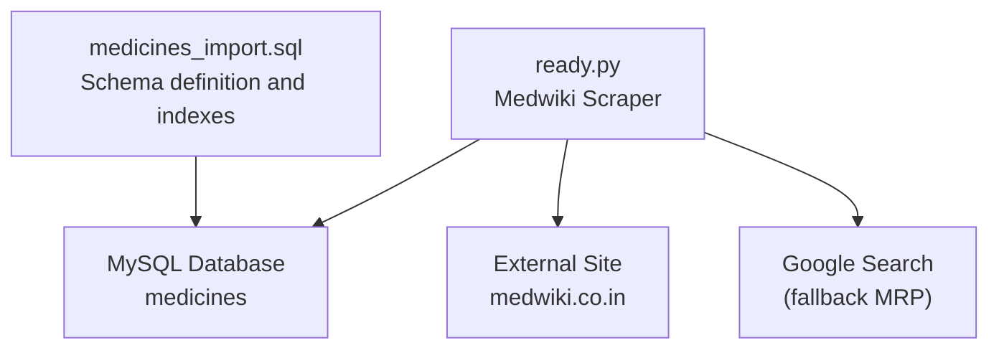
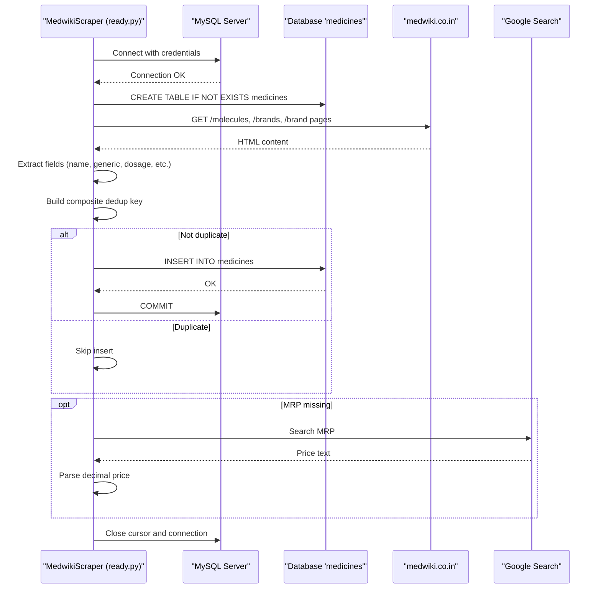
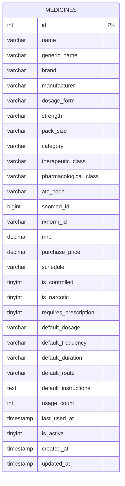
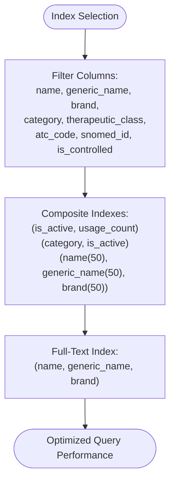
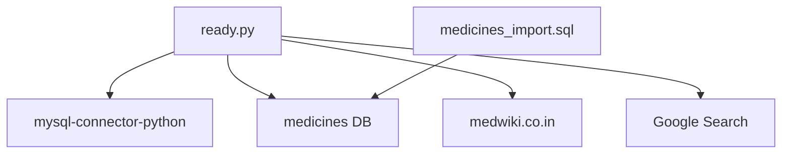

# Database Management

<cite>
**Referenced Files in This Document**
- [medicines_import.sql](file://medicines_import.sql)
- [ready.py](file://ready.py)
</cite>

## Table of Contents
1. [Introduction](#introduction)
2. [Project Structure](#project-structure)
3. [Core Components](#core-components)
4. [Architecture Overview](#architecture-overview)
5. [Detailed Component Analysis](#detailed-component-analysis)
6. [Dependency Analysis](#dependency-analysis)
7. [Performance Considerations](#performance-considerations)
8. [Troubleshooting Guide](#troubleshooting-guide)
9. [Conclusion](#conclusion)
10. [Appendices](#appendices)

## Introduction
This document provides comprehensive data model documentation for the MySQL database management system used by the Medwiki scraper. It covers the medicines table schema, indexing strategy, connection management, insertion strategies, and operational guidance for performance, security, and maintenance.

## Project Structure
The repository contains two primary assets:
- A SQL script that defines and initializes the medicines table schema and indexes.
- A Python scraper that connects to MySQL, creates the schema if missing, and inserts scraped medicine data while preventing duplicates.

**Diagram sources**
- [medicines_import.sql:15-60](file://medicines_import.sql#L15-L60)
- [ready.py:43-49](file://ready.py#L43-L49)

**Section sources**
- [medicines_import.sql:1-73](file://medicines_import.sql#L1-L73)
- [ready.py:1-780](file://ready.py#L1-L780)

## Core Components
- Medicines table schema with 25 columns covering medicine attributes, pricing, regulatory classifications, and usage metadata.
- Indexes for fast filtering and full-text search.
- Unique composite key to prevent duplicates during ingestion.
- Database connection and transaction handling with rollback on errors.
- Duplicate detection logic using a composite key built from multiple fields.

**Section sources**
- [medicines_import.sql:15-60](file://medicines_import.sql#L15-L60)
- [ready.py:67-136](file://ready.py#L67-L136)
- [ready.py:138-207](file://ready.py#L138-L207)

## Architecture Overview
The system architecture centers on a single MySQL database with one table (medicines). The scraper performs:
- Schema initialization (table creation and index creation).
- Data extraction from medwiki.co.in.
- Optional fallback MRP lookup via Google search.
- Deduplication using a composite key.
- Single-row inserts with commit and rollback on error.

**Diagram sources**
- [ready.py:67-136](file://ready.py#L67-L136)
- [ready.py:150-207](file://ready.py#L150-L207)
- [ready.py:221-287](file://ready.py#L221-L287)

## Detailed Component Analysis

### Medicines Table Schema
The medicines table captures comprehensive medicine metadata with the following characteristics:
- Primary key: auto-increment integer id.
- Attributes: name, generic_name, brand, manufacturer, dosage_form, strength, pack_size.
- Classification: category, therapeutic_class, pharmacological_class, atc_code, snomed_id, rxnorm_id.
- Pricing: mrp, purchase_price.
- Regulatory: schedule, controlled/narcotic indicators, prescription requirement.
- Defaults: default_dosage, default_frequency, default_duration, default_route, default_instructions.
- Usage metadata: usage_count, last_used_at, is_active.
- Audit: created_at, updated_at.

Constraints and indexes:
- Unique composite key on (name, generic_name) to prevent duplicates.
- Indexes on frequently filtered columns: name, generic_name, brand, category, therapeutic_class, atc_code, snomed_id, is_controlled, and composite indexes for popular filters.
- Full-text index on (name, generic_name, brand) for text search.

**Diagram sources**
- [medicines_import.sql:15-45](file://medicines_import.sql#L15-L45)

**Section sources**
- [medicines_import.sql:15-60](file://medicines_import.sql#L15-L60)

### Database Connection Management
- Connection configuration includes host, user, password, database, and charset.
- The scraper establishes a single connection and cursor, executes DDL to create the table if absent, and commits the schema change.
- On insert failures, the scraper logs the error and attempts a rollback before returning.

Operational notes:
- No explicit connection pooling is implemented in the scraper; a single connection is used for the entire run.
- Transactions are handled per insert with commit on success and rollback on error.

**Section sources**
- [ready.py:43-49](file://ready.py#L43-L49)
- [ready.py:67-136](file://ready.py#L67-L136)
- [ready.py:150-207](file://ready.py#L150-L207)

### Data Insertion Strategies
- Composite key deduplication: The scraper builds a composite key from name, generic_name, strength, manufacturer, dosage_form, and pack_size. If present, the record is skipped.
- Single-row inserts: The scraper inserts one medicine at a time, committing immediately upon success.
- Fallback MRP: If MRP is not found on the source site, the scraper attempts to extract it from Google search results.
- Error handling: On MySQL errors, the scraper increments error counters and rolls back the transaction.

Batch processing: The current implementation does not use bulk/batch inserts; however, the schema supports batch operations if needed.

**Section sources**
- [ready.py:118-130](file://ready.py#L118-L130)
- [ready.py:138-148](file://ready.py#L138-L148)
- [ready.py:150-207](file://ready.py#L150-L207)
- [ready.py:221-287](file://ready.py#L221-L287)

### Indexing Strategy
Indexes are designed for:
- Equality and range scans on frequently filtered columns (name, generic_name, brand, category, therapeutic_class, atc_code, snomed_id, is_controlled).
- Popular composite filters (is_active, usage_count), (category, is_active), and a short-key composite (name(50), generic_name(50), brand(50)).
- Full-text search on name, generic_name, and brand for flexible text matching.

**Diagram sources**
- [medicines_import.sql:47-59](file://medicines_import.sql#L47-L59)

**Section sources**
- [medicines_import.sql:47-59](file://medicines_import.sql#L47-L59)

### Data Access Patterns
Common access patterns inferred from schema and scraper logic:
- Exact match lookups on name, generic_name, brand, category, therapeutic_class, atc_code, snomed_id.
- Controlled substance filtering via is_controlled.
- Active/inactive filtering via is_active.
- Popularity-based ordering via usage_count.
- Text search using full-text index on name, generic_name, brand.

These patterns align with the indexes defined in the schema.

**Section sources**
- [medicines_import.sql:47-59](file://medicines_import.sql#L47-L59)
- [ready.py:118-130](file://ready.py#L118-L130)

### Data Lifecycle Management
- Initialization: The scraper creates the medicines table if it does not exist and loads existing records into memory for deduplication.
- Population: The scraper scrapes multiple pages, extracts fields, and inserts records.
- Maintenance: The schema includes audit timestamps (created_at, updated_at) and usage metadata (usage_count, last_used_at), enabling lifecycle tracking.

**Section sources**
- [ready.py:67-136](file://ready.py#L67-L136)
- [medicines_import.sql:41-45](file://medicines_import.sql#L41-L45)

### Backup Procedures
- Recommended approach: Use MySQL native tools (e.g., mysqldump) to export the medicines database prior to major schema changes or bulk operations.
- Export command example: mysql -u root -p medicines > medicines_backup.sql
- Restore: Import using mysql -u root -p medicines < medicines_backup.sql

[No sources needed since this section provides general guidance]

### Security, Access Control, and Privacy
- Current configuration uses a local MySQL user with broad privileges. For production, restrict privileges to the medicines database and limit network exposure.
- Store credentials securely (environment variables or a secrets manager) rather than hardcoding in scripts.
- Consider encrypting sensitive fields at rest and in transit.
- Apply least privilege principles and enable auditing for compliance.

[No sources needed since this section provides general guidance]

### Database Initialization Process
- The scraper connects to MySQL and executes a CREATE TABLE IF NOT EXISTS statement with the medicines schema and indexes.
- After table creation, it queries existing records to populate an in-memory deduplication set.
- The scraper proceeds to scrape and insert data.

**Section sources**
- [ready.py:67-136](file://ready.py#L67-L136)

## Dependency Analysis
- The scraper depends on the mysql-connector-python library for database connectivity.
- The scraper interacts with external websites (medwiki.co.in) and optionally Google for MRP retrieval.
- The medicines table schema is defined in both the SQL script and the scraper’s initialization logic.

**Diagram sources**
- [ready.py:23-29](file://ready.py#L23-L29)
- [ready.py:43-49](file://ready.py#L43-L49)
- [medicines_import.sql:8-10](file://medicines_import.sql#L8-L10)

**Section sources**
- [ready.py:23-29](file://ready.py#L23-L29)
- [ready.py:43-49](file://ready.py#L43-L49)
- [medicines_import.sql:8-10](file://medicines_import.sql#L8-L10)

## Performance Considerations
- Single-row inserts: The current implementation inserts one record at a time. For large-scale ingestion, consider batching inserts to reduce round-trips.
- Index coverage: The schema includes indexes aligned with typical queries. Ensure queries leverage these indexes (e.g., equality filters and full-text search).
- Full-text search: Use MATCH AGAINST for efficient text searches on name, generic_name, brand.
- Memory footprint: The deduplication set grows with existing records. Monitor memory usage during initialization.

[No sources needed since this section provides general guidance]

## Troubleshooting Guide
- Connection failures: Verify host, user, password, and database name. Ensure MySQL is running and accessible.
- Schema creation errors: Confirm permissions to create tables and indexes.
- Insert errors: Review field trimming and numeric parsing. The scraper logs MySQL errors and attempts rollback.
- Duplicate detection: If duplicates still occur, verify the composite key logic and uniqueness constraints.

**Section sources**
- [ready.py:134-136](file://ready.py#L134-L136)
- [ready.py:200-207](file://ready.py#L200-L207)

## Conclusion
The medicines table schema and scraper provide a robust foundation for managing medicine data with strong indexing and deduplication. For production deployments, consider adding connection pooling, batch inserts, stricter access controls, and automated backups.

## Appendices

### Sample Data Structures
- Deduplication key: Concatenation of normalized name, generic_name, strength, manufacturer, dosage_form, and pack_size.
- Insert payload: Values for all relevant columns, including defaults for route and activity flags.

**Section sources**
- [ready.py:118-130](file://ready.py#L118-L130)
- [ready.py:138-148](file://ready.py#L138-L148)
- [ready.py:172-195](file://ready.py#L172-L195)