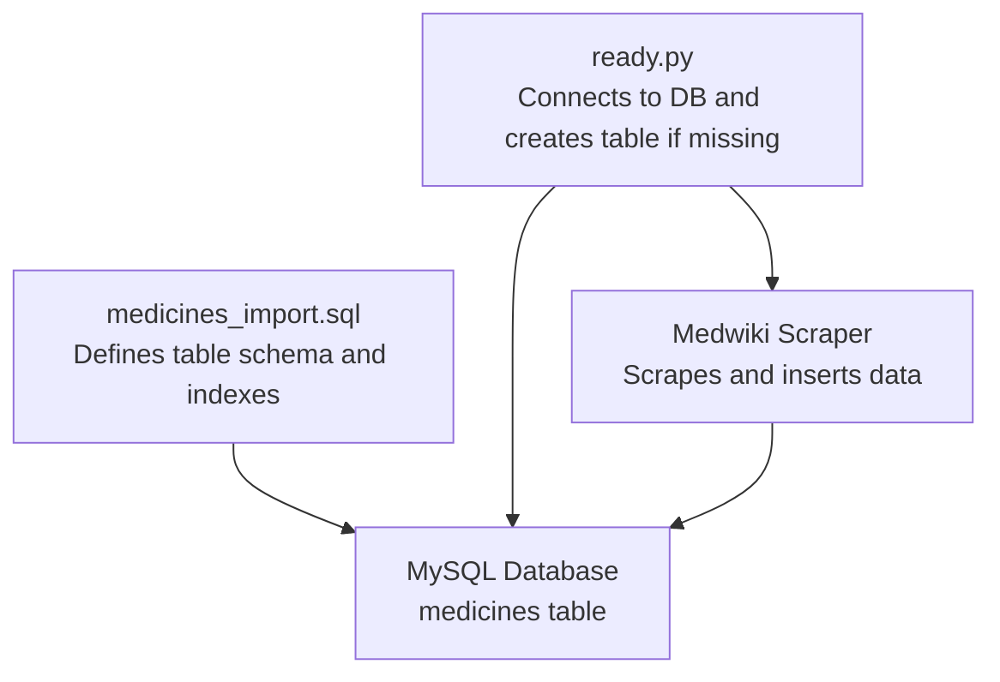
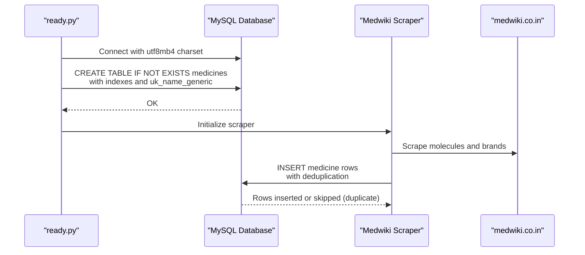
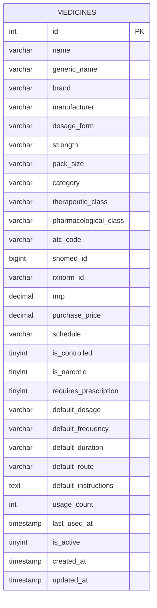
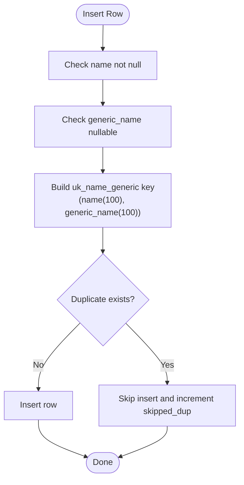
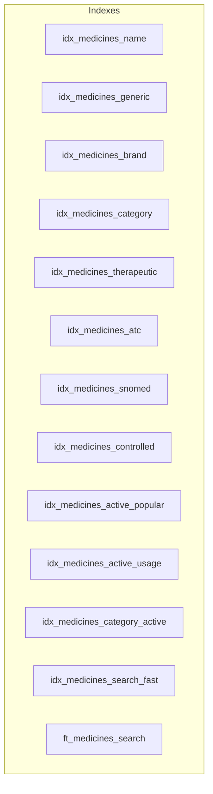
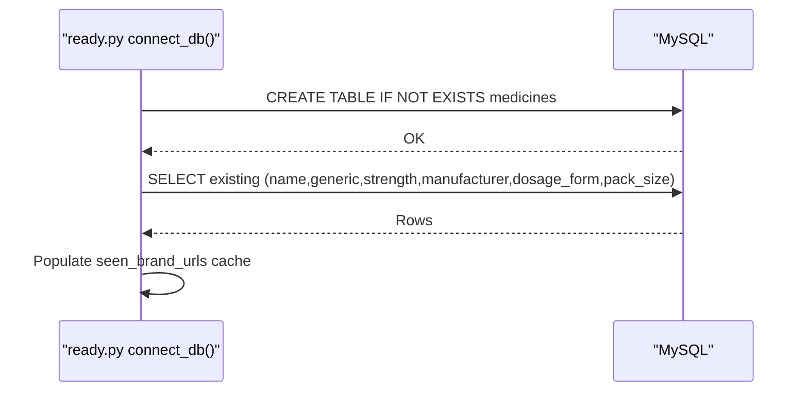
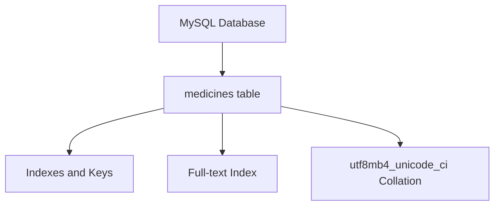

# Database Schema Design

<cite>
**Referenced Files in This Document**
- [medicines_import.sql](file://medicines_import.sql)
- [ready.py](file://ready.py)
</cite>

## Table of Contents
1. [Introduction](#introduction)
2. [Project Structure](#project-structure)
3. [Core Components](#core-components)
4. [Architecture Overview](#architecture-overview)
5. [Detailed Component Analysis](#detailed-component-analysis)
6. [Dependency Analysis](#dependency-analysis)
7. [Performance Considerations](#performance-considerations)
8. [Troubleshooting Guide](#troubleshooting-guide)
9. [Conclusion](#conclusion)

## Introduction
This document provides comprehensive data model documentation for the MySQL medicines table schema used by the Medwiki project. It details all 25 columns, the unique composite key uk_name_generic, the indexing strategy, collation and character set settings, and the automatic creation of the schema during database initialization. It also explains how the schema supports duplicate prevention and enables efficient search and filtering.

## Project Structure
The repository contains two primary artifacts that define and initialize the medicines table:
- A SQL script that creates the medicines table with indexes and full-text search capabilities.
- A Python script that connects to the database, ensures the medicines table exists, and inserts scraped medicine data while preventing duplicates.

**Diagram sources**
- [medicines_import.sql:15-60](file://medicines_import.sql#L15-L60)
- [ready.py:67-115](file://ready.py#L67-L115)

**Section sources**
- [medicines_import.sql:1-73](file://medicines_import.sql#L1-L73)
- [ready.py:1-780](file://ready.py#L1-L780)

## Core Components
This section documents each column in the medicines table, including data types, collation, constraints, and typical usage. It also explains the unique composite key uk_name_generic and the rationale behind combining name and generic_name.

- Primary key
  - id: int, auto-increment, not null, primary key
- Medicine attributes
  - name: varchar(255), utf8mb4_unicode_ci, not null
  - generic_name: varchar(255), utf8mb4_unicode_ci, nullable
  - brand: varchar(255), utf8mb4_unicode_ci, nullable
  - manufacturer: varchar(255), utf8mb4_unicode_ci, nullable
- Dosage information
  - dosage_form: varchar(100), utf8mb4_unicode_ci, nullable
  - strength: varchar(100), utf8mb4_unicode_ci, nullable
  - pack_size: varchar(100), utf8mb4_unicode_ci, nullable
- Regulatory and classification
  - category: varchar(100), utf8mb4_unicode_ci, nullable
  - therapeutic_class: varchar(255), utf8mb4_unicode_ci, nullable
  - pharmacological_class: varchar(255), utf8mb4_unicode_ci, nullable
  - atc_code: varchar(10), utf8mb4_unicode_ci, nullable
  - snomed_id: bigint unsigned, nullable
  - rxnorm_id: varchar(20), utf8mb4_unicode_ci, nullable
  - schedule: varchar(20), utf8mb4_unicode_ci, nullable
  - is_controlled: tinyint(1), default 0
  - is_narcotic: tinyint(1), default 0
  - requires_prescription: tinyint(1), default 1
- Pricing data
  - mrp: decimal(12,2), nullable
  - purchase_price: decimal(12,2), nullable
- Clinical metadata
  - default_dosage: varchar(100), utf8mb4_unicode_ci, nullable
  - default_frequency: varchar(100), utf8mb4_unicode_ci, nullable
  - default_duration: varchar(100), utf8mb4_unicode_ci, nullable
  - default_route: varchar(50), utf8mb4_unicode_ci, default "Oral"
  - default_instructions: text, utf8mb4_unicode_ci, nullable
- Usage tracking
  - usage_count: int, default 0
  - last_used_at: timestamp, nullable
  - is_active: tinyint(1), default 1
- Timestamps
  - created_at: timestamp, not null, default current_timestamp
  - updated_at: timestamp, not null, default current_timestamp on update current_timestamp

Unique composite key
- uk_name_generic: unique constraint on (name, generic_name) with prefix length 100

Indexing strategy
- Single-column indexes
  - idx_medicines_name on name
  - idx_medicines_generic on generic_name
  - idx_medicines_brand on brand
  - idx_medicines_category on category
  - idx_medicines_therapeutic on therapeutic_class
  - idx_medicines_atc on atc_code
  - idx_medicines_snomed on snomed_id
  - idx_medicines_controlled on is_controlled
- Composite indexes
  - idx_medicines_active_popular on (is_active, usage_count)
  - idx_medicines_active_usage on (is_active, usage_count)
  - idx_medicines_category_active on (category, is_active)
  - idx_medicines_search_fast on (name(50), generic_name(50), brand(50))
- Full-text search
  - ft_medicines_search on (name, generic_name, brand)

Character set and collation
- Table charset: utf8mb4
- Collation: utf8mb4_unicode_ci
- All columns use utf8mb4_unicode_ci collation

Rationale for uk_name_generic
- Prevents duplicate entries for the same brand name and generic name combination.
- Prefix length 100 is used to support index creation on these columns.
- Combined with application-level deduplication across strength, manufacturer, dosage_form, and pack_size to avoid near-duplicates.

**Section sources**
- [medicines_import.sql:15-60](file://medicines_import.sql#L15-L60)
- [ready.py:105](file://ready.py#L105)
- [ready.py:118-130](file://ready.py#L118-L130)

## Architecture Overview
The medicines table is created automatically during database initialization by the Python script. The scraper ensures the table exists with the exact schema, then scrapes data from Medwiki, applies deduplication rules, and inserts rows into the database.

**Diagram sources**
- [ready.py:67-115](file://ready.py#L67-L115)
- [ready.py:150-207](file://ready.py#L150-L207)

## Detailed Component Analysis

### Table Structure and Constraints
The medicines table defines a robust schema for storing medicine metadata, pricing, regulatory attributes, and usage tracking. It uses utf8mb4_unicode_ci for international character support and includes a unique composite key to prevent duplicates.

**Diagram sources**
- [medicines_import.sql:15-45](file://medicines_import.sql#L15-L45)

**Section sources**
- [medicines_import.sql:15-60](file://medicines_import.sql#L15-L60)

### Unique Composite Key uk_name_generic
The uk_name_generic constraint enforces uniqueness for the combination of name and generic_name. This prevents duplicate brand entries for the same active ingredient. The prefix length 100 is used to satisfy MySQL index key length requirements.

**Diagram sources**
- [ready.py:105](file://ready.py#L105)
- [ready.py:165-170](file://ready.py#L165-L170)

**Section sources**
- [ready.py:105](file://ready.py#L105)
- [ready.py:165-170](file://ready.py#L165-L170)

### Indexing Strategy
Indexes are designed to optimize common queries:
- Single-column indexes for frequent filters and joins
- Composite indexes for multi-column filters (e.g., active status and popularity)
- A prefix-length composite index for fast text searches on name, generic_name, and brand
- Full-text index for flexible text search across name, generic_name, and brand

**Diagram sources**
- [medicines_import.sql:47-59](file://medicines_import.sql#L47-L59)
- [ready.py:106-113](file://ready.py#L106-L113)

**Section sources**
- [medicines_import.sql:47-59](file://medicines_import.sql#L47-L59)
- [ready.py:106-113](file://ready.py#L106-L113)

### Character Set and Collation
- Table-level charset: utf8mb4
- Collation: utf8mb4_unicode_ci
- All columns inherit the table collation, ensuring consistent sorting and comparison behavior across the dataset.

**Section sources**
- [medicines_import.sql:60](file://medicines_import.sql#L60)
- [ready.py:114](file://ready.py#L114)

### Schema Evolution and Initialization
The medicines table is created automatically during database initialization by the Python script. It:
- Establishes the exact schema required by the scraper
- Creates the uk_name_generic unique key
- Adds all indexes and full-text search capabilities
- Loads existing records to build a deduplication cache

**Diagram sources**
- [ready.py:67-115](file://ready.py#L67-L115)
- [ready.py:118-130](file://ready.py#L118-L130)

**Section sources**
- [ready.py:67-115](file://ready.py#L67-L115)
- [ready.py:118-130](file://ready.py#L118-L130)

## Dependency Analysis
The medicines table depends on:
- MySQL engine InnoDB for transactional integrity and foreign key support
- utf8mb4_unicode_ci collation for international character support
- Indexes and full-text search for query performance and usability

**Diagram sources**
- [medicines_import.sql:15-60](file://medicines_import.sql#L15-L60)
- [ready.py:67-115](file://ready.py#L67-L115)

**Section sources**
- [medicines_import.sql:15-60](file://medicines_import.sql#L15-L60)
- [ready.py:67-115](file://ready.py#L67-L115)

## Performance Considerations
- Use prefix indexes for long text columns to reduce index size and improve performance.
- Leverage composite indexes for frequently filtered combinations (e.g., is_active and usage_count).
- Utilize full-text search for flexible text matching across name, generic_name, and brand.
- Apply the unique composite key uk_name_generic to prevent duplicate inserts and maintain data integrity.
- Monitor query plans to ensure indexes are used effectively for common filters and sorts.

[No sources needed since this section provides general guidance]

## Troubleshooting Guide
Common issues and resolutions:
- Duplicate insertion attempts: The uk_name_generic unique key and application-level deduplication prevent duplicates. If duplicates occur, verify the deduplication cache and ensure consistent normalization of name and generic_name.
- Index-related errors: Ensure prefix lengths for indexed columns meet MySQL requirements. Adjust prefix lengths if necessary.
- Character encoding problems: Confirm the database and table use utf8mb4_unicode_ci. Verify client connections specify utf8mb4 charset.
- Full-text search limitations: Full-text indexes require MyISAM or InnoDB storage engines and are case-insensitive by default. Use MATCH() AGAINST() queries for optimal performance.

**Section sources**
- [ready.py:105](file://ready.py#L105)
- [ready.py:118-130](file://ready.py#L118-L130)
- [medicines_import.sql:60](file://medicines_import.sql#L60)

## Conclusion
The medicines table schema is designed for robust data capture, efficient querying, and reliable duplicate prevention. The unique composite key uk_name_generic, combined with application-level deduplication and a comprehensive indexing strategy, ensures high-quality medicine data suitable for clinical and administrative use. The automatic initialization process guarantees consistent schema deployment across environments.