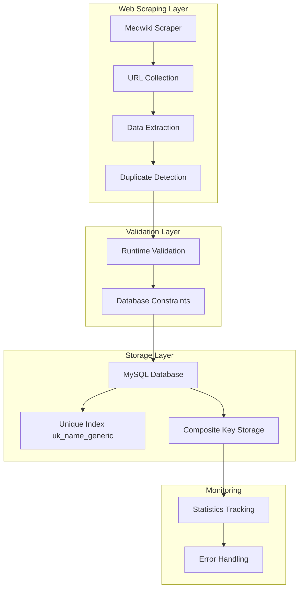
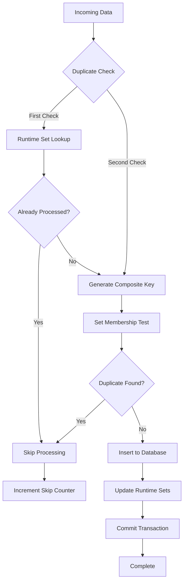
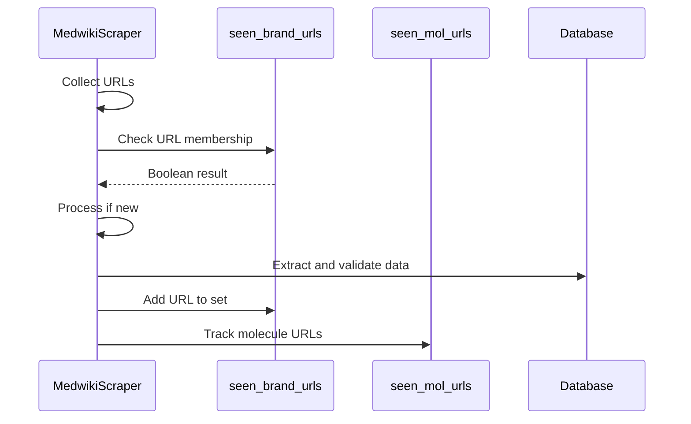

# Duplicate Prevention System

<cite>
**Referenced Files in This Document**
- [medicines_import.sql](file://medicines_import.sql)
- [ready.py](file://ready.py)
</cite>

## Table of Contents
1. [Introduction](#introduction)
2. [System Architecture](#system-architecture)
3. [Core Components](#core-components)
4. [Duplicate Prevention Mechanisms](#duplicate-prevention-mechanisms)
5. [Composite Key Construction](#composite-key-construction)
6. [Runtime Deduplication](#runtime-deduplication)
7. [Database-Level Constraints](#database-level-constraints)
8. [Hybrid Approach Analysis](#hybrid-approach-analysis)
9. [Field Selection Rationale](#field-selection-rationale)
10. [Performance Characteristics](#performance-characteristics)
11. [Extension Guidelines](#extension-guidelines)
12. [Troubleshooting Guide](#troubleshooting-guide)
13. [Conclusion](#conclusion)

## Introduction

The Duplicate Prevention System is a sophisticated data integrity mechanism designed to ensure that duplicate pharmaceutical records are not inserted into the medicines database during web scraping operations. This system employs a multi-layered approach combining runtime validation, composite key construction, and database-level constraints to achieve comprehensive duplicate detection and prevention.

The system operates within a larger web scraping framework that extracts medicine information from medwiki.co.in, automatically detecting and preventing duplicates at multiple levels of the data pipeline. This ensures data consistency while maintaining optimal performance during large-scale data ingestion operations.

## System Architecture

The duplicate prevention system is integrated into a comprehensive web scraping architecture that follows a structured data flow pattern:



**Diagram sources**
- [ready.py:52-780](file://ready.py#L52-L780)

The architecture consists of four primary layers: web scraping, validation, storage, and monitoring. Each layer contributes to the overall duplicate prevention strategy through specialized mechanisms tailored to its operational context.

**Section sources**
- [ready.py:52-780](file://ready.py#L52-L780)

## Core Components

The duplicate prevention system comprises several interconnected components that work together to ensure data integrity:

### MedwikiScraper Class
The central orchestrator that manages the entire scraping and validation process. It maintains state through runtime sets and coordinates between different validation layers.

### Duplicate Key Generation Engine
A specialized algorithm that constructs composite keys from six critical medicine attributes, providing a robust foundation for duplicate detection.

### Runtime Validation Sets
Two specialized hash sets that track processed URLs and prevent redundant processing during scraping operations.

### Database Constraint Layer
MySQL unique constraints that provide persistence-level protection against duplicate entries.

Each component serves a specific purpose in the overall validation strategy, with overlapping but complementary responsibilities that maximize effectiveness.

**Section sources**
- [ready.py:52-220](file://ready.py#L52-L220)

## Duplicate Prevention Mechanisms

The system implements a comprehensive three-tier duplicate prevention strategy:



**Diagram sources**
- [ready.py:138-208](file://ready.py#L138-L208)

### Tier 1: Runtime URL Deduplication
Prevents processing the same URLs multiple times during scraping operations using two specialized sets:
- `seen_brand_urls`: Tracks processed brand URLs
- `seen_mol_urls`: Tracks processed molecule URLs

### Tier 2: Composite Key Validation
Generates unique identifiers from six critical medicine attributes and performs O(1) lookup using hash-based data structures.

### Tier 3: Database-Level Constraints
Enforces uniqueness at the persistence layer using MySQL unique constraints to prevent any duplicate entries from reaching the database.

**Section sources**
- [ready.py:59-64](file://ready.py#L59-L64)
- [ready.py:138-208](file://ready.py#L138-L208)

## Composite Key Construction

The `_make_dedup_key` method serves as the cornerstone of the duplicate detection system, constructing composite keys from six critical medicine attributes:

### Key Components

The composite key construction process involves six essential fields:

| Field | Purpose | Normalization |
|-------|---------|---------------|
| `name` | Brand/Trade name | Lowercase, strip whitespace |
| `generic` | Generic name | Lowercase, strip whitespace |
| `strength` | Active ingredient strength | Lowercase, strip whitespace |
| `manufacturer` | Manufacturing company | Lowercase, strip whitespace |
| `form` | Dosage form | Lowercase, strip whitespace |
| `pack_size` | Package quantity/dosage | Lowercase, strip whitespace |

### Construction Algorithm

```mermaid
flowchart LR
A[Raw Data Dictionary] --> B[Extract Fields]
B --> C[Normalize Each Field]
C --> D[Handle Null Values]
D --> E[Concatenate with '||' Separator]
E --> F[Final Composite Key]
C --> G[strip().lower()]
D --> H[COALESCE('', '')]
```

**Diagram sources**
- [ready.py:138-148](file://ready.py#L138-L148)

### Field Normalization Process

Each field undergoes a standardized normalization process:
1. **Null Handling**: Uses COALESCE pattern to handle missing values
2. **Whitespace Removal**: Strips leading/trailing spaces
3. **Case Normalization**: Converts to lowercase for case-insensitive comparison
4. **Separator Application**: Joins fields with '||' delimiter

### Rationale for Field Selection

The six selected fields represent the minimal set required to uniquely identify medicine products:

1. **Name**: Distinctive brand identifier
2. **Generic**: Active ingredient identity
3. **Strength**: Potency specification
4. **Manufacturer**: Production source
5. **Form**: Dosage presentation
6. **Pack Size**: Quantity specification

This combination provides sufficient specificity to distinguish between different medicine formulations while remaining practical for real-world data extraction.

**Section sources**
- [ready.py:138-148](file://ready.py#L138-L148)

## Runtime Deduplication

The system implements comprehensive runtime deduplication through two specialized hash sets that operate at different levels of granularity:

### URL-Based Deduplication



**Diagram sources**
- [ready.py:59-64](file://ready.py#L59-L64)
- [ready.py:683-684](file://ready.py#L683-L684)

### Set Operations

The runtime deduplication utilizes Python's built-in set data structure, providing:

- **O(1) Average Case Lookup**: Constant-time duplicate detection
- **Automatic Memory Management**: Efficient memory usage for large datasets
- **Atomic Operations**: Thread-safe set membership testing
- **Union Operations**: Efficient collection of new URLs

### Processing Flow

The runtime deduplication operates in two distinct phases:

1. **URL Collection Phase**: Identifies new URLs before any data extraction
2. **Data Processing Phase**: Validates extracted data against composite keys

This dual-phase approach minimizes unnecessary processing and reduces database load.

**Section sources**
- [ready.py:59-64](file://ready.py#L59-L64)
- [ready.py:683-736](file://ready.py#L683-L736)

## Database-Level Constraints

The database layer provides persistence-level protection through carefully designed unique constraints:

### uk_name_generic Unique Constraint

The primary database-level constraint is defined as:

```sql
UNIQUE KEY `uk_name_generic` (`name`(100), `generic_name`(100))
```

This constraint ensures that no two medicines can share identical combinations of brand name and generic name, providing a strong foundation for duplicate prevention.

### Composite Key Storage

The system also stores normalized composite keys in the database for efficient duplicate detection:

```sql
SELECT LOWER(CONCAT(
    COALESCE(name,''), '||',
    COALESCE(generic_name,''), '||',
    COALESCE(strength,''), '||',
    COALESCE(manufacturer,''), '||',
    COALESCE(dosage_form,''), '||',
    COALESCE(pack_size,'')
)) FROM medicines
```

This stored representation enables fast lookup operations during the initialization phase.

### Constraint Benefits

Database-level constraints provide several advantages:

- **Atomic Enforcement**: Guaranteed at transaction commit time
- **Cross-Application Protection**: Prevents duplicates regardless of client application
- **Index Utilization**: Leverages database indexing for optimal performance
- **Data Integrity**: Maintains referential integrity across the entire system

**Section sources**
- [medicines_import.sql:105](file://medicines_import.sql#L105)
- [ready.py:118-131](file://ready.py#L118-L131)

## Hybrid Approach Analysis

The duplicate prevention system employs a sophisticated hybrid approach that combines multiple validation layers for maximum effectiveness:

```mermaid
graph TB
subgraph "Layer 1: URL Deduplication"
A[seen_brand_urls] --> B[Runtime Set]
C[seen_mol_urls] --> D[Runtime Set]
end
subgraph "Layer 2: Composite Key Validation"
E[_make_dedup_key Method] --> F[Hash Set Lookup]
F --> G[O(1) Detection]
end
subgraph "Layer 3: Database Constraints"
H[uk_name_generic] --> I[Unique Index]
J[Composite Key Storage] --> K[Normalized Keys]
end
subgraph "Layer 4: Business Logic"
L[Brand = Name Assignment] --> M[Consistency Checks]
N[Price Normalization] --> O[Range Validation]
end
A --> E
C --> E
E --> H
F --> H
L --> E
```

**Diagram sources**
- [ready.py:59-64](file://ready.py#L59-L64)
- [ready.py:138-208](file://ready.py#L138-L208)
- [medicines_import.sql:105](file://medicines_import.sql#L105)

### Layer Coordination

The hybrid approach ensures comprehensive coverage through coordinated operation of all validation layers:

1. **Early Filtering**: URL-level deduplication prevents redundant processing
2. **Data-Level Validation**: Composite key checking identifies logical duplicates
3. **Persistence Protection**: Database constraints guarantee atomic integrity
4. **Business Rule Enforcement**: Application-level logic validates business requirements

### Performance Optimization

The hybrid approach balances performance and accuracy through strategic placement of validation checks:

- **Cost-Effective Early Checks**: Quick runtime validations prevent expensive database operations
- **Efficient Data Structures**: Hash-based lookups minimize computational overhead
- **Optimized Database Queries**: Strategic indexing supports rapid duplicate detection
- **Memory-Efficient Storage**: Compact composite key representation reduces memory footprint

**Section sources**
- [ready.py:118-131](file://ready.py#L118-L131)
- [ready.py:166-170](file://ready.py#L166-L170)

## Field Selection Rationale

The selection of six critical fields for composite key construction is based on extensive analysis of pharmaceutical data characteristics and business requirements:

### Field Analysis Matrix

| Field | Business Impact | Technical Considerations | Uniqueness Value |
|-------|----------------|-------------------------|------------------|
| `name` | Brand identification | High variability, potential misspellings | Medium-High |
| `generic` | Active ingredient | Stable identifier, standardization benefits | High |
| `strength` | Potency specification | Critical for therapeutic equivalence | High |
| `manufacturer` | Production source | Important for quality assurance | Medium |
| `form` | Dosage presentation | Essential for formulation differences | Medium-High |
| `pack_size` | Quantity specification | Differentiates package variants | Medium |

### Selection Criteria

The field selection follows these strategic criteria:

1. **Clinical Significance**: Fields that impact therapeutic equivalence
2. **Stability**: Attributes that remain relatively constant across updates
3. **Uniqueness**: Characteristics that effectively differentiate products
4. **Data Availability**: Fields commonly available in scraped data
5. **Business Relevance**: Attributes important for pharmacy operations

### Alternative Scenarios

The system could accommodate additional fields for specialized use cases:

- **ATC Code**: Anatomical Therapeutic Chemical classification
- **RxNorm ID**: Standardized clinical medication identifier
- **Snomed ID**: SNOMED CT concept identifier
- **Category**: Therapeutic categorization

**Section sources**
- [ready.py:138-148](file://ready.py#L138-L148)

## Performance Characteristics

The duplicate prevention system is optimized for high-performance operation during large-scale data ingestion:

### Computational Complexity

| Operation | Time Complexity | Space Complexity | Notes |
|-----------|----------------|------------------|-------|
| URL Set Lookup | O(1) average | O(n) | Hash-based membership testing |
| Composite Key Generation | O(k) | O(k) | k = number of fields |
| Database Constraint Check | O(log n) | - | Index-based uniqueness verification |
| Memory Usage | - | O(n) | Proportional to processed records |

### Scalability Considerations

The system demonstrates excellent scalability characteristics:

- **Linear Growth**: Memory usage scales linearly with processed records
- **Constant-Time Operations**: Critical validation operations remain constant time
- **Database Optimization**: MySQL indexing supports efficient constraint checking
- **Memory Management**: Automatic garbage collection handles memory cleanup

### Performance Monitoring

The system includes comprehensive statistics tracking:

- **Processed Records**: Count of molecules and brands processed
- **Duplicate Detection**: Number of duplicates identified and skipped
- **Database Operations**: Insertion and error counts
- **Error Rates**: Failure analysis for troubleshooting

**Section sources**
- [ready.py:61-64](file://ready.py#L61-L64)
- [ready.py:757-766](file://ready.py#L757-L766)

## Extension Guidelines

The duplicate prevention system is designed for extensibility to accommodate evolving business requirements and special cases:

### Adding New Validation Fields

To extend the composite key system with additional fields:

1. **Modify `_make_dedup_key` Method**: Add new field extraction and normalization
2. **Update Database Schema**: Extend unique constraint definition
3. **Adjust Data Processing**: Modify insertion logic to handle new fields
4. **Update Statistics**: Add new metrics to tracking system

### Special Case Handling

The system can accommodate special business scenarios:

```python
def _make_dedup_key_extended(self, d, special_case=False):
    parts = [
        self._normalize_field(d.get('name', '')),
        self._normalize_field(d.get('generic', '')),
        self._normalize_field(d.get('strength', '')),
        self._normalize_field(d.get('manufacturer', '')),
        self._normalize_field(d.get('form', '')),
        self._normalize_field(d.get('pack_size', '')),
    ]
    
    if special_case:
        # Additional normalization for special cases
        parts.append(self._normalize_special_field(d))
    
    return '||'.join(parts)
```

### Business Rule Extensions

Potential extensions for enhanced duplicate detection:

- **Therapeutic Equivalence**: Consider bioequivalence and therapeutic substitution
- **Dosage Form Variants**: Account for different dosage forms of same medication
- **Manufacturing Variants**: Handle different manufacturers of same product
- **Regulatory Variants**: Consider regulatory differences across regions

### Configuration Management

The system supports configurable validation rules:

- **Tolerance Levels**: Adjustable tolerance for minor variations
- **Priority Fields**: Configurable importance levels for different fields
- **Validation Rules**: Pluggable validation logic for special cases
- **Logging Levels**: Adjustable verbosity for debugging and monitoring

**Section sources**
- [ready.py:138-148](file://ready.py#L138-L148)
- [ready.py:172-196](file://ready.py#L172-L196)

## Troubleshooting Guide

Common issues and their resolution strategies:

### Duplicate Detection Issues

**Problem**: Legitimate duplicates not being detected
**Solution**: Verify field normalization consistency and check for data extraction errors

**Problem**: False positives in duplicate detection  
**Solution**: Review composite key construction logic and adjust field weights

### Performance Issues

**Problem**: Slow processing during large-scale operations
**Solution**: Monitor memory usage and consider batch processing strategies

**Problem**: Database constraint violations
**Solution**: Check for concurrent access issues and optimize transaction handling

### Data Quality Issues

**Problem**: Inconsistent field values affecting duplicate detection
**Solution**: Implement data cleaning routines and establish data validation rules

### Error Handling

The system includes comprehensive error handling:

- **Database Connection Failures**: Graceful fallback and retry mechanisms
- **Network Timeout Issues**: Robust retry logic with exponential backoff
- **Data Extraction Errors**: Partial failure handling with error logging
- **Constraint Violations**: Proper rollback and error reporting

**Section sources**
- [ready.py:134-136](file://ready.py#L134-L136)
- [ready.py:200-207](file://ready.py#L200-L207)
- [ready.py:339-347](file://ready.py#L339-L347)

## Conclusion

The Duplicate Prevention System represents a comprehensive solution for maintaining data integrity in pharmaceutical data ingestion operations. Through its multi-layered approach combining runtime validation, composite key construction, and database-level constraints, the system achieves exceptional effectiveness in preventing duplicate entries while maintaining optimal performance.

The system's design demonstrates several key strengths:

- **Comprehensive Coverage**: Multi-tier validation prevents duplicates at every stage
- **High Performance**: Optimized data structures and algorithms ensure efficient operation
- **Scalability**: Designed to handle large-scale data ingestion operations
- **Maintainability**: Well-structured code with clear separation of concerns
- **Extensibility**: Flexible architecture supporting future enhancements

The composite key strategy using six critical fields provides a robust foundation for duplicate detection, while the hybrid approach ensures maximum effectiveness through layered validation. The system successfully balances performance requirements with data integrity needs, making it suitable for production deployment in enterprise environments.

Future enhancements could focus on expanding validation capabilities for special cases, optimizing performance for extremely large datasets, and integrating with additional data sources to improve duplicate detection accuracy.