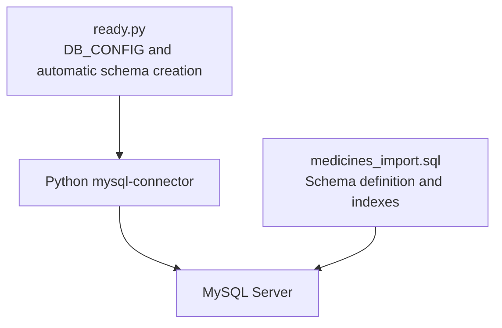
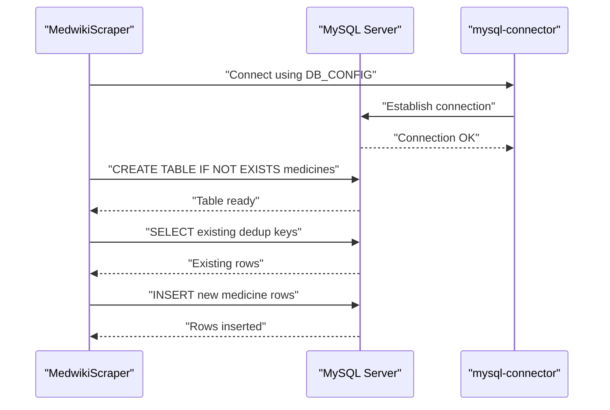
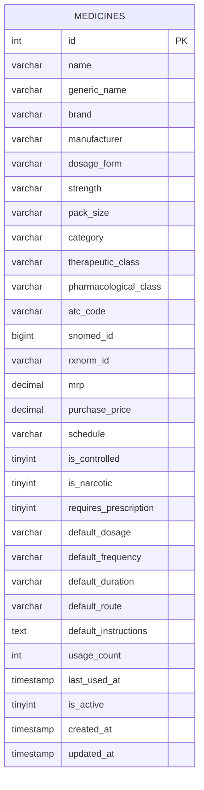
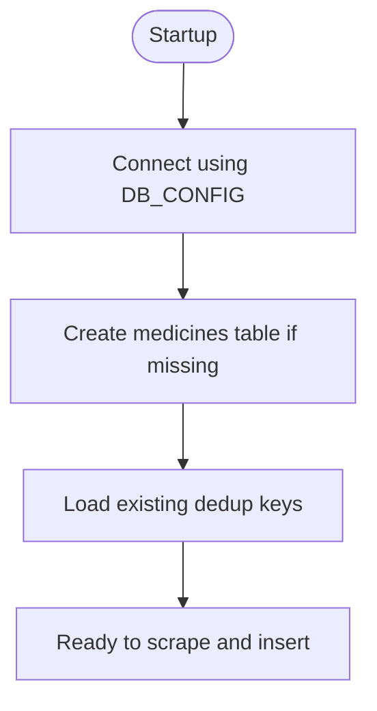
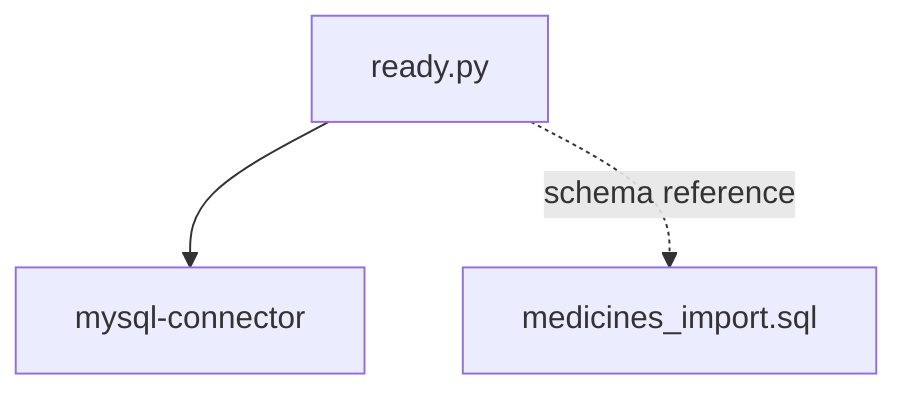

# Database Configuration

<cite>
**Referenced Files in This Document**
- [medicines_import.sql](file://medicines_import.sql)
- [ready.py](file://ready.py)
</cite>

## Table of Contents
1. [Introduction](#introduction)
2. [Project Structure](#project-structure)
3. [Core Components](#core-components)
4. [Architecture Overview](#architecture-overview)
5. [Detailed Component Analysis](#detailed-component-analysis)
6. [Dependency Analysis](#dependency-analysis)
7. [Performance Considerations](#performance-considerations)
8. [Troubleshooting Guide](#troubleshooting-guide)
9. [Conclusion](#conclusion)
10. [Appendices](#appendices)

## Introduction
This document provides comprehensive database configuration guidance for the MedWiki scraper. It covers MySQL setup, user permissions, DB_CONFIG credentials, database schema definition, connection parameters, and operational best practices. It also explains the automatic schema creation and table initialization performed by the scraper.

## Project Structure
The repository contains two primary assets relevant to database configuration:
- medicines_import.sql: Defines the medicines database schema and indexes.
- ready.py: Implements the MedwikiScraper class, including DB_CONFIG credentials and automatic schema creation.

**Diagram sources**
- [medicines_import.sql:15-60](file://medicines_import.sql#L15-L60)
- [ready.py:42-49](file://ready.py#L42-L49)
- [ready.py:67-136](file://ready.py#L67-L136)

**Section sources**
- [medicines_import.sql:1-73](file://medicines_import.sql#L1-L73)
- [ready.py:1-780](file://ready.py#L1-L780)

## Core Components
- DB_CONFIG: Connection parameters used by the scraper to connect to MySQL.
- medicines table: Schema and indexes defined in medicines_import.sql and enforced by the scraper’s automatic initialization.

Key responsibilities:
- DB_CONFIG supplies host, user, password, database, and charset.
- The scraper connects to MySQL and creates the medicines table if it does not exist.
- The scraper loads existing records to deduplicate new inserts.

**Section sources**
- [ready.py:42-49](file://ready.py#L42-L49)
- [ready.py:67-136](file://ready.py#L67-L136)
- [medicines_import.sql:15-60](file://medicines_import.sql#L15-L60)

## Architecture Overview
The scraper initializes the medicines table automatically and writes scraped data directly to MySQL. The flow below maps to actual code and schema definitions.

**Diagram sources**
- [ready.py:42-49](file://ready.py#L42-L49)
- [ready.py:67-136](file://ready.py#L67-L136)
- [ready.py:150-207](file://ready.py#L150-L207)

## Detailed Component Analysis

### Database Schema Definition (medicines table)
The medicines table is defined with the following characteristics:
- Storage engine: InnoDB
- Character set and collation: utf8mb4 with utf8mb4_unicode_ci
- Columns include identifiers, product metadata, pricing, regulatory attributes, defaults, counters, and timestamps
- Indexes include primary key, unique constraints, functional indexes, and full-text index

**Diagram sources**
- [medicines_import.sql:15-60](file://medicines_import.sql#L15-L60)

**Section sources**
- [medicines_import.sql:15-60](file://medicines_import.sql#L15-L60)

### Automatic Schema Creation and Initialization
The scraper performs the following steps during startup:
- Connects to MySQL using DB_CONFIG
- Creates the medicines table if it does not exist, using the exact schema defined in the code
- Loads existing records to build a deduplication set
- Proceeds to scrape and insert new rows

**Diagram sources**
- [ready.py:67-136](file://ready.py#L67-L136)

**Section sources**
- [ready.py:67-136](file://ready.py#L67-L136)

### Database Connection Parameters
The DB_CONFIG object defines the connection parameters used by the scraper:
- host: localhost
- user: root
- password: root
- database: medicines
- charset: utf8mb4

These values are used to establish a connection to MySQL and to initialize the medicines table.

**Section sources**
- [ready.py:42-49](file://ready.py#L42-L49)

### Indexes and Constraints
Indexes and constraints defined in the schema:
- Primary key on id
- Unique constraint on name and generic_name combination
- Functional indexes on name, generic_name, brand, category, therapeutic_class, is_active and usage_count
- Full-text index on name, generic_name, brand for fast text search
- Additional indexes for controlled substances and category filtering

**Section sources**
- [medicines_import.sql:46-59](file://medicines_import.sql#L46-L59)
- [ready.py:105-113](file://ready.py#L105-L113)

## Dependency Analysis
The scraper depends on:
- Python mysql-connector for MySQL connectivity
- The medicines_import.sql schema for reference and for the initial database load usage note

**Diagram sources**
- [ready.py:23-29](file://ready.py#L23-L29)
- [medicines_import.sql:1-73](file://medicines_import.sql#L1-L73)

**Section sources**
- [ready.py:23-29](file://ready.py#L23-L29)
- [medicines_import.sql:1-73](file://medicines_import.sql#L1-L73)

## Performance Considerations
- Use utf8mb4 character set and collation to support full Unicode, including emojis and extended characters.
- Indexes are designed to optimize common queries:
  - Exact match filters on name, generic_name, brand, category, therapeutic_class
  - Composite indexes for popularity and activity filtering
  - Full-text index for efficient text search across name, generic_name, and brand
- Consider partitioning or additional indexing strategies if the dataset grows substantially.
- Ensure MySQL server is configured with adequate buffer pool size and connection limits for concurrent scraping and insertion.

[No sources needed since this section provides general guidance]

## Troubleshooting Guide
Common issues and resolutions:
- Connection failures:
  - Verify DB_CONFIG credentials and network accessibility to the MySQL server.
  - Confirm that the medicines database exists or allow the scraper to create it automatically.
- Schema mismatch:
  - The scraper recreates the medicines table with the exact schema defined in the code. If manual schema changes were made, the scraper will overwrite them on next run.
- Duplicate detection:
  - Deduplication relies on a composite key built from name, generic_name, strength, manufacturer, dosage_form, and pack_size. Ensure these fields are populated consistently to avoid false positives.
- Encoding issues:
  - Ensure the client and server use utf8mb4 to prevent truncation or corruption of multilingual content.

**Section sources**
- [ready.py:67-136](file://ready.py#L67-L136)
- [ready.py:138-148](file://ready.py#L138-L148)

## Conclusion
The MedWiki scraper is configured to automatically manage the medicines database schema and connect using DB_CONFIG. The medicines_import.sql file documents the schema and indexes, while ready.py handles connection, schema creation, and data insertion. Following the setup steps below will ensure a secure, performant, and reliable deployment.

[No sources needed since this section summarizes without analyzing specific files]

## Appendices

### A. MySQL Setup and Security Checklist
- Create the medicines database and a dedicated MySQL user for the scraper.
- Grant minimal required privileges to the user for the medicines database.
- Configure MySQL to use utf8mb4 and appropriate collation.
- Enable SSL/TLS for connections if accessing remotely.
- Regularly audit user access and monitor slow queries.

[No sources needed since this section provides general guidance]

### B. Step-by-Step MySQL Commands (Conceptual)
- Create the medicines database.
- Create a dedicated user for the scraper.
- Grant privileges to the user for the medicines database.
- Apply MySQL configuration for utf8mb4 and performance tuning.
- Verify connectivity using DB_CONFIG values.

[No sources needed since this section provides general guidance]

### C. Backup and Recovery Procedures
- Schedule regular logical backups of the medicines database.
- Validate backups periodically and test restoration procedures.
- Consider point-in-time recovery if using binary logs.
- Store backups securely and offsite where possible.

[No sources needed since this section provides general guidance]

### D. Operational Notes
- The medicines_import.sql file includes a usage note indicating how to load the schema via the MySQL CLI. This is intended for manual schema loading scenarios.
- The scraper’s automatic initialization ensures the schema is present and up-to-date at runtime.

**Section sources**
- [medicines_import.sql:5](file://medicines_import.sql#L5)
- [ready.py:67-136](file://ready.py#L67-L136)