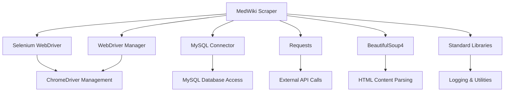
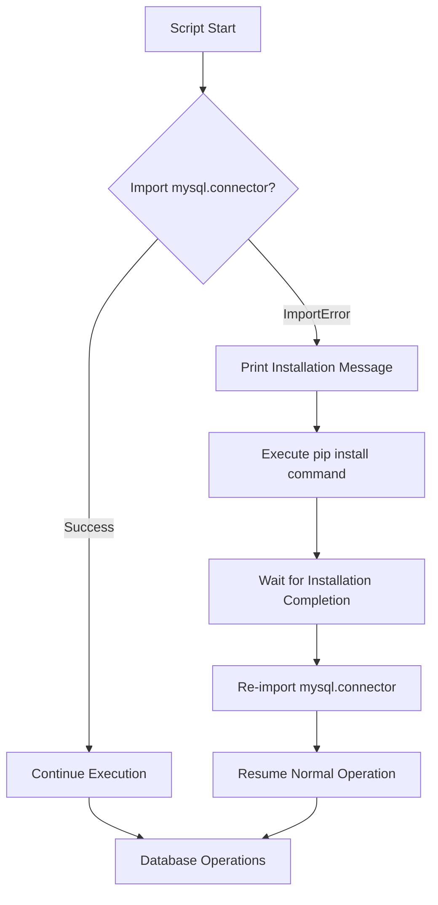

# Dependency Installation

<cite>
**Referenced Files in This Document**
- [ready.py](file://ready.py)
- [medicines_import.sql](file://medicines_import.sql)
</cite>

## Table of Contents
1. [Introduction](#introduction)
2. [Project Dependencies Overview](#project-dependencies-overview)
3. [Required Python Packages](#required-python-packages)
4. [Installation Methods](#installation-methods)
5. [Automatic Dependency Installation](#automatic-dependency-installation)
6. [Platform-Specific Considerations](#platform-specific-considerations)
7. [Version Requirements](#version-requirements)
8. [Troubleshooting Guide](#troubleshooting-guide)
9. [Alternative Installation Methods](#alternative-installation-methods)
10. [Verification Steps](#verification-steps)

## Introduction

The MedWiki scraper is a Python-based web scraping tool designed to extract pharmaceutical information from medwiki.co.in and save it directly to a MySQL database. This documentation provides comprehensive guidance for installing all required dependencies, including the automatic dependency installation feature built into the script.

## Project Dependencies Overview

The MedWiki scraper relies on several key Python packages to function properly:

- **Web Automation**: Selenium WebDriver for browser automation
- **Database Connectivity**: MySQL Connector for Python database operations  
- **Browser Management**: WebDriver Manager for automatic ChromeDriver management
- **HTTP Requests**: Requests library for external API calls
- **HTML Parsing**: BeautifulSoup4 for HTML content parsing
- **System Utilities**: Various standard libraries for logging, networking, and data processing



**Diagram sources**
- [ready.py:5-21](file://ready.py#L5-L21)

**Section sources**
- [ready.py:5-21](file://ready.py#L5-L21)

## Required Python Packages

The MedWiki scraper requires the following Python packages:

### Core Dependencies

1. **selenium** - Web automation framework for browser control
2. **mysql-connector-python** - Official MySQL driver for Python
3. **webdriver-manager** - Automatic ChromeDriver management
4. **requests** - HTTP library for external API calls
5. **beautifulsoup4** - HTML/XML parsing library

### Additional Dependencies

The script also utilizes several standard Python libraries:
- **time** - Time-related functions
- **random** - Random number generation
- **re** - Regular expressions
- **string** - String constants and functions
- **logging** - Logging framework
- **sys** - System-specific parameters
- **datetime** - Date and time manipulation

**Section sources**
- [ready.py:5-21](file://ready.py#L5-L21)

## Installation Methods

### Method 1: Standard pip Installation

#### Step 1: Install Selenium WebDriver
```bash
pip install selenium
```

#### Step 2: Install MySQL Connector
```bash
pip install mysql-connector-python
```

#### Step 3: Install WebDriver Manager
```bash
pip install webdriver-manager
```

#### Step 4: Install Requests Library
```bash
pip install requests
```

#### Step 5: Install BeautifulSoup4
```bash
pip install beautifulsoup4
```

### Method 2: Using pip with Version Pinning

For reproducible installations, use specific versions:

```bash
pip install selenium==4.15.0
pip install mysql-connector-python==8.2.1
pip install webdriver-manager==4.1.1
pip install requests==2.31.0
pip install beautifulsoup4==4.12.2
```

### Method 3: Batch Installation

Install all dependencies in a single command:
```bash
pip install selenium mysql-connector-python webdriver-manager requests beautifulsoup4
```

**Section sources**
- [ready.py:23-29](file://ready.py#L23-L29)

## Automatic Dependency Installation

The MedWiki scraper includes an intelligent automatic dependency installation feature specifically for the MySQL connector package. This feature ensures seamless operation even if the required dependencies are not initially installed.

### How It Works

The automatic installation mechanism follows this process:



**Diagram sources**
- [ready.py:23-29](file://ready.py#L23-L29)

### Automatic Installation Process

1. **Import Attempt**: The script tries to import `mysql.connector`
2. **Error Detection**: If import fails, an ImportError is caught
3. **Installation Trigger**: The script prints "Installing mysql-connector-python..." message
4. **Subprocess Execution**: Uses `subprocess.run()` with `sys.executable` to install via pip
5. **Re-import**: After successful installation, re-imports the module
6. **Continuation**: Script continues with normal execution flow

### Benefits of Automatic Installation

- **Zero Manual Intervention**: Users don't need to pre-install dependencies
- **Seamless Experience**: Installation happens transparently during script startup
- **Error Prevention**: Eliminates "ModuleNotFoundError" during execution
- **Cross-Platform Compatibility**: Works consistently across different operating systems

**Section sources**
- [ready.py:23-29](file://ready.py#L23-L29)

## Platform-Specific Considerations

### Windows Installation

#### Prerequisites
- Python 3.7 or higher
- Administrative privileges for system-wide installation
- Internet connection for package downloads

#### Installation Commands
```cmd
pip install --upgrade pip
pip install selenium mysql-connector-python webdriver-manager requests beautifulsoup4
```

#### Common Windows Issues
- **Permission Errors**: Run Command Prompt as Administrator
- **PATH Issues**: Ensure Python and Scripts directories are in PATH
- **Antivirus Interference**: Temporarily disable real-time protection if needed

### Linux Installation

#### Ubuntu/Debian Systems
```bash
sudo apt update
sudo apt install python3-pip python3-dev
pip3 install --user selenium mysql-connector-python webdriver-manager requests beautifulsoup4
```

#### CentOS/RHEL/Fedora Systems
```bash
sudo yum install python3-pip
pip3 install --user selenium mysql-connector-python webdriver-manager requests beautifulsoup4
```

#### Permission Considerations
- Use `--user` flag to install for current user only
- Avoid using `sudo` with pip when possible
- Ensure write permissions for user site-packages directory

### macOS Installation

#### Homebrew Python
```bash
brew install python
pip install selenium mysql-connector-python webdriver-manager requests beautifulsoup4
```

#### System Python (Not Recommended)
```bash
sudo pip install selenium mysql-connector-python webdriver-manager requests beautifulsoup4
```

#### macOS Specific Notes
- **Xcode Command Line Tools**: Required for compilation
- **Rosetta**: Needed for Intel-based apps on Apple Silicon
- **Code Signing**: May require additional permissions for automation

**Section sources**
- [ready.py:290-326](file://ready.py#L290-L326)

## Version Requirements

### Recommended Versions

For optimal compatibility and stability:

| Package | Recommended Version | Minimum Version | Notes |
|---------|-------------------|-----------------|-------|
| selenium | 4.15.0 | 4.10.0 | Latest stable release |
| mysql-connector-python | 8.2.1 | 8.0.0 | Official MySQL driver |
| webdriver-manager | 4.1.1 | 4.0.0 | ChromeDriver management |
| requests | 2.31.0 | 2.25.0 | HTTP library |
| beautifulsoup4 | 4.12.2 | 4.9.0 | HTML parsing |

### Version Checking

Verify installed versions:
```bash
pip show selenium mysql-connector-python webdriver-manager requests beautifulsoup4
```

### Compatibility Matrix

| Component | Compatible Versions | Notes |
|-----------|-------------------|-------|
| Python | 3.7, 3.8, 3.9, 3.10, 3.11 | Tested versions |
| MySQL | 5.7, 8.0 | Database compatibility |
| Chrome | Latest stable | Browser compatibility |
| Operating Systems | Windows, Linux, macOS | Cross-platform support |

**Section sources**
- [ready.py:23-29](file://ready.py#L23-L29)

## Troubleshooting Guide

### Common Installation Issues

#### 1. Permission Errors

**Problem**: `PermissionError: [Errno 13] Permission denied`

**Solutions**:
- **Windows**: Run Command Prompt as Administrator
- **Linux/macOS**: Use `sudo` or `--user` flag
- **Virtual Environments**: Activate environment before installation

#### 2. Network Connectivity Problems

**Problem**: `ConnectionError` or timeout during package download

**Solutions**:
- Check internet connection
- Configure proxy settings if behind corporate firewall
- Use alternative package index mirrors
- Download wheel files manually and install locally

#### 3. Version Conflicts

**Problem**: `DistributionNotFound` or dependency resolution errors

**Solutions**:
- Upgrade pip: `python -m pip install --upgrade pip`
- Clear pip cache: `pip cache purge`
- Use compatible version combinations
- Create fresh virtual environment

#### 4. Compilation Errors

**Problem**: `Microsoft Visual C++ 14.0 is required` (Windows)

**Solutions**:
- Install Microsoft C++ Build Tools
- Use pre-compiled wheel files
- Upgrade to newer Python version
- Use conda-forge channel

#### 5. Database Connection Issues

**Problem**: MySQL connection failures despite successful installation

**Solutions**:
- Verify MySQL server is running
- Check database credentials in configuration
- Ensure MySQL Connector Python is properly installed
- Test connection separately using basic Python script

### Advanced Troubleshooting

#### Virtual Environment Setup

```bash
# Create virtual environment
python -m venv medwiki_env

# Activate environment
# Windows:
medwiki_env\Scripts\activate
# Linux/macOS:
source medwiki_env/bin/activate

# Install dependencies
pip install selenium mysql-connector-python webdriver-manager requests beautifulsoup4
```

#### Dependency Verification

```python
# Test script to verify all imports work
try:
    import selenium
    import mysql.connector
    import webdriver_manager
    import requests
    import bs4
    print("All dependencies installed successfully!")
except ImportError as e:
    print(f"Missing dependency: {e}")
```

**Section sources**
- [ready.py:23-29](file://ready.py#L23-L29)
- [ready.py:134-136](file://ready.py#L134-L136)

## Alternative Installation Methods

### Method 1: Conda Installation

For scientific Python users:

```bash
conda install -c conda-forge selenium mysql-connector-python requests beautifulsoup4
conda install -c anaconda webdriver-manager
```

### Method 2: Docker Container

Create Dockerfile:
```dockerfile
FROM python:3.11-slim

WORKDIR /app
COPY requirements.txt .
RUN pip install --no-cache-dir -r requirements.txt

COPY . .

CMD ["python", "ready.py"]
```

Requirements file:
```txt
selenium>=4.10.0
mysql-connector-python>=8.0.0
webdriver-manager>=4.0.0
requests>=2.25.0
beautifulsoup4>=4.9.0
```

### Method 3: Poetry Package Management

Initialize project:
```bash
poetry init
poetry add selenium mysql-connector-python webdriver-manager requests beautifulsoup4
```

### Method 4: Pipenv Environment

```bash
pipenv install selenium mysql-connector-python webdriver-manager requests beautifulsoup4
pipenv shell
python ready.py
```

### Method 5: Manual Installation

Download wheel files:
```bash
pip install selenium-4.15.0-cp311-cp311-win_amd64.whl
pip install mysql_connector_python-8.2.1-cp311-cp311-win_amd64.whl
pip install webdriver_manager-4.1.1-py3-none-any.whl
pip install requests-2.31.0-py3-none-any.whl
pip install beautifulsoup4-4.12.2-py3-none-any.whl
```

**Section sources**
- [ready.py:23-29](file://ready.py#L23-L29)

## Verification Steps

### Step 1: Basic Import Test

Create verification script:
```python
# verification.py
def test_dependencies():
    try:
        import selenium
        import mysql.connector
        import webdriver_manager
        import requests
        import bs4
        print("✓ All dependencies imported successfully")
        return True
    except ImportError as e:
        print(f"✗ Import failed: {e}")
        return False

if __name__ == "__main__":
    test_dependencies()
```

### Step 2: Selenium WebDriver Test

```python
# selenium_test.py
from selenium import webdriver
from selenium.webdriver.chrome.options import Options

def test_selenium():
    try:
        options = Options()
        options.add_argument('--headless')
        driver = webdriver.Chrome(options=options)
        driver.quit()
        print("✓ Selenium WebDriver test passed")
        return True
    except Exception as e:
        print(f"✗ Selenium test failed: {e}")
        return False

if __name__ == "__main__":
    test_selenium()
```

### Step 3: Database Connection Test

```python
# db_test.py
import mysql.connector

def test_mysql_connection():
    try:
        connection = mysql.connector.connect(
            host='localhost',
            user='root',
            password='root',
            database='medicines'
        )
        connection.close()
        print("✓ MySQL connection test passed")
        return True
    except Exception as e:
        print(f"✗ MySQL connection test failed: {e}")
        return False

if __name__ == "__main__":
    test_mysql_connection()
```

### Step 4: Complete System Test

Run the automated dependency installation test:
```bash
python -c "import ready; print('Script runs successfully')"
```

**Section sources**
- [ready.py:23-29](file://ready.py#L23-L29)
- [ready.py:67-136](file://ready.py#L67-L136)

## Conclusion

The MedWiki scraper provides a robust and user-friendly dependency management system. The automatic installation feature for MySQL connector eliminates common setup barriers, while the comprehensive documentation ensures successful deployment across various platforms and environments.

Key benefits of this approach:
- **Zero manual intervention** for MySQL connector installation
- **Cross-platform compatibility** with platform-specific guidance
- **Comprehensive troubleshooting** for common issues
- **Multiple installation methods** to suit different development environments
- **Verification steps** to ensure proper setup

For best results, follow the platform-specific instructions, use recommended versions, and perform the verification steps outlined above. The automatic dependency installation feature will handle the MySQL connector setup seamlessly during script execution.