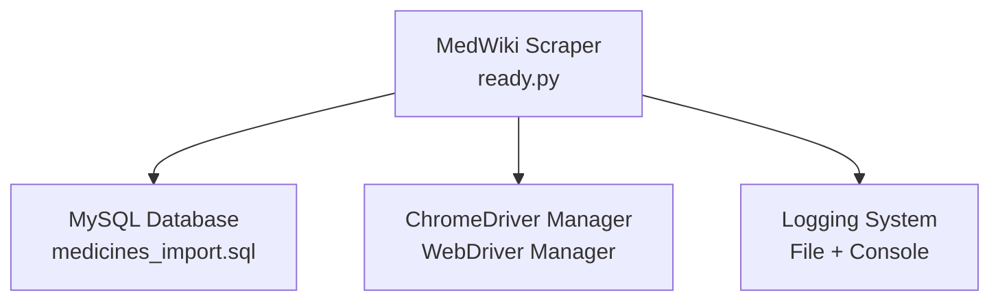
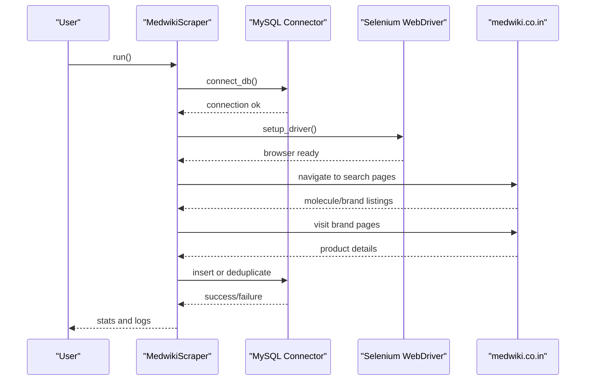
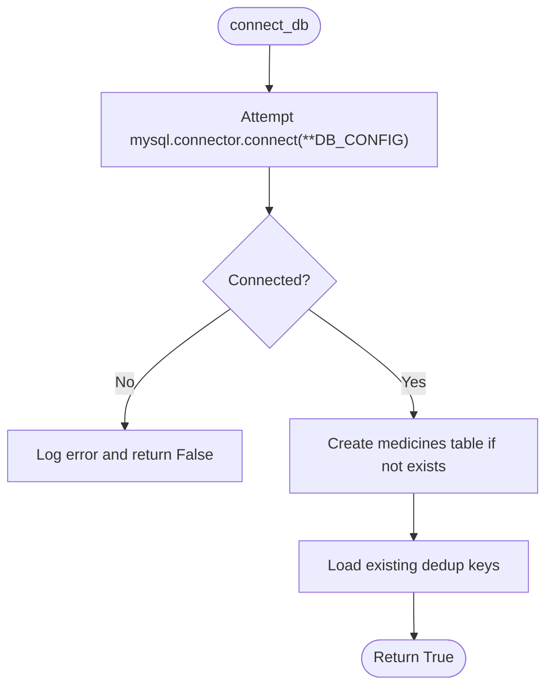
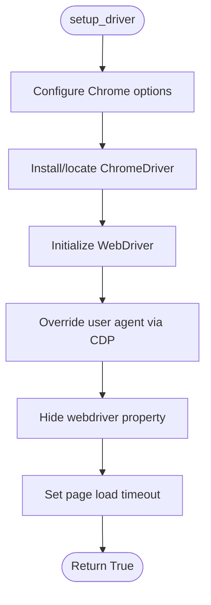
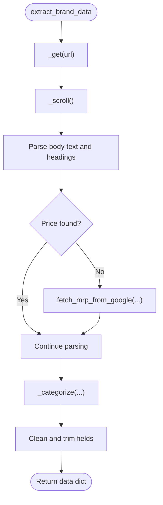
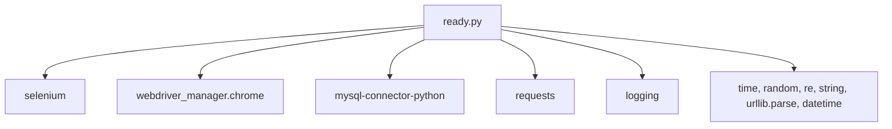

# Troubleshooting and Common Issues

<cite>
**Referenced Files in This Document**
- [ready.py](file://ready.py)
- [medicines_import.sql](file://medicines_import.sql)
</cite>

## Table of Contents
1. [Introduction](#introduction)
2. [Project Structure](#project-structure)
3. [Core Components](#core-components)
4. [Architecture Overview](#architecture-overview)
5. [Detailed Component Analysis](#detailed-component-analysis)
6. [Dependency Analysis](#dependency-analysis)
7. [Performance Considerations](#performance-considerations)
8. [Troubleshooting Guide](#troubleshooting-guide)
9. [Conclusion](#conclusion)

## Introduction
This document provides comprehensive troubleshooting guidance for installing and running the MedWiki scraper. It focuses on resolving common issues such as ChromeDriver compatibility, permission errors during dependency installation, MySQL connection failures, network/firewall/antivirus interference, browser automation anti-detection measures, and Selenium WebDriver problems. It also includes log analysis guidance, error message interpretation, and performance optimization tips for large-scale scraping operations.

## Project Structure
The repository contains two primary files:
- ready.py: The main scraper script that orchestrates browser automation, data extraction, and database insertion.
- medicines_import.sql: SQL schema for the target database table used by the scraper.

**Diagram sources**
- [ready.py:1-780](file://ready.py#L1-L780)
- [medicines_import.sql:1-73](file://medicines_import.sql#L1-L73)

**Section sources**
- [ready.py:1-780](file://ready.py#L1-L780)
- [medicines_import.sql:1-73](file://medicines_import.sql#L1-L73)

## Core Components
- Database connector and schema creation: The script dynamically connects to MySQL and creates the medicines table if it does not exist. It also loads existing records to deduplicate incoming data.
- Browser automation: Uses Selenium WebDriver with ChromeDriverManager to manage driver installation and configure anti-detection options.
- Data extraction: Implements robust parsing of brand pages to extract attributes such as name, composition, manufacturer, dosage form, strength, MRP, schedule, category, and usage instructions.
- Logging: Writes logs to both a rotating daily file and console for real-time monitoring.

Key implementation references:
- Database configuration and connection: [DB_CONFIG:43-49](file://ready.py#L43-L49), [connect_db:67-136](file://ready.py#L67-L136)
- Table creation and deduplication: [table creation:72-115](file://ready.py#L72-L115), [load existing keys:118-131](file://ready.py#L118-L131)
- Browser setup and anti-detection: [setup_driver:290-326](file://ready.py#L290-L326)
- Data extraction pipeline: [extract_brand_data:406-558](file://ready.py#L406-L558)
- Logging configuration: [logging setup:32-40](file://ready.py#L32-L40)

**Section sources**
- [ready.py:43-136](file://ready.py#L43-L136)
- [ready.py:290-326](file://ready.py#L290-L326)
- [ready.py:406-558](file://ready.py#L406-L558)
- [ready.py:32-40](file://ready.py#L32-L40)

## Architecture Overview
The scraper follows a straightforward pipeline:
- Initialize logging and database connection
- Launch a controlled Chrome session configured to reduce detection signals
- Navigate to MedWiki search endpoints and extract molecule and brand URLs
- Visit brand pages to extract product details
- Insert or deduplicate entries into the medicines table
- Close resources and report statistics

**Diagram sources**
- [ready.py:656-767](file://ready.py#L656-L767)
- [ready.py:67-136](file://ready.py#L67-L136)
- [ready.py:290-326](file://ready.py#L290-L326)

## Detailed Component Analysis

### Database Layer
- Connection parameters are defined centrally and used to establish a persistent connection.
- On first run, the medicines table is created with indexes and full-text search support.
- Deduplication is performed using a composite key built from name, generic_name, strength, manufacturer, dosage_form, and pack_size.

**Diagram sources**
- [ready.py:67-136](file://ready.py#L67-L136)

**Section sources**
- [ready.py:67-136](file://ready.py#L67-L136)

### Browser Automation Layer
- Anti-detection measures include disabling automation indicators, overriding navigator.webdriver, setting a realistic user agent, and configuring Chrome options for stability.
- ChromeDriverManager automatically installs compatible drivers.
- Navigation and waits use explicit waits to handle dynamic content loading.

**Diagram sources**
- [ready.py:290-326](file://ready.py#L290-L326)

**Section sources**
- [ready.py:290-326](file://ready.py#L290-L326)

### Data Extraction Pipeline
- Extracts product details from brand pages using heuristics and regex patterns.
- Falls back to Google search for MRP when not present on MedWiki.
- Applies categorization rules and handles missing fields gracefully.

**Diagram sources**
- [ready.py:406-558](file://ready.py#L406-L558)
- [ready.py:221-287](file://ready.py#L221-L287)

**Section sources**
- [ready.py:406-558](file://ready.py#L406-L558)
- [ready.py:221-287](file://ready.py#L221-L287)

## Dependency Analysis
- External libraries:
  - selenium: browser automation
  - webdriver_manager.chrome: automatic ChromeDriver management
  - mysql-connector-python: MySQL connectivity
  - requests: HTTP requests for MRP fallback
  - logging, time, random, re, string, urllib.parse, datetime: utilities

**Diagram sources**
- [ready.py:5-21](file://ready.py#L5-L21)

**Section sources**
- [ready.py:5-21](file://ready.py#L5-L21)

## Performance Considerations
- Randomized delays between actions reduce detection risk and server pressure.
- Explicit waits prevent premature element access.
- Deduplication reduces redundant database writes.
- Indexes on frequently queried columns improve query performance.
- Full-text search indexes accelerate text-based queries.

[No sources needed since this section provides general guidance]

## Troubleshooting Guide

### Installation and Environment Setup

- Permission errors during dependency installation
  - Symptom: pip install fails with permission denied.
  - Resolution steps:
    - Run the command prompt as Administrator.
    - Use virtual environments to avoid system-wide installations.
    - Ensure Python and pip are installed and updated.
    - Verify that the script can install mysql-connector-python automatically if missing.
  - Related code references:
    - Automatic dependency installation: [ready.py:23-29](file://ready.py#L23-L29)

- ChromeDriver compatibility issues
  - Symptom: WebDriver initialization fails with driver version mismatch.
  - Resolution steps:
    - Allow ChromeDriverManager to install the correct driver version.
    - Ensure Chrome is installed and up-to-date.
    - If offline, pre-install a compatible ChromeDriver and configure the service accordingly.
  - Related code references:
    - ChromeDriverManager usage: [ready.py:309-310](file://ready.py#L309-L310)
    - Driver options and anti-detection: [ready.py:290-326](file://ready.py#L290-L326)

- MySQL connection failures
  - Symptom: DB connection fails with authentication or host errors.
  - Resolution steps:
    - Verify MySQL is running locally or adjust host/user/password in DB_CONFIG.
    - Confirm the database exists and the user has privileges.
    - Use the provided SQL to create the medicines table if needed.
  - Related code references:
    - DB configuration: [ready.py:43-49](file://ready.py#L43-L49)
    - Connection and table creation: [ready.py:67-136](file://ready.py#L67-L136)
    - Schema definition: [medicines_import.sql:15-60](file://medicines_import.sql#L15-L60)

- Network connectivity and firewall configuration
  - Symptom: Browser cannot reach medwiki.co.in or timeouts occur.
  - Resolution steps:
    - Test connectivity to https://medwiki.co.in in a browser.
    - Temporarily disable firewall or add exceptions for Chrome and Python.
    - Configure proxy settings if behind corporate firewall.
    - Reduce page load timeout if necessary.
  - Related code references:
    - Page load timeout: [ready.py:317](file://ready.py#L317)
    - Explicit waits: [ready.py:318](file://ready.py#L318)
    - Navigation attempts: [ready.py:328-347](file://ready.py#L328-L347)

- Antivirus interference
  - Symptom: Chrome or Python processes blocked or terminated unexpectedly.
  - Resolution steps:
    - Add trusted paths for Python, Chrome, and ChromeDriver to antivirus exclusions.
    - Run in a controlled environment without aggressive security policies.
    - Temporarily disable real-time scanning during runs.

- Browser automation anti-detection measures
  - Symptom: Sites detect automation and block navigation.
  - Resolution steps:
    - Use anti-detection options already enabled in the script (e.g., disabling automation flags, overriding navigator.webdriver).
    - Avoid headless mode if the site blocks it.
    - Rotate user agents and vary timing between requests.
  - Related code references:
    - Anti-detection options: [ready.py:290-326](file://ready.py#L290-L326)

- Selenium WebDriver problems
  - Symptom: WebDriver initialization errors or stale sessions.
  - Resolution steps:
    - Ensure ChromeDriverManager is available and can download drivers.
    - Close and quit the driver cleanly in finally blocks.
    - Increase timeouts and retry logic for flaky pages.
  - Related code references:
    - Driver setup and teardown: [ready.py:290-326](file://ready.py#L290-L326), [ready.py:749-755](file://ready.py#L749-L755)

- Log file analysis and error message interpretation
  - Symptom: Unclear failure reasons or repeated errors.
  - Resolution steps:
    - Review the daily log file generated under the current directory.
    - Look for DB connection errors, driver setup failures, timeouts, or extraction errors.
    - Use error counts and messages to pinpoint failing stages.
  - Related code references:
    - Logging configuration: [ready.py:32-40](file://ready.py#L32-L40)
    - DB error logging: [ready.py:135](file://ready.py#L135)
    - Browser setup error logging: [ready.py:325](file://ready.py#L325)
    - Extraction error logging: [ready.py:557](file://ready.py#L557)

- Performance optimization and resource management for large-scale scraping
  - Recommendations:
    - Use smaller batches and stagger requests to avoid rate limits.
    - Monitor memory usage and periodically restart the process.
    - Optimize regex patterns and reduce unnecessary DOM parsing.
    - Use database transactions strategically to batch inserts.
    - Limit concurrent instances to prevent resource contention.
  - Related code references:
    - Delays and retries: [ready.py:328-347](file://ready.py#L328-L347)
    - Deduplication to reduce writes: [ready.py:166-170](file://ready.py#L166-L170)
    - Database commit/rollback: [ready.py:196-207](file://ready.py#L196-L207)

**Section sources**
- [ready.py:23-29](file://ready.py#L23-L29)
- [ready.py:309-310](file://ready.py#L309-L310)
- [ready.py:43-49](file://ready.py#L43-L49)
- [ready.py:67-136](file://ready.py#L67-L136)
- [medicines_import.sql:15-60](file://medicines_import.sql#L15-L60)
- [ready.py:317](file://ready.py#L317)
- [ready.py:318](file://ready.py#L318)
- [ready.py:328-347](file://ready.py#L328-L347)
- [ready.py:290-326](file://ready.py#L290-L326)
- [ready.py:325](file://ready.py#L325)
- [ready.py:557](file://ready.py#L557)
- [ready.py:135](file://ready.py#L135)
- [ready.py:32-40](file://ready.py#L32-L40)
- [ready.py:166-170](file://ready.py#L166-L170)
- [ready.py:196-207](file://ready.py#L196-L207)
- [ready.py:749-755](file://ready.py#L749-L755)

## Conclusion
This guide consolidates practical troubleshooting steps for the MedWiki scraper, covering installation, environment setup, browser automation, database connectivity, network/firewall/antivirus issues, and performance tuning. By following the step-by-step procedures and leveraging the provided references, you can systematically diagnose and resolve most issues encountered during installation and operation.