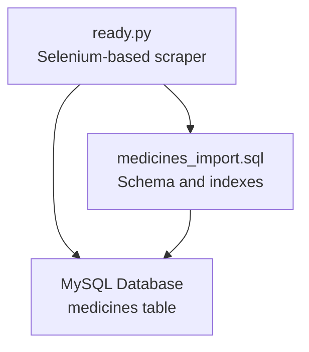
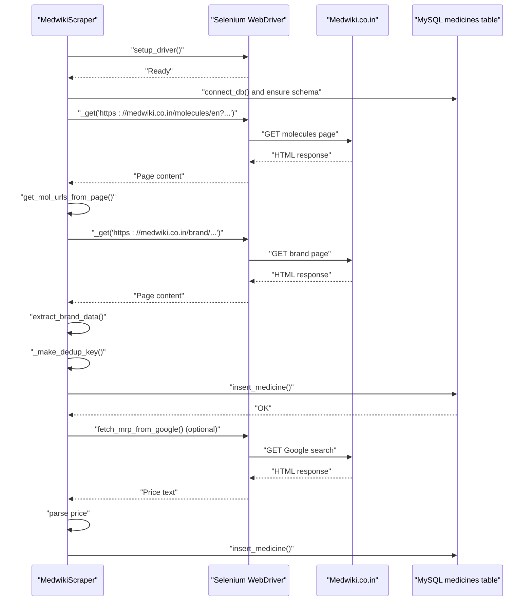
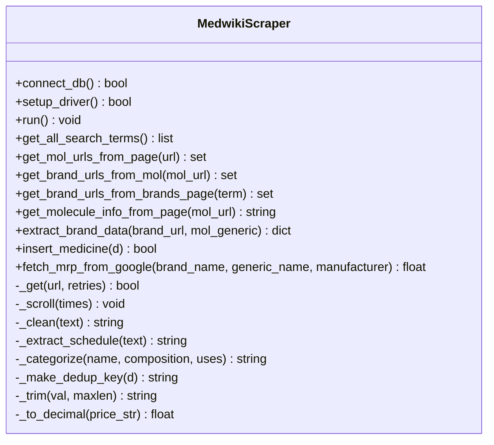
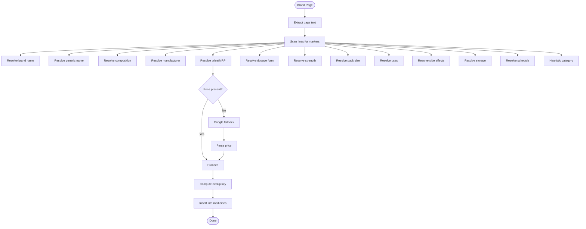
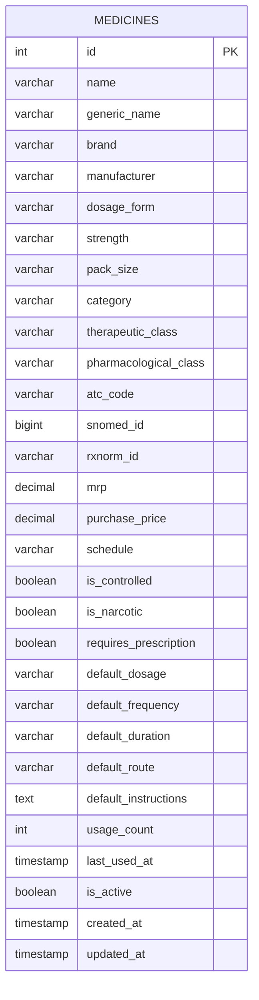
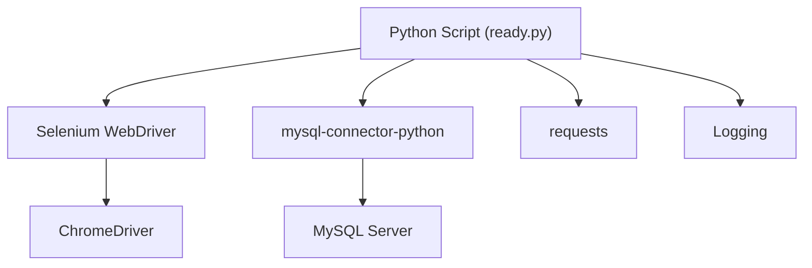
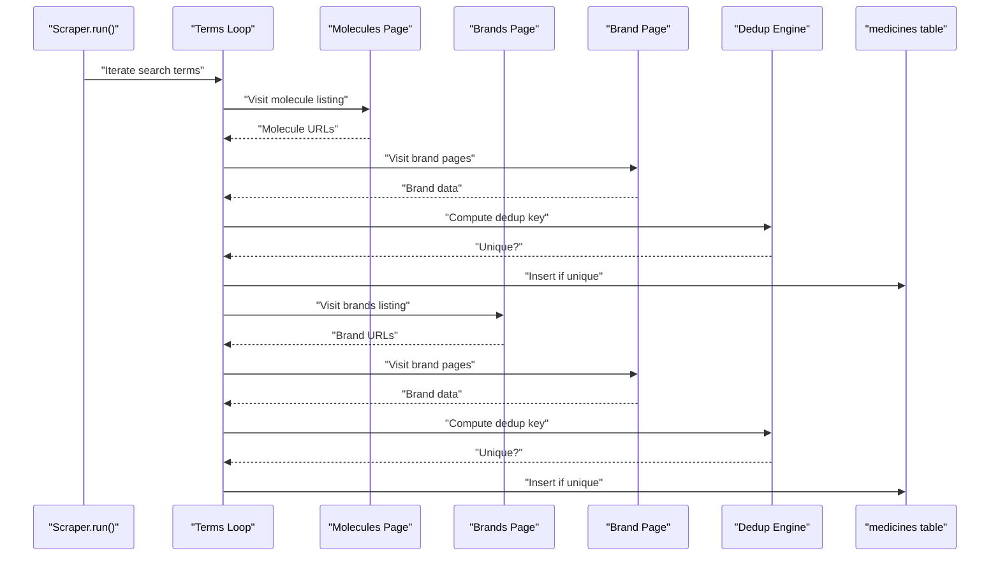

# Project Overview

<cite>
**Referenced Files in This Document**
- [ready.py](file://ready.py)
- [medicines_import.sql](file://medicines_import.sql)
</cite>

## Table of Contents
1. [Introduction](#introduction)
2. [Project Structure](#project-structure)
3. [Core Components](#core-components)
4. [Architecture Overview](#architecture-overview)
5. [Detailed Component Analysis](#detailed-component-analysis)
6. [Dependency Analysis](#dependency-analysis)
7. [Performance Considerations](#performance-considerations)
8. [Troubleshooting Guide](#troubleshooting-guide)
9. [Conclusion](#conclusion)
10. [Appendices](#appendices)

## Introduction
This document presents the MedWiki project overview for a specialized web scraping application that aggregates Indian medicine information from Medwiki.co.in. The tool is implemented as a Selenium-based ETL pipeline that navigates the target website, extracts structured data from brand pages and molecule pages, performs deduplication, and inserts clean, normalized records into a MySQL database. It is designed to support healthcare data management systems by providing a curated dataset of medicines with standardized attributes such as name, generic name, manufacturer, dosage form, strength, pack size, category, therapeutic class, MRP, and regulatory scheduling indicators.

The project’s scope focuses on:
- Aggregating brand-level medicine pages across alphabetic and search-based listings on Medwiki.co.in
- Extracting and normalizing textual fields from HTML content
- Enforcing deduplication across multiple data sources and fields
- Persisting data into a dedicated medicines table aligned with typical healthcare IT schemas

Limitations and considerations:
- Reliance on external site structure and navigation patterns
- Potential rate limiting and anti-bot measures on the source site
- Accuracy of extracted fields depends on page content and layout
- Ethical and legal compliance with robots.txt and terms of service of the source site

## Project Structure
The repository contains two primary assets:
- A Python script that orchestrates browser automation, data extraction, deduplication, and database persistence
- A SQL script that defines the medicines table schema and indexes, intended for initial setup or verification

**Diagram sources**
- [ready.py:52-115](file://ready.py#L52-L115)
- [medicines_import.sql:15-60](file://medicines_import.sql#L15-L60)

**Section sources**
- [ready.py:52-115](file://ready.py#L52-L115)
- [medicines_import.sql:15-60](file://medicines_import.sql#L15-L60)

## Core Components
- MedwikiScraper class: Central orchestrator for browser setup, navigation, data extraction, deduplication, and database operations
- Database connector: Establishes a MySQL connection and ensures the medicines table exists with appropriate indexes
- Deduplication engine: Maintains sets of seen URLs and computed dedup keys to prevent duplicate inserts
- Extraction routines: Parse brand pages and molecule pages to populate standardized fields
- Google fallback: Attempts to resolve missing MRP values by searching Google for brand-generic-manufacturer combinations

Key implementation highlights:
- Selenium WebDriver with ChromeOptions configured for stability and reduced detection signals
- Robust wait strategies and retry logic for page loads
- Regex-based parsing for pricing, dosage forms, strengths, schedules, categories, and usage instructions
- Inline insertion into the medicines table with controlled field mapping and sanitization

**Section sources**
- [ready.py:52-115](file://ready.py#L52-L115)
- [ready.py:138-208](file://ready.py#L138-L208)
- [ready.py:406-559](file://ready.py#L406-L559)
- [ready.py:655-767](file://ready.py#L655-L767)

## Architecture Overview
The system follows a Selenium-driven ETL flow:
- Initialize browser and database
- Generate search terms (single letters and common medical prefixes)
- Navigate to molecule and brands pages, collect URLs for molecules and brands
- Visit brand pages to extract structured fields
- Compute deduplication keys and insert into the medicines table
- Optionally fetch MRP from Google when not present on the source site

**Diagram sources**
- [ready.py:290-326](file://ready.py#L290-L326)
- [ready.py:328-347](file://ready.py#L328-L347)
- [ready.py:583-597](file://ready.py#L583-L597)
- [ready.py:599-613](file://ready.py#L599-L613)
- [ready.py:615-633](file://ready.py#L615-L633)
- [ready.py:406-559](file://ready.py#L406-L559)
- [ready.py:138-208](file://ready.py#L138-L208)
- [ready.py:221-287](file://ready.py#L221-L287)

## Detailed Component Analysis

### MedwikiScraper Class
Responsibilities:
- Manage browser lifecycle and navigation
- Connect to MySQL and create/verify the medicines table
- Generate search terms and traverse molecule and brand pages
- Extract structured fields from brand pages
- Compute deduplication keys and insert records
- Optionally enrich missing MRP via Google search

Design patterns:
- Stateful orchestration with runtime caches for seen URLs
- Regex-driven parsing for robust extraction across varied page layouts
- Controlled field mapping to align with healthcare IT expectations

**Diagram sources**
- [ready.py:52-767](file://ready.py#L52-L767)

**Section sources**
- [ready.py:52-767](file://ready.py#L52-L767)

### Data Extraction Patterns
Extraction targets include:
- Brand name and generic name
- Composition and strength
- Manufacturer
- Dosage form and pack size
- Uses, side effects, contraindications, warnings, storage
- Prescription requirement and regulatory schedule
- Category derived from heuristics
- MRP (directly from the site or via Google search)

Parsing strategy:
- Title-based extraction for brand names
- Line-by-line scanning with contextual markers for composition, manufacturer, uses, side effects, storage
- Regex patterns for dosage forms, strengths, pack sizes, and currency amounts
- Heuristic categorization based on keywords in name, composition, and uses

**Diagram sources**
- [ready.py:406-559](file://ready.py#L406-L559)
- [ready.py:221-287](file://ready.py#L221-L287)
- [ready.py:138-208](file://ready.py#L138-L208)

**Section sources**
- [ready.py:406-559](file://ready.py#L406-L559)
- [ready.py:221-287](file://ready.py#L221-L287)
- [ready.py:138-208](file://ready.py#L138-L208)

### Database Design and Integration
The medicines table is designed for healthcare data management:
- Unique constraints and indexes for efficient lookups and deduplication
- Full-text search capabilities for fast discovery
- Fields for regulatory identifiers and scheduling flags
- Timestamps for audit and change tracking

**Diagram sources**
- [medicines_import.sql:15-60](file://medicines_import.sql#L15-L60)
- [ready.py:73-115](file://ready.py#L73-L115)

**Section sources**
- [medicines_import.sql:15-60](file://medicines_import.sql#L15-L60)
- [ready.py:73-115](file://ready.py#L73-L115)

## Dependency Analysis
External dependencies and integrations:
- Selenium WebDriver for browser automation
- ChromeDriver via webdriver_manager
- MySQL connector for Python
- Requests for optional Google search integration
- Logging for operational visibility

**Diagram sources**
- [ready.py:5-30](file://ready.py#L5-L30)
- [ready.py:221-287](file://ready.py#L221-L287)

**Section sources**
- [ready.py:5-30](file://ready.py#L5-L30)
- [ready.py:221-287](file://ready.py#L221-L287)

## Performance Considerations
- Browser initialization and page load timeouts are tuned for reliability
- Randomized delays between requests reduce server-side detection risk
- Scroll-based pagination traversal reduces reliance on explicit pagination controls
- Deduplication caches minimize redundant database writes
- Index selection in the medicines table balances write and read performance

[No sources needed since this section provides general guidance]

## Troubleshooting Guide
Common issues and mitigations:
- Browser setup failures: Verify Chrome installation and driver compatibility; review logs for errors
- Page load timeouts: Increase timeout values or adjust network conditions
- Anti-bot protections: The script includes user agent overrides and disabling automation flags
- Database connectivity: Confirm host, user, password, and database name; ensure MySQL service is running
- Extraction inconsistencies: Regex patterns may need updates if site markup changes; monitor logs for extraction errors

Operational tips:
- Monitor log files generated during runs for insights into errors and skipped entries
- Periodically review deduplication statistics to assess coverage and effectiveness
- Validate database schema alignment with the medicines_import.sql definition

**Section sources**
- [ready.py:290-326](file://ready.py#L290-L326)
- [ready.py:328-347](file://ready.py#L328-L347)
- [ready.py:138-208](file://ready.py#L138-L208)
- [ready.py:749-767](file://ready.py#L749-L767)

## Conclusion
The MedWiki project demonstrates a practical, end-to-end ETL pipeline for aggregating Indian medicine data from Medwiki.co.in. By combining Selenium-based browser automation, robust extraction logic, and a deduplicated MySQL schema, it produces a structured dataset suitable for healthcare data management systems. The approach balances reliability and scalability while remaining adaptable to evolving site structures.

[No sources needed since this section summarizes without analyzing specific files]

## Appendices

### Practical Example: Scraping Workflow
- Start the scraper to initialize the browser and database
- Iterate through search terms (alphabetic and prefixed)
- From molecule pages, collect molecule URLs and navigate to brand pages
- From brands pages, collect brand URLs directly
- For each brand page, extract fields and compute a deduplication key
- Insert the record into the medicines table if not a duplicate
- If MRP is missing, attempt to fetch from Google and parse the result
- Continue until all terms are processed, logging progress and statistics

**Diagram sources**
- [ready.py:655-767](file://ready.py#L655-L767)
- [ready.py:583-633](file://ready.py#L583-L633)
- [ready.py:406-559](file://ready.py#L406-L559)
- [ready.py:138-208](file://ready.py#L138-L208)

### Scope, Limitations, and Ethical Considerations
Scope:
- Covers alphabetic and prefixed search terms
- Focuses on brand pages and molecule pages for comprehensive coverage
- Provides MRP enrichment via Google search when unavailable on the source site

Limitations:
- Relies on the structure and availability of Medwiki.co.in pages
- Parsing accuracy depends on consistent markup; changes may require regex updates
- Rate limits and anti-bot measures may impact throughput

Ethics and compliance:
- Respect robots.txt and terms of service of the source site
- Use reasonable delays and avoid excessive load
- Limit data usage to intended purposes and ensure privacy/compliance with applicable regulations

[No sources needed since this section provides general guidance]