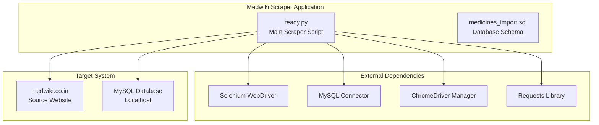
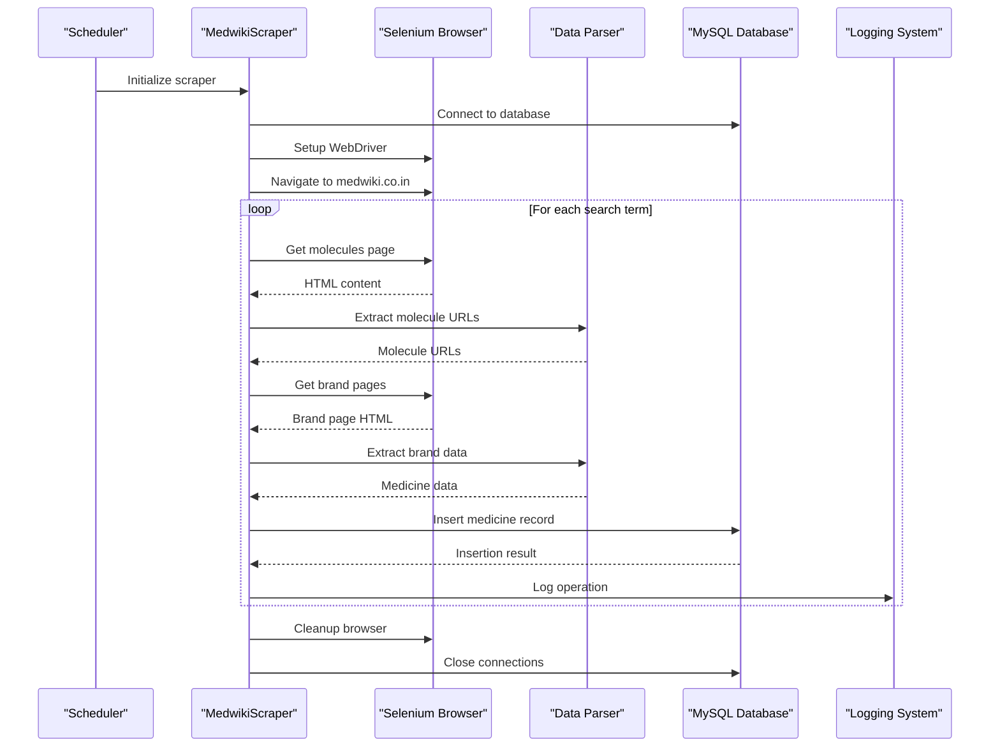
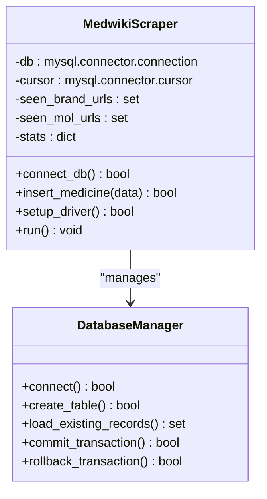
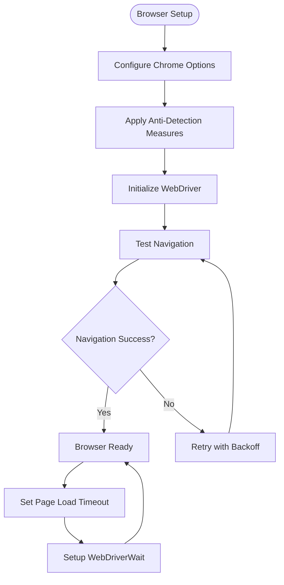
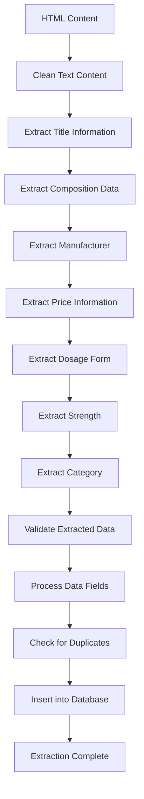
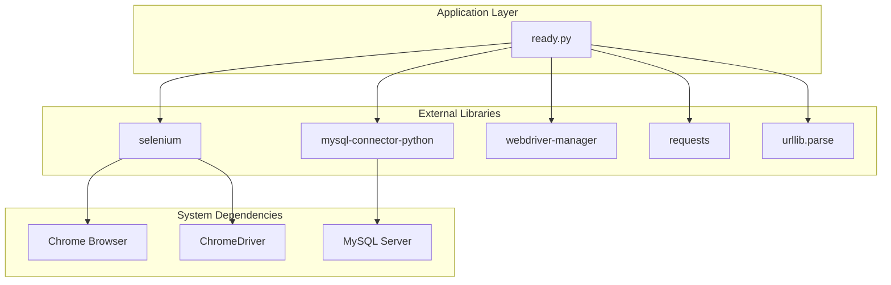

# Troubleshooting and FAQ

<cite>
**Referenced Files in This Document**
- [medicines_import.sql](file://medicines_import.sql)
- [ready.py](file://ready.py)
</cite>

## Table of Contents
1. [Introduction](#introduction)
2. [Project Structure](#project-structure)
3. [Core Components](#core-components)
4. [Architecture Overview](#architecture-overview)
5. [Detailed Component Analysis](#detailed-component-analysis)
6. [Dependency Analysis](#dependency-analysis)
7. [Performance Considerations](#performance-considerations)
8. [Troubleshooting Guide](#troubleshooting-guide)
9. [FAQ](#faq)
10. [Monitoring and Alerting](#monitoring-and-alerting)
11. [Maintenance Procedures](#maintenance-procedures)
12. [Escalation Procedures](#escalation-procedures)
13. [Conclusion](#conclusion)

## Introduction
This document provides comprehensive troubleshooting guidance for the Medwiki scraper application. It addresses common issues including browser automation failures, database connection errors, network timeouts, and parsing inconsistencies. The guide includes systematic debugging approaches, performance optimization techniques, and operational procedures for production deployments.

## Project Structure
The repository contains a minimal but functional scraping application with two primary components:

**Diagram sources**
- [ready.py:1-780](file://ready.py#L1-L780)
- [medicines_import.sql:1-73](file://medicines_import.sql#L1-L73)

**Section sources**
- [ready.py:1-780](file://ready.py#L1-L780)
- [medicines_import.sql:1-73](file://medicines_import.sql#L1-L73)

## Core Components
The application consists of several key components working together to scrape and process medicine data:

### Database Management
The scraper manages a MySQL database with specialized indexing for efficient querying and deduplication. The schema includes comprehensive medicine attributes and multiple indexing strategies for optimal performance.

### Web Automation Engine
Built with Selenium WebDriver, the application handles browser automation with anti-detection measures and robust error handling for network issues.

### Data Extraction Pipeline
Intelligent parsing logic extracts structured information from medicine pages, including pricing, composition, and therapeutic categories.

**Section sources**
- [ready.py:42-49](file://ready.py#L42-L49)
- [ready.py:66-137](file://ready.py#L66-L137)
- [medicines_import.sql:15-60](file://medicines_import.sql#L15-L60)

## Architecture Overview
The system follows a pipeline architecture with clear separation of concerns:

**Diagram sources**
- [ready.py:655-767](file://ready.py#L655-L767)
- [ready.py:290-327](file://ready.py#L290-L327)

## Detailed Component Analysis

### Database Connection Management
The application implements robust database connectivity with automatic schema creation and deduplication support:

**Diagram sources**
- [ready.py:52-137](file://ready.py#L52-L137)
- [ready.py:66-137](file://ready.py#L66-L137)

**Section sources**
- [ready.py:66-137](file://ready.py#L66-L137)
- [medicines_import.sql:15-60](file://medicines_import.sql#L15-L60)

### Browser Automation Engine
The Selenium-based browser automation includes sophisticated anti-detection measures and retry mechanisms:

**Diagram sources**
- [ready.py:290-327](file://ready.py#L290-L327)

**Section sources**
- [ready.py:290-327](file://ready.py#L290-L327)

### Data Extraction Pipeline
The extraction system processes HTML content through multiple parsing stages:

**Diagram sources**
- [ready.py:406-558](file://ready.py#L406-L558)

**Section sources**
- [ready.py:406-558](file://ready.py#L406-L558)

## Dependency Analysis
The application has clear dependency relationships that impact troubleshooting:

**Diagram sources**
- [ready.py:5-22](file://ready.py#L5-L22)

**Section sources**
- [ready.py:5-22](file://ready.py#L5-L22)

## Performance Considerations
The application implements several optimization strategies:

### Memory Management
- Runtime deduplication using sets to prevent duplicate processing
- Efficient database transactions with rollback capabilities
- Controlled browser window management to prevent memory leaks

### Network Optimization
- Configurable retry mechanisms with exponential backoff
- Randomized delays between requests to avoid detection
- Intelligent timeout settings for different page types

### Database Performance
- Comprehensive indexing strategy for fast lookups
- Batch processing with transaction boundaries
- Optimized query patterns for deduplication checks

**Section sources**
- [ready.py:59-64](file://ready.py#L59-L64)
- [ready.py:118-131](file://ready.py#L118-L131)
- [medicines_import.sql:46-59](file://medicines_import.sql#L46-L59)

## Troubleshooting Guide

### Browser Automation Failures

#### Common Symptoms
- Browser fails to start or crashes immediately
- Pages load but elements are not found
- Timeout exceptions during page loading
- CAPTCHA or bot detection screens

#### Diagnostic Steps
1. **Verify Chrome Installation**: Ensure Chrome browser is properly installed
2. **Check ChromeDriver Compatibility**: Verify ChromeDriver version matches Chrome
3. **Test Manual Navigation**: Attempt manual browsing to the target website
4. **Review Anti-Detection Settings**: Check browser configuration options

#### Resolution Strategies
- Update ChromeDriver to match Chrome version
- Disable headless mode for debugging
- Increase page load timeouts for slow networks
- Add additional anti-detection headers

**Section sources**
- [ready.py:290-327](file://ready.py#L290-L327)
- [ready.py:328-347](file://ready.py#L328-L347)

### Database Connection Errors

#### Common Symptoms
- Connection refused errors
- Authentication failures
- Database not found errors
- Transaction rollback failures

#### Diagnostic Steps
1. **Verify MySQL Service**: Ensure MySQL server is running
2. **Check Credentials**: Validate database credentials and permissions
3. **Test Connection**: Use command-line client to test connectivity
4. **Review Schema**: Verify database schema exists and is correct

#### Resolution Strategies
- Install missing MySQL connector package
- Update database credentials in configuration
- Create database manually if not exists
- Check firewall and network connectivity

**Section sources**
- [ready.py:66-137](file://ready.py#L66-L137)
- [medicines_import.sql:8-10](file://medicines_import.sql#L8-L10)

### Network Timeouts and Connectivity Issues

#### Common Symptoms
- HTTP 429 Too Many Requests
- SSL certificate errors
- DNS resolution failures
- Proxy authentication required

#### Diagnostic Steps
1. **Test Network Connectivity**: Ping target website and resolve DNS
2. **Check Proxy Settings**: Verify proxy configuration if applicable
3. **Test SSL Certificates**: Validate SSL/TLS certificates
4. **Monitor Bandwidth**: Check network bandwidth and latency

#### Resolution Strategies
- Implement rate limiting and backoff strategies
- Configure proxy settings if required
- Update SSL certificates and trust stores
- Use rotating IP addresses for multiple requests

**Section sources**
- [ready.py:328-347](file://ready.py#L328-L347)
- [ready.py:221-287](file://ready.py#L221-L287)

### Parsing Inconsistencies and Data Extraction Issues

#### Common Symptoms
- Missing or incorrect medicine information
- Inconsistent pricing data
- Wrong therapeutic classification
- Duplicate entries despite deduplication

#### Diagnostic Steps
1. **Review Target Website Structure**: Analyze HTML structure changes
2. **Test Extraction Patterns**: Validate regex patterns against sample data
3. **Check Data Validation**: Verify extracted data meets business rules
4. **Monitor Deduplication Logic**: Ensure duplicate detection works correctly

#### Resolution Strategies
- Update regex patterns for new HTML structures
- Implement fallback extraction methods
- Enhance data validation rules
- Improve deduplication key generation

**Section sources**
- [ready.py:406-558](file://ready.py#L406-L558)
- [ready.py:138-148](file://ready.py#L138-L148)

### Error Codes and Warning Messages

#### Database Errors
- **1045**: Access denied for user
- **2003**: Can't connect to MySQL server
- **1146**: Table doesn't exist
- **1062**: Duplicate entry for key constraint

#### Browser Automation Errors
- **TimeoutException**: Page load timeout exceeded
- **NoSuchElementException**: Element not found
- **WebDriverException**: General WebDriver error
- **InvalidSessionIdException**: Session expired

#### Network Errors
- **ConnectionRefusedError**: Connection refused
- **TimeoutError**: Operation timed out
- **SSLError**: SSL certificate error
- **HTTPError**: HTTP request failed

**Section sources**
- [ready.py:134-136](file://ready.py#L134-L136)
- [ready.py:555-558](file://ready.py#L555-L558)

## FAQ

### Ethical and Legal Considerations

#### Is web scraping legal?
Web scraping legality depends on several factors:
- Terms of service of the target website
- Copyright and intellectual property laws
- Fair use doctrine and commercial vs. non-commercial use
- Data protection and privacy regulations

#### Best Practices for Responsible Scraping
- Respect robots.txt and terms of service
- Implement reasonable rate limits
- Use appropriate user agents
- Handle errors gracefully
- Store data responsibly
- Consider API alternatives when available

#### Compliance Guidelines
- Review website terms before scraping
- Limit request frequency to avoid burden
- Cache data appropriately
- Remove sensitive information
- Document scraping activities
- Consider licensing requirements

### Technical Questions

#### How often should I run the scraper?
- Daily for frequently changing prices
- Weekly for static information
- Monthly for slowly changing data
- Adjust based on target website update frequency

#### What happens if the target website changes?
- Update extraction patterns accordingly
- Monitor for structural changes
- Implement fallback methods
- Test regularly for compatibility

#### How do I handle blocked access?
- Rotate user agents and headers
- Use proxy rotation
- Implement random delays
- Respect robots.txt
- Consider API alternatives

### Performance and Optimization

#### How can I improve scraping speed?
- Use headless mode for faster execution
- Optimize browser settings
- Implement parallel processing
- Use efficient selectors
- Minimize DOM traversal

#### What are the memory requirements?
- Minimum 2GB RAM for basic operation
- Additional memory for large datasets
- Monitor memory usage during long runs
- Implement cleanup routines

## Monitoring and Alerting

### Production Monitoring Strategy

#### Health Checks
- Database connectivity monitoring
- Browser automation health checks
- Target website availability
- Resource utilization metrics

#### Alerting Mechanisms
- Email notifications for critical failures
- Slack/webhook alerts for major issues
- Log aggregation and analysis
- Performance degradation alerts

#### Metrics to Track
- Successful extraction rates
- Error rates and types
- Processing time per batch
- Memory and CPU usage
- Database query performance

### Log Analysis Procedures

#### Log Levels and Purposes
- **DEBUG**: Detailed operational information
- **INFO**: General operational information
- **WARNING**: Potentially problematic situations
- **ERROR**: Error conditions requiring attention

#### Log Analysis Tools
- ELK Stack (Elasticsearch, Logstash, Kibana)
- Splunk for enterprise logging
- CloudWatch for AWS deployments
- Local log rotation and retention

**Section sources**
- [ready.py:31-40](file://ready.py#L31-L40)

## Maintenance Procedures

### Database Maintenance

#### Regular Tasks
- **Index Optimization**: Regular index analysis and rebuilding
- **Table Maintenance**: Analyze and optimize tables periodically
- **Backup Verification**: Regular backup testing and verification
- **Schema Updates**: Apply database schema changes as needed

#### Cleanup Procedures
- Remove duplicate records systematically
- Archive old or unused data
- Optimize storage space
- Monitor table growth patterns

### System Maintenance

#### Software Updates
- **Python Packages**: Regular pip updates
- **Browser Updates**: Keep Chrome and ChromeDriver current
- **Dependencies**: Update system libraries
- **Security Patches**: Apply security updates promptly

#### Environment Management
- **Virtual Environments**: Use isolated Python environments
- **Configuration Management**: Centralize configuration settings
- **Secrets Management**: Secure credential storage
- **Environment Variables**: Proper environment isolation

### Log Rotation and Management

#### Log Rotation Strategy
- **Size-based Rotation**: Rotate logs when exceeding size limits
- **Time-based Rotation**: Daily/weekly/monthly rotation schedules
- **Compression**: Compress rotated logs for storage efficiency
- **Retention Policy**: Define log retention periods

#### Storage Management
- Monitor disk usage for log files
- Implement automated cleanup policies
- Archive logs to external storage
- Monitor log file growth trends

**Section sources**
- [ready.py:31-40](file://ready.py#L31-L40)
- [medicines_import.sql:64-72](file://medicines_import.sql#L64-L72)

## Escalation Procedures

### Critical Issue Escalation

#### Tier 1 Response (Initial)
- **Response Time**: Within 1 hour
- **Actions**: Basic troubleshooting and restart
- **Communication**: Initial status update
- **Resolution**: Simple fixes and workarounds

#### Tier 2 Response (Advanced)
- **Response Time**: Within 4 hours
- **Actions**: Deep debugging and analysis
- **Communication**: Progress updates and ETA
- **Resolution**: Complex fixes and patches

#### Tier 3 Response (Expert)
- **Response Time**: Within 8 hours
- **Actions**: Architectural review and major fixes
- **Communication**: Detailed progress reports
- **Resolution**: System redesign and improvements

### Support Resources

#### Internal Resources
- **Development Team**: Primary support contact
- **DevOps Team**: Infrastructure and deployment support
- **Database Administrators**: Database-related issues
- **Security Team**: Compliance and security concerns

#### External Resources
- **Vendor Support**: ChromeDriver and browser vendor support
- **Community Forums**: Python and Selenium community
- **Documentation**: Official library documentation
- **Professional Services**: External consulting when needed

### Communication Protocols

#### Incident Reporting
- **Immediate Notification**: Critical issues require immediate reporting
- **Status Updates**: Regular progress updates during resolution
- **Resolution Documentation**: Complete documentation of fixes
- **Post-mortem Analysis**: Lessons learned and prevention strategies

#### Stakeholder Communication
- **Executive Reports**: High-level summaries for management
- **Technical Details**: Detailed analysis for technical teams
- **User Impact**: Clear communication of user-facing effects
- **Timeline Expectations**: Realistic timelines for resolution

## Conclusion
This troubleshooting guide provides comprehensive coverage of common issues and their solutions for the Medwiki scraper application. The key to successful operation lies in understanding the system architecture, implementing proper monitoring, and following established maintenance procedures. Regular updates, careful logging, and adherence to ethical scraping practices will ensure reliable operation in production environments.

The modular design of the application allows for targeted troubleshooting while maintaining system stability. By following the diagnostic steps and resolution strategies outlined in this document, most issues can be resolved efficiently with minimal downtime.