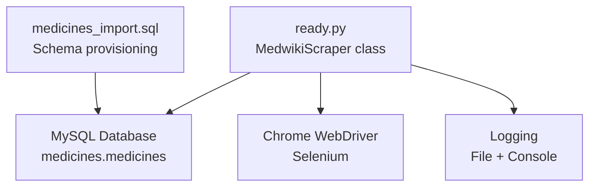
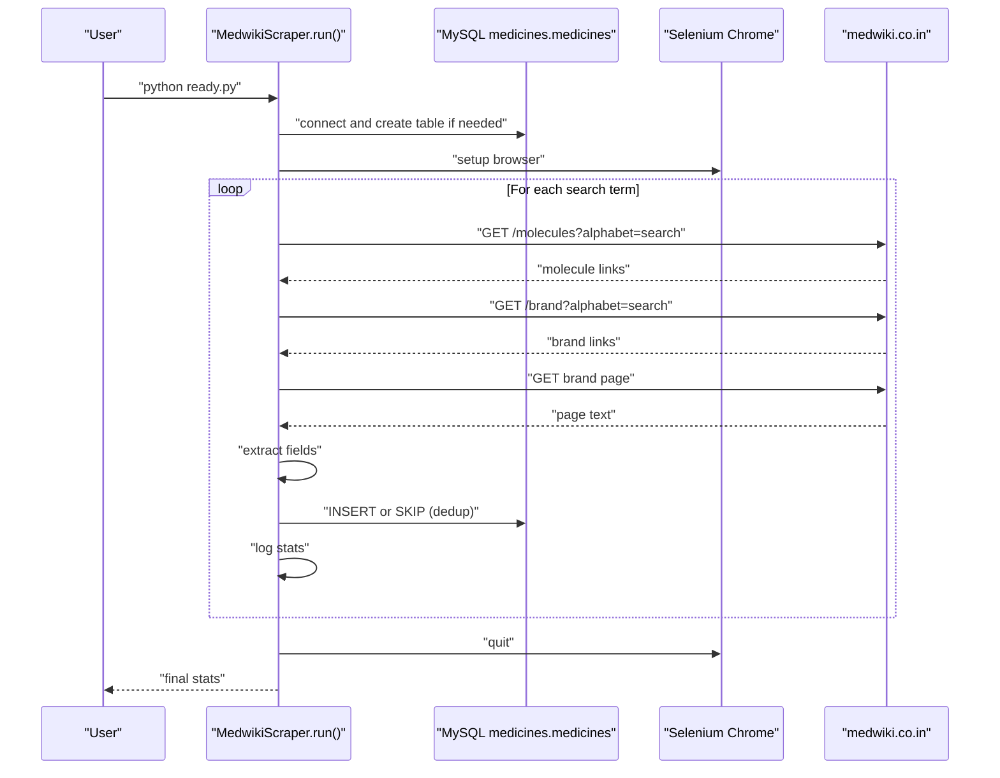
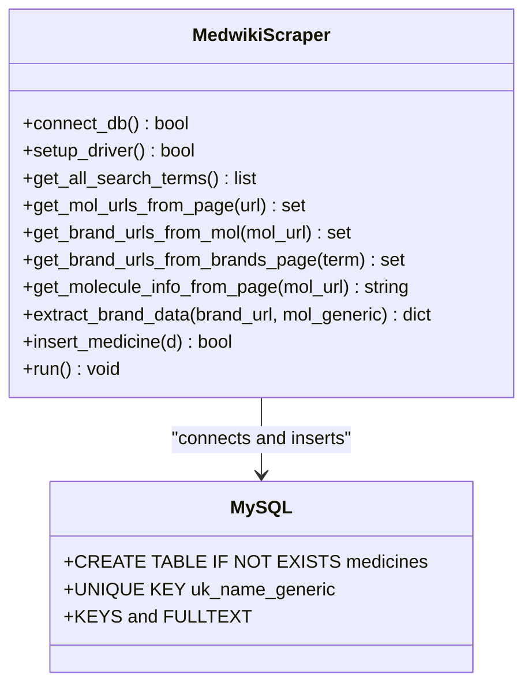
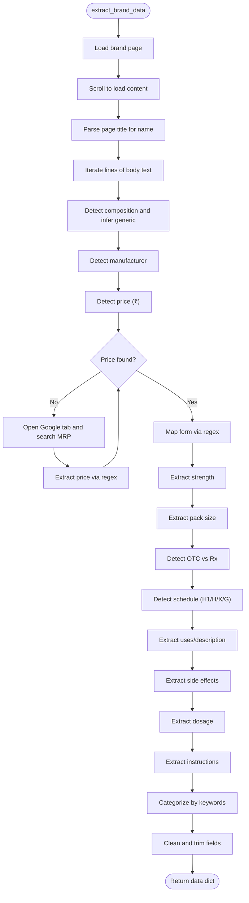
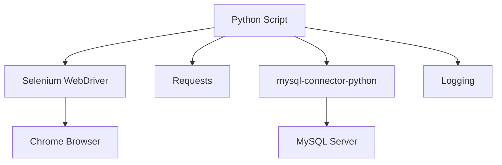

# Usage Examples

<cite>
**Referenced Files in This Document**
- [ready.py](file://ready.py)
- [medicines_import.sql](file://medicines_import.sql)
</cite>

## Table of Contents
1. [Introduction](#introduction)
2. [Project Structure](#project-structure)
3. [Core Components](#core-components)
4. [Architecture Overview](#architecture-overview)
5. [Detailed Component Analysis](#detailed-component-analysis)
6. [Dependency Analysis](#dependency-analysis)
7. [Performance Considerations](#performance-considerations)
8. [Troubleshooting Guide](#troubleshooting-guide)
9. [Conclusion](#conclusion)
10. [Appendices](#appendices)

## Introduction
This document provides a practical, end-to-end guide for using the MedWiki scraper to collect Indian medicine data directly into a MySQL database. It covers installation, execution, customization, monitoring, and operational best practices. It also includes examples for initial data collection, incremental updates, validation workflows, and integration patterns, along with troubleshooting and ethical considerations.

## Project Structure
The project consists of two primary assets:
- A Python scraper script that automates browser-based data extraction from MedWiki and writes to a MySQL database.
- A SQL script to provision the target database and table schema.

**Diagram sources**
- [ready.py:655-780](file://ready.py#L655-L780)
- [medicines_import.sql:15-60](file://medicines_import.sql#L15-L60)

**Section sources**
- [ready.py:1-780](file://ready.py#L1-L780)
- [medicines_import.sql:1-73](file://medicines_import.sql#L1-L73)

## Core Components
- MedwikiScraper: Orchestrates browser automation, data extraction, deduplication, and database insertion.
- Database schema: Defines the medicines table with indexing and constraints.
- Logging: Captures progress and errors to console and dated log files.

Key responsibilities:
- Connect to MySQL and create the medicines table if missing.
- Initialize a Selenium-driven Chrome session with anti-bot settings.
- Iterate through search terms (single letters and common 2-letter prefixes).
- Navigate to molecule and brand pages, extract structured fields, and insert into the database.
- Deduplicate by combining name, generic_name, strength, manufacturer, dosage_form, and pack_size.
- Fall back to Google search for MRP when not present on MedWiki.

**Section sources**
- [ready.py:42-49](file://ready.py#L42-L49)
- [ready.py:67-136](file://ready.py#L67-L136)
- [ready.py:290-326](file://ready.py#L290-L326)
- [ready.py:561-581](file://ready.py#L561-L581)
- [ready.py:655-767](file://ready.py#L655-L767)

## Architecture Overview
The scraper follows a pipeline: initialize driver and DB → iterate search terms → discover molecule and brand URLs → extract fields → insert into DB with deduplication → log stats and finalize.

**Diagram sources**
- [ready.py:655-767](file://ready.py#L655-L767)
- [ready.py:583-633](file://ready.py#L583-L633)
- [ready.py:406-558](file://ready.py#L406-L558)
- [ready.py:150-207](file://ready.py#L150-L207)

## Detailed Component Analysis

### Database Provisioning
- The SQL script creates the medicines table with appropriate collation, keys, and full-text index for fast search.
- It sets foreign key checks off during creation and back on afterward.

Operational tip:
- Apply the schema before first run or rely on the scraper’s automatic table creation.

**Section sources**
- [medicines_import.sql:15-60](file://medicines_import.sql#L15-L60)

### MedwikiScraper Class
- Initialization: Sets up logging, stats, and runtime de-dup sets.
- Database connectivity: Creates the medicines table if missing and preloads existing dedup keys from the DB.
- Browser setup: Starts Chrome with anti-detection flags and waits for page load.
- Search term generation: Produces a-z plus common 2-letter medical prefixes.
- Discovery: Collects molecule and brand URLs from both molecule and brands endpoints.
- Extraction: Parses brand pages for name, composition, manufacturer, price, form, strength, pack size, schedule, uses, side effects, dosage, and instructions.
- Deduplication: Builds a composite key across multiple fields to avoid duplicates.
- Insertion: Inserts into medicines with computed flags (controlled/narcotic/prescription) and default route/instructions.
- Fallback MRP: Attempts to find MRP via Google search if absent on MedWiki.

**Diagram sources**
- [ready.py:52-780](file://ready.py#L52-L780)
- [medicines_import.sql:15-60](file://medicines_import.sql#L15-L60)

**Section sources**
- [ready.py:52-780](file://ready.py#L52-L780)

### Extraction Logic Flow
The extraction routine parses the page body text and applies heuristics to locate fields. It includes fallbacks for form, strength, pack size, and OTC status, and computes category via keyword matching.

**Diagram sources**
- [ready.py:406-558](file://ready.py#L406-L558)
- [ready.py:221-287](file://ready.py#L221-L287)

## Dependency Analysis
- Python packages: selenium, webdriver-manager, mysql-connector-python, requests, logging, datetime, urllib.parse, random, re, string, sys, time.
- Runtime dependencies: Chrome browser and chromedriver (managed automatically).
- Database dependency: MySQL server with credentials configured in DB_CONFIG.

**Diagram sources**
- [ready.py:5-22](file://ready.py#L5-L22)
- [ready.py:42-49](file://ready.py#L42-L49)

**Section sources**
- [ready.py:5-22](file://ready.py#L5-L22)
- [ready.py:42-49](file://ready.py#L42-L49)

## Performance Considerations
- Browser settings: Maximized window, reduced logging level, and anti-detection flags improve stability.
- Delays: Randomized sleeps between requests reduce rate-limit risk.
- Deduplication: Preloading existing records minimizes wasted work.
- Indexing: The medicines table includes keys and full-text index to support efficient queries.

Recommendations:
- Increase delays for unstable networks.
- Limit concurrent runs to avoid DB contention.
- Monitor DB CPU and disk I/O during bulk runs.

[No sources needed since this section provides general guidance]

## Troubleshooting Guide
Common issues and resolutions:
- Connection failures
  - Verify MySQL host, user, password, and database name in DB_CONFIG.
  - Ensure the database exists and the user has privileges to CREATE/INSERT.
  - Confirm the MySQL service is running locally or adjust host accordingly.
- Parsing errors
  - Pages may change layout; extraction relies on text patterns. If fields are missing, review the extraction logic and update regex patterns.
  - Some pages may require scrolling; the scraper scrolls multiple times—ensure network stability.
- Performance bottlenecks
  - Reduce concurrency by avoiding multiple instances.
  - Adjust random delays to balance speed and stability.
- Browser automation issues
  - If the site blocks automation, the current options already include anti-detection flags. Consider running in visible mode and avoiding headless if necessary.
- Logging and diagnostics
  - Review the dated log file for detailed errors and warnings.

**Section sources**
- [ready.py:42-49](file://ready.py#L42-L49)
- [ready.py:67-136](file://ready.py#L67-L136)
- [ready.py:328-347](file://ready.py#L328-L347)
- [ready.py:555-558](file://ready.py#L555-L558)

## Conclusion
The MedWiki scraper provides a robust, automated pipeline to collect Indian medicine data and persist it to MySQL. With configurable database credentials, flexible search terms, and built-in deduplication and logging, it supports both initial collections and incremental updates. Follow the operational guidance below to deploy reliably and troubleshoot effectively.

[No sources needed since this section summarizes without analyzing specific files]

## Appendices

### A. Step-by-Step Execution Guide
- Prerequisites
  - Python installed.
  - MySQL server running and accessible.
  - Install dependencies: selenium, webdriver-manager, mysql-connector-python, requests.
- Prepare database
  - Option A: Run the schema SQL to create the medicines table.
  - Option B: Allow the scraper to auto-create the table on first run.
- Configure database credentials
  - Edit DB_CONFIG with host, user, password, and database name.
- Run the scraper
  - Execute the script to start the collection process.
  - Observe console output and dated log files for progress and errors.
- Monitor progress
  - The script logs counts for inserted, skipped duplicates, and errors per search term.
  - Final summary includes total molecules processed, brands visited, and DB statistics.

**Section sources**
- [ready.py:42-49](file://ready.py#L42-L49)
- [ready.py:655-767](file://ready.py#L655-L767)
- [medicines_import.sql:15-60](file://medicines_import.sql#L15-L60)

### B. Customization Options
- Modify search terms
  - Adjust the list of search terms generated by get_all_search_terms to focus on specific categories or prefixes.
- Tune extraction parameters
  - Update regex patterns for forms, strengths, packs, and schedules in the extraction routines.
  - Adjust category detection keywords to reflect domain-specific terminology.
- Database configuration
  - Change DB_CONFIG to point to a remote MySQL instance or different credentials.
  - Add SSL/TLS settings if required by your MySQL server.
- Browser behavior
  - Modify Chrome options for timeouts, window size, or logging level.
- Deduplication thresholds
  - Extend the dedup key to include additional fields if stricter uniqueness is desired.

**Section sources**
- [ready.py:561-581](file://ready.py#L561-L581)
- [ready.py:462-484](file://ready.py#L462-L484)
- [ready.py:138-148](file://ready.py#L138-L148)
- [ready.py:290-326](file://ready.py#L290-L326)
- [ready.py:42-49](file://ready.py#L42-L49)

### C. Practical Use Cases
- Initial data collection
  - Run the scraper once to populate the medicines table from scratch.
  - Use the schema SQL to ensure consistent indexing and constraints.
- Incremental updates
  - Re-run the scraper periodically; deduplication prevents re-insertion of existing rows.
  - Monitor the “skipped duplicates” count to gauge coverage growth.
- Data validation workflows
  - After ingestion, run queries to validate completeness and correctness (see Appendix D).
  - Example validations: count by category, presence of MRP, uniqueness of name+generic combinations.
- Integration with other systems
  - Export validated data via MySQL client tools or ETL pipelines.
  - Expose a read-only interface to downstream applications using the medicines table.

**Section sources**
- [ready.py:118-130](file://ready.py#L118-L130)
- [ready.py:655-767](file://ready.py#L655-L767)

### D. Database Queries and Export Operations
- List all categories and counts
  - Query the category column and group by category to assess coverage.
- Find duplicates by composite key
  - Use the dedup key logic to identify potential duplicates before ingestion.
- Export data
  - Use the MySQL client to export the medicines table to CSV or JSON for downstream processing.
- Full-text search
  - Leverage the full-text index to search across name, generic_name, and brand.

Example query patterns (adapt to your environment):
- Count by category: SELECT category, COUNT(*) FROM medicines GROUP BY category ORDER BY COUNT DESC;
- Find records with missing MRP: SELECT COUNT(*) FROM medicines WHERE mrp IS NULL;
- Export to CSV: SELECT * FROM medicines INTO OUTFILE '/tmp/medicines.csv' FIELDS TERMINATED BY ',' ENCLOSED BY '"' LINES TERMINATED BY '\n';

[No sources needed since this section provides general guidance]

### E. Production Deployment Best Practices
- Scheduling
  - Use cron or Windows Task Scheduler to run the scraper at fixed intervals.
  - Ensure only one instance runs concurrently to prevent DB contention.
- Monitoring
  - Tail the dated log files and watch for spikes in errors.
  - Track DB metrics (connections, slow queries, disk usage).
- Maintenance
  - Periodically review and refine extraction regex patterns as site layouts evolve.
  - Back up the medicines table regularly.
- Security
  - Store DB credentials securely (environment variables or a secrets manager).
  - Restrict write access to the medicines table to the scraper and authorized admin accounts.

[No sources needed since this section provides general guidance]

### F. Ethical and Legal Considerations
- Terms of service
  - Review the website’s terms of service and robots.txt before scraping.
  - Avoid excessive requests that could impact site performance.
- Data usage
  - Ensure compliance with applicable privacy and health data regulations.
  - Attribute sources appropriately and avoid misrepresentation of data.
- Responsible automation
  - Use reasonable delays and respect rate limits.
  - Consider caching and incremental updates to minimize traffic.

[No sources needed since this section provides general guidance]