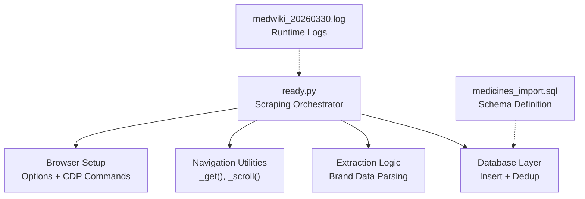
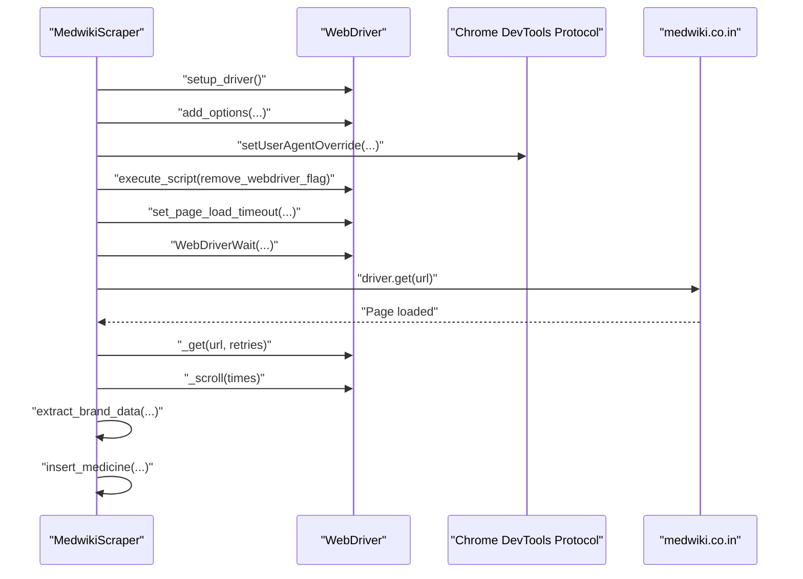
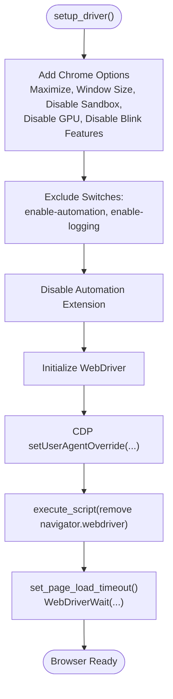
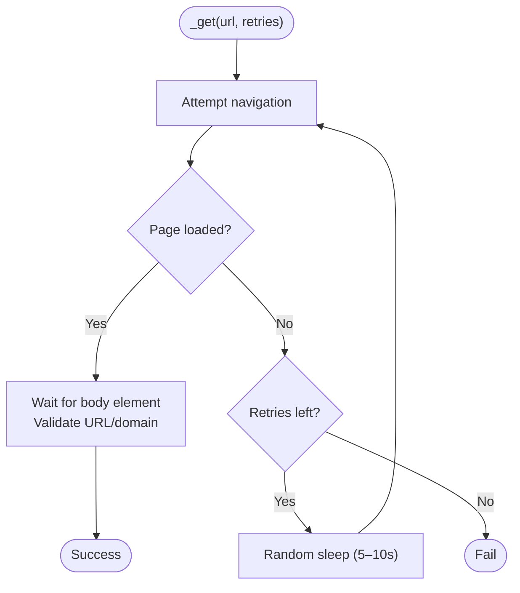
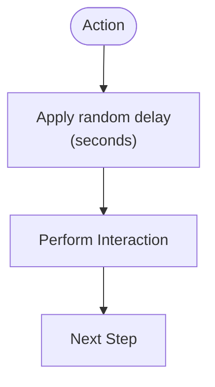
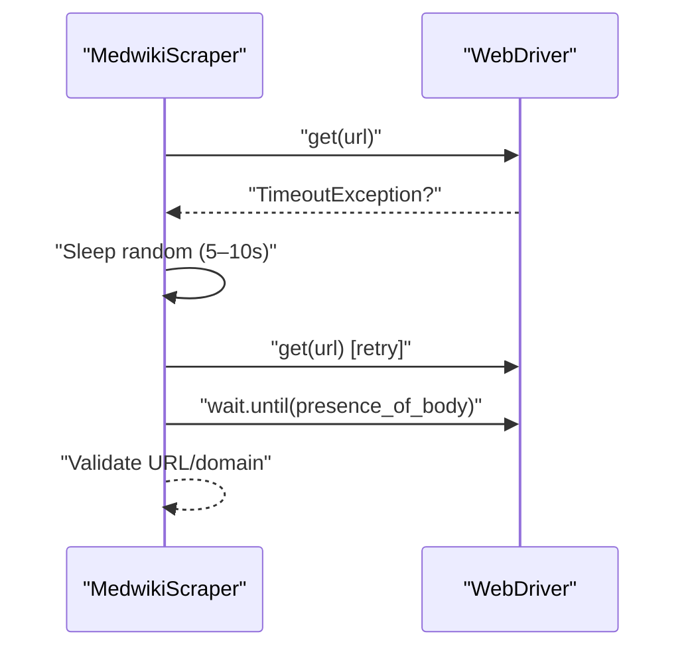
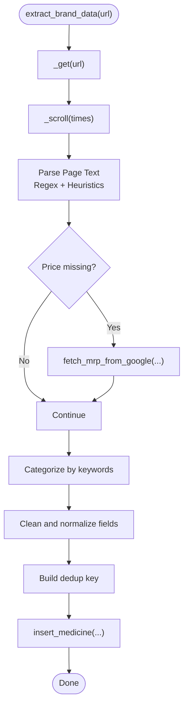
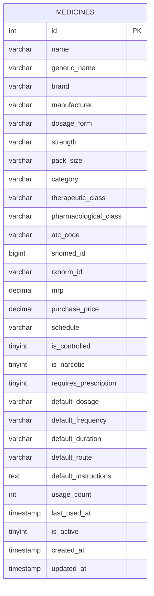
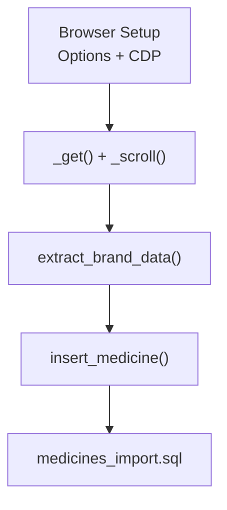

# Anti-Detection Measures

<cite>
**Referenced Files in This Document**
- [ready.py](file://ready.py)
- [medicines_import.sql](file://medicines_import.sql)
- [medwiki_20260330.log](file://medwiki_20260330.log)
</cite>

## Table of Contents
1. [Introduction](#introduction)
2. [Project Structure](#project-structure)
3. [Core Components](#core-components)
4. [Architecture Overview](#architecture-overview)
5. [Detailed Component Analysis](#detailed-component-analysis)
6. [Dependency Analysis](#dependency-analysis)
7. [Performance Considerations](#performance-considerations)
8. [Troubleshooting Guide](#troubleshooting-guide)
9. [Conclusion](#conclusion)

## Introduction
This document explains the anti-detection measures implemented in the scraping pipeline for medwiki.co.in. It focuses on techniques to avoid detection by target websites, including automation flag removal, user-agent spoofing, realistic browser behavior simulation, experimental option configuration, randomization strategies, and timeout/retry mechanisms. The content is grounded in the actual codebase and highlights how the browser setup module integrates with navigation and extraction modules to mimic human browsing behavior.

## Project Structure
The repository contains:
- A Python scraper script that orchestrates browser setup, navigation, data extraction, and database persistence.
- A SQL schema file defining the destination database table for scraped medicine data.
- A log file capturing runtime events during scraping runs.

**Diagram sources**
- [ready.py:290-327](file://ready.py#L290-L327)
- [ready.py:328-363](file://ready.py#L328-L363)
- [ready.py:406-558](file://ready.py#L406-L558)
- [ready.py:150-208](file://ready.py#L150-L208)
- [medicines_import.sql:15-60](file://medicines_import.sql#L15-L60)
- [medwiki_20260330.log:1-80](file://medwiki_20260330.log#L1-L80)

**Section sources**
- [ready.py:290-327](file://ready.py#L290-L327)
- [ready.py:328-363](file://ready.py#L328-L363)
- [ready.py:406-558](file://ready.py#L406-L558)
- [ready.py:150-208](file://ready.py#L150-L208)
- [medicines_import.sql:15-60](file://medicines_import.sql#L15-L60)
- [medwiki_20260330.log:1-80](file://medwiki_20260330.log#L1-L80)

## Core Components
- Browser setup and anti-detection configuration:
  - Disables automation indicators and sets a realistic user agent.
  - Uses Chrome DevTools Protocol (CDP) to override user agent and remove navigator.webdriver property.
  - Configures timeouts and waits to simulate human browsing.
- Navigation utilities:
  - Robust GET with retries, timeouts, and basic page validation.
  - Scroll simulation to mimic human interaction.
- Randomization and behavioral simulation:
  - Randomized delays between actions and during navigation.
  - Variable timing for page loads and interactions.
- Timeout and retry mechanisms:
  - Retry loop with exponential-like pauses and validation of successful navigation.
- Data extraction and deduplication:
  - Extraction of structured fields with fallbacks and deduplication keys across multiple columns.

**Section sources**
- [ready.py:290-327](file://ready.py#L290-L327)
- [ready.py:328-363](file://ready.py#L328-L363)
- [ready.py:406-558](file://ready.py#L406-L558)
- [ready.py:150-208](file://ready.py#L150-L208)

## Architecture Overview
The anti-detection architecture centers around the browser initialization and subsequent navigation/extraction phases. The browser setup module configures Chrome options and applies CDP commands to reduce automation signals. Navigation utilities encapsulate retries and timeouts. Extraction logic parses pages and persists data while maintaining deduplication.

**Diagram sources**
- [ready.py:290-327](file://ready.py#L290-L327)
- [ready.py:328-363](file://ready.py#L328-L363)
- [ready.py:406-558](file://ready.py#L406-L558)

## Detailed Component Analysis

### Browser Setup and Anti-Detection Configuration
Key anti-detection techniques implemented:
- Automation flag removal:
  - Adds a Chrome option to disable Blink features associated with automation.
  - Applies an experimental exclusion switch to prevent automation indicators.
  - Removes the navigator.webdriver property via JavaScript execution.
- User-agent spoofing:
  - Sets a realistic desktop Chrome user agent via Chrome options.
  - Overrides the user agent using CDP immediately after driver creation.
- Realistic browser behavior:
  - Starts the browser maximized and with a fixed window size.
  - Disables sandbox and dev-shm usage to improve stability on headless environments.
  - Sets a page load timeout and explicit wait conditions to emulate human pacing.
- Experimental options:
  - Excludes automation switches and disables the automation extension to reduce detection.

**Diagram sources**
- [ready.py:290-327](file://ready.py#L290-L327)

**Section sources**
- [ready.py:290-327](file://ready.py#L290-L327)

### Navigation Utilities: GET, Retry, and Scroll Simulation
- Robust GET with retries:
  - Attempts navigation with configurable retries.
  - Validates successful page load and avoids error pages.
  - Pauses with randomized delays between attempts.
- Scroll simulation:
  - Scrolls to bottom of the page multiple times.
  - Tracks scroll height to detect content loading and stops early if no change.
- Human-like pacing:
  - Randomized sleeps between actions and page visits.

**Diagram sources**
- [ready.py:328-347](file://ready.py#L328-L347)

**Section sources**
- [ready.py:328-363](file://ready.py#L328-L363)

### Randomization Strategies and Behavioral Simulation
- Randomized delays:
  - Delays between page visits and after extracting data.
  - Delays during scrolling and between Google search tab operations.
- Variable timing:
  - Varying sleep durations for navigation and extraction steps.
- Human-like interaction patterns:
  - Simulated scrolling and pause behavior to avoid bot-like patterns.

**Diagram sources**
- [ready.py:349-363](file://ready.py#L349-L363)
- [ready.py:240-277](file://ready.py#L240-L277)
- [ready.py:711](file://ready.py#L711)
- [ready.py:736](file://ready.py#L736)
- [ready.py:630](file://ready.py#L630)
- [ready.py:744](file://ready.py#L744)

**Section sources**
- [ready.py:349-363](file://ready.py#L349-L363)
- [ready.py:240-277](file://ready.py#L240-L277)
- [ready.py:711](file://ready.py#L711)
- [ready.py:736](file://ready.py#L736)
- [ready.py:630](file://ready.py#L630)
- [ready.py:744](file://ready.py#L744)

### Timeout and Retry Mechanisms
- Page load timeout:
  - Enforced via driver configuration to avoid hanging on slow pages.
- Retry loop:
  - Attempts navigation with backoff-like delays.
  - Validates successful load and avoids error pages.
- Wait conditions:
  - Explicit waits for presence of body element to ensure DOM readiness.

**Diagram sources**
- [ready.py:317](file://ready.py#L317)
- [ready.py:328-347](file://ready.py#L328-L347)
- [ready.py:333](file://ready.py#L333)

**Section sources**
- [ready.py:317](file://ready.py#L317)
- [ready.py:328-347](file://ready.py#L328-L347)
- [ready.py:333](file://ready.py#L333)

### Data Extraction and Deduplication
- Extraction logic:
  - Parses brand pages for name, composition, manufacturer, price, form, strength, pack size, schedule, uses, side effects, dosage, and storage.
  - Includes fallbacks to Google search for missing MRP data.
- Deduplication:
  - Builds a composite key across name, generic_name, strength, manufacturer, dosage_form, and pack_size to prevent duplicate inserts.
  - Maintains runtime sets to skip previously seen URLs.

**Diagram sources**
- [ready.py:406-558](file://ready.py#L406-L558)
- [ready.py:221-287](file://ready.py#L221-L287)
- [ready.py:138-148](file://ready.py#L138-L148)
- [ready.py:150-208](file://ready.py#L150-L208)

**Section sources**
- [ready.py:406-558](file://ready.py#L406-L558)
- [ready.py:221-287](file://ready.py#L221-L287)
- [ready.py:138-148](file://ready.py#L138-L148)
- [ready.py:150-208](file://ready.py#L150-L208)

### Database Integration and Schema
- Destination table:
  - The medicines table stores standardized medicine attributes with indexes for fast lookups and full-text search support.
- Insertion and deduplication:
  - Inserts only when the dedup key does not exist in the runtime set.
  - Handles errors and logs statistics for monitoring.

**Diagram sources**
- [medicines_import.sql:15-60](file://medicines_import.sql#L15-L60)

**Section sources**
- [medicines_import.sql:15-60](file://medicines_import.sql#L15-L60)
- [ready.py:150-208](file://ready.py#L150-L208)

## Dependency Analysis
- Browser setup depends on Selenium WebDriver and Chrome options.
- Navigation utilities depend on explicit waits and timeouts.
- Extraction logic depends on page parsing and fallback mechanisms.
- Database layer depends on the schema and deduplication keys.

**Diagram sources**
- [ready.py:290-327](file://ready.py#L290-L327)
- [ready.py:328-363](file://ready.py#L328-L363)
- [ready.py:406-558](file://ready.py#L406-L558)
- [ready.py:150-208](file://ready.py#L150-L208)
- [medicines_import.sql:15-60](file://medicines_import.sql#L15-L60)

**Section sources**
- [ready.py:290-327](file://ready.py#L290-L327)
- [ready.py:328-363](file://ready.py#L328-L363)
- [ready.py:406-558](file://ready.py#L406-L558)
- [ready.py:150-208](file://ready.py#L150-L208)
- [medicines_import.sql:15-60](file://medicines_import.sql#L15-L60)

## Performance Considerations
- Randomized delays reduce detection risk but increase total runtime; tune delays to balance speed and stealth.
- Scroll simulation helps avoid immediate detection but adds overhead; adjust iteration counts based on page sizes.
- Retries with backoff-like pauses improve resilience against transient failures.
- Indexes on the medicines table optimize insertions and queries.

[No sources needed since this section provides general guidance]

## Troubleshooting Guide
Common issues and mitigations:
- Connection resets during navigation:
  - The logs show connection reset errors; consider increasing retry attempts and adding jitter to delays.
- Page load timeouts:
  - Adjust page load timeout and explicit waits to accommodate slower pages.
- Automation detection:
  - Ensure all anti-detection options are applied consistently and that navigator.webdriver is removed.
- Duplicate entries:
  - Verify deduplication keys and runtime sets are updated correctly.

**Section sources**
- [medwiki_20260330.log:77-80](file://medwiki_20260330.log#L77-L80)
- [ready.py:317](file://ready.py#L317)
- [ready.py:328-347](file://ready.py#L328-L347)
- [ready.py:138-148](file://ready.py#L138-L148)

## Conclusion
The anti-detection measures in this scraper combine practical browser configuration, CDP commands, and behavioral randomization to reduce detection risk. The modular design separates browser setup, navigation, extraction, and persistence, enabling maintainability and extensibility. The database schema supports efficient deduplication and fast lookups. Together, these components create a robust pipeline that mimics human browsing while reliably extracting structured data.