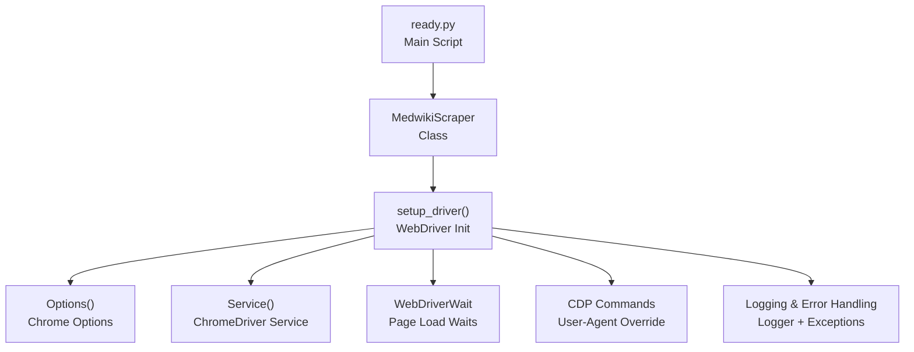
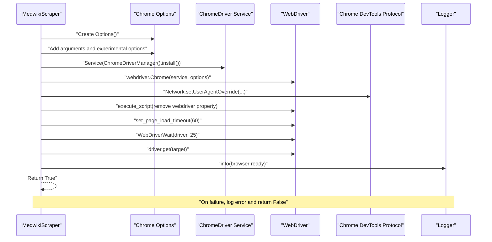
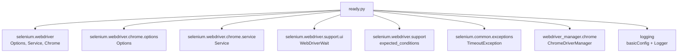

# Browser Automation Setup

<cite>
**Referenced Files in This Document**
- [ready.py](file://ready.py)
</cite>

## Table of Contents
1. [Introduction](#introduction)
2. [Project Structure](#project-structure)
3. [Core Components](#core-components)
4. [Architecture Overview](#architecture-overview)
5. [Detailed Component Analysis](#detailed-component-analysis)
6. [Dependency Analysis](#dependency-analysis)
7. [Performance Considerations](#performance-considerations)
8. [Troubleshooting Guide](#troubleshooting-guide)
9. [Conclusion](#conclusion)

## Introduction
This document explains the browser automation setup used in the Medwiki Scraper project. It focuses on the Selenium WebDriver initialization process, ChromeDriver configuration, browser options, service management, anti-detection measures, CDP commands, timeouts, and error handling. The goal is to help developers configure reliable, stealthy browser automation for scraping tasks while maintaining robust logging and recovery mechanisms.

## Project Structure
The project is a single-file Python script that orchestrates browser automation, database connectivity, and data extraction. The browser setup is encapsulated within a dedicated class and method responsible for initializing the WebDriver with anti-detection and performance-friendly options.

**Diagram sources**
- [ready.py:289-326](file://ready.py#L289-L326)

**Section sources**
- [ready.py:1-780](file://ready.py#L1-L780)

## Core Components
- Selenium WebDriver initialization with ChromeDriver and Chrome options
- Service management via webdriver-manager for automatic driver installation
- Anti-detection measures including disabling automation flags and removing webdriver properties
- CDP commands for user-agent override and navigator property cleanup
- Timeout configuration for page loads and explicit waits
- Logging and error handling integrated throughout the setup and usage lifecycle

**Section sources**
- [ready.py:5-22](file://ready.py#L5-L22)
- [ready.py:289-326](file://ready.py#L289-L326)

## Architecture Overview
The browser automation pipeline integrates logging, service management, and WebDriver configuration. The setup method constructs Chrome options, initializes the driver with a managed service, applies anti-detection measures, sets timeouts, and validates readiness by navigating to a target site.

**Diagram sources**
- [ready.py:289-326](file://ready.py#L289-L326)

## Detailed Component Analysis

### Selenium WebDriver Initialization and Service Management
- Options creation: A fresh Chrome Options instance is created and populated with arguments and experimental options.
- Service creation: The ChromeDriver service is initialized using webdriver-manager, which automatically installs and manages the appropriate driver version.
- Driver instantiation: The WebDriver is launched with the configured service and options.

Key behaviors:
- Automatic driver installation and version management
- Explicit options for window sizing, GPU, sandbox, and logging
- Wait setup and page load timeout configuration

**Section sources**
- [ready.py:289-326](file://ready.py#L289-L326)

### Chrome Options Configuration
The following options are configured to improve stability and reduce detection signals:
- Window management: maximized window and fixed resolution
- Sandbox and shared memory: disabled sandbox and dev-shm usage
- Blink features: disable automation-controlled flag
- GPU and extensions: disabled GPU and extensions
- Logging: reduced log verbosity
- User-agent: set via argument and CDP command
- Automation flags: excluded switches and disabled automation extension

Anti-detection highlights:
- Excluding automation-related switches
- Disabling automation extension
- Overriding navigator.webdriver property via JavaScript

**Section sources**
- [ready.py:292-307](file://ready.py#L292-L307)
- [ready.py:311-316](file://ready.py#L311-L316)

### Service Management with webdriver-manager
- The service is constructed using ChromeDriverManager().install(), ensuring the correct driver binary is downloaded and used.
- This approach avoids manual driver management and reduces environment-specific issues.

**Section sources**
- [ready.py:11-12](file://ready.py#L11-L12)
- [ready.py:308-310](file://ready.py#L308-L310)

### CDP Commands and Anti-Detection Measures
Two critical CDP commands and a JavaScript fix are used:
- Network.setUserAgentOverride: Overrides the user agent at the network level for consistency.
- Navigator property cleanup: Removes the webdriver property from the navigator object to avoid detection.

These steps complement the Chrome options that disable automation flags and exclude logging switches.

**Section sources**
- [ready.py:311-316](file://ready.py#L311-L316)

### Timeout Configuration and Page Load Strategies
- Page load timeout: Set to 60 seconds to prevent indefinite waits.
- Implicit/explicit waits: A WebDriverWait is configured with a 25-second timeout for element presence checks.
- Retry logic: The internal GET method retries navigation attempts with backoff and validation against the target domain.

**Section sources**
- [ready.py:317-318](file://ready.py#L317-L318)
- [ready.py:328-347](file://ready.py#L328-L347)

### Error Handling During Browser Initialization
- Try/catch around the entire setup routine logs failures and returns False to signal initialization problems.
- Logging uses a rotating file handler and console handler with timestamps and severity levels.
- On exceptions, the method logs the error and exits gracefully.

**Section sources**
- [ready.py:324-326](file://ready.py#L324-L326)
- [ready.py:31-40](file://ready.py#L31-L40)

### Initialization Verification
- After driver startup, the method navigates to the target site and logs the page title to confirm successful loading.
- A short pause ensures the page has rendered before proceeding.

**Section sources**
- [ready.py:319-322](file://ready.py#L319-L322)

### Relationship with Logging System and Error Recovery
- Centralized logging configuration with file and stream handlers.
- Extensive use of logger.info, logger.debug, and logger.error throughout setup, navigation, and extraction routines.
- Error counters track failures and support statistics reporting.

**Section sources**
- [ready.py:31-40](file://ready.py#L31-L40)
- [ready.py:61-64](file://ready.py#L61-L64)
- [ready.py:134](file://ready.py#L134)
- [ready.py:200](file://ready.py#L200)
- [ready.py:279](file://ready.py#L279)
- [ready.py:324](file://ready.py#L324)
- [ready.py:555](file://ready.py#L555)

## Dependency Analysis
The browser setup depends on Selenium and webdriver-manager for driver management. Logging is configured centrally and used extensively for observability.

**Diagram sources**
- [ready.py:5-22](file://ready.py#L5-L22)

**Section sources**
- [ready.py:5-22](file://ready.py#L5-L22)

## Performance Considerations
- Fixed window size and maximization reduce rendering variability and improve stability.
- Disabling GPU and sandbox can improve performance on headless or constrained environments.
- Reduced logging level minimizes overhead.
- Page load timeout prevents long hangs; explicit waits ensure responsive UI interactions.
- Retry logic with backoff mitigates transient network or server issues.

[No sources needed since this section provides general guidance]

## Troubleshooting Guide
Common issues and remedies:
- Driver mismatch or missing driver: Use webdriver-manager to install the correct driver automatically.
- Detection by target sites: Apply anti-detection measures (exclude switches, disable automation extension, CDP user-agent override, navigator cleanup).
- Slow or hanging loads: Increase page load timeout and adjust explicit wait durations.
- Logging visibility: Ensure logging handlers are configured and check the generated log files for timestamps and error messages.
- Initialization failures: Wrap setup in try/catch and rely on logged errors to diagnose root causes.

**Section sources**
- [ready.py:11-12](file://ready.py#L11-L12)
- [ready.py:306-307](file://ready.py#L306-L307)
- [ready.py:311-316](file://ready.py#L311-L316)
- [ready.py:317-318](file://ready.py#L317-L318)
- [ready.py:324-326](file://ready.py#L324-L326)
- [ready.py:31-40](file://ready.py#L31-L40)

## Conclusion
The browser automation setup in this project emphasizes reliability and stealth. It leverages webdriver-manager for driver management, applies comprehensive anti-detection measures, and integrates robust logging and error handling. The combination of Chrome options, CDP commands, timeouts, and retry logic creates a resilient foundation for scraping tasks.