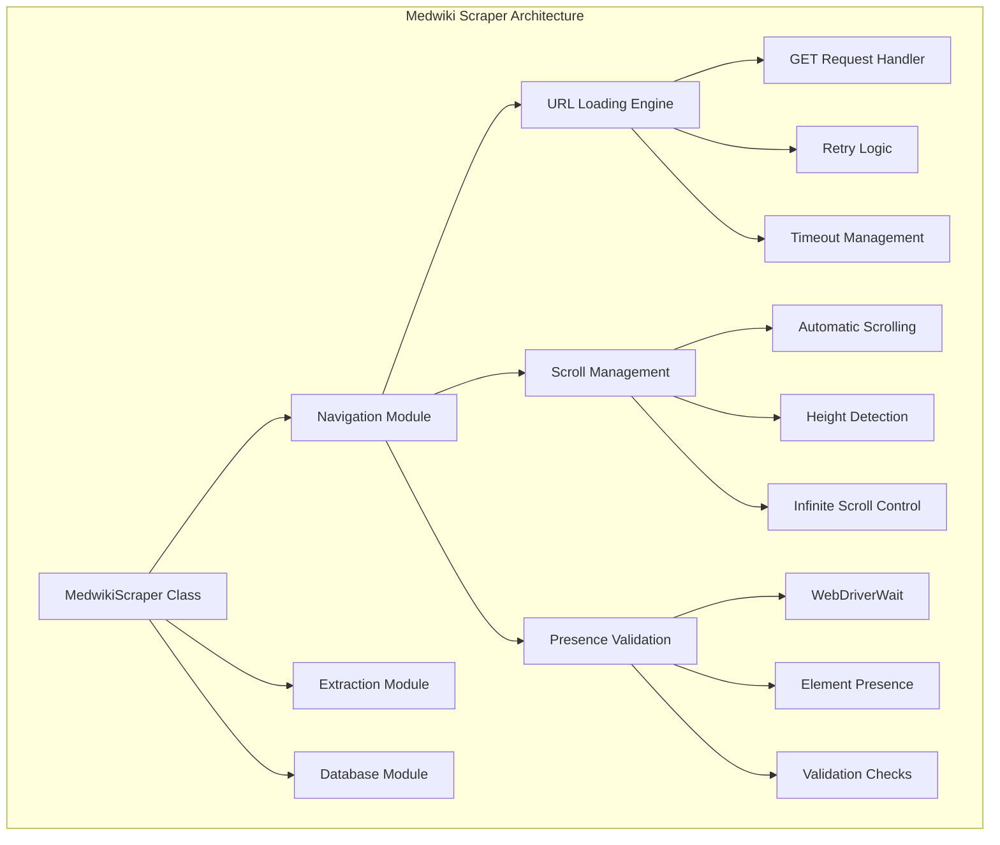
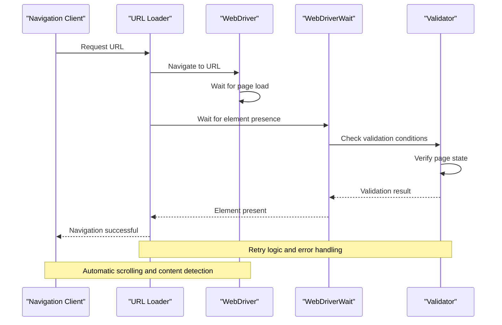
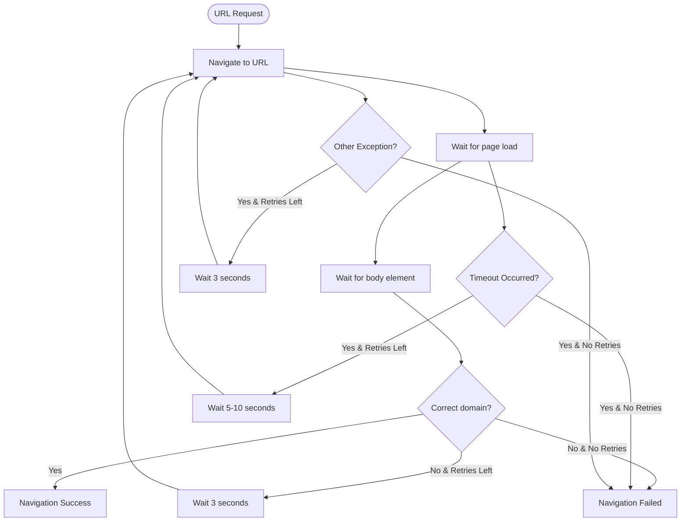
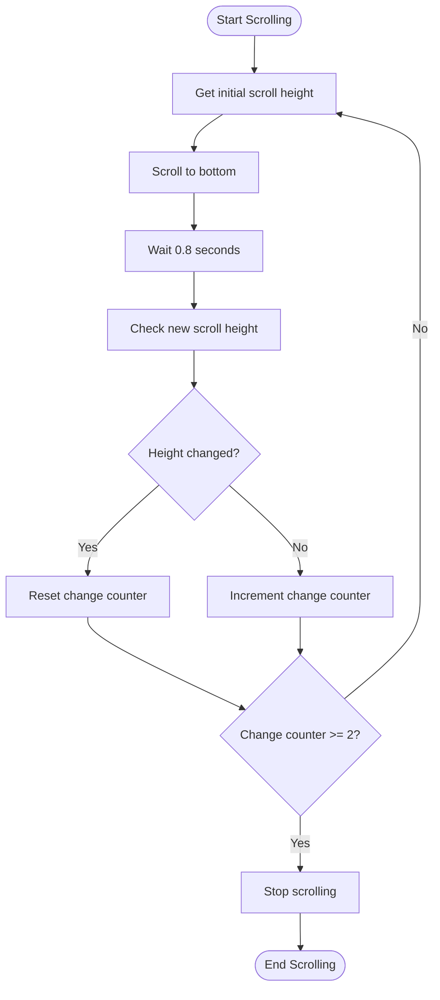
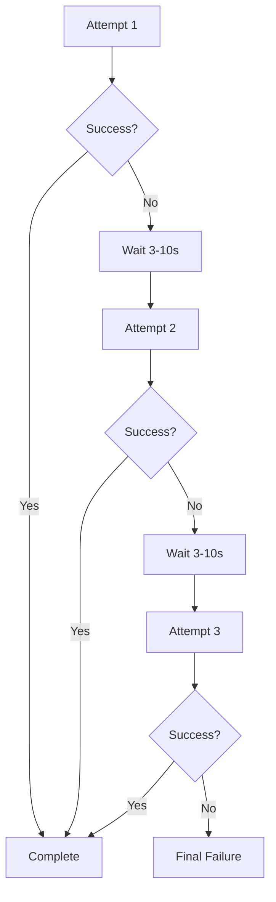
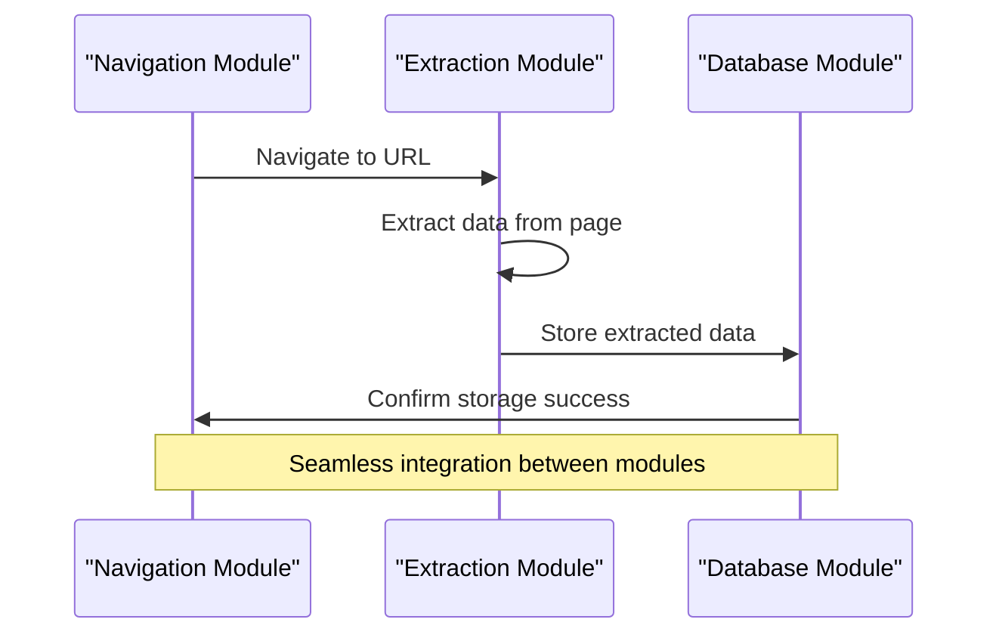
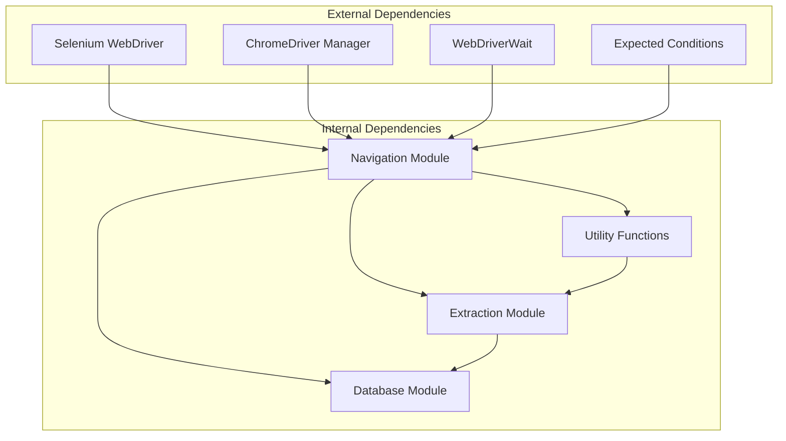

# Page Navigation Strategies

<cite>
**Referenced Files in This Document**
- [ready.py](file://ready.py)
</cite>

## Table of Contents
1. [Introduction](#introduction)
2. [Project Structure](#project-structure)
3. [Core Components](#core-components)
4. [Architecture Overview](#architecture-overview)
5. [Detailed Component Analysis](#detailed-component-analysis)
6. [Dependency Analysis](#dependency-analysis)
7. [Performance Considerations](#performance-considerations)
8. [Troubleshooting Guide](#troubleshooting-guide)
9. [Conclusion](#conclusion)

## Introduction

The Page Navigation Strategies component is a critical part of the Medwiki Scraper system, responsible for reliable web navigation, URL loading mechanisms, and robust error recovery. This component implements sophisticated navigation patterns including GET requests with retry logic, timeout handling, scroll-based content loading, and presence condition waiting using Selenium WebDriver's WebDriverWait.

The system handles complex navigation scenarios including visiting base URLs, accessing search pages, handling redirects, and managing dynamic content loading through infinite scroll mechanisms. It provides comprehensive error recovery strategies and validation techniques to ensure successful navigation and content loading across various website states.

## Project Structure

The navigation strategies are implemented within a single cohesive Python module that follows a structured approach to web scraping:



**Diagram sources**
- [ready.py:52-780](file://ready.py#L52-L780)

**Section sources**
- [ready.py:1-780](file://ready.py#L1-L780)

## Core Components

The Page Navigation Strategies component consists of several interconnected modules that work together to provide robust web navigation capabilities:

### URL Loading Engine
The URL loading engine handles all HTTP GET requests with sophisticated retry logic and timeout management. It implements exponential backoff strategies and comprehensive error recovery mechanisms.

### Scroll Management System
The scroll management system handles automatic scrolling, scroll height detection, and infinite scroll termination conditions. It monitors scroll position changes and detects when content stops loading.

### Presence Validation Framework
The presence validation framework uses WebDriverWait with expected conditions to ensure elements are available before proceeding with data extraction operations.

**Section sources**
- [ready.py:289-363](file://ready.py#L289-L363)
- [ready.py:406-558](file://ready.py#L406-L558)

## Architecture Overview

The navigation strategies follow a layered architecture pattern that separates concerns between URL handling, content loading, and validation:



**Diagram sources**
- [ready.py:328-347](file://ready.py#L328-L347)
- [ready.py:349-362](file://ready.py#L349-L362)

## Detailed Component Analysis

### URL Loading Mechanisms with Retry Logic

The URL loading system implements a sophisticated retry mechanism that handles various failure scenarios gracefully:

#### GET Request Implementation
The `_get` method handles all URL navigation with comprehensive error handling:



**Diagram sources**
- [ready.py:328-347](file://ready.py#L328-L347)

#### Retry Strategy Analysis
The system implements a tiered retry strategy with different wait times for different failure types:

| Failure Type | Retry Count | Wait Time | Purpose |
|--------------|-------------|-----------|---------|
| TimeoutException | 3 attempts | 5-10 seconds | Network delays, slow servers |
| General Exception | 3 attempts | 3 seconds | Temporary errors, page issues |
| Domain Validation | 3 attempts | 3 seconds | Redirect loops, wrong domain |

**Section sources**
- [ready.py:328-347](file://ready.py#L328-L347)

### Timeout Handling and Error Recovery

The timeout handling system provides comprehensive protection against various network and server issues:

#### Page Load Timeout Configuration
The WebDriver is configured with a 60-second page load timeout to prevent indefinite waits:

```python
self.driver.set_page_load_timeout(60)
```

#### Expected Conditions Implementation
The system uses WebDriverWait with presence_of_element_located to ensure the page is ready:

```python
self.wait.until(EC.presence_of_element_located((By.TAG_NAME, "body")))
```

#### Error Recovery Patterns
Multiple error recovery mechanisms are implemented:

1. **Domain Validation**: Ensures navigation to the correct domain before proceeding
2. **Graceful Degradation**: Continues with partial functionality when possible
3. **Resource Cleanup**: Properly closes browser windows and handles exceptions

**Section sources**
- [ready.py:317-318](file://ready.py#L317-L318)
- [ready.py:333-338](file://ready.py#L333-L338)

### Scroll-Based Content Loading Strategy

The scroll management system handles dynamic content loading through intelligent scrolling mechanisms:

#### Automatic Scrolling Implementation
The `_scroll` method implements a sophisticated scrolling strategy:



**Diagram sources**
- [ready.py:349-362](file://ready.py#L349-L362)

#### Scroll Height Detection
The system monitors scroll height changes to detect when content has finished loading:

- **Initial Height**: Captures the document body height before scrolling
- **Progressive Detection**: Monitors height changes during scrolling
- **Stability Threshold**: Stops when height remains unchanged for 2 consecutive checks

#### Infinite Scroll Handling
The system handles infinite scroll scenarios by detecting when no new content is loaded:

- **Change Counter**: Tracks consecutive iterations with no height change
- **Early Termination**: Stops scrolling when stability threshold is reached
- **Configurable Iterations**: Allows adjustment of maximum scroll attempts

**Section sources**
- [ready.py:349-362](file://ready.py#L349-L362)

### Presence Condition Waiting with WebDriverWait

The presence validation system ensures elements are available before proceeding with data extraction:

#### WebDriverWait Configuration
The system uses WebDriverWait with a 25-second timeout:

```python
self.wait = WebDriverWait(self.driver, 25)
```

#### Expected Conditions Implementation
Multiple expected conditions are used for different validation scenarios:

```python
# Wait for body element to be present
self.wait.until(EC.presence_of_element_located((By.TAG_NAME, "body")))

# Wait for specific elements to be visible
self.wait.until(EC.visibility_of_element_located((By.CLASS_NAME, "content")))
```

#### Element Availability Validation
The system validates element availability through multiple mechanisms:

- **Presence Validation**: Ensures elements exist in DOM
- **Visibility Validation**: Confirms elements are visible to user
- **Interactable Validation**: Verifies elements can receive user input

**Section sources**
- [ready.py:318](file://ready.py#L318)
- [ready.py:333](file://ready.py#L333)

### Navigation Patterns and URL Access

The system implements various navigation patterns to handle different website structures:

#### Base URL Navigation
Direct navigation to the main website URL with validation:

```python
self.driver.get("https://medwiki.co.in")
```

#### Search Page Navigation
Access to search functionality with parameterized URLs:

```python
# Molecules search
url = f"https://medwiki.co.in/molecules/en?{param}={term}"

# Brands search  
url = f"https://medwiki.co.in/brands/en?{param}={term}"
```

#### Redirect Handling
The system handles various redirect scenarios:

- **Domain Redirects**: Ensures navigation to correct domain
- **Language Redirects**: Handles language parameter variations
- **Search Parameter Redirects**: Manages different search parameter formats

**Section sources**
- [ready.py:619-621](file://ready.py#L619-L621)
- [ready.py:679](file://ready.py#L679)

### Page Validation Techniques

The validation system ensures successful navigation and content loading through multiple verification steps:

#### Domain Validation
Checks that navigation targets the correct domain:

```python
if "medwiki" not in self.driver.current_url.lower():
    # Handle incorrect domain
```

#### Content Validation
Verifies that pages contain expected content:

- **Title Validation**: Confirms page title indicates successful navigation
- **Content Presence**: Ensures key content areas are available
- **Element Verification**: Validates critical elements exist

#### Error State Detection
The system identifies and handles various error states:

- **Error Pages**: Detects when navigation fails
- **Empty Results**: Handles cases with no search results
- **Loading States**: Waits for content to finish loading

**Section sources**
- [ready.py:335-337](file://ready.py#L335-L337)

### Retry Mechanisms with Exponential Backoff

The retry system implements sophisticated backoff strategies to handle transient failures:

#### Backoff Strategy Implementation
Different failure types use different backoff patterns:

- **Timeout Failures**: 5-10 second wait (linear increase)
- **General Errors**: 3 second wait (immediate retry)
- **Domain Issues**: 3 second wait (quick recovery)

#### Retry Logic Flow


**Diagram sources**
- [ready.py:328-347](file://ready.py#L328-L347)

**Section sources**
- [ready.py:328-347](file://ready.py#L328-L347)

### Relationship with URL Extraction and Data Extraction Modules

The navigation strategies integrate seamlessly with the broader scraping architecture:

#### URL Extraction Integration
Navigation strategies work closely with URL extraction modules:

- **Molecule URL Extraction**: Navigates to molecule pages and extracts URLs
- **Brand URL Extraction**: Accesses brand pages and collects product URLs
- **Search Result Navigation**: Handles pagination and search result pages

#### Data Extraction Coordination
Navigation and extraction are tightly coupled:

- **Scroll Synchronization**: Scroll operations coordinate with extraction timing
- **Content Loading**: Navigation ensures content is fully loaded before extraction
- **Element Availability**: Presence validation ensures extraction targets are ready

#### Data Flow Integration


**Diagram sources**
- [ready.py:583-633](file://ready.py#L583-L633)
- [ready.py:406-558](file://ready.py#L406-L558)

**Section sources**
- [ready.py:583-633](file://ready.py#L583-L633)
- [ready.py:406-558](file://ready.py#L406-L558)

## Dependency Analysis

The navigation strategies have well-defined dependencies with clear separation of concerns:



**Diagram sources**
- [ready.py:5-22](file://ready.py#L5-L22)

### Component Coupling Analysis

The navigation module maintains loose coupling with other components:

- **High Cohesion**: Related navigation functionality is grouped together
- **Low Coupling**: Minimal dependencies on external components
- **Clear Interfaces**: Well-defined methods for navigation operations

### External Dependencies

The system relies on several key external libraries:

- **Selenium**: Web automation and navigation
- **WebDriver Manager**: Automatic ChromeDriver management
- **Requests**: HTTP requests for fallback scenarios
- **MySQL Connector**: Database connectivity

**Section sources**
- [ready.py:5-22](file://ready.py#L5-L22)

## Performance Considerations

The navigation strategies are designed with performance optimization in mind:

### Timeout Management
- **Configurable Timeouts**: Adjustable page load and wait timeouts
- **Efficient Validation**: Minimal validation overhead
- **Resource Cleanup**: Proper cleanup of browser resources

### Retry Optimization
- **Intelligent Backoff**: Appropriate wait times for different failure types
- **Early Termination**: Stops retries when failures persist
- **Memory Management**: Prevents memory leaks during retries

### Scroll Performance
- **Optimized Scrolling**: Efficient scroll height detection
- **Stability Detection**: Quick termination when content stops loading
- **Configurable Parameters**: Adjustable scroll behavior

## Troubleshooting Guide

Common issues and their solutions:

### Navigation Failures
- **Symptom**: Pages fail to load or timeout
- **Solution**: Check network connectivity, adjust timeout values, verify URL correctness

### Scroll Issues
- **Symptom**: Content doesn't load or scrolls indefinitely
- **Solution**: Adjust scroll iteration limits, verify scroll height detection, check for JavaScript blocking

### Validation Problems
- **Symptom**: Elements not found despite page loading
- **Solution**: Adjust wait timeouts, verify expected conditions, check for dynamic content loading

### Retry Exhaustion
- **Symptom**: Maximum retry attempts exceeded
- **Solution**: Review error logs, adjust retry parameters, investigate underlying causes

**Section sources**
- [ready.py:328-347](file://ready.py#L328-L347)
- [ready.py:349-362](file://ready.py#L349-L362)

## Conclusion

The Page Navigation Strategies component provides a robust foundation for web scraping operations. Its sophisticated retry mechanisms, comprehensive error handling, and intelligent validation systems ensure reliable navigation across various website states and network conditions.

The component's modular design allows for easy maintenance and extension while maintaining high performance standards. The integration with URL extraction and data extraction modules creates a seamless workflow for automated web scraping operations.

Key strengths of the implementation include:
- Comprehensive retry logic with appropriate backoff strategies
- Intelligent scroll management for dynamic content
- Robust validation and error recovery mechanisms
- Flexible configuration options for different use cases
- Clean separation of concerns with well-defined interfaces

This navigation system serves as a solid foundation for building reliable web scraping applications and can be adapted for various use cases beyond the Medwiki scraper.