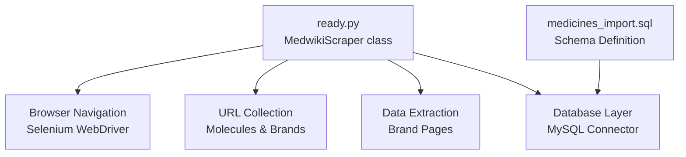
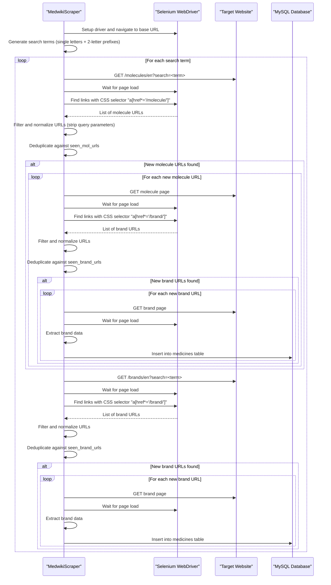
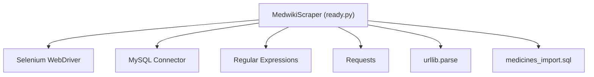

# URL Extraction System

<cite>
**Referenced Files in This Document**
- [ready.py](file://ready.py)
- [medicines_import.sql](file://medicines_import.sql)
</cite>

## Table of Contents
1. [Introduction](#introduction)
2. [Project Structure](#project-structure)
3. [Core Components](#core-components)
4. [Architecture Overview](#architecture-overview)
5. [Detailed Component Analysis](#detailed-component-analysis)
6. [Dependency Analysis](#dependency-analysis)
7. [Performance Considerations](#performance-considerations)
8. [Troubleshooting Guide](#troubleshooting-guide)
9. [Conclusion](#conclusion)
10. [Appendices](#appendices)

## Introduction
This document explains the URL extraction system used to collect URLs for molecule and brand pages from a target website, focusing on:
- CSS selector usage for link discovery
- Link parsing and URL filtering
- Search term generation covering single letters and common 2-letter medical prefixes
- Multi-source URL collection strategies
- URL deduplication mechanisms
- URL validation and cleaning
- Integration with search functionality using both search and alphabet parameters
- Relationships with browser navigation and data extraction modules

## Project Structure
The project consists of a single Python script that orchestrates browser automation, URL collection, and database insertion. The database schema is defined in a separate SQL file.

**Diagram sources**
- [ready.py:52-780](file://ready.py#L52-L780)
- [medicines_import.sql:15-60](file://medicines_import.sql#L15-L60)

**Section sources**
- [ready.py:52-780](file://ready.py#L52-L780)
- [medicines_import.sql:15-60](file://medicines_import.sql#L15-L60)

## Core Components
- MedwikiScraper: Central orchestrator managing browser setup, URL collection, data extraction, and database persistence.
- Search Term Generation: Produces a comprehensive list of single-letter terms and 2-letter medical prefixes.
- URL Collection Strategies: Collects molecule URLs from molecules pages and brand URLs from molecule and brands pages.
- URL Deduplication: Uses runtime sets to prevent duplicate processing and insertion.
- URL Validation and Cleaning: Strips query parameters and normalizes URLs before deduplication.
- Integration with Search: Queries the site using both search and alphabet parameters.

**Section sources**
- [ready.py:52-780](file://ready.py#L52-L780)

## Architecture Overview
The system follows a pipeline:
- Initialize browser and database
- Generate search terms
- For each term:
  - Collect molecule URLs from molecules page using search/alphabet parameters
  - For each new molecule URL:
    - Extract brand URLs from molecule page
    - For each brand URL:
      - Validate/clean URL
      - Deduplicate
      - Extract brand data
      - Insert into database
  - Collect brand URLs from brands page using search/alphabet parameters
  - For each new brand URL:
    - Validate/clean URL
    - Deduplicate
    - Extract brand data
    - Insert into database
- Finalize and report statistics

**Diagram sources**
- [ready.py:561-780](file://ready.py#L561-L780)

## Detailed Component Analysis

### Search Term Generation
The system generates a comprehensive list of search terms to maximize coverage:
- Single letters: a to z
- Common 2-letter medical prefixes: includes many standard pharmaceutical suffixes and common Indian prefixes
- Deduplication: Ensures uniqueness while preserving order

Implementation highlights:
- Single-letter generation using ASCII lowercase
- Prefix list includes standard and Indian-specific prefixes
- Deduplication via dict conversion to preserve order

**Section sources**
- [ready.py:561-582](file://ready.py#L561-L582)

### URL Collection Strategies

#### Molecules Page Scraping
- Endpoint: /molecules/en with parameters:
  - search=<term>
  - alphabet=<term>
- CSS Selector: "a[href*='/molecule/']"
- Filtering: Only URLs containing "/molecule/"
- Normalization: Strip query parameters using split("?")[0]
- Deduplication: Add to a set scoped to the current term and merge with seen_mol_urls

Key methods:
- get_mol_urls_from_page(url): Returns a set of normalized molecule URLs

**Section sources**
- [ready.py:583-597](file://ready.py#L583-L597)
- [ready.py:676-685](file://ready.py#L676-L685)

#### Brands Page Scraping
- Endpoint: /brands/en with parameters:
  - search=<term>
  - alphabet=<term>
- CSS Selector: "a[href*='/brand/']"
- Filtering: Only URLs containing "/brand/"
- Normalization: Strip query parameters using split("?")[0]
- Deduplication: Add to a set scoped to the current term and merge with seen_brand_urls

Key methods:
- get_brand_urls_from_brands_page(term): Returns a set of normalized brand URLs

**Section sources**
- [ready.py:615-633](file://ready.py#L615-L633)
- [ready.py:713-736](file://ready.py#L713-L736)

#### Direct URL Extraction from Molecule Pages
- After obtaining molecule URLs, the system navigates to each molecule page
- CSS Selector: "a[href*='/brand/']"
- Filtering: Only URLs containing "/brand/"
- Normalization: Strip query parameters using split("?")[0]
- Deduplication: Add to seen_brand_urls

Key methods:
- get_brand_urls_from_mol(mol_url): Returns a set of normalized brand URLs

**Section sources**
- [ready.py:599-613](file://ready.py#L599-L613)
- [ready.py:689-701](file://ready.py#L689-L701)

### URL Deduplication Mechanisms
Runtime tracking:
- seen_mol_urls: Set to track molecule URLs already processed during the run
- seen_brand_urls: Set to track brand URLs already processed during the run

Deduplication strategy:
- For each term, collect URLs into a temporary set
- Compute difference against the global seen set to identify new URLs
- Merge new URLs into the global seen set
- Before extracting data from a brand URL, check against seen_brand_urls and skip if duplicate

Additional database-level deduplication:
- On DB connection, load existing records into seen_brand_urls using a composite key built from name, generic_name, strength, manufacturer, dosage_form, and pack_size
- During insertion, compute the same composite key and skip if present

**Section sources**
- [ready.py:59-64](file://ready.py#L59-L64)
- [ready.py:118-131](file://ready.py#L118-L131)
- [ready.py:138-148](file://ready.py#L138-L148)
- [ready.py:166-170](file://ready.py#L166-L170)
- [ready.py:683-684](file://ready.py#L683-L684)
- [ready.py:696-700](file://ready.py#L696-L700)
- [ready.py:715](file://ready.py#L715)
- [ready.py:718-723](file://ready.py#L718-L723)

### URL Validation and Cleaning
Validation steps:
- Presence check: Ensure the URL is not empty
- Content check: Verify the URL contains the expected path segment ("/molecule/" or "/brand/")
- Parameter stripping: Remove query parameters using split("?")[0]
- Trailing slash normalization: Remove trailing "/" for consistent comparison

Integration with deduplication:
- Normalized URLs are used as keys for seen_mol_urls and seen_brand_urls

**Section sources**
- [ready.py:592-594](file://ready.py#L592-L594)
- [ready.py:607-610](file://ready.py#L607-L610)
- [ready.py:627-629](file://ready.py#L627-L629)
- [ready.py:696-697](file://ready.py#L696-L697)
- [ready.py:718-719](file://ready.py#L718-L719)

### Integration with Search Functionality
The system integrates with the website’s search by:
- Using both search and alphabet parameters for molecules page
- Using both search and alphabet parameters for brands page
- Iterating through the generated search terms to cover broad coverage

Parameter usage:
- Molecules page: /molecules/en?search=<term> and /molecules/en?alphabet=<term>
- Brands page: /brands/en?search=<term> and /brands/en?alphabet=<term>

**Section sources**
- [ready.py:678-681](file://ready.py#L678-L681)
- [ready.py:619-621](file://ready.py#L619-L621)

### Relationships with Browser Navigation and Data Extraction Modules
Browser navigation:
- setup_driver(): Initializes Chrome options, sets user agent, disables automation indicators, and sets timeouts
- _get(url): Navigates to a URL with retry logic and timeout handling
- _scroll(times): Scrolls to load dynamic content

Data extraction:
- extract_brand_data(brand_url, mol_generic): Parses brand pages for product details
- get_molecule_info_from_page(mol_url): Extracts molecule/generic name from molecule pages

**Section sources**
- [ready.py:290-326](file://ready.py#L290-L326)
- [ready.py:328-347](file://ready.py#L328-L347)
- [ready.py:349-363](file://ready.py#L349-L363)
- [ready.py:406-558](file://ready.py#L406-L558)
- [ready.py:635-653](file://ready.py#L635-L653)

## Dependency Analysis
The MedwikiScraper class depends on:
- Selenium WebDriver for browser automation
- MySQL Connector for database operations
- Regular expressions for text parsing and price extraction
- Requests for external MRP lookup (Google search)
- urllib.parse for URL encoding

**Diagram sources**
- [ready.py:52-780](file://ready.py#L52-L780)
- [medicines_import.sql:15-60](file://medicines_import.sql#L15-L60)

**Section sources**
- [ready.py:52-780](file://ready.py#L52-L780)
- [medicines_import.sql:15-60](file://medicines_import.sql#L15-L60)

## Performance Considerations
- Browser setup: Maximized window, reduced logging level, and disabling GPU to improve stability and speed
- Dynamic loading: Scroll-based loading to ensure content is rendered before link extraction
- Retry logic: Navigation attempts with backoff to handle transient failures
- Random delays: Introduce randomness between requests to mimic human behavior and reduce blocking
- Deduplication: Runtime sets minimize repeated processing and database writes
- Database indexing: Pre-existing indexes support efficient lookups and full-text search

[No sources needed since this section provides general guidance]

## Troubleshooting Guide
Common issues and resolutions:
- Timeout errors: The _get method retries navigation; ensure network connectivity and consider increasing timeouts
- Empty or incorrect pages: Validate that the current URL belongs to the target domain after navigation
- Missing links: Confirm CSS selectors match the site’s structure; adjust selectors if the site changes
- Duplicate entries: Verify deduplication keys and sets are updated consistently across runs
- Database connection failures: Check credentials and server availability; the script attempts automatic installation of the MySQL connector package

**Section sources**
- [ready.py:328-347](file://ready.py#L328-L347)
- [ready.py:349-363](file://ready.py#L349-L363)
- [ready.py:138-148](file://ready.py#L138-L148)
- [ready.py:166-170](file://ready.py#L166-L170)

## Conclusion
The URL extraction system employs robust strategies to collect molecule and brand URLs from a target website:
- Comprehensive search term generation ensures broad coverage
- Multi-source collection via molecules and brands pages maximizes URL discovery
- CSS selectors precisely target relevant links
- URL normalization and deduplication prevent redundant processing
- Integration with browser navigation and data extraction modules provides a cohesive pipeline
- Database-level deduplication and indexing support reliable persistence

[No sources needed since this section summarizes without analyzing specific files]

## Appendices

### Appendix A: CSS Selector Patterns Used
- Molecules page: "a[href*='/molecule/']"
- Brands page: "a[href*='/brand/']"
- Molecule page: "a[href*='/brand/']"

**Section sources**
- [ready.py:590](file://ready.py#L590)
- [ready.py:625](file://ready.py#L625)
- [ready.py:606](file://ready.py#L606)

### Appendix B: URL Extraction Loops
- Molecules page loop: Iterates over search terms and collects molecule URLs using two parameters
- Brand URLs from molecule pages: Iterates over newly discovered molecule URLs to collect brand URLs
- Brands page loop: Iterates over search terms and collects brand URLs using two parameters

**Section sources**
- [ready.py:676-736](file://ready.py#L676-L736)

### Appendix C: Deduplication Strategies
- Runtime sets: seen_mol_urls and seen_brand_urls track URLs during the run
- Database composite key: A unique key built from name, generic_name, strength, manufacturer, dosage_form, and pack_size prevents duplicate inserts

**Section sources**
- [ready.py:59-64](file://ready.py#L59-L64)
- [ready.py:118-131](file://ready.py#L118-L131)
- [ready.py:138-148](file://ready.py#L138-L148)
- [ready.py:166-170](file://ready.py#L166-L170)