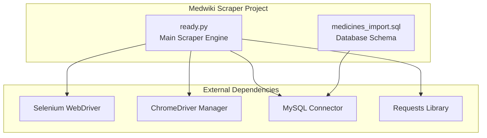
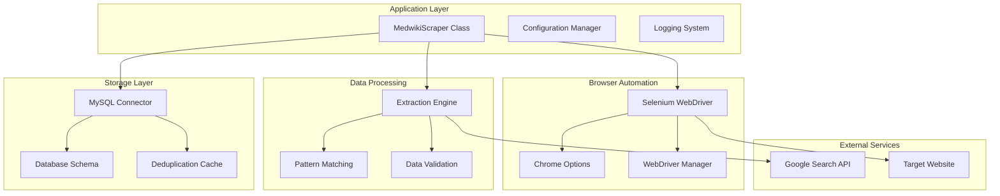
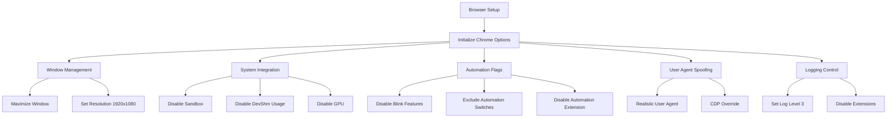
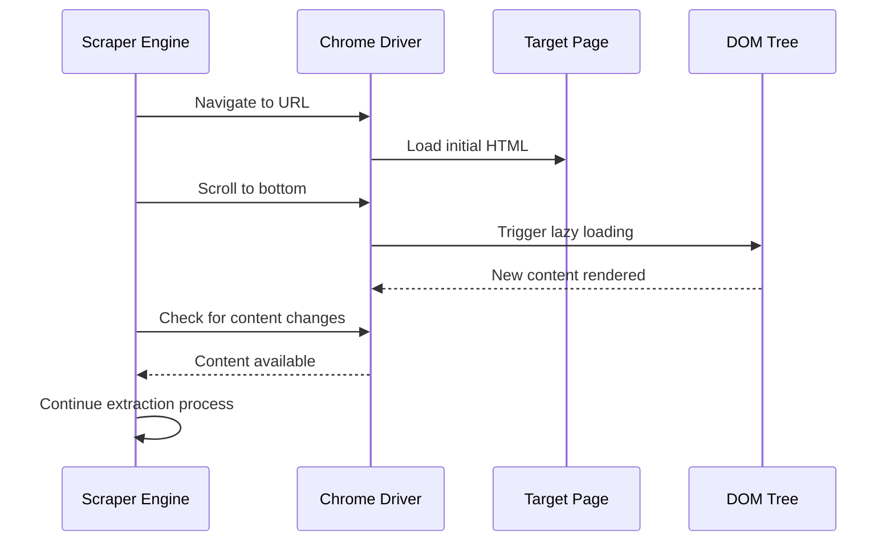
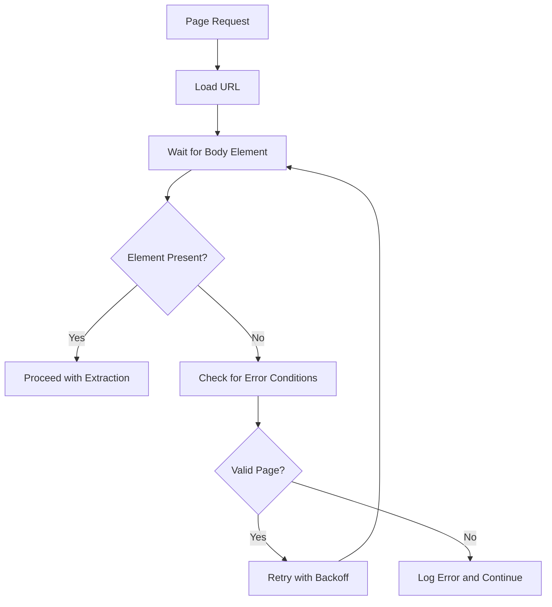
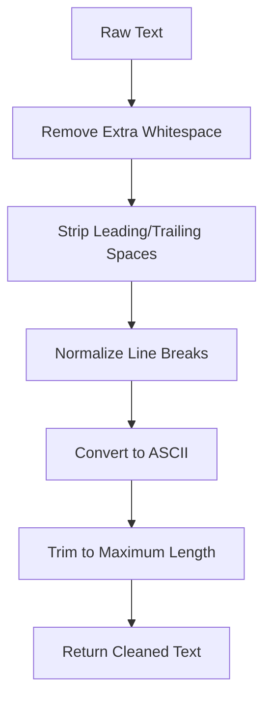
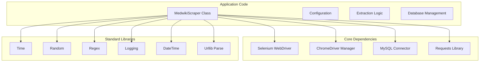

# Web Scraping Engine

<cite>
**Referenced Files in This Document**
- [ready.py](file://ready.py)
- [medicines_import.sql](file://medicines_import.sql)
</cite>

## Table of Contents
1. [Introduction](#introduction)
2. [Project Structure](#project-structure)
3. [Core Components](#core-components)
4. [Architecture Overview](#architecture-overview)
5. [Detailed Component Analysis](#detailed-component-analysis)
6. [Dependency Analysis](#dependency-analysis)
7. [Performance Considerations](#performance-considerations)
8. [Troubleshooting Guide](#troubleshooting-guide)
9. [Conclusion](#conclusion)
10. [Appendices](#appendices)

## Introduction
This document provides comprehensive technical documentation for the web scraping engine component that powers the Medwiki scraper. The system automates browser interactions to extract pharmaceutical product data from medwiki.co.in, with a focus on Selenium WebDriver implementation, anti-detection mechanisms, and robust data extraction strategies. The scraper operates as a standalone Python application that directly saves extracted data to a MySQL database while implementing sophisticated browser automation techniques to avoid detection and handle dynamic content loading.

The scraper targets Indian pharmaceutical products, extracting detailed information about medicines including brand names, generic compositions, manufacturers, pricing, dosages, and therapeutic classifications. It implements multiple extraction strategies to maximize coverage and accuracy, including direct molecule and brand page navigation, search-based discovery, and fallback mechanisms for missing data.

## Project Structure
The project consists of two primary components: the main scraping engine and the database schema definition.



**Diagram sources**
- [ready.py:1-30](file://ready.py#L1-L30)
- [medicines_import.sql:15-60](file://medicines_import.sql#L15-L60)

The project follows a modular architecture with clear separation between browser automation, data extraction, and database management components. The main application file contains all necessary functionality in a single cohesive module, while the SQL file defines the target database schema.

**Section sources**
- [ready.py:1-30](file://ready.py#L1-L30)
- [medicines_import.sql:15-60](file://medicines_import.sql#L15-L60)

## Core Components
The web scraping engine is built around several interconnected components that work together to achieve reliable data extraction:

### Browser Automation Engine
The Selenium WebDriver implementation provides the foundation for all browser interactions. The engine manages Chrome browser instances with extensive configuration for anti-detection and performance optimization.

### Data Extraction Module
Specialized extraction logic handles the parsing of pharmaceutical product information from HTML content, including composition analysis, pricing extraction, and metadata categorization.

### Database Management System
Direct MySQL integration provides persistent storage with deduplication logic and comprehensive indexing for efficient querying and reporting.

### Navigation Strategy Layer
Multi-tiered navigation patterns enable systematic exploration of the target website, combining search-based discovery with direct page traversal.

**Section sources**
- [ready.py:52-65](file://ready.py#L52-L65)
- [ready.py:290-327](file://ready.py#L290-L327)
- [ready.py:67-137](file://ready.py#L67-L137)

## Architecture Overview
The scraping engine implements a comprehensive architecture designed for reliability, scalability, and stealth operation.



**Diagram sources**
- [ready.py:52-780](file://ready.py#L52-L780)
- [ready.py:43-49](file://ready.py#L43-L49)

The architecture emphasizes modularity with clear separation of concerns. The MedwikiScraper class orchestrates all operations, managing browser lifecycle, data extraction, and persistence. The system implements multiple fallback strategies and error recovery mechanisms to ensure robust operation under varying conditions.

**Section sources**
- [ready.py:52-780](file://ready.py#L52-L780)

## Detailed Component Analysis

### Browser Configuration and Anti-Detection Implementation

The browser configuration system implements comprehensive anti-detection measures to avoid bot detection and ensure reliable operation.

#### Chrome Options Configuration
The browser initialization includes extensive Chrome options designed to mimic real user behavior and avoid automation detection:



**Diagram sources**
- [ready.py:290-327](file://ready.py#L290-L327)

The configuration includes critical anti-detection measures:
- **Automation Flag Removal**: Disables automation indicators that websites use to detect bots
- **Realistic User Agent**: Uses a modern Chrome user agent string to appear as legitimate browser traffic
- **Window Management**: Sets realistic window dimensions and maximizes the browser for natural appearance
- **System Integration**: Disables sandboxing and devshm usage for better compatibility

#### Anti-Detection Mechanisms
The system implements multiple layers of anti-detection:

1. **JavaScript-Based Detection Evasion**: Executes scripts to remove webdriver properties from navigator objects
2. **CDP Command Integration**: Uses Chrome DevTools Protocol commands for advanced browser manipulation
3. **Randomized Timing**: Implements variable delays and randomized wait periods
4. **Navigation Validation**: Verifies successful page loads before proceeding with extraction

**Section sources**
- [ready.py:290-327](file://ready.py#L290-L327)

### Page Loading and Navigation Strategies

The navigation system implements sophisticated strategies for handling dynamic content and ensuring reliable page loading.

#### Dynamic Content Loading
The system employs scroll-based content loading to handle JavaScript-rendered content:



**Diagram sources**
- [ready.py:349-363](file://ready.py#L349-L363)

The scroll mechanism monitors page height changes and stops when no new content loads, preventing infinite loops and optimizing performance.

#### Presence Condition Waiting
The system uses explicit wait conditions to ensure elements are available before extraction:



**Diagram sources**
- [ready.py:328-347](file://ready.py#L328-L347)

#### Error Recovery Mechanisms
The navigation system implements comprehensive error handling with retry logic and graceful degradation:

**Section sources**
- [ready.py:328-347](file://ready.py#L328-L347)
- [ready.py:349-363](file://ready.py#L349-L363)

### URL Extraction Logic and Link Parsing

The URL extraction system implements multiple strategies for discovering and parsing pharmaceutical product links.

#### Molecule Page Discovery
The system extracts molecule URLs using targeted CSS selectors:

```mermaid
flowchart TD
A[Molecule Page Request] --> B[Load /molecules Page]
B --> C[Scroll to Load All Content]
C --> D[Find Links with /molecule/]
D --> E[Extract href Attributes]
E --> F[Clean URLs (Remove Query Params)]
F --> G[Add to Set (Automatic Dedup)]
G --> H[Return Unique URLs]
```

**Diagram sources**
- [ready.py:583-597](file://ready.py#L583-L597)

#### Brand Page Discovery
Brand URL extraction follows similar patterns with different selectors:

**Section sources**
- [ready.py:583-597](file://ready.py#L583-L597)
- [ready.py:599-613](file://ready.py#L599-L613)

#### Search-Based Discovery
The system implements fallback strategies using search functionality:

**Section sources**
- [ready.py:615-633](file://ready.py#L615-L633)

### Data Extraction and Processing

The extraction engine implements sophisticated pattern matching and data validation:

#### Text Cleaning and Normalization
The system includes comprehensive text processing:



**Diagram sources**
- [ready.py:365-368](file://ready.py#L365-L368)

#### Pattern-Based Information Extraction
The extraction system uses regex patterns for structured data:

**Section sources**
- [ready.py:406-558](file://ready.py#L406-L558)

### Database Management and Integration

The database layer provides robust persistence with comprehensive indexing and deduplication:

#### Schema Design
The database schema includes extensive indexing for optimal query performance:

**Section sources**
- [medicines_import.sql:15-60](file://medicines_import.sql#L15-L60)

#### Deduplication Strategy
The system implements multi-layered deduplication:

**Section sources**
- [ready.py:138-148](file://ready.py#L138-L148)
- [ready.py:165-170](file://ready.py#L165-L170)

## Dependency Analysis

The scraping engine has minimal external dependencies, focusing on essential libraries for browser automation and database connectivity.



**Diagram sources**
- [ready.py:5-22](file://ready.py#L5-L22)

The dependency graph shows a clean separation between external libraries and internal application logic. The system is designed to be self-contained with minimal external requirements.

**Section sources**
- [ready.py:5-22](file://ready.py#L5-L22)

## Performance Considerations

The scraping engine implements several optimization strategies for efficient operation:

### Browser Performance Optimization
- **Window Size Management**: Fixed resolution ensures consistent rendering
- **Resource Limitation**: Disables unnecessary features to reduce memory usage
- **Connection Pooling**: Reuses browser instances for multiple operations

### Network Optimization
- **Intelligent Retries**: Exponential backoff for failed requests
- **Content Filtering**: Targets specific content areas to reduce processing overhead
- **Parallel Processing**: Concurrent extraction from multiple URLs

### Memory Management
- **Runtime Deduplication**: Maintains sets for URL tracking
- **Efficient Data Structures**: Uses sets for O(1) lookup performance
- **Proper Resource Cleanup**: Ensures browser and database connections are closed

## Troubleshooting Guide

### Common Issues and Solutions

#### Browser Detection Failures
**Problem**: Websites detect automated browsing
**Solution**: Verify anti-detection flags are properly configured and browser is fully initialized

#### Timeout Errors
**Problem**: Pages load slowly or fail to respond
**Solution**: Adjust wait timeouts and implement retry logic with exponential backoff

#### Data Extraction Failures
**Problem**: Missing or incorrect information
**Solution**: Implement fallback extraction methods and validate extracted data against known patterns

#### Database Connection Issues
**Problem**: Cannot connect to MySQL server
**Solution**: Verify database credentials and ensure MySQL service is running

**Section sources**
- [ready.py:328-347](file://ready.py#L328-L347)
- [ready.py:134-136](file://ready.py#L134-L136)

## Conclusion

The Medwiki web scraping engine represents a sophisticated implementation of browser automation for pharmaceutical data extraction. The system successfully combines multiple anti-detection techniques, robust error handling, and efficient data processing to deliver reliable results. Key strengths include comprehensive anti-detection measures, flexible extraction strategies, and direct database integration.

The modular architecture enables easy maintenance and extension, while the comprehensive logging system provides excellent observability. The implementation demonstrates best practices for browser automation, including proper resource management, error recovery, and stealth operation.

Future enhancements could include support for additional data sources, improved pattern recognition, and enhanced monitoring capabilities. The current implementation provides a solid foundation for continued development and expansion.

## Appendices

### Configuration Reference

#### Database Configuration
- Host: localhost
- User: root
- Password: root
- Database: medicines
- Charset: utf8mb4

#### Browser Configuration
- Window Size: 1920x1080
- User Agent: Modern Chrome 120
- Timeout: 60 seconds
- Maximized: Enabled

### API Endpoints and Patterns

#### Target Website Structure
- Base URL: https://medwiki.co.in
- Molecule Pages: /molecules/en?{param}={term}
- Brand Pages: /brand/{name}
- Molecule Pages: /molecule/{name}

### Extraction Fields

#### Medicine Record Structure
- Name: Brand or product name
- Generic Name: Active ingredient name
- Manufacturer: Production company
- Dosage Form: Tablet, Capsule, Injection, etc.
- Strength: Active ingredient concentration
- Pack Size: Quantity per package
- Category: Therapeutic classification
- Price: Maximum Retail Price
- Schedule: Drug scheduling information
- Uses: Medical indications
- Side Effects: Adverse reactions
- Storage: Storage requirements